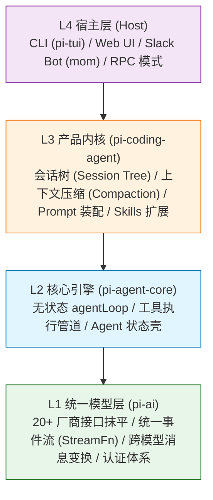
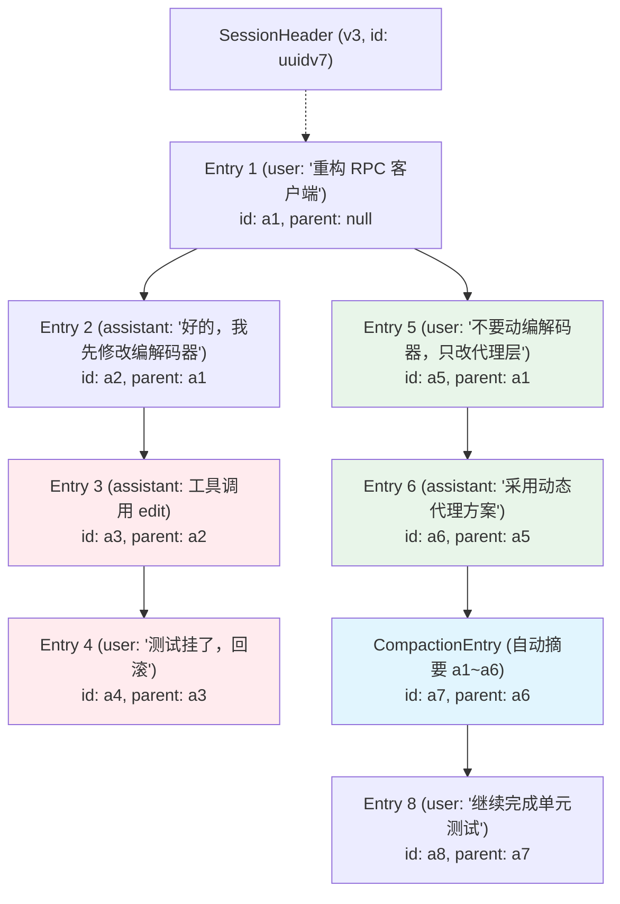
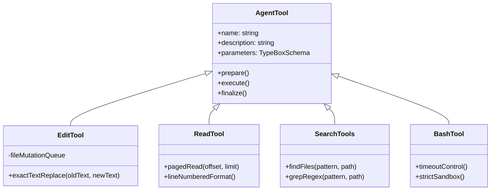

# 读《pi 的设计艺术》：生产级 Coding Agent 运行时架构与工程决策复盘

最近精读了张汉东老师的在线开源著作《pi 的设计艺术：构建生产级 Coding Agent 的架构决策》（基于开源项目 `pi-mono`）。市面上讲大模型调用的材料浩如烟海，但绝大部分停留在 Prompt 调试、LangChain 胶水层拼装，或者做一个简单的问答 Demo。而这本书直击一个极为严肃的工业级课题：**如果要构建一个能稳定帮人写代码的生产级 Coding Agent，底层的运行时架构到底该如何设计？**

书中没有空洞的概念堆砌，每一章都咬住一个具体的技术决策，讲透“为什么这样选、放弃了什么、得到了什么”。读完之后，很多此前在写 Agent 时模棱两可的工程痛点，豁然开朗。这里梳理一份核心架构决策的深度复盘。

---

## 1. 范式转变：从“LLM 调用库”到“Agent 运行时（Runtime）”

搭建一个 Agent 最难的部分究竟在哪里？

很多人的直觉是：难在大模型选型、Prompt 提示词工程、以及怎么把接口调通。但只要你在真实生产环境里写过自动化编码代理，就会发现：**调大模型只占整个复杂度的 10%，剩下的 90% 全在“大模型响应之后该怎么办”。**

| 关注维度     | 通用 LLM 调用库（如 OpenAI SDK / Vercel AI SDK） | 生产级 Coding Agent 运行时（如 pi）                         |
| :----------- | :----------------------------------------------- | :---------------------------------------------------------- |
| **核心职责** | 怎么发 HTTP 请求、怎么把 JSON 序列化送进模型     | 模型返回后如何运转闭环、状态机如何流转                      |
| **错误观念** | 将网络异常、API 报错当做异常（throw exception）  | 错误是一等公民，被编码进统一事件流（`stopReason: "error"`） |
| **生命周期** | 单次 Request-Response 或单纯的流式打字机         | 持续自愈的无状态执行循环（Agent Loop）                      |
| **多轮治理** | 简单的消息数组（`messages.push(...)`）           | 非线性会话树、分支跳转、自动上下文压缩（Compaction）        |
| **工具交互** | 暴露函数给模型，听天由命                         | 严格的三阶段管道（准备、执行、终结）与类型护栏              |

正如书开篇所言：**pi 是一个 Agent 运行时（Runtime），而不是又一个 LLM 包装器（Wrapper）。** 它管理的是一个持续运行、自主感知环境、纠正错误、并在有限窗口中自愈的操作系统式循环。

---

## 2. 全局骨架：四层洋葱架构与依赖纪律

在大型系统中，模块拆分最怕“互相越权”。pi 采用严格由外向内的**四层洋葱架构**：



每一层都遵守近乎偏执的**单向无知纪律**：

- **L1 (`pi-ai`)**：只负责连接各大模型提供商。它根本不知道世界上还有“工具执行”或者“文件读写”这回事，它只负责输出标准事件流（`text-delta`, `tool-call-delta`）。
- **L2 (`pi-agent-core`)**：是底层的发动机。它只认识消息和工具接口，负责死循环调度。它不知道什么是 Git 仓库，不知道用户开的是终端还是 Slack，更不知道什么叫项目配置。
- **L3 (`pi-coding-agent`)**：特化为面向 Coding 场景的产品内核。它接管文件树、会话树持久化、上下文超出后的压缩策略、Markdown 格式的 Skill 发现。
- **L4 (宿主壳)**：纯粹的交互外壳。同一颗内核，插上 `pi-tui` 就是终端应用，插上 JSON-L 协议就是后台 RPC 服务，连上 Web 就是浏览器 IDE。

这套架构带来的收益极其巨大：核心循环足够薄、足够干净，就可以在任意宿主中零成本复用。

---

## 3. 内核发动机：`agentLoop` 为什么必须是“无状态纯函数”？

在许多 Agent 框架设计中，循环执行器往往兼任了“大内总管”：既管发消息，又管记历史，还管失败重试。

但 pi 做出了一个反直觉的抉择：**循环引擎应该知道尽可能少的事情。** 打开 `packages/agent/src/agent-loop.ts`，核心注释只有两句话：

> _"Agent loop that works with AgentMessage throughout._  
> _Transforms to Message[] only at the LLM call boundary."_

### 双层嵌套循环状态机

`agentLoop` 的内部实现由内外两层 `while` 循环构成，分别承担截然不同的语义：


为什么要精细划分两层循环？因为在真实编码交互中，有两类完全不同的用户消息：

1. **Steering（转向指令）**：Agent 正在改代码，用户中途发现方向偏了，输入“别改 A 文件，去改 B”。这种消息必须在**当前 turn 的工具执行完毕后立刻插队注入**，直接影响下一次 LLM 推理。
2. **Follow-up（追加任务）**：Agent 已经完整完成了当前需求并准备停下来（内层退出），用户接着说“好的，顺便把单元测试也补上”。这是**外层循环在 Agent 即将停下时将其重新激活**。

如果把逻辑揉成单层循环，就无法在状态机中正交解耦“干活中的实时纠偏”与“干完活后的连续追加”。

---

## 4. 会话状态建模：为什么不用聊天记录，而用“会话树”？

常规聊天机器人的会话数据结构是一个平铺的 `List<Message>`。但在 Coding 场景下，线性列表是完全不可用的：

- Agent 尝试用方案 A 重构，改了 8 个文件后测试跑崩了。用户想：**“撤销刚才的全部操作，回到改之前，换方案 B 重试”**。
- 用户在第 15 轮发现第 3 轮选型有瑕疵，想从第 3 轮分叉出一个新分支进行对比实验。

线性列表面对这种诉求，要么只能粗暴截断，要么必须完整深拷贝整个会话。

### JSONL + parentId 树形存储

pi 设计了一套极简但容错率奇高的存储模式：**单文件 JSONL，每行一个节点，通过 `parentId` 链接**。



这里有两个极为精巧的设计细节：

1. **两种 ID 的权衡**：
   - **Entry ID**：采用 8 位短十六进制（如 `randomUUID().slice(0, 8)`），因为 Entry ID 会高频暴露在 TUI 终端和分支切换命令中，短小直观。
   - **Session ID**：采用 **UUIDv7**。UUIDv7 具备时间自增单调性，让不同时间维度的会话天然具备时间局部性，这对多用户路由集群下的 Prompt Cache（提示词缓存）命中至关重要。
2. **Append-only 的坚韧性**：
   - 会话文件只做追加写入（Append），从不原地修改或覆写。即使机器掉电、进程强杀，尾部损坏的一两行可以直接丢弃，整棵历史树的主干依然安然无恙。

---

## 5. 胜负手：Compaction（把无限对话装进有限窗口）

当用户和 Agent 深入排查一个复杂 Bug 时，几十轮对话、反复的 `grep` 输出、长文本读写会轻易把 128K 甚至 200K 的 Context Window 打满。

如果直接截断历史，Agent 会瞬间“失忆”，连刚刚讨论到哪个文件都不记得。pi 落地了一套高度工程化的 **Compaction（上下文压缩）机制**。

### 触发水位线设计

Compaction 并不是每轮都做，而是在阈值触碰时才激活：
$$\text{Trigger Condition: } ContextTokens > (ContextWindow - ReserveTokens)$$
其中 `ReserveTokens` 默认保留 16K。**为什么要给模型留出整整 16K 的余量？** 因为如果等到上下文只剩 1K 时才触发压缩，大模型根本没有足够的 output token 来生成高质量的总结摘要，甚至会在摘要生成中途报截断错误。

### 关键细节：追踪文件变更集（File Operations Tracking）

绝大部分 Agent 压缩时只是让 LLM 写一段自然语言总结（“讨论了 RPC 异常并做了修改”）。**但在真实工程开发中，这会导致灾难性的幻觉**——模型很快忘了自己到底读过哪些文件、具体改动了哪几个模块。

pi 在压缩对话时，设计了双通道提炼：

```typescript
interface CompactionDetails {
  readFiles: string[]; // 明确记录：读过哪些文件
  modifiedFiles: string[]; // 明确记录：改过哪些文件
}
```

通过静态扫描工具调用的消息历史，即使把数万 Token 的工具输出压缩为一段几百字的主干总结，**`readFiles` 和 `modifiedFiles` 列表也会作为结构化上下文永久锚定在当前分支中**。下一次循环时，Agent 依然确切知道当前项目的改动边界。

---

## 6. 工具设计哲学：约束即保护

很多开发者误以为“给 Agent 一个通用的 `bash` 工具，让它为所欲为，能力最强”。但在生产环境中，**越无约束的工具，故障率越高**。

pi 提出的工具设计核心法则是：**工具是带护栏的接口，约束即保护。**



1. **`edit` 工具：精确旧文本替换，严禁全文件重写**
   - 不允许模型直接给文件内容做 overwrite，也不采用极易漂移的行号修改。
   - 采用 `oldText -> newText` 精确匹配。一旦文件被外部修改导致 `oldText` 不匹配，立即拒绝写入并报错打断。
   - 内置 `file-mutation-queue`，对同一文件的并发写入进行排队串行化，彻底消除文件写穿隐患。
2. **`read` 工具：带行号与强制分页**
   - 不做简单的 `cat`。强制返回带行号的内容，让后续需要编辑时可以精确锁定位置；限制单次读取上限，超大文件自动提示分页，防止单次读取撑爆上下文。
3. **把 `find` 和 `grep` 独立为一等公民工具**
   - 不鼓励模型自己在 `bash` 里面拼凑复杂的 `find . -name "*.ts" | xargs grep` 命令。模型极易在 Shell 引号、转义字符上出错。
   - 提供结构化的搜索工具，由原生代码执行文件系统遍历，既快又准。

---

## 7. 反主流选择背后的判断：极简核心，能力外置

在 Agent 技术浪潮中，各种复杂的概念层出不穷：多智能体编排（Multi-Agent Swarm）、庞大的外部工作流框架、各种可视化拓扑。

pi 的设计哲学非常克制，在书中总结为一句话：

> **“如果一个功能可以用更底层的机制组合出来，就不应该把它内建到内核中。”**

### 为什么坚决不内建 Sub-Agents？

主流框架喜欢搞一堆 `CoderAgent`、`ReviewerAgent`、`PlannerAgent` 互相传小纸条，看起来高大上，但在实际编码中，通信损耗极大、错误级联放大、上下文割裂严重。

pi 怎么做？**内核根本没有 Sub-Agent 的概念。**  
它只提供一个普通的 `AgentTool` 工具。当主 Agent 需要委派子任务时，它只需发起一次常规的工具调用：`execute(AgentTool, { prompt: "去检索某某库的 API" })`。而在 `AgentTool` 的执行体内部，只是实例化一个新的无状态 `agentLoop` 去执行。

对主引擎来说，调用一个子 Agent，和调用一次 `grep` 没有本质差别：**发出参数，等待工具结果返回**。这种设计让内核的复杂度降低了一个数量级，同时拥有了无限嵌套组合的能力。

### 为什么 Skill 只是带 frontmatter 的 Markdown？

pi 的 Skill 机制不依赖任何复杂的插件加载器或外部 RPC 服务。一个 Skill 就是一段带有 frontmatter 描述的 Markdown 说明书。Agent 在需要时把 Markdown 读进 System Prompt，模型就自然学会了这套业务规范。**用最朴素的文本和协议替代沉重的代码，是系统能够长期演进的秘诀。**

---

## 小结与思考

从后端架构师的视角来看，设计一个生产级 Coding Agent，本质上是在解决**“如何为一个不可靠、不可预测的概率计算引擎（LLM），构建一套确定性的状态机与安全沙箱”**：

1. **分层无知**：洋葱模型确保各层职责单一，模型适配层不干预循环，循环引擎不干预业务；
2. **状态纯粹**：把循环引擎做成无状态的纯函数，将状态管理交给外围的会话树；
3. **数据韧性**：JSONL + parentId 支撑分支回溯，自动 Compaction 守住上下文边界；
4. **防御性工具**：杜绝万能权限，用精确替换和结构化工具收敛模型的犯错空间。

无论未来底层大模型如何迭代演进，这些关于状态、上下文、并发与沙箱隔离的工程法则，依然是软件工程中最经得起时间考验的基石。

---

## 参考

- [pi-book: 《pi 的设计艺术：构建生产级 Coding Agent 的架构决策》](https://zhanghandong.github.io/pi-book) (张汉东)
- [pi-mono 开源仓库](https://github.com/ZhangHanDong/pi-book)
- 结合本项目生产环境上下文管理与 AI 编程工程实践复盘
