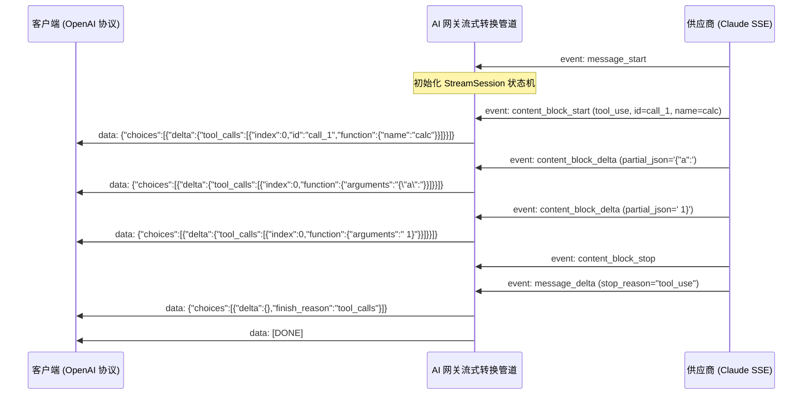
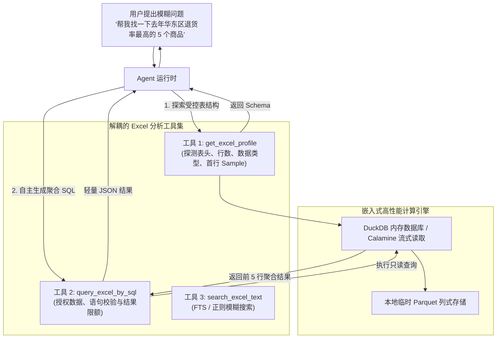

# 大厂 AI 后端面经复盘：网关协议转换、工具适配、上下文治理与 10 万行 Excel 场景题

> 从 AI 应用原型走向生产，需要理解高性能网关、工具适配与 Agent 运行时架构。这篇面经围绕这些工程能力展开复盘。

最近复盘了一位同学在头部大厂 AI 基础设施 / Agent 平台的面试经历。整场面试几乎没有问常见的八股定义，而是紧紧围绕业务落地与中台建设展开：**网关怎么做异构模型协议转换？工具调用在跨模型时怎么抹平？长会话 Agent 上下文快爆了怎么治理？给一个 10 万行 Excel 场景题，你怎么设计一套 Agent 读取工具？**

这几个问题连环追问下来，逻辑非常紧密：从底层的**网络 I/O 与协议管道**，到中层的**模型契约适配**，再到高层的**Agent 运行时状态治理**，最后落到一个具体的**大规模数据检索场景设计**。

这里我结合实际网关（如 LiteLLM、OneAPI）与 Agent 运行时（如 pi-agent、LangGraph）的工程落地实践，把这一整套架构推演和避坑细节系统化地复盘出来。

---

## 1. 面试考核全景：从 Demo 到生产级 AI 基础设施

在很多初学者看来，AI 后端无非就是引入官方 SDK，发个 HTTP POST 请求拿到回复完事。然而一旦业务规模化，直连模型会立刻遇到生产级灾难：


面试官的核心关注点在于：**你是否具备在不确定的概率模型外围，构建高确定性、高吞吐、低延迟系统软件的能力。**

---

## 2. 问题一：AI 网关中的异构模型协议转换怎么做？

### 2.1 协议分裂的真实痛点

不同供应商和私有部署的接口契约存在差异。下表以常见接口形态说明，OpenAI 一列主要指 Chat Completions；Responses API 采用另一套响应项与事件结构。字段、参数范围及多模态支持仍需按具体模型和 API 版本确认。

| 差异维度           | OpenAI API 体系                            | Anthropic Claude Messages API                                    | Google Gemini API                          | 私有开源模型 (vLLM / Ollama) |
| :----------------- | :----------------------------------------- | :--------------------------------------------------------------- | :----------------------------------------- | :--------------------------- |
| **System 提示词**  | 平铺在 `messages` 列表（`role: "system"`） | 顶层独立字段 `system: string`                                    | 顶层 `systemInstruction` 对象              | 视具体 Prompt 模板而定       |
| **消息体结构**     | `content` 通常为纯文本或图像 URL           | `content` 为多态 Block 数组（`text`, `tool_use`, `tool_result`） | `parts` 数组包含 `text`, `inlineData`      | 多数单字符串或简单 JSON      |
| **参数命名与范围** | `max_tokens`, `temperature (0~2)`          | `max_tokens` (必填), `temperature (0~1)`                         | `maxOutputTokens`, `temperature (0~2)`     | `max_new_tokens`, 独立传参   |
| **流式事件模型**   | 单一的 `data: {"choices":[{"delta":...}]}` | 事件驱动流：`content_block_start`、`delta`、`stop`               | 块状增量更新 `candidates[0].content.parts` | 兼容 OpenAI 或专用 chunk     |

如果让每个业务系统各自去写适配代码，业务代码就会充斥着大量的 `if (model.startsWith("claude"))`，甚至导致一次模型升级全链路重新发版。

### 2.2 解决方案：Canonical IR（内部统一中间表示）

多种入站与出站协议需要复用适配时，可以采用**前端-中间层-后端（IR - Intermediate Representation）**的组织方式：

1. **Inbound 适配器**：对外统一暴露兼容 OpenAI 规范的标准接口，完成鉴权、路由判定、配额检查；
2. **Canonical IR**：将输入的 Payload 反序列化并转换为内部脱耦的通用数据模型（包含规范化的 `Message`, `ContentBlock`, `ToolDefinition`, `TokenConfig`）；
3. **Outbound 适配器**：实现应用定义的 `ModelProvider` 接口，将 Canonical IR 转换为目标提供商的实际请求，例如 Anthropic、Gemini 或自建的 OpenAI 兼容 HTTP 服务。

在 N 种入站、M 种出站协议之间，这样可以减少成对适配的重复工作，适配器数量可从约 $N \times M$ 变为约 $N + M$。这是组件组织的估算，不是运行时复杂度或无损转换保证。内部表示仍需保留调用标识、结束原因、多模态信息与供应商扩展，对不支持的能力明确拒绝或降级。

### 2.3 流式 SSE（Server-Sent Events）状态机转换管道

协议转换还要处理**流式事件转换**。下面以 Claude Messages 转为 OpenAI Chat Completions 形态的简化过程说明，不适用于直接转换为 Responses API：

- **Claude 流式事件**：先发 `content_block_start` 声明块类型（是文本还是工具调用），接着持续吐出 `content_block_delta`，最后以 `content_block_stop` 和 `message_stop` 结尾。
- **OpenAI 客户端预期**：持续收到 `choices[0].delta.content`，若是工具调用则持续追加 `choices[0].delta.tool_calls[i].function.arguments`。

希望及时交付增量时，应避免等待完整回答再转发。可以用响应式流或其他具备背压的读取方式，结合轻量流式状态机处理片段、调用标识、完成和错误；具体延迟仍需分段测量。



### 2.4 异常截断与优雅兜底

在流式传输途中，如果上游供应商遭遇 429、上下文超限或者连接异常断开：

- 响应尚未开始时，按入站 HTTP 契约返回适当的状态与错误；响应已经开始时，不能再任意改写状态码。
- 流内错误应采用网关与客户端明确支持的事件形式，并记录未完成或失败终态。不能把所有错误包装成一次正常完成，也不能用 `[DONE]` 证明业务成功；连接已丢失时还需要处理结果未知。

---

## 3. 问题二：工具调用（Tool Calling）如何跨异构模型适配？

### 3.1 核心差异与抹平策略

当一个 Agent 注册了一组工具，网关或运行时需要让这套工具既能跑在支持原生 Function Calling 的模型上，也能跑在只支持 Prompt 注入的轻量模型上。

#### 1. Schema 规格归一化

- **标准定义**：内部工具元数据明确采用的 JSON Schema 方言与受支持关键字，各出站适配器验证目标 API 的支持范围。
- **动态映射**：
  - 对 OpenAI：映射为 `tools: [{type: "function", function: {name, description, parameters}}]`；
  - 对 Claude：映射为 `tools: [{name, description, input_schema}]`；
  - 对不支持 Tool Call 的小模型：执行 **Schema Flattening & Prompt Inlining**，将工具定义格式化为 TypeScript 接口签名，注入到 System Prompt 中，并显式要求模型使用 XML 标签或指定 Markdown 语法包裹调用意图（如 `<tool_call>{"name": "...", "arguments": {}}</tool_call>`）。

#### 2. 参数规范化与执行前校验

模型输出的 Tool Call 参数需要当作不可信输入。流式参数、类型不符和业务语义错误要分别处理：

- **等待完整参数**：按对应 API 的完成事件组装调用，再解析和校验。容错解析可以用于界面预览，不能靠补括号猜测一个未完成请求，再据此执行写操作。
- **限定规范化范围**：若工具契约明确允许分页参数 `"20"` 规范化为整数，可在白名单规则下转换并重新校验、保留原值与转换记录。金额、对象标识、授权状态和有副作用的动作不能静默强转或猜测。
- **返回可纠正错误**：参数不符合 Schema 或业务前提时，返回受控错误并限制重试。服务端权限与状态机仍须执行，不能为了避免一次 400 而改变用户的业务意图。具体边界见 [业务工具调用](/ai/ai-tool-calling-business-api.html)。

#### 3. 工具执行结果的双向回填

工具在本地执行完后，回填格式各家完全不同：

- **OpenAI Chat Completions**：通过 `role: "tool"` 消息与 `tool_call_id` 回填；Responses API 则用 `function_call_output` 和对应 `call_id`，并保留该 API 要求延续的响应项；
- **Claude 机制**：必须回填到 `role: "user"` 的消息体中，内容为 `type: "tool_result"` 块，并绑定 `tool_use_id`。
  运行时适配器统一封装 `ToolResult` 对象，在发往下游前根据目标供应商自动编译成合规的消息结构。

#### 4. 拥抱 MCP（Model Context Protocol）标准

多 Host 复用外部能力时，可以增加 **MCP Client** 接入；少量固定内部调用不必为使用协议而额外改造：

- 工具提供方作为 MCP Server 暴露标准接口，通过 stdio 或 Streamable HTTP 连接，SSE 是部分 HTTP 响应的承载方式；
- 网关/Agent 按实际协议版本发现能力，读取 `tools/list` 后经审核、筛选和 Schema 映射再提供给模型；
- 模型触发调用时，网关通过 MCP `tools/call` 进行 IPC 远程调度并拿回输出，实现工具的真正插件化解耦。

初始化、会话与传输规则要按版本区分，发现工具也不等于获得访问其全部数据的权限。具体链路见 [MCP 协议与架构](/ai/ai-mcp-architecture.html)。

---

## 4. 问题三：Agent 的上下文治理与 Token 预算

### 4.1 为什么要严肃管理上下文？

任务运行变长后，历史和工具结果会持续占用窗口。什么时候出现质量或成本问题，取决于具体模型、任务与上下文，不能固定为某个轮数。需要关注三类因素：

1. **物理窗口与累计成本**：只有每轮近似增加固定历史、每次重发全部历史且没有裁剪等条件成立时，累计输入量才近似呈二次增长；费用还受模型计价、缓存写入和命中影响；
2. **证据位置与干扰**：部分研究任务中存在“Lost in the Middle”现象，但不能推广为所有模型统一的窗口使用阈值，需改变证据位置和干扰材料进行验证；
3. **工具大输出污染**：工具（如爬虫、日志查询）单次返回几十 KB 数据，直接撑满上下文。

### 4.2 三层记忆模型架构（Hierarchical Memory）

```
┌─────────────────────────────────────────────────────────────┐
│ Token Budget Controller (总预算控制，如 32k / 128k)        │
├─────────────────┬─────────────────┬─────────────────────────┤
│ L1: 工作记忆    │ L2: 情景记忆    │ L3: 语义/长期记忆       │
│ (Working)       │ (Episodic)      │ (Semantic)              │
├─────────────────┼─────────────────┼─────────────────────────┤
│ • System Prompt │ • 滑动窗口      │ • 外部向量数据库 (RAG)  │
│ • Tool Schemas  │ • 滚动结构化摘要│ • 键值对状态存储 (KV)   │
│ • 最近 3 轮交互 │ • 工具输出指针化│ • 会话归档冷存储        │
│ (100% 原始保真) │ (脱水/剪枝处理) │ (按需相关度动态召回)    │
└─────────────────┴─────────────────┴─────────────────────────┘
```

这三层是本场景的设计划分，不是统一协议。最近轮数、总窗口和各层预算都需按完整请求核算，不能只按消息条数判断。

### 4.3 核心工程技巧与治理策略

#### 1. 工具结果的“指针截断机制”（Pointer / Reference Pattern）

较大的工具结果可以按需要外置，当前轮和历史轮次都由上下文装配器决定保留多少：

- **第 N 轮（当前轮）**：传递当前任务需要的证据与截断说明，结果过大时只返回相关片段和可继续读取的引用；
- **后续轮次**：归档历史时可以保留必要摘要与结果引用，同时维持目标 API 要求的工具调用、结果及标识对应关系：

  ```json
  {
    "status": "success",
    "summary": "成功拉取 500 条日志，检测到 3 处 NullPointerException",
    "cache_ref": "oss://temp-context-cache/run_1024_step_3.json"
  }
  ```

  摘要帮助恢复进展，但仍可能遗漏条件。引用应能在有效期内按权限回查，恢复时重新核验事实和已发生的业务动作，不能靠摘要推断结果必然成功。

#### 2. Head & Tail 保真 + 中间压缩

- **可信规则**：由应用按当前版本装配，不能因为优化缓存而继续沿用已失效规则；
- **近期消息**：按预算保留完整的用户、模型和工具消息组，不能截断对应关系；
- **早期历史**：在输出余量和下一步需要无法满足前执行压缩，保留目标、约束、已完成工作、证据引用与待办。触发阈值是可测策略，摘要的结构化字段也不能保证信息永不丢失。

#### 3. 面向 Prompt Caching 的排布纪律

缓存复用依赖目标 API 实际渲染的相同前缀，还受到可缓存长度、断点、模型、路由、保留和淘汰策略等条件影响。不能只比较请求 JSON 的字节，或把会话保持不变当成命中保证。

- **纪律**：
  1. 将可复用的规则与工具定义放在目标 API 支持的位置，减少无意义的重复改写；
  2. 动态信息按真实角色与时效需求装配，避免为了前缀命中混淆可信规则和用户输入；
  3. 必要的压缩、事实更新和授权撤销仍应执行。记录实际命中 Token、写入开销、延迟和总成本，再判断是否获益，不能承诺固定命中率。

预算与恢复的完整例子见 [Agent 上下文工程](/ai/ai-agent-context-engineering.html)，缓存改善的阶段边界见 [推理延迟](/ai/ai-llm-inference-latency.html)。

---

## 5. 场景设计题：10 万行 Excel 中查找数据，如何设计工具来读？

### 5.1 常见错误方案剖析

面试官问：“现在用户上传了一个 10 万行的数据表（如全年的销售订单流水），让 Agent 在里面定位并回答问题，你设计一个工具给 Agent 读。”

很多求职者当场掉坑：

- **错误一：把全表文本直接塞进请求**。10 万行、每行 50 字符约为 500 万字符，Token 数还需按实际文本与 Tokenizer 核算。是否超窗、成本和延迟取决于具体模型、缓存与请求，不应给出未经测量的固定费用或耗时；
- **错误二：无大小、并发和内存预算就整表加载**。XLSX 的压缩大小不能直接代表解压与对象化后的占用，具体膨胀取决于列类型、字符串、样式、解析器和中间副本。需要按样本测量峰值，并限制上传、解压、解析和并发资源。

### 5.2 破局思维：“LLM 看结构（Schema），引擎查数据（SQL），LLM 汇总结果”

大模型不擅长做大规模数据的高精度扫描与数学运算，但它极擅长**理解用户模糊意图并编写结构化查询语句**。



### 5.3 生产级工具集原子设计

不要暴露一个臃肿的万能函数，而是暴露一套职责明确的原子原语：

#### 工具 1：`get_excel_profile(file_path: str)` —— 结构探查

- **实现机制**：按解析器实际能力读取工作表与少量样例，Java 也可以采用 POI 的事件读取等方式。行数、共享字符串、合并表头和公式可能需要更多处理，不能把“流式”解释为总是只读取文件前几行。
- **返回给 LLM 的内容**（按实际 Token 和结果字节预算裁剪）：
  - 表名 / Sheet 清单，预估总行数、总列数；
  - 各列字段名与推断类型（如 `order_id: VARCHAR`, `sales_amount: DOUBLE`, `order_date: TIMESTAMP`）；
  - 数据首行样例（脱敏后的 2-3 行真实样本，供模型感知枚举值风格）。

#### 工具 2：`query_excel_by_sql(sql: str, file_path: str)` —— 核心计算

- **底层技术选型**：DuckDB 等嵌入式分析引擎可用于读取受控 Parquet/CSV，并执行筛选、聚合和排序。实际延迟取决于数据、查询、硬件、缓存与并发，10 万行本身不能保证毫秒级响应。
- **预处理优化**：可以将 XLSX 转成结构化记录或 Parquet，保留表头、单位、空值、源版本与行标识，再按负载验证重复查询收益。转换也有成本，不能保证比直接读取快固定倍数，字段、公式和计算边界见 [表格证据](/ai/ai-rag-table-evidence.html)。
- **安全沙箱与拦截**：
  - AST 校验明确允许的语句、对象、函数与数据范围，并由服务端执行用户和租户过滤。`SELECT` 仍可能通过表函数或扩展读取其他文件或网络资源，不能只检查首个关键字；
  - 限制可用数据源、文件读取函数、扩展加载、凭据和网络出口，在受限进程或相应隔离环境中运行，不能仅凭“只读查询”宣称沙箱成立；
  - 行数、单元格长度与总输出字节分别设限。`LIMIT` 只限制结果行数，无法限制全量扫描、昂贵聚合或一个超大单元格；
  - 同时设置执行时间、内存、CPU 和临时磁盘上限。取消等待线程后还要确认作业停止与资源回收，具体实现见 [执行隔离](/ai/ai-agent-sandbox-isolation.html)。

#### 工具 3：`search_excel_text(keyword: str, column: str, limit: int = 10)` —— 模糊匹配

- **场景**：处理非结构化模糊查找（如“找一下备注里提到‘物流损坏’的订单”）。
- **实现机制**：在 DuckDB 中利用 FTS 全文索引或基于正则向量加速匹配，定位到命中记录的物理行号。

#### 工具 4：`fetch_row_detail(row_ids: list[int])` —— 单点详情还原

- **场景**：当通过 SQL 锁定了特定的 2-3 个异常订单行号后，按 ID 精准回表抽取出完整的所有列信息，给大模型组织最终论据。

### 5.4 自愈机制（Self-Correction）

大模型第一次生成的 SQL 可能会带错列名（如把 `order_date` 写成 `create_time`）：

- 执行引擎捕获 `BinderException: Referenced column 'create_time' not found`；
- 适配器不应直接抛异常终止，而是将简洁的报错信息回传给 Agent：`"执行失败：列 'create_time' 不存在，可用列名为: [order_id, order_date, sales_amount]"`；
- Agent 可以依据受控反馈修正查询，但要继续经过同样的校验，并限制次数、总时长与数据范围。成功率需用固定问集和真实终态测量，不能承诺统一比例；权限失败也不能通过放宽范围“修复”。

---

## 6. 小结

面对这套连环追问，最地道的回答主线可以概括为以下四点：

1. **网关协议转换**：内部统一表示可以减少重复适配，流式状态机仍需保存调用标识、完成与错误语义，延迟和能力覆盖按实际链路验证。
2. **工具参数约束**：完整参数先校验，契约允许的规范化要显式记录，不能静默改变金额、对象、授权或有副作用的动作；不同 API 的结果回填分别处理。
3. **上下文动态治理**：按预算组织近期消息、摘要与外置引用，恢复时重新检查证据和授权。缓存收益来自实际前缀命中，不能阻止必要更新或承诺固定比例。
4. **Excel 场景**：模型提出查询与解释，结构化引擎在授权范围内计算。SQL 校验、结果限额、文件与网络隔离及作业资源约束共同保护执行，重试仍需有预算和验收。

---

## 参考

- Anthropic 官方文档：《Building Effective Agents & Model Context Protocol Specification》
- OpenAI 官方文档：《Function Calling & Structured Outputs Guide》
- DuckDB 官方文档：《DuckDB as an Embedded Analytical Engine for Parquet/Excel》
- 张汉东《pi 的设计艺术：构建生产级 Coding Agent 的架构决策》
- 结合生产环境 AI Gateway（LiteLLM 架构）与 Agent Runtime 源码演进落地总结。
- 2026-11-20 依据 [OWASP 提示注入防护](https://cheatsheetseries.owasp.org/cheatsheets/LLM_Prompt_Injection_Prevention_Cheat_Sheet.html)、[Docker 执行边界](https://docs.docker.com/engine/security/) 与 POI 文档校准参数和执行约束；本篇没有实际执行10万行数据性能压测、缓存命中测试或SQL自愈成功率实验。完整任务的验证方法见 [Agent 评测](/ai/ai-agent-evaluation.html)。
