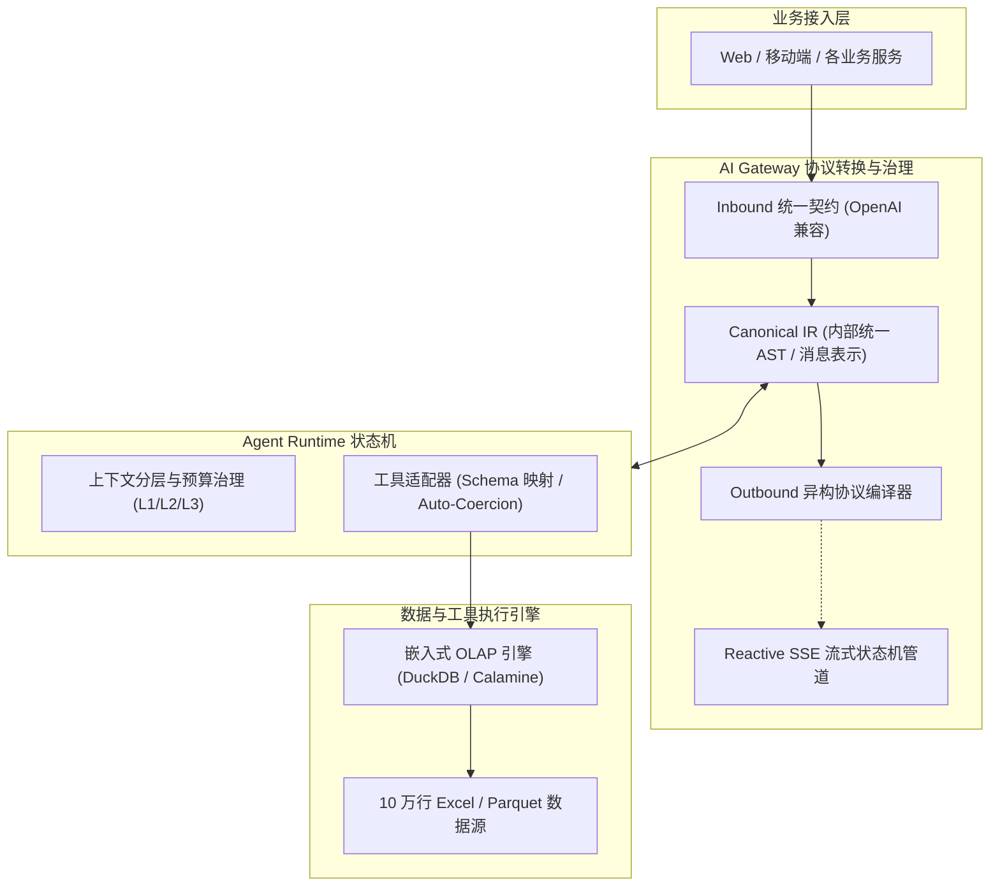
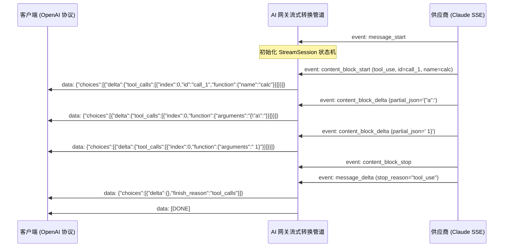

# 大厂 AI 后端面经复盘：网关协议转换、工具适配、上下文治理与 10 万行 Excel 场景题

> 从 AI 应用原型走向生产，需要理解高性能网关、工具适配与 Agent 运行时架构。这篇面经围绕这些工程能力展开复盘。

最近复盘了一位同学在头部大厂 AI 基础设施 / Agent 平台的面试经历。整场面试几乎没有问常见的八股定义，而是紧紧围绕业务落地与中台建设展开：**网关怎么做异构模型协议转换？工具调用在跨模型时怎么抹平？长会话 Agent 上下文快爆了怎么治理？给一个 10 万行 Excel 场景题，你怎么设计一套 Agent 读取工具？**

这几个问题连环追问下来，逻辑非常紧密：从底层的**网络 I/O 与协议管道**，到中层的**模型契约适配**，再到高层的**Agent 运行时状态治理**，最后落到一个具体的**大规模数据检索场景设计**。

这里我结合实际网关（如 LiteLLM、OneAPI）与 Agent 运行时（如 pi-agent、LangGraph）的工程落地实践，把这一整套架构推演和避坑细节系统化地复盘出来。

---

## 1. 面试考核全景：从 Demo 到生产级 AI 基础设施

在很多初学者看来，AI 后端无非就是引入官方 SDK，发个 HTTP POST 请求拿到回复完事。然而一旦业务规模化，直连模型会立刻遇到生产级灾难：



面试官的核心关注点在于：**你是否具备在不确定的概率模型外围，构建高确定性、高吞吐、低延迟系统软件的能力。**

---

## 2. 问题一：AI 网关中的异构模型协议转换怎么做？

### 2.1 协议分裂的真实痛点

目前虽然 OpenAI API 格式成为了事实上的行业标准，但主流厂商与私有部署之间依然存在严重的协议割裂：

| 差异维度           | OpenAI API 体系                            | Anthropic Claude Messages API                                    | Google Gemini API                          | 私有开源模型 (vLLM / Ollama) |
| :----------------- | :----------------------------------------- | :--------------------------------------------------------------- | :----------------------------------------- | :--------------------------- |
| **System 提示词**  | 平铺在 `messages` 列表（`role: "system"`） | 顶层独立字段 `system: string`                                    | 顶层 `systemInstruction` 对象              | 视具体 Prompt 模板而定       |
| **消息体结构**     | `content` 通常为纯文本或图像 URL           | `content` 为多态 Block 数组（`text`, `tool_use`, `tool_result`） | `parts` 数组包含 `text`, `inlineData`      | 多数单字符串或简单 JSON      |
| **参数命名与范围** | `max_tokens`, `temperature (0~2)`          | `max_tokens` (必填), `temperature (0~1)`                         | `maxOutputTokens`, `temperature (0~2)`     | `max_new_tokens`, 独立传参   |
| **流式事件模型**   | 单一的 `data: {"choices":[{"delta":...}]}` | 事件驱动流：`content_block_start`、`delta`、`stop`               | 块状增量更新 `candidates[0].content.parts` | 兼容 OpenAI 或专用 chunk     |

如果让每个业务系统各自去写适配代码，业务代码就会充斥着大量的 `if (model.startsWith("claude"))`，甚至导致一次模型升级全链路重新发版。

### 2.2 解决方案：Canonical IR（内部统一中间表示）

生产级网关必须采用**编译器前端-中间层-后端（IR - Intermediate Representation）**的思想：

1. **Inbound 适配器**：对外统一暴露兼容 OpenAI 规范的标准接口，完成鉴权、路由判定、配额检查；
2. **Canonical IR**：将输入的 Payload 反序列化并转换为内部脱耦的通用数据模型（包含规范化的 `Message`, `ContentBlock`, `ToolDefinition`, `TokenConfig`）；
3. **Outbound 适配器**：实现 `ModelProvider` 接口，将 Canonical IR 编译转换为目标提供商（如 Anthropic、Gemini、vLLM gRPC）的真实请求报文。

这样设计彻底将输入协议与输出协议解耦，新增一个模型供应商只需要实现单个 Outbound 转换器，复杂度由 $O(N \times M)$ 降低至 $O(N + M)$。

### 2.3 流式 SSE（Server-Sent Events）状态机转换管道

协议转换中最棘手的不是单次请求-响应，而是**流式事件转换**。以 Claude 转 OpenAI 规范为例：

- **Claude 流式事件**：先发 `content_block_start` 声明块类型（是文本还是工具调用），接着持续吐出 `content_block_delta`，最后以 `content_block_stop` 和 `message_stop` 结尾。
- **OpenAI 客户端预期**：持续收到 `choices[0].delta.content`，若是工具调用则持续追加 `choices[0].delta.tool_calls[i].function.arguments`。

网关不能做全量缓冲（Buffering），否则会导致首字延迟（TTFT）大幅飙升，必须采用**响应式流（Reactive Stream / Netty ByteBuf）**结合轻量流式会话状态机：



### 2.4 异常截断与优雅兜底

在流式传输途中，如果上游供应商遭遇 429、上下文超限或者连接异常断开：

- 网关不能直接把底层 TCP 连接掐断，否则客户端会抛出不友好的 `PrematureCloseException`；
- 网关状态机必须捕获上游错误，构造标准化的 SSE Error Chunk（如 OpenAI 风格的 `data: {"error": {"message": "Upstream rate limit exceeded", "type": "gateway_error"}}`），并下发 `[DONE]` 正常关闭流。

---

## 3. 问题二：工具调用（Tool Calling）如何跨异构模型适配？

### 3.1 核心差异与抹平策略

当一个 Agent 注册了一组工具，网关或运行时需要让这套工具既能跑在支持原生 Function Calling 的模型上，也能跑在只支持 Prompt 注入的轻量模型上。

#### 1. Schema 规格归一化

- **标准定义**：统一采用 JSON Schema Draft 7 / 2020-12 作为工具元数据底座。
- **动态映射**：
  - 对 OpenAI：映射为 `tools: [{type: "function", function: {name, description, parameters}}]`；
  - 对 Claude：映射为 `tools: [{name, description, input_schema}]`；
  - 对不支持 Tool Call 的小模型：执行 **Schema Flattening & Prompt Inlining**，将工具定义格式化为 TypeScript 接口签名，注入到 System Prompt 中，并显式要求模型使用 XML 标签或指定 Markdown 语法包裹调用意图（如 `<tool_call>{"name": "...", "arguments": {}}</tool_call>`）。

#### 2. 参数自动纠偏与类型强转（Auto-Coercion & Sanitization）

大模型在输出 Tool Call 的 JSON 参数时，即使温度设为 0，也会有小概率输出畸变数据：

- **截断与畸变修复**：引入流式 `partial-json` / `dirty-json` 解析器，自动补齐未闭合的括号、去除尾部多余逗号；
- **类型自动强转**：模型极容易将整型输出为字符串（例如 `"page_size": "20"`），或者将布尔值输出为 `"true"`。适配器必须基于事先注册的 JSON Schema 定义进行自适应强转，避免下游业务校验器抛出 400 异常导致循环崩溃。

#### 3. 工具执行结果的双向回填

工具在本地执行完后，回填格式各家完全不同：

- **OpenAI 机制**：必须作为新消息回填，`role: "tool"`, 并严格携带 `tool_call_id`；
- **Claude 机制**：必须回填到 `role: "user"` 的消息体中，内容为 `type: "tool_result"` 块，并绑定 `tool_use_id`。
  运行时适配器统一封装 `ToolResult` 对象，在发往下游前根据目标供应商自动编译成合规的消息结构。

#### 4. 拥抱 MCP（Model Context Protocol）标准

网关与 Agent 运行时应逐步将内置工具改造为 **MCP Client**：

- 工具提供方作为 MCP Server 暴露标准接口（通过 stdio 或 SSE 连接）；
- 网关/Agent 启动时动态读取 MCP 的 `tools/list`，自动注册为模型的 Function Schema；
- 模型触发调用时，网关通过 MCP `tools/call` 进行 IPC 远程调度并拿回输出，实现工具的真正插件化解耦。

---

## 4. 问题三：Agent 的上下文治理与 Token 预算

### 4.1 为什么要严肃管理上下文？

很多 Demo 在跑 3-5 轮后效果很好，一跑到 15-20 轮就开始胡言乱语。核心瓶颈有三：

1. **物理窗口溢出与成本剧增**：输入 Token 费用随轮次呈二次方 $O(N^2)$ 级累积膨胀；
2. **“Lost in the Middle” 效应**：随着上下文拉长，大模型对窗口中间段信息的注意力召回率急剧下降，关键信息被大量无用噪声淹没；
3. **工具大输出污染**：工具（如爬虫、日志查询）单次返回几十 KB 数据，直接撑满上下文。

### 4.2 三层记忆模型架构（Hierarchical Memory）

```
┌─────────────────────────────────────────────────────────────┐
│ Token Budget Controller (总预算控制，如 32k / 128k)        │
├─────────────────┬─────────────────┬─────────────────────────┤
│ L1: 工作记忆    │ L2: 情景记忆    │ L3: 语义/长期记忆       │
│ (Working)       │ (Episodic)      │ (Semantic)              │
├─────────────────┼─────────────────┼─────────────────────────┤
│ • System Prompt │ • 滑动窗口      │ • 外部向量数据库 (RAG)  │
│ • Tool Schemas  │ • 滚动结构化摘要│ • 键值对状态存储 (KV)   │
│ • 最近 3 轮交互 │ • 工具输出指针化│ • 会话归档冷存储        │
│ (100% 原始保真) │ (脱水/剪枝处理) │ (按需相关度动态召回)    │
└─────────────────┴─────────────────┴─────────────────────────┘
```

### 4.3 核心工程技巧与治理策略

#### 1. 工具结果的“指针截断机制”（Pointer / Reference Pattern）

这是防止上下文爆炸最有效的手段：

- **第 N 轮（当前轮）**：工具刚执行完，模型需要完整内容进行推理，传递全量结果；
- **第 N+1 轮及之后**：当历史消息归档时，网关将该条庞大的 `tool_result` 自动“脱水”，替换为元数据摘要与缓存引用指针：

  ```json
  {
    "status": "success",
    "summary": "成功拉取 500 条日志，检测到 3 处 NullPointerException",
    "cache_ref": "oss://temp-context-cache/run_1024_step_3.json"
  }
  ```

  模型后续能清楚记得“这步做过了且结果是什么”，而无需一直扛着 20KB 的原始日志。

#### 2. Head & Tail 保真 + 中间压缩

- **头部固定**：系统角色、安全围栏、核心工具定义永远锁定在最前；
- **尾部保真**：保留最新的 3-5 轮用户输入、工具调用与模型回复，确保即时逻辑连贯；
- **中间挤压（Compaction）**：当 Context 达到阈值（如 75% 预算），后台触发异步 Summarization，将早期的多轮问答压缩为结构化的 Bullet Points。**切记：压缩不能只写自然语言总结，必须强制保留关键实体（文件路径、修改过的函数名、错误码）！**

#### 3. 面向 Prompt Caching 的排布纪律

主流大厂（Anthropic Prompt Cache / OpenAI Prefix Cache）对缓存命中的要求极为苛刻：**前缀内容必须字节级完全一致**。

- **纪律**：
  1. 静态不变的 System Prompt、静态 Tool Schemas 必须严格置顶；
  2. 动态变量（如“当前时间：2026-11-11 14:00”）绝对不要插在 System Prompt 开头，应放在最后一条 User Message 的末尾；
  3. 历史对话必须 Append-only，严禁在后续轮次中微调前几轮的标点符号或空格，最大化榨取 80%+ 的缓存命中率，降低首字延迟与调用成本。

---

## 5. 场景设计题：10 万行 Excel 中查找数据，如何设计工具来读？

### 5.1 常见错误方案剖析

面试官问：“现在用户上传了一个 10 万行的数据表（如全年的销售订单流水），让 Agent 在里面定位并回答问题，你设计一个工具给 Agent 读。”

很多求职者当场掉坑：

- **错误一：把数据 Dump 成文本喂给大模型**。10 万行哪怕每行 50 个字符，也是几百万 Token，超出了绝大多数窗口上限，费用上百元一次，且延迟十几秒；
- **错误二：写一个 `read_excel(file_path)` 工具，内部用 `pandas.read_excel()`**。XLSX 文件基于 XML 压缩打包，解压加载为内存 DataFrame 对象后，内存占用会膨胀 5~10 倍。如果并发进来几个请求，服务器瞬间 OOM 宕机。

### 5.2 破局思维：“LLM 看结构（Schema），引擎查数据（SQL），LLM 汇总结果”

大模型不擅长做大规模数据的高精度扫描与数学运算，但它极擅长**理解用户模糊意图并编写结构化查询语句**。

```mermaid
flowchart TD
    User["用户提出模糊问题<br/>'帮我找一下去年华东区退货率最高的 5 个商品'"] --> Agent["Agent 运行时"]

    subgraph 工具层 [解耦的 Excel 分析工具集]
        Tool1["工具 1: get_excel_profile<br/>(探测表头、行数、数据类型、首行 Sample)"]
        Tool2["工具 2: query_excel_by_sql<br/>(只读 SQL 执行 + 自动注入 LIMIT 50)"]
        Tool3["工具 3: search_excel_text<br/>(FTS / 正则模糊搜索)"]
    end

    subgraph 计算层 [嵌入式高性能计算引擎]
        DuckDB["DuckDB 内存数据库 / Calamine 流式读取"]
        Storage["本地临时 Parquet 列式存储"]
    end

    Agent -->|1. 探索表结构 (~300 Token)| Tool1
    Tool1 --> DuckDB
    DuckDB --> Storage
    Tool1 -->|返回 Schema| Agent

    Agent -->|2. 自主生成聚合 SQL| Tool2
    Tool2 -->|执行只读查询| DuckDB
    DuckDB -->|返回前 5 行聚合结果| Tool2
    Tool2 -->|轻量 JSON 结果| Agent

    Agent --> User
```

### 5.3 生产级工具集原子设计

不要暴露一个臃肿的万能函数，而是暴露一套职责明确的原子原语：

#### 工具 1：`get_excel_profile(file_path: str)` —— 结构探查

- **实现机制**：流式只读前几行元数据（使用 Rust 编写的 `calamine` 引擎或 `openpyxl(read_only=True)`），严禁一次性解压全表。
- **返回给 LLM 的内容**（极度精简，仅耗费 ~300 Tokens）：
  - 表名 / Sheet 清单，预估总行数、总列数；
  - 各列字段名与推断类型（如 `order_id: VARCHAR`, `sales_amount: DOUBLE`, `order_date: TIMESTAMP`）；
  - 数据首行样例（脱敏后的 2-3 行真实样本，供模型感知枚举值风格）。

#### 工具 2：`query_excel_by_sql(sql: str, file_path: str)` —— 核心计算

- **底层技术选型**：使用 **DuckDB**。DuckDB 是嵌入式进程内 OLAP 数据库，单机支持零拷贝直接查询 Parquet/CSV，10 万行规模做聚合、排序、分组都是毫秒级响应。
- **预处理优化**：文件上传后，在后台一次性将 XLSX 流式转换为本地临时 **Parquet** 格式。后续所有查询均对 Parquet 进行列式扫描，性能比直接读 XLSX 提升 2 个数量级。
- **安全沙箱与拦截**：
  - 强制 AST 解析，仅允许只读 `SELECT` 语句，严禁 `DROP`, `INSTALL`, `COPY` 等高危语句；
  - 强制在最外层注入 `LIMIT 50`，无论模型是否写了 Limit，彻底杜绝 `SELECT *` 导致输出打爆下游上下文；
  - 设置执行超时（如 3 秒超时熔断）与内存上限。

#### 工具 3：`search_excel_text(keyword: str, column: str, limit: int = 10)` —— 模糊匹配

- **场景**：处理非结构化模糊查找（如“找一下备注里提到‘物流损坏’的订单”）。
- **实现机制**：在 DuckDB 中利用 FTS 全文索引或基于正则向量加速匹配，定位到命中记录的物理行号。

#### 工具 4：`fetch_row_detail(row_ids: list[int])` —— 单点详情还原

- **场景**：当通过 SQL 锁定了特定的 2-3 个异常订单行号后，按 ID 精准回表抽取出完整的所有列信息，给大模型组织最终论据。

### 5.4 自愈机制（Self-Correction）

大模型第一次生成的 SQL 可能会带错列名（如把 `order_date` 写成 `create_time`）：

- 执行引擎捕获 `BinderException: Referenced column 'create_time' not found`；
- 适配器不应直接抛异常终止，而是将简洁的报错信息回传给 Agent：`"执行失败：列 'create_time' 不存在，可用列名为: [order_id, order_date, sales_amount]"`；
- Agent 在下一轮依据反馈自动重写 SQL 并自愈重试，成功率可达 95% 以上。

---

## 6. 小结

面对这套连环追问，最地道的回答主线可以概括为以下四点：

1. **网关协议转换**：核心是 **Canonical IR 编译器架构**。入站出站解耦，使用 Netty/Tokio 响应式管道在流式 SSE 下通过**会话状态机**完成 Chunk 级实时映射，保证首字延迟与异常隔离。
2. **工具适配抹平**：以 **JSON Schema** 为元数据底座，支持原生 Tool Call、Prompt Inlining 与 **MCP 协议**的动态转换；在执行入口做类型自适应强转（Auto-Coercion），提升执行容错率。
3. **上下文动态治理**：遵循 **L1 工作 / L2 情景 / L3 语义**分层模型。对历史工具的大输出实行**指针脱水与摘要引用**；前缀保持静态 Append-only，最大化命中 **Prompt Cache**。
4. **10 万行 Excel 场景题**：坚决不向 LLM 倾倒原始数据，坚持“**大模型看 Schema 定逻辑，本地嵌入式 OLAP（DuckDB/Parquet）跑计算，沙箱限制只读与硬 Limit**”，辅以报错反馈的 Self-Correction 机制。

---

## 参考

- Anthropic 官方文档：《Building Effective Agents & Model Context Protocol Specification》
- OpenAI 官方文档：《Function Calling & Structured Outputs Guide》
- DuckDB 官方文档：《DuckDB as an Embedded Analytical Engine for Parquet/Excel》
- 张汉东《pi 的设计艺术：构建生产级 Coding Agent 的架构决策》
- 结合生产环境 AI Gateway（LiteLLM 架构）与 Agent Runtime 源码演进落地总结。
