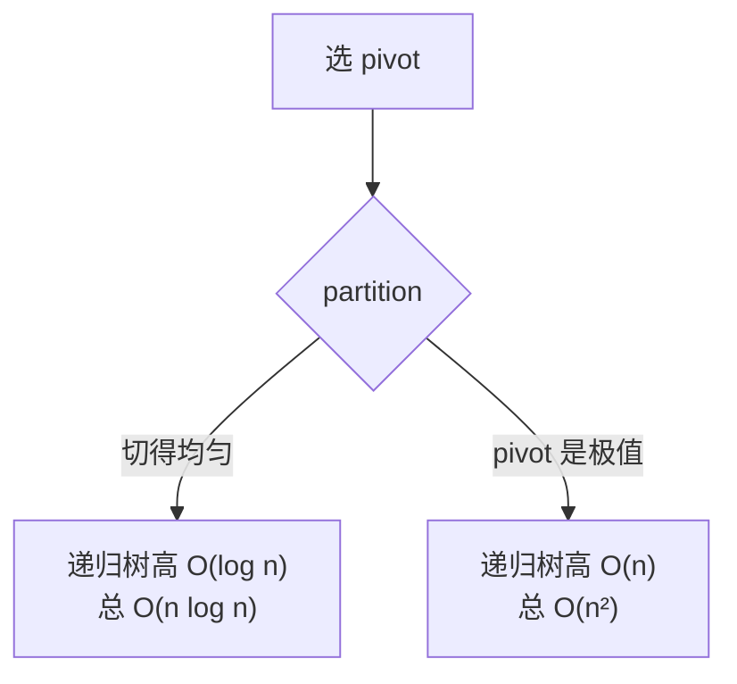

# 十大排序怎么选？稳定性和最坏情况怎么看？

> 一句话点题：面试考排序不是考默写，是考你能不能按复杂度、稳定性和数据特征选对排序。

## 排序分三档，先看懂这张表

十种排序按时间复杂度分成三档记，比一个个背清楚得多：

- **O(n²) 基础比较类**：冒泡、选择、插入。逻辑简单、常数小，适合小数据或近乎有序的数据，工程里基本只做兜底或子过程。
- **O(n log n) 进阶比较类**：快速排序、归并排序、堆排序、希尔排序。前三个是面试主力，希尔是插入排序的增量改进版，复杂度和增量序列强相关。
- **线性时间非比较类**：计数排序、桶排序、基数排序。靠"桶"而不是"比较"定位，能突破比较排序 O(n log n) 的下界，但对数据范围、分布、类型都有要求，不是通用排序。

这三档不是优劣排名，而是适用范围不同。面试官给一组数据让你选排序，第一反应就该是判断它落在哪一档：数据小或近乎有序看第一档，通用大数据看第二档，整数且值域集中看第三档。

一张表把面试最关心的几项列清楚（n 是数据量，k 是值域范围或位数）：

| 排序 | 平均时间    | 最坏时间   | 空间     | 稳定   | 适用场景                              |
| ---- | ----------- | ---------- | -------- | ------ | ------------------------------------- |
| 冒泡 | O(n²)       | O(n²)      | O(1)     | 稳定   | 近乎有序的小数组，带提前退出可到 O(n) |
| 选择 | O(n²)       | O(n²)      | O(1)     | 不稳定 | 不挑数据但处处慢，几乎不推荐          |
| 插入 | O(n²)       | O(n²)      | O(1)     | 稳定   | 小数据或近乎有序，常作快排/归并的收尾 |
| 希尔 | O(n log n)~ | O(n²)      | O(1)     | 不稳定 | 嵌入式、对稳定性无要求的中等数据      |
| 归并 | O(n log n)  | O(n log n) | O(n)     | 稳定   | 需要稳定、数据量大、外排              |
| 快排 | O(n log n)  | O(n²)      | O(log n) | 不稳定 | 通用内存排序首选                      |
| 堆排 | O(n log n)  | O(n log n) | O(1)     | 不稳定 | 原地 + 最坏可控，或 Top-K             |
| 计数 | O(n+k)      | O(n+k)     | O(k)     | 稳定   | 值域集中的整数                        |
| 桶   | O(n+k)      | O(n²)      | O(n+k)   | 看桶内 | 数据均匀分布                          |
| 基数 | O(n·k)      | O(n·k)     | O(n+k)   | 稳定   | 等长关键字（字符串、定长整数）        |

> 纠偏：计数排序的空间有两种口径。只算计数数组是 O(k)，把结果数组也算进去是 O(n+k)。工程里通常按 O(n+k) 算更接近实际占用，面试说清是哪个数组即可。桶排序的稳定性取决于桶内用的是什么排序——桶内用稳定排序则整体稳定，用快排就不稳定。

## 稳定性到底有什么用

稳定性指的是：值相等的两个元素，排序后相对顺序和原来保持一致。判断口诀是——**做"跨距交换"的排序容易不稳定**。

什么场景真要稳定？最典型的是**多关键字排序**。比如先按部门排，再按工龄排，要求同部门内工龄顺序不被打乱。做法是先按次要关键字稳定排，再按主要关键字稳定排，稳定性保证上一轮的成果不被这一轮毁掉。这也是 Java 里 `Arrays.sort` 对对象数组走归并系（Tim Sort）而不用快排的根本原因——对象比较只看一个字段，但用户往往隐含期望等价对象保持原序。

为什么快排不稳定？看 partition：它用交换把元素搬到 pivot 两侧，相等的元素可能被一个从左、一个从右的指针同时抓到再对调，相对顺序就乱了。举个例子，数组 `[5a, 3, 5b, 2]`，选 5a 做 pivot，一轮 partition 后 5b 很可能被换到 5a 前面，两个 5 的相对顺序就反了。归并稳定是因为合并两段有序子序列时，相等元素可以"左段优先出队"，天然保序。选择排序不稳定是因为它把最小值和当前位置直接交换，这一跨可能把中间某个相等的元素甩到后面。

> 纠偏：网上常把"不稳定"列成死结论，其实稳定性取决于具体写法。堆排的标准实现不稳定，但理论上加副键能让它稳定，只是代价不值得。面试答"标准实现下不稳定，原因是跨距交换打乱同值相对顺序"就够了。

## 快排最坏为什么会退化到 O(n²)

快排的核心是 partition：选一个 pivot，把比它小的放左、大的放右，pivot 落到最终位置，再递归两边。理想情况每次几乎对半切，递归树高 O(log n)，每层扫描 O(n)，总共 O(n log n)。

但 partition 切得多均匀，完全取决于 pivot 选得好不好。最坏情况是每次 pivot 都选到当前区间的最大或最小值——比如对一个已经升序的数组，固定取第一个元素做 pivot，每轮只切掉一个元素，递归树退化成一条链，高度 n，每层扫描仍是 O(n)，总复杂度掉到 O(n²)，行为上退化成冒泡。

工程上压低退化概率的常见手段：

1. **随机选 pivot**：把"输入有序"这种最坏情况从一个确定性事件变成概率事件，期望复杂度回到 O(n log n)。
2. **三数取中**：取 left、mid、right 三个位置的中间值当 pivot，简单又能挡住有序和逆序输入。
3. **小数组转插入排序**：区间长度小于某个阈值（比如 47）时直接插入排序，常数更小，也少一层递归。
4. **三路快排**：大量重复元素时把区间切成"小于/等于/大于"三段，等于段不再递归，避免重复元素把递归撑爆。

## 归并还是快排？外排怎么办

归并和快排都是分治，但取舍完全相反：

| 维度     | 快排                  | 归并                 |
| -------- | --------------------- | -------------------- |
| 空间     | O(log n) 递归栈，原地 | O(n) 辅助数组        |
| 稳定性   | 不稳定                | 稳定                 |
| 最坏时间 | O(n²)                 | O(n log n)           |
| 数据访问 | 跳跃访问，cache 一般  | 顺序访问，cache 友好 |
| 适用     | 内存通用排序          | 需稳定 / 数据量大    |

内存里追求速度一般选快排（常数小、原地）；要稳定或要最坏可控就选归并。归并还有一个快排替代不了的场景——**外部排序**。当数据量远超内存，要把数据分块排序后落盘，再用多路归并把有序块合成整体。因为归并只需顺序读两个有序段、顺序写一个输出段，正好匹配磁盘顺序 IO 的特性；快排那种随机跳跃的访问模式在磁盘上会慢得没法用。

堆排的甜区是另一种场景——**只要部分有序的结果**。求海量数据里前 K 大的 Top-K 问题，维护一个大小为 K 的小顶堆就够了，O(n log K) 拿到结果，既不用排全量、又原地可控，这是快排和归并都不擅长的。

## 工程里实际跑的是哪种排序

实际工程不会用单一纯排序算法，而是**混合 + 按数据特征分流**：

- **Tim Sort**：归并排序 + 插入排序的混合体，先扫描找出已经有序的小段（run），再归并这些 run。Java 对象数组的 `Arrays.sort`、Python 的 `sorted`/`list.sort` 都用它，本质是"利用数据里已有的有序性"，对近乎有序的数据能跑到接近 O(n)。
- **DualPivotQuicksort**：双轴快排，Java 对基本类型数组的 `Arrays.sort` 用它。两个 pivot 把数组切成三段，比单轴少一些交换；同时小数组切到插入排序、对近乎有序数据走有序分支。
- **Collections.sort / List.sort**：底层走对象数组那套，也就是 Tim Sort。

记住一条规律：**工程排序 = 通用算法 + 小数据转插入 + 按数据类型分流**。面试问"Java 用什么排序"，答"对象用 Tim Sort 保证稳定，基本类型用双轴快排追求速度，小段都转插入排序"就到位了。

## 容易踩的坑

- **以为快排永远最快**：快排平均最快，但最坏是 O(n²)，有序输入加固定首元素 pivot 是经典退化点，没做随机化就会被追着问。
- **忽略稳定性选错算法**：需要稳定排序却用了快排/堆排，多关键字场景直接翻车；反过来不要求稳定时还硬上归并，白白多花 O(n) 空间。
- **堆排 cache 不友好**：堆排时间 O(n log n)、原地、最坏可控，看起来很美，但堆是跳跃式访问父子节点，对 CPU cache 极不友好，实测常比快排慢几倍，别只看复杂度就下结论。
- **把非比较排序当通用排序**：计数/桶/基数对值域、分布、数据类型都有要求，值域一大计数数组就爆内存（比如对 `[1, 1e9]` 范围的少量数据做计数排序，数组要开十亿），数据不均匀桶排序就退化成个别桶装太多、桶内排序撑到 O(n²)，没确认数据特征前别上。
- **快排空间写成 O(1)**：快排是原地没错，但递归栈是 O(log n)、最坏 O(n)，空间复杂度应记 O(log n) 不是 O(1)。
- **把"最好 O(n)"和"平均"混着报**：冒泡、插入在近乎有序时最好 O(n)，但平均仍是 O(n²)，报复杂度要分清最好/平均/最坏三个口径。

## 小结

排序面试的核心不是手写，是选型。记住三件事：一看数据量和数据特征（小或近乎有序用插入，整数且值域集中用计数，均匀分布用桶），二看是否要稳定和最坏可控（要稳定或外排用归并，通用内存排序用快排），三看工程落地（实际都是混合排序，Tim Sort 管对象、双轴快排管基本类型、小段转插入）。把这张表和快排退化这条主线讲清楚，排序这一关就稳了。

## 参考

- 社区整理的排序算法总结与复杂度对比资料。
- 经典算法教材中关于比较排序下界与非比较排序（计数、桶、基数）的章节。
- 排序算法可视化演示资源。
