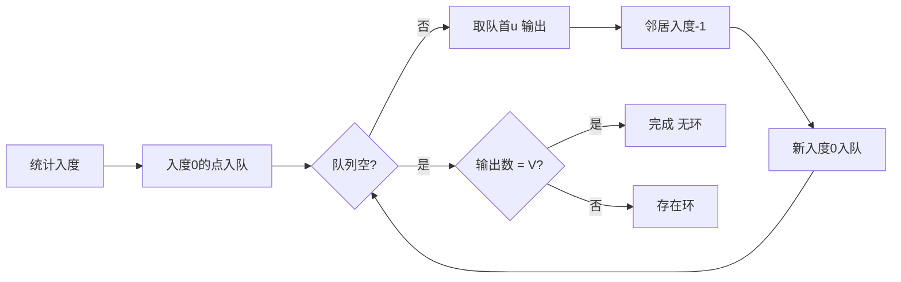

# 图的表示和最短路径怎么选？

> 图题先选表示法，再按有向/无向、权重正负选算法，别一上来就 Dijkstra。

## 图先选表示法：邻接矩阵还是邻接表

图 `G(V, E)` 由顶点集 `V` 和边集 `E` 组成。和树不同，图中元素关系是任意的，没有层次。先把"图是什么"理清再谈表示：

- **有向 / 无向**：好友关系双向，用无向图；关注、依赖这类单向的用有向图。
- **有权 / 无权**：只关心关系有没有，用无权图；关心距离 / 代价 / 时长，用带权图，每条边带一个权值。
- **度**：一个顶点连着多少条边。有向图再分出度（出去的边）和入度（进来的边），拓扑排序就靠入度推进。

表示法两选一，直接决定后续算法的复杂度：

| 存储方式 | 空间复杂度 | 判两点是否相邻 | 遍历某点邻居 | 适合场景                   |
| -------- | ---------- | -------------- | ------------ | -------------------------- |
| 邻接矩阵 | O(V²)      | O(1)           | O(V)         | 稠密图、顶点少、频繁查邻接 |
| 邻接表   | O(V + E)   | 取决于表结构   | 和度数成正比 | 稀疏图、算法题默认         |

邻接矩阵用二维数组，`A[i][j]` 存边或权值。无向图的邻接矩阵是对称的——`A[i][j] = A[j][i]`，因为关系双向。它查"i 和 j 是否相邻"直接读一格 O(1)，但空间固定 O(V²)，顶点一多就浪费：1000 个顶点只有 10 条边，矩阵仍占百万格。

邻接表给每个顶点挂一个链表，只存实际存在的邻居。无向图里表元素个数是边数的两倍（每条边两端各存一次），有向图里等于边数。空间跟着边走，稀疏图（E ≪ V²）几乎都用它。代价是查"i、j 是否相邻"要扫一遍链表，不能 O(1) 直读。

判断稠密还是稀疏：边数 E 接近 V² 是稠密，接近 V 是稀疏。社交网络、网页链接这种度数有限的图几乎都是稀疏图，邻接表是工程默认。带权图只要在表元素里多存一个权值：

```java
// 带权有向图：每个顶点挂一个 (邻居, 权值) 列表
List<int[]>[] buildWeightedGraph(int n, int[][] edges) {
    List<int[]>[] g = new ArrayList[n];
    for (int i = 0; i < n; i++) g[i] = new ArrayList<>();
    for (int[] e : edges) {                 // e = {from, to, weight}
        g[e[0]].add(new int[]{e[1], e[2]});
        // 无向图记得加反向边：g[e[1]].add(new int[]{e[0], e[2]});
    }
    return g;
}
```

> 工程里邻接表常不是真的链表，而是 `List<int[]>[]` 数组、`HashMap<节点, Set<邻居>>`，或对顶点排序后用 `int[]` 紧凑存。教材里画的"链表"只是示意，实现形态多样，但"按需存邻居、空间随边走"的思想一致。

## 遍历：BFS、DFS 与连通分量

BFS 用队列一层层扩，像水面波纹；DFS 用栈（或递归）一条路走到底再回溯。邻接表下两者都是 O(V + E)，邻接矩阵下是 O(V²)（每访问一个顶点都要扫一整行）。

- 无权图求最少步数首选 BFS：第一次到达目标点的层数就是最短边数。
- 连通分量个数、判环、网格类题（岛屿数量）用 DFS 递归标记最顺手。
- 多源扩散（腐烂橘子一类）：多源 BFS，所有源同时入队再扩。
- 有环图必须标记 `visited`，否则 BFS / DFS 会无限转圈死循环。

BFS / DFS 的模板和选型细节见 [BFS 和 DFS 怎么选](/cs-basics/algorithms/algo-bfs-dfs.html)，这里只点结论：无向图连通性 / 判环用 DFS、BFS 或并查集都行，按顺手程度挑。求连通分量个数就跑一次遍历染一个连通块，统计要发起几次遍历才能覆盖所有顶点，那就是分量数——省份数量、岛屿数量都是这个套路，区别只在网格图里"陆地格子"才是顶点。

## 最短路径：按权重选算法

带权图的最短路不是普通 BFS，要按"权是否可负、单源还是多源"选算法：

| 算法         | 能否负权     | 单源 / 多源 | 时间复杂度                 | 关键点                        |
| ------------ | ------------ | ----------- | -------------------------- | ----------------------------- |
| Dijkstra     | 不能         | 单源        | O((V+E) log V)（优先队列） | 贪心，每次取最近点松弛        |
| Bellman-Ford | 能，可判负环 | 单源        | O(VE)                      | 对所有边松弛 V-1 轮           |
| Floyd        | 能           | 多源全对    | O(V³)                      | 动态规划，`d[i][j]` 经 k 中转 |

**Dijkstra**：最小堆维护"当前距离最小的未定顶点"，每次取出最近的一个松弛它的邻居。本质是贪心——已确定最短距离的点不再回退，所以一旦遇到负权边，"先确定的不一定最优"就被打破，结果会错且不报错。优先队列实现是 O((V+E) log V)，朴素数组实现是 O(V²)，稀疏图前者更优。

**Bellman-Ford**：不挑边，对每条边反复松弛，最多 V-1 轮（最短路径最多 V-1 条边）。能处理负权；再多松弛一轮若仍有边能更新，说明存在负环——这是它独有能力。代价是 O(VE)，稠密图下相当慢。

**Floyd**：三重循环 `d[i][j] = min(d[i][j], d[i][k] + d[k][j])`，求出所有点对之间的最短路。代码极短，适合 V 很小（一般几百以内）的多源问题。空间 O(V²) 看着不大，但 V 上千就爆内存，加上 O(V³) 的时间，大规模图不能用。

```mermaid
flowchart TD
    A[带权最短路] --> B{有负权边?}
    B -->|无| C[Dijkstra 优先队列]
    B -->|有| D{要判负环?}
    D -->|是，单源| E[Bellman-Ford]
    D -->|否，多源且图小| F[Floyd]
    C --> G[O((V+E)logV)]
    E --> H[O(VE)]
    F --> I[O(V³)]
```

选型口诀：无负权单源用 Dijkstra，有负权或要判负环用 Bellman-Ford，全对且图小用 Floyd。

> Floyd 能处理负权边，但**不能处理负环**——负环意味着绕一圈路径无限变短，最短路根本不存在。算法不会报错，只是结果会偏。判负环仍是 Bellman-Ford 的活，别指望 Floyd 帮你发现。

## 最小生成树：Kruskal 与 Prim

最小生成树（MST）只在无向连通带权图上谈：选 V-1 条边把所有顶点连起来，且总权最小。两大算法：

**Kruskal**：把所有边按权排序，从小到大挑边，用并查集判是否成环——两端点已连通就跳过，否则加入并合并。复杂度 O(E log E)，瓶颈在排序。适合稀疏图（边少，排序便宜）。

**Prim**：从一个点出发，用最小堆维护"已选集合到外部的最短跨边"，每次取最短边把一个新点纳入。复杂度 O((V+E) log V)。适合稠密图（边很多时 Kruskal 排序反而贵）。

|      | Kruskal           | Prim                |
| ---- | ----------------- | ------------------- |
| 思路 | 排序边 + 并查集   | 优先队列扩点        |
| 瓶颈 | 边排序 O(E log E) | 堆操作 O((V+E)logV) |
| 适合 | 稀疏图            | 稠密图              |
| 依赖 | 并查集            | 优先队列            |

电网布线、网络拓扑、单链接层次聚类都能套 MST。稀疏选 Kruskal、稠密选 Prim 是常规取舍。

## 拓扑排序：DAG 的依赖排序

拓扑排序只对有向无环图（DAG）成立——把所有顶点排成线性序，使每条有向边 u→v 中 u 都排在 v 前面。课程先修、任务依赖、编译顺序、打包顺序都是它的应用。图里有环就排不出来，所以拓扑排序顺带能判环。

两种实现：

**Kahn（入度法 / BFS）**：统计各点入度，入度为 0 的先入队，每次取出一个、把它指向的邻居入度减一，新的入度 0 继续入队。若最后输出点数少于 V，说明有环。



**DFS 着色法**：三色标记（白未访问、灰在递归栈中、黑已完成）。访问完一个点染黑后入栈，全部出栈即拓扑序（逆序输出）。回边时遇到灰色节点说明有环。

课程表（Course Schedule）就是典型题：能完成所有课程当且仅当拓扑排序输出数等于顶点数。

## 工程取舍：内存图与大规模图

面试里的图能塞进内存，工程里的图经常不能。

- 内存规模、点数在百万级以内：邻接表 + 内置算法即可，带权图用 `List<int[]>[]`。
- 点边过亿：单机内存吃紧，转向图数据库（Neo4j、Nebula 等）或分布式图计算框架。邻接表思想不变，但存到磁盘 / 分片上，按需加载子图。
- 只关心最短路的离线查询：A\* 加启发式比 Dijkstra 快很多，导航类场景几乎都是 A\* 而非裸 Dijkstra。
- 权重会变的实时场景（如交通路况）：要增量更新和动态最短路，纯内存邻接表维护成本高，常落到图数据库加缓存。

> 算法题里"建图"是前提，也最易翻车：注意有向 / 无向（无向图记得加反向边）、权值放哪、编号从 0 还是 1。建图错了，后面算法再对也白搭。

## 容易踩的坑

1. **无向图忘记加反向边**：邻接表建无向图时只加 u→v 不加 v→u，连通图被误判成不连通，BFS / 拓扑全错。
2. **Dijkstra 套到负权图上**：贪心前提是"已确定点不回退"，负权边会推翻它，结果错且不报错。见到负权立刻换 Bellman-Ford。
3. **忽略有向 / 无向**：判环在有向图看入度或三色 DFS，在无向图看并查集或"父节点回头"，混用判定方式会漏判或多判。
4. **Floyd 空间 / 时间爆**：V 上千时 O(V³) 时间和 O(V²) 空间都扛不住。Floyd 只适合小图全对最短路，大规模别想它。
5. **没标记 visited 导致死循环**：图有环时 BFS / DFS 不标记访问会无限转圈，最基础也最常忘的 bug。
6. **建图编号 0/1 混用**：顶点编号 0~n-1 和 1~n 的下标要统一，邻接数组大小开 n 还是 n+1 别开错。
7. **拓扑排序漏判环**：Kahn 结束后没检查输出点数是否等于 V，会误判"有环图也能排"。

## 小结

1. 表示法先定：稠密 / 频繁查邻接用邻接矩阵 O(V²)，稀疏 / 算法题用邻接表 O(V+E)，后者是工程默认。
2. 遍历邻接表 O(V+E)、邻接矩阵 O(V²)；无权最短用 BFS，连通块用 DFS，判环用并查集或 DFS。
3. 最短路按权选：无负权 Dijkstra、有负权或判负环 Bellman-Ford、全对小图 Floyd，别拿 Dijkstra 硬套负权。
4. 最小生成树：稀疏 Kruskal（排序边 + 并查集）、稠密 Prim（优先队列），都选 V-1 条边。
5. 拓扑排序只对 DAG：Kahn 按入度 BFS、DFS 着色回栈，输出数小于 V 即有环，课程表是典型应用。
6. 工程上小图用内存邻接表，大图转图数据库 / 分布式框架，导航类实时最短路用 A\* 而非裸 Dijkstra。

## 参考

综合自社区数据结构与图论基础资料及经典教材，覆盖图的基本概念、邻接矩阵 / 邻接表表示、BFS / DFS 遍历，以及 Dijkstra、Bellman-Ford、Floyd 最短路、Kruskal / Prim 最小生成树、Kahn / DFS 拓扑排序等算法的复杂度与适用边界。
