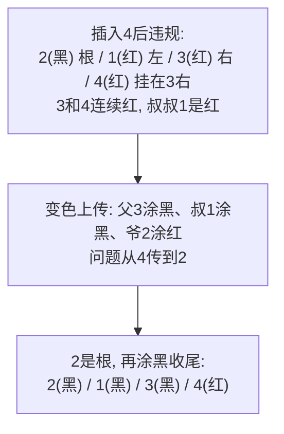

# 红黑树为什么折中？和 AVL 怎么选？

> 红黑树不是比 AVL"更优"，是在旋转次数和查询效率之间折中，写多读少才选它。

## 先回到 BST 的两个极端

普通 BST 实现简单，但形状由插入顺序决定。升序插入 `1,2,3,4,5` 就退化成一条右链，查找从 O(log n) 退化到 O(n)。这是所有自平衡结构要解决的根本问题。压住树高有两条路：

- **AVL 走"严"的路线**：每个节点左右子树高度差不超过 1。查询最稳、树最矮，但每次插入/删除都可能要一路旋转上来恢复平衡，删除最坏要旋转 O(log n) 次。
- **红黑树走"宽"的路线**：不要求高度差 ≤ 1，只靠颜色规则做"弱平衡"保证树高不失控。插入最多 2 次旋转、删除最多 3 次旋转，其余靠变色（recolor）消化。

> 纠偏：有的资料把 AVL、2-3 树、红黑树并称为"B-树"来类比，这个说法不严谨。红黑树和 2-3-4 树确实存在等价映射——把红色节点"折"进父节点就得到一棵 2-3-4 树；但 AVL 树不是 B 树族系，它是纯二叉的高度平衡树，没有多路节点。记住：红黑树 ≈ 2-3-4 树的二叉化表示，AVL 是另一条独立的线。

## 红黑树五条性质：不只是背诵，要会推

红黑树在每个 BST 节点上多一个颜色位，五条规则一起把树高压住：

1. 每个节点非红即黑。
2. 根节点是黑色。
3. 每个叶子（NIL 哨兵）是黑色。
4. 红节点的孩子必须是黑色——即任一路径上不会出现连续两个红色。
5. 从任一节点到其所有叶子节点的路径，黑色节点数相同（黑高 black-height 相同）。

面试真正要答的是"为什么这几条能保证 O(log n)"，拆开看：

- **第 5 条**锁定"黑高一致"：从根出发的每条路径都有相同的黑高 b。
- **第 4 条**锁定"红不连排"：一条路径上每两个黑节点之间最多再插一个红节点。
- 两件事合起来：最短路径是全黑，长度正好 b；最长路径是"黑红交替"，长度最多 2b。所以**最长路径 ≤ 2 × 最短路径**，这就是"弱平衡"的几何含义。

再算节点下界。一棵黑高为 b 的子树，即使全黑、最"瘦"，也至少有 2^b − 1 个内部节点（满的黑路径）。于是 n ≥ 2^b − 1，得 b ≤ log₂(n+1)；而树高 h ≤ 2b，所以：

> h ≤ 2·log₂(n+1)，即红黑树最坏树高被压在 2log n 量级，查找/插入/删除都 O(log n)。

记住这个"长路 ≤ 2 倍短路"的直觉，比死背"高度不超过 2log(n+1)"有用得多——它能解释为什么红黑树比 AVL 略高、但旋转更少。

> 纠偏：第 3 条的"叶子节点是黑色空节点"经常被忽略。它不是普通的空指针，而是黑色的 NIL 哨兵。黑高的计数、删除修复里的"双黑"概念都依赖它，跳过这条，后面讲删除就会卡住。

## 插入和删除：变色为主，旋转兜底

红黑树的修复动作只有两把刷子：**变色**和**旋转**。理解思想比背 case 表重要。

**插入**：新节点先涂红（这样只可能破坏第 4 条"红不连排"，不会动到黑高）。然后看父节点：

- 父黑：直接结束，没问题。
- 父红 + 叔叔红：把父、叔涂黑，爷爷涂红，把"问题"上传给爷爷继续处理。这是纯变色、不旋转，最典型的情形。
- 父红 + 叔叔黑（或空）：要旋转。按"父在左/右、新节点在左/右"分成 LL / RR / LR / RL 四种，至多 2 次旋转修复，再补涂色。

**删除**一个黑节点会让某条路径少一个黑高，修复时引入"双黑"概念，靠变色把多出的黑往上推，推不动就用旋转补一个黑节点下来；整个删除修复最多 3 次旋转就能结束。

用一个插入序列 `1,2,3,4` 走一遍变色上传的过程。其中插入 3 时是 RR 情形，对根做一次左旋并涂色，得到 `2(黑)/1(红)/3(红)`；接下来插入 4 才是纯变色的典型：

这一步一次旋转都没动，全靠变色把矛盾从叶子推到根。这正是红黑树"调整便宜"的来源：AVL 在同样的不平衡下往往必须立刻旋转，红黑树能用变色把调整摊薄。

## 红黑树 vs AVL：怎么选

| 对比点   | AVL 树                   | 红黑树                               |
| -------- | ------------------------ | ------------------------------------ |
| 平衡条件 | 任意节点左右子树高差 ≤ 1 | 五条颜色性质，弱平衡                 |
| 最坏树高 | ≈ 1.44 log n             | ≤ 2 log n                            |
| 查找性能 | 更矮更稳，略胜           | 仍是 O(log n)，略逊一点              |
| 插入旋转 | 最多 1 次                | 最多 2 次                            |
| 删除旋转 | 可能级联 O(log n) 次     | 最多 3 次                            |
| 调整成本 | 偏高                     | 偏低（靠变色消化）                   |
| 适用场景 | 读多写少、近乎静态       | 写也频繁、读写均衡                   |
| 典型应用 | 读密集型内存索引         | TreeMap、std::map、CFS、nginx 定时器 |

一句话选型：**读远多于写、且写之后基本不动的有序结构选 AVL；写也频繁、或读写均衡选红黑树**。标准库基本一边倒地选红黑树，就是因为大多数容器既要查又要频繁增删，红黑树的总开销更均衡。

## 工程里都在用它

| 场景                        | 用法                                                                      |
| --------------------------- | ------------------------------------------------------------------------- |
| Java `TreeMap` / `TreeSet`  | 整棵就是红黑树，提供有序 key 遍历、`firstKey`/`subMap` 等范围操作，单线程 |
| Java `HashMap`（JDK 8+）    | 某个桶链表过长时树化成红黑树，把单桶退化查找从 O(n) 拉回 O(log n)         |
| C++ `std::map` / `std::set` | libstdc++、libc++ 都用红黑树实现有序关联容器                              |
| Linux CFS 调度              | 以 vruntime 为键的红黑树，每次挑最左节点（vruntime 最小）投入运行         |
| nginx 定时器                | 以到期时间为键的红黑树，堆顶就是最近要触发的定时任务                      |

`HashMap` 树化是个高频追问点，细节要准：

- 阈值是 8（`TREEIFY_THRESHOLD`），但**链表长度到 8 不一定树化**。只有当哈希表容量也达到 64（`MIN_TREEIFY_CAPACITY`）才真正树化；容量不够时只是扩容（resize）把链表拆短。
- 退化阈值是 6（`UNTREEIFY_THRESHOLD`）：扩容或删除导致桶内元素降到 6 及以下，红黑树又退回链表。

为什么是 8 和 6 而不是相邻整数？源码注释里用泊松分布算过：哈希均匀时一个桶挂 8 个元素的概率约 6×10⁻⁸（亿分之六量级），几乎不会触发；8 和 6 之间留出滞回区，避免在临界点反复树化/退化抖动。

## 容易踩的坑

1. **背五条性质却讲不清为什么 O(log n)**：核心是第 4 + 第 5 条一起推出"最长路径 ≤ 2 × 最短路径"，再由节点下界推到 h ≤ 2log(n+1)。这个推导比性质本身更值钱。
2. **以为红黑树全面优于 AVL**：它只是写入更省。纯读、读远多于写的场景，AVL 树更矮、查找更稳，依然有理由选。
3. **把红黑树说成"B 树的一种"**：准确说法是红黑树与 2-3-4 树存在等价映射；AVL 树不是 B 树族系，别一起并称。
4. **`HashMap` 树化只记阈值 8**：容量不到 64 时即便链表到 8 也只是扩容，不会树化。这是 Java 集合面试的常考细节。
5. **忘掉 NIL 哨兵是黑色**：第 3 条的黑色空叶子是黑高计数和删除"双黑"修复的基础，跳过它后面讲不通。
6. **把 `TreeMap` 当并发容器**：`TreeMap` 非线程安全；并发有序结构用 `ConcurrentSkipListMap`（跳表），别和红黑树容器混谈。

## 小结

1. 红黑树为治 BST 退化而生，在 AVL 的"严平衡"和旋转成本之间折中：弱平衡、调整便宜。
2. 五条性质里第 4 + 第 5 条是命门，合起来推出最长路径 ≤ 2 倍最短路径，进而 h ≤ 2log(n+1)，保证所有操作 O(log n)。
3. 插入/删除靠"变色为主、旋转兜底"，插入最多 2 次旋转、删除最多 3 次，其余靠变色上传消化。
4. AVL 读更稳更矮、写更贵；红黑树读写更均衡，标准库默认选它。
5. 落地：`TreeMap`/`std::map`、`HashMap` 桶树化、Linux CFS、nginx 定时器；`HashMap` 树化要同时满足容量 ≥ 64。

## 参考

综合自自平衡二叉查找树（AVL、红黑树）的性质与复杂度推导、经典教材对红黑树高度上界的证明，以及 Java `TreeMap` / `HashMap` 源码、Linux CFS 调度器与 nginx 定时器的公开实现说明；`HashMap` 树化容量条件、AVL 非 B 树族系等易错点按官方源码与定义复核。
