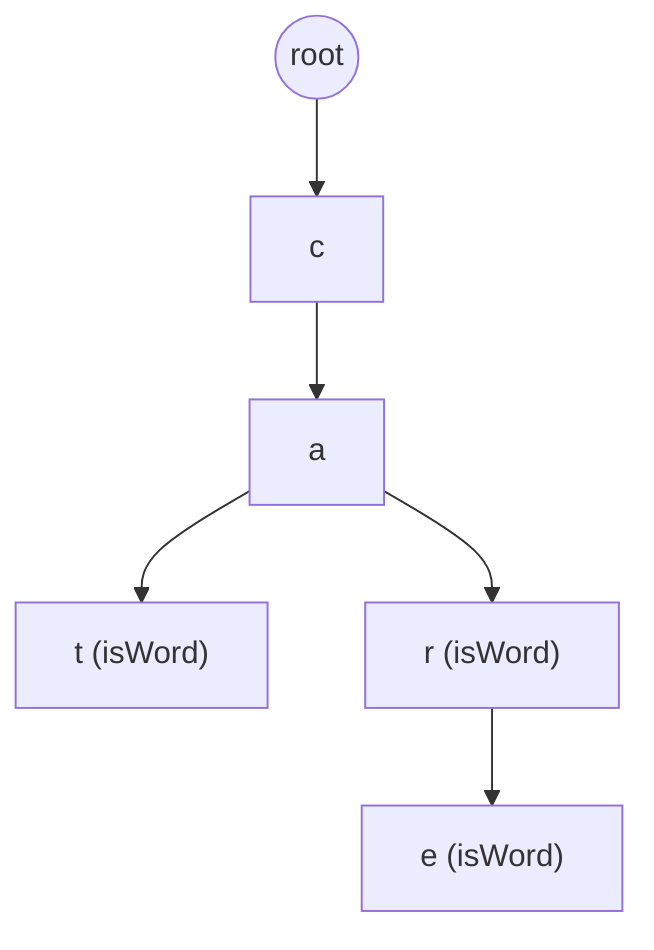

# 前缀树怎么用？和哈希表比赢在哪？

> 一句话点题：Trie 用空间换前缀查询能力，这是哈希表做不到的。

哈希表能把"某个词在不在集合里"答得又快又省；可一旦问题变成"以 `app` 开头的词有哪些""敏感词命中了哪几个""路由最长前缀匹配到哪条"，哈希表就得扫全量 key 或额外维护前缀索引。Trie 把这件事做成了结构能力——前缀就是树上的一条路径，走完前缀，剩下的就是答案。

## 前缀树是什么：按字符分叉、共享公共前缀

Trie 不靠"大小关系"组织，而是靠"字符路径"组织。三条规则记牢：

- 根节点不代表任何字符，只是所有字符串的入口。
- 从根往下每走一层，匹配字符串中的一个字符；从根到某节点经过的字符连起来就是一个前缀。
- 节点上的 `isWord` 标记表示"从根到我这儿已经构成一个完整单词"。

`isWord` 不是装饰。Trie 里同时存 `app` 和 `apple` 时，`a -> p -> p` 这条路径被两者共享，只有走到 `app` 的末尾 `p` 标记 `isWord=true`，Trie 才知道 `app` 本身也是一个词，而不只是 `apple` 的前缀。

下面这张图存的是 `cat`、`car`、`care` 三个词，可以直观看到公共前缀 `ca` 和 `car` 是怎么被复用的：



读法：`root -> c -> a -> t` 是 `cat`；`root -> c -> a -> r` 是 `car`（`r` 节点带 `isWord`）；`root -> c -> a -> r -> e` 是 `care`（`e` 节点带 `isWord`）。`ca` 三个词都走过只存一次；`r` 节点既是 `car` 的结尾又是 `care` 的中间节点，靠 `isWord` 区分两种身份。

这就是 Trie 的根本动机：**用路径表示字符串，用共享路径复用公共前缀**。

## 节点怎么设计：数组还是 Map

Trie 节点要两样东西：子节点引用、是否为单词结尾的标记。差别在子节点用什么容器存。

```java
class TrieNode {
    TrieNode[] children = new TrieNode[26]; // 固定小字符集
    boolean isWord;
}
```

字符集不固定（大小写、中文、路径片段、任意 Unicode）时用 `Map<Character, TrieNode>`，只存实际出现的字符。两种写法没有绝对好坏：

| 节点实现方式               | 优点                                      | 缺点                                   |
| -------------------------- | ----------------------------------------- | -------------------------------------- |
| `TrieNode[26]` 数组        | 访问 O(1)，下标直接定位，适合固定小字符集 | 空节点多时浪费空间，字符集一大就不可行 |
| `Map<Character, TrieNode>` | 只存实际出现的字符，灵活                  | 有额外对象和哈希访问成本               |

手写面试题时：题目只有小写英文字母就上数组最清楚；字符集含大小写、中文、路径片段或任意字符就上 Map 更稳妥。

## 插入、查询、前缀匹配怎么走

插入和查询是同一条主线：从根按字符一层层往下走，路径不存在时插入就建节点、查询就返回失败，差别只在最后一步。

```java
class Trie {
    private final TrieNode root = new TrieNode();

    public void insert(String word) {
        TrieNode node = root;
        for (char c : word.toCharArray()) {
            int index = c - 'a';
            if (node.children[index] == null) {
                node.children[index] = new TrieNode();
            }
            node = node.children[index];
        }
        node.isWord = true;
    }

    public boolean search(String word) {
        TrieNode node = find(word);
        return node != null && node.isWord;
    }

    public boolean startsWith(String prefix) {
        return find(prefix) != null;
    }

    private TrieNode find(String text) {
        TrieNode node = root;
        for (char c : text.toCharArray()) {
            int index = c - 'a';
            if (node.children[index] == null) return null;
            node = node.children[index];
        }
        return node;
    }
}
```

对照上面 `cat/car/care` 的图走一遍：

| 操作               | 走法                                                              | 结果                                |
| ------------------ | ----------------------------------------------------------------- | ----------------------------------- |
| `insert("care")`   | `root -> c(已有) -> a(已有) -> r(已有) -> e(建)`，`e` 标 `isWord` | 只新增 `e` 分支，复用了 `ca`、`car` |
| `search("car")`    | 走到 `r` 节点，`isWord=true`                                      | 命中                                |
| `search("ca")`     | 走到 `a` 节点，`isWord=false`                                     | 不是完整词                          |
| `startsWith("ca")` | 能走到 `a`                                                        | 前缀存在，下面有 `cat/car/care`     |

注意 `search` 要 `isWord` 为真、`startsWith` 只要路径走完——这正是 `isWord` 的意义：区分"某词的前缀"和"本身就是词"。

复杂度和**字符串长度** `L` 绑定，不直接和词典大小成正比：

| 操作             | 时间            | 说明                          |
| ---------------- | --------------- | ----------------------------- |
| 插入             | O(L)            | 每个字符一层，最多建 L 个节点 |
| 完整词查询       | O(L)            | 走完路径查 `isWord`           |
| 前缀查询         | O(L)            | 走完前缀即可                  |
| 枚举前缀下所有词 | O(L + 子树规模) | 定位前缀后还要遍历子树        |

最后一行容易被忽略：光"前缀存在"是 O(L)，要吐出该前缀下所有词还得遍历子树，成本和结果数量、子树大小有关。

## 删除：比插入查询更容易写错

Trie 的删除不能把整条路径删掉。同时存 `app` 和 `apple` 时删 `app`，只能取消 `app` 末尾 `p` 的 `isWord`，把 `a -> p -> p` 整条删了 `apple` 也跟着废。

正确做法是从单词末尾往回看：某节点没有子节点、且不是其他单词的结尾，才可以被回收。面试没明确要求删除时，先把插入、完整查询、前缀查询写稳，删除作为加分项点到即可。

## 空间换时间：前缀查询是结构自带的

"以 `app` 开头的词有哪些"这类查询就是 Trie 的主场——除非额外维护前缀索引，哈希表得扫描大量 key。Trie 把它变成了结构能力：

- 前缀天然对应一条路径，查询 `app` 只要从根走 `a -> p -> p`。
- 走不到末尾 → 没有任何词以 `app` 为前缀；走到了 → 这个节点下面所有词都以 `app` 开头。

搜索提示、路由最长前缀匹配、词典过滤都吃这个红利。但要清醒：**Trie 是"用空间换这个能力"，不是"省空间"**——见 Trie vs 哈希表一节的纠偏。

## 实战场景：Trie 在工程里到底用在哪

| 场景                   | 怎么用 Trie                                        | 关键点                      |
| ---------------------- | -------------------------------------------------- | --------------------------- |
| 搜索框自动补全         | 用户输入前缀，定位前缀节点，枚举子树候选词         | 候选排序可加词频权重        |
| 敏感词过滤             | 把敏感词建成 Trie，再配合 AC 自动机做多模式匹配    | AC 自动机 = Trie + 失败指针 |
| IP 路由 / 最长前缀匹配 | 路由前缀用 Trie 思路组织，变种 radix tree 压缩路径 | 二进制位而非字符            |
| 词典校验               | 快速判断单词或前缀是否存在                         | 拼写检查、输入法            |
| 词频统计               | 节点上挂计数，插入时累加                           | 可做热词统计                |

其中 IP 路由表的最长前缀匹配最典型：把路由前缀按二进制位组织成 Trie（也叫 radix tree / Patricia tree），把"只有一个子节点的连续路径"压缩成一段，减少节点数量。

## 变种：压缩 Trie、后缀树各解决什么

基础 Trie 节点太碎、空间太费，工程里常被改造：

- **压缩 Trie / Radix Tree**：把只有一个子节点的连续路径压成一段字符串。代价是节点分裂/合并逻辑更复杂。
- **Ternary Search Trie（三向单词查找树）**：每个节点用"小于 / 等于 / 大于"三方向组织字符，比数组省、比 Map 快一些。
- **AC 自动机**：Trie + 失败指针，做多模式字符串匹配，敏感词过滤的标配。
- **后缀树**：把一个字符串的所有后缀都塞进 Trie 再压缩，解决"在文本里找某子串是否出现"这类问题。它和前缀匹配是不同维度——Trie 关心多串的公共前缀，后缀树关心单串内部的重复结构。

## Trie vs 哈希表：前缀是 Trie 独有，精确查询哈希更快

这是面试高频对比，别只背"谁更快"。

| 场景               | Trie                             | 哈希表                     |
| ------------------ | -------------------------------- | -------------------------- |
| 完整字符串精确查询 | 能做，但空间更大                 | 更直接，O(1) 平均          |
| 前缀是否存在       | 天然支持                         | 需额外维护前缀索引或扫 key |
| 按前缀枚举所有词   | 天然支持                         | 不方便                     |
| 最长前缀匹配       | 天然支持（路由表场景）           | 不直接支持                 |
| 字符集很大         | 节点结构要优化（Map / 压缩）     | 更省心                     |
| 空间               | 公共前缀多时省，无公共前缀时更费 | 通常更省                   |

一句话边界：**只判断一个词在不在，哈希表更简单更省；要频繁查前缀、按前缀枚举、最长前缀匹配，Trie 更合适。**二者问题重心不同，不是谁替代谁——**Trie 用多出来的空间，买到了哈希表结构上不具备的能力**，而不是和哈希表比"同一个查询谁更快"。

> 纠偏一个常见误解：有人觉得"既然 Trie 共享前缀，应该比哈希表省空间"。反了——只有当公共前缀很长、词典规模很大时，Trie 才可能比"每个词各存一份"省；如果词之间几乎没公共前缀（比如一组随机 hash 值），Trie 反而因每个字符都要建节点、还要带 `isWord` 和子节点容器，比哈希表更费内存。

## 容易踩的坑

1. **`isWord` 不能省**：否则无法区分 `app` 只是前缀还是本身也是词，`search("app")` 会和 `search("apple")` 混在一起。
2. **字符集不只有小写字母**：题目含大小写、中文、路径片段时别硬上 `children[26]`，用 Map 更稳妥。
3. **以为 Trie 省空间**：公共前缀多才省，无公共前缀时反而比哈希表费；节点数组在字符集大时空洞严重。
4. **复杂度和词典大小成正比**：错。查询是 O(L)，L 是字符串长度；只有枚举前缀下所有词才牵涉子树规模。
5. **删除当全路径删**：同时有 `app` 和 `apple` 时删 `app`，只取消末尾 `isWord`，不能把 `a -> p -> p` 整条删掉；回收节点要判断"无子节点且非其他词结尾"。
6. **`search` 和 `startsWith` 混用**：前者要 `isWord` 为真，后者只要路径走完。面试常在这里判错。
7. **节点数组 vs Map 死记**：这是工程取舍，固定小字符集上数组，大字符集上 Map。

## 小结

1. Trie 用字符路径组织字符串，共享公共前缀；`isWord` 区分"前缀"和"完整词"。
2. 插入/查询/前缀查询是同一条主线，差别只在末尾是否查 `isWord`；复杂度 O(L)，和字符串长度绑定。
3. 删除要判断节点能否被回收，不能整条路径删；面试没要求时先写稳前三项。
4. 前缀查询是 Trie 结构自带能力，哈希表做不到（除非额外维护索引）。
5. 变种各有侧重：压缩 Trie 省节点，AC 自动机做多模式匹配，后缀树处理单串内部重复结构。
6. Trie vs 哈希表不是"谁更快"：精确查询哈希更省更直接，前缀类查询 Trie 独占优势。

## 参考

综合自前缀树（Trie）经典原理、节点结构与插入/查询/前缀匹配实现，并对照压缩 Trie / Radix Tree、AC 自动机、后缀树等变种的工程取舍后整理；复杂度与空间边界参考《Algorithms》（Sedgewick）中的 Tries 章节及 Stanford CS166 相关讲义。
