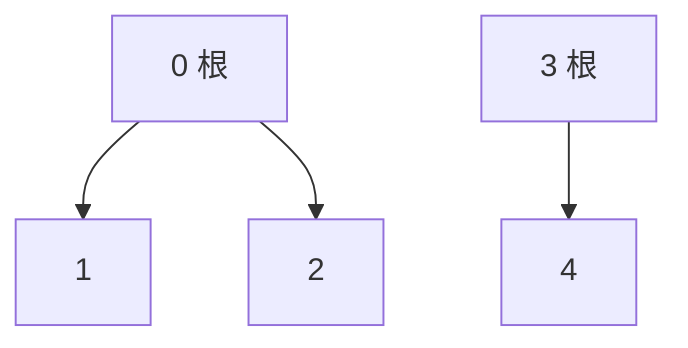
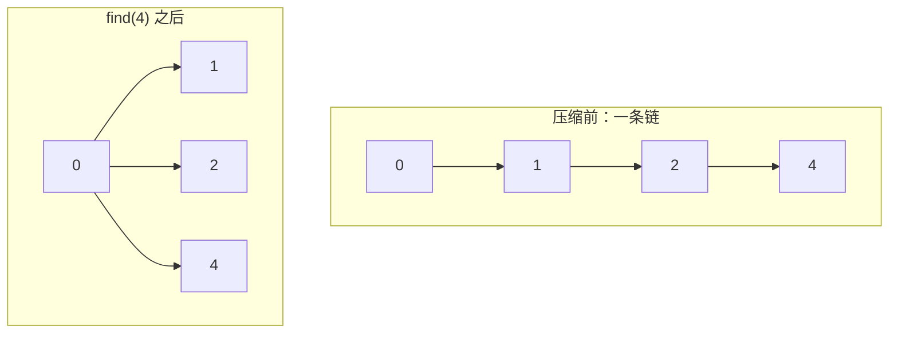

# 并查集怎么用？路径压缩和按秩合并怎么做？

> 并查集是处理动态连通性的利器：一边把元素不断合并进同一组，一边随时能查「这俩到底是不是一伙的」，靠路径压缩 + 按秩合并把每次操作压到近 O(1)。

## 并查集到底在解决什么问题

并查集（Disjoint Set Union，DSU，也叫 Union Find）维护一组**互不相交**的集合，只擅长回答两件事：

1. **查询**：两个元素现在是不是属于同一个集合？
2. **合并**：把两个元素所在的集合并成一个。

它**不关心**集合内部长什么样，也**不关心**两个点之间具体经过哪些边。社交网络里它能秒答「A 和 B 是不是同一个关系网」，但答不出「A 到 B 的最短路径」——后者是 BFS/DFS 的活。

> 纠偏一个常见误读：并查集不是「图的最短路径工具」，它是「连通性 + 等价类」工具。问「能不能到」找并查集，问「怎么到最短」找 Dijkstra/BFS。

工程上凡是「关系不断合并、随后要查是否同组」的场景都适合它：省份数量、冗余连接、账户合并、Kruskal 最小生成树、等式方程的可满足性。反过来，**频繁删边**的场景它做不好——一旦合并完成，内部哪些边让它们连通的信息往往已经被路径压缩抹掉了，删一条边后集合是否仍然连通，没法靠改 `parent` 数组直接得出。

## 一个森林怎么表示一堆集合

用一个 `parent` 数组表示由若干棵树组成的森林：

- `parent[x]` 是 `x` 的父节点；
- 若 `parent[x] == x`，说明 `x` 是所在集合的根，也就是这个集合的**代表**；
- 初始化时每个元素自成一组，`parent[i] = i`。

关键不是「当前父节点是谁」，而是「沿父指针一直往上，最终根是谁」。`find(x)` 干的就是这件事。

理解并查集时，可以先看两个极端版本，再明白为什么最后都用它们的折中：

| 版本        | 数组存什么             | 查询             | 合并                        |
| ----------- | ---------------------- | ---------------- | --------------------------- |
| Quick Find  | 每个元素所属集合的编号 | O(1)：直接比编号 | O(n)：要扫整个数组改编号    |
| Quick Union | 每个元素的父指针       | O(树高)：爬到根  | O(树高)：只改一个根的父指针 |

Quick Find 查询飞快但合并贵，元素一多就扛不住；Quick Union 合并便宜但树可能长成链、查询退化。面试和刷题里实际用的是 Quick Union 的**优化版本**——路径压缩 + 按大小/秩合并，把两个极端的短板都补上。

走个例子：从 5 个独立元素开始，依次 `union(0,1)`、`union(1,2)`、`union(3,4)`，最后 0/1/2 一组、3/4 一组，连通分量数 `count=2`。



`union(1,2)` 时传进去的是 1 和 2，但真正被合并的是 1 的根（0）和 2 的根（2）：把 2 挂到 0 下。所以「合并两个元素」本质是「合并两个根」。

## find 和 union 的标准写法

三个核心操作：

| 操作             | 作用                            |
| ---------------- | ------------------------------- |
| `find(x)`        | 找 `x` 所在集合的根（代表节点） |
| `union(a,b)`     | 合并 `a` 和 `b` 所在的两个集合  |
| `connected(a,b)` | 判断 `find(a) == find(b)`       |

`union` 的真正动作是合并**两个根**：先 `find` 拿到各自的根，若不同就把一个根挂到另一个根下面。带 `count`（连通分量数）的完整模板：

```java
class UnionFind {
    private final int[] parent;
    private final int[] rank;
    private int count;

    UnionFind(int n) {
        parent = new int[n];
        rank = new int[n];
        count = n;
        for (int i = 0; i < n; i++) parent[i] = i;
    }

    int find(int x) {
        if (parent[x] != x) {
            parent[x] = find(parent[x]); // 路径压缩
        }
        return parent[x];
    }

    boolean union(int a, int b) {
        int ra = find(a), rb = find(b);
        if (ra == rb) return false;       // 已同组，不重复减
        if (rank[ra] < rank[rb]) { parent[ra] = rb; }
        else if (rank[ra] > rank[rb]) { parent[rb] = ra; }
        else { parent[rb] = ra; rank[ra]++; }
        count--;
        return true;
    }

    boolean connected(int a, int b) { return find(a) == find(b); }
    int count() { return count; }
}
```

两个细节单拎出来：

1. `find` 里 `parent[x] = find(parent[x])` 是**路径压缩**：递归拿到根后，顺手把 `x` 直接连到根上。
2. `union` 里按 `rank` 决定谁挂谁，这是**按秩合并**；高度相等时随便挑一边当父，并把新根的 `rank` 加 1。

`count` 只有在「两个原本不连通的集合真正合并」时才减 1；若 `find(a)==find(b)` 直接返回 `false`，不能误减——这是统计连通分量题里最常见的 off-by-one。

## 路径压缩：find 时顺手把树拍平

不加优化的 Quick Union（只存父指针、合并时直接挂）最坏会退化成一条链，`find` 从叶子爬到根要 O(n)。路径压缩的思路：既然 `find(x)` 反正要一路爬到根，爬完就把沿途每个节点**直接挂到根下面**，下次再查这些节点就一步到位。



迭代版（避免深递归栈）也很好写，数据量极大、怕栈溢出时换它：

```java
int find(int x) {
    int root = x;
    while (parent[root] != root) root = parent[root];
    while (parent[x] != root) {     // 二次遍历拍平
        int next = parent[x];
        parent[x] = root;
        x = next;
    }
    return root;
}
```

递归版更短、面试常用；两层循环的迭代版是把「找根」和「拍平」拆成两趟，逻辑更直白。

## 按秩 / 按大小合并：别让树退化成链

路径压缩是「查询时修树」，但**首次合并**那一刻谁挂谁仍会影响树高。如果总是无脑把第二棵挂到第一棵下面，构造性的输入能把树做成一条链——这时代码若没开路径压缩，`find` 全程 O(n)。

按秩/按大小合并解决「合并那一刻」的方向选择：

- **按大小（size）**：把小树挂到大树下，维护 `size[root]`；好处是顺手就能拿到每个集合的元素个数。
- **按秩（rank）**：把矮树挂到高树下，维护 `rank[root]` 作为树高的**上界估计**。

> 纠偏：开了路径压缩后，`rank` 就不再是真实树高了——路径压缩会把树拍扁，但 `rank` 不回退，所以 `rank` 只是「没压缩时的高度估计」，用来在合并时比方向，不是查询时的真实高度。面试别说成「rank 就是树高」。

两者二选一即可，复杂度界一样。工程上**按大小**更常见，因为合并后顺手能问「这个集合多大」；按秩则更贴近「控制树高」这个原始动机。

按大小合并走一遍：初始所有 `size[i]=1`。`union(0,1)` 时两边 size 都是 1，随便挂（把 1 挂到 0 下），`size[0]` 变 2。再 `union(2,1)`：2 的 size 是 1，1 所在根 0 的 size 是 2，小挂大，把 2 挂到 0 下，`size[0]` 变 3。整棵树高度始终被压在 2 以内——这就是「按大小」防退化的直观效果。

## 近 O(1) 到底"近"在哪

把路径压缩 + 按秩/按大小合并**同时**打开，单次操作的均摊复杂度是 **O(α(n))**，其中 α(n) 是**反阿克曼函数**。

α(n) 增长极慢：即便 n 取到可观测宇宙原子数量级（约 10^80），α(n) 也不超过 4。所以「实际工程里就是常数」，面试说「近似 O(1)」没问题。

但「近」不是「是」——α(n) 理论上随 n 增长趋于无穷，只是慢到物理范围内观察不到。这也是为什么严格表述要写 O(α(n)) 而不是 O(1)。

> 纠偏一个高频误解：只做路径压缩、不做按秩/按大小合并，单次均摊是 **O(log n)**，**不是**近 O(1)；反过来只按秩合并、不做路径压缩，也是 O(log n)。要拿到 α(n) 这个近常数均摊界，**两个优化缺一不可**。模板里少写哪一段，复杂度都升一档。

空间 O(n)，来自 `parent` 和 `rank`/`size` 两个数组。

## 实战场景：连通分量、判环、Kruskal、账户合并

| 场景               | 怎么用                                               |
| ------------------ | ---------------------------------------------------- |
| 统计连通分量个数   | 初始化 `count = n`，每次成功 `union` 减 1            |
| 判断无向图是否有环 | 加边前若两端已连通，这条边就是冗余边/成环            |
| Kruskal 最小生成树 | 边按权排序逐条 `union`；两端已连通就跳过（避免成环） |
| 省份数量 / 朋友圈  | 城市间的相连关系当边，最后 `count()` 即省份数        |
| 等式方程可满足性   | 先合并所有 `==`，再检查每条 `!=` 两端是否同根        |
| 账户合并           | 同一账户多邮箱先内部 `union`，再跨账户合并同邮箱     |
| 二维网格连通块     | 把 `(i,j)` 映射成一维 `i*cols + j` 再 `union`        |

判环这条值得展开：并查集判的是**无向图**的环。对无向边 `(u,v)`，若 `find(u)==find(v)` 说明 u、v 已在同组，再加这条边必成环——LeetCode 684 冗余连接就是逐边 `union`，第一个 `union` 返回 `false` 的边即答案。有向图判环并查集做不了，那是拓扑排序 / DFS 三色标记的活。

Kruskal 的核心也是 `union` 的「返回 false 就跳过」：按边权从小到大加边，能合并（不同组）就加入 MST 并 `count--`，已同组就跳过——这就是「避环」。整套流程 `O(E log E)` 排序 + `O(E · α(n))` 合并，排序是瓶颈。

统计连通分量时有个细节：`count` 的初值是 `n`（每个元素自成一组），而不是 0。它随「成功合并」递减，最终值就是连通块个数；写反成「从 0 加到 n」会把语义搞反。

## 容易踩的坑

- `find` 返回根，不是返回 `parent[x]`；少写一层递归就把代表节点找错了。
- 路径压缩写丢递归返回值：写成 `find(parent[x])` 而**不赋值回** `parent[x]`，压缩就没生效。
- 只做路径压缩、不做按秩/按大小合并——复杂度退回 O(log n)，构造数据下仍可能退化。
- `union` 时不比 rank/size，谁挂谁随意：链式退化、`find` 变慢。
- 两个元素已同组还 `count--`：把「调用 union」当成「成功合并」。
- 路径压缩后仍把 `rank` 当真实树高去算最坏深度。
- 二维网格题忘了把 `(i,j)` 映射成一维编号 `i*cols+j`，越界或下标错位。
- 想用并查集删边：合并后再删，连通性无法靠改 `parent` 恢复。

## 小结

1. 并查集维护互不相交的集合，只管「是否同组」和「合并」，不管组内结构和最短路径。
2. 用 `parent` 数组表示森林，`find` 沿父指针找根，`union` 合并两个根；`count` 跟踪连通分量数，只在真正合并时减。
3. 路径压缩在 `find` 时把沿途节点拍平到根下；按秩/按大小合并在 `union` 时让小树挂大树、矮树挂高树，二者**缺一不可**。
4. 两个优化同开，单次均摊 O(α(n))，反阿克曼函数在物理范围内不超过 4，近似常数；只开其一退回 O(log n)。
5. 实战覆盖连通分量、无向图判环、Kruskal、等式方程、账户合并、网格连通块；不擅长删边、不擅长有向图判环。

## 参考

综合自经典算法教材中并查集（Union-Find）的森林表示、路径压缩与按大小/按秩合并的复杂度结论，以及连通分量、判环、Kruskal 最小生成树等常见应用整理；按秩与按大小合并的差异、路径压缩后 rank 不再等于真实树高、两优化缺一即退回 O(log n) 等细节按实现语义复核。
