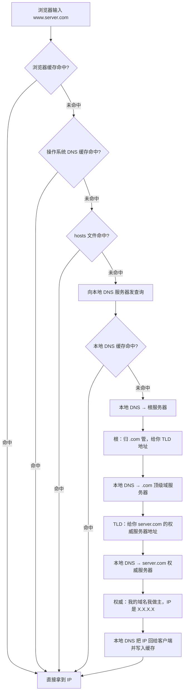
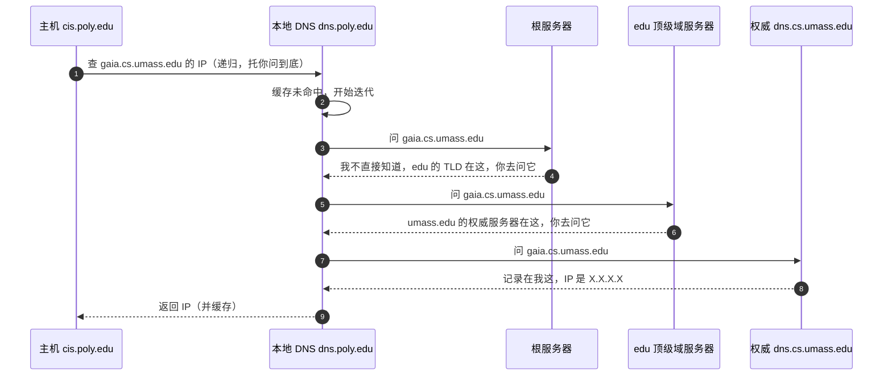

# DNS 解析到底是怎么找到 IP 的？

> DNS 不是一张表，而是一套分层的、带缓存的问路系统：客户端只管问本地 DNS 服务器，剩下的“挨家挨户问下去”由它代劳。

## DNS 想解决什么问题？

网络通信认的是 IP 地址，可人记不住 `142.250.94.46` 这种数字，只记得住 `www.google.com`。于是需要一个机制把域名翻译成 IP，这就是 DNS（Domain Name System）。

但翻译这件事，为什么不做成“一个文件存所有域名-IP 映射”？

- 单点故障：那台服务器挂了，全世界都上不了网。
- 不可扩展：几十亿条记录、每秒上百亿次查询，单机扛不住。
- 管理失控：谁改谁的域名都要去找中央，组织自治无从谈起。

所以 DNS 走的是**分布式、分层**的路子：域名按句点分层，`.com` 归一类服务器管，`example.com` 又往下委托给另一类服务器，每一层只负责自己那一段。这样既分散了压力，也让每个组织能自治自己的域名。

定位上，DNS 是**应用层协议，默认走 UDP，端口 53**。为什么默认 UDP，后面单说。

## 解析链路：从浏览器缓存到权威服务器

一次完整解析，是“先翻本地缓存，再出门问路”两段。先用 mermaid 把全貌画出来：



前半段（浏览器 → 操作系统 → hosts → 本地 DNS 服务器）是**在本地翻缓存和配置**，能命中就不出门。后半段（本地 DNS 服务器 → 根 → 顶级域 → 权威）才是真正的“网上问路”。

> 浏览器缓存的优先级各家实现略有差异，但大方向是：浏览器自己先查，查不到交给操作系统，操作系统会看自己的缓存，再翻 `hosts` 文件，最后才向配置的本地 DNS 服务器发查询。`hosts` 是本机静态映射，改它能直接“劫持”特定域名的解析，调试时常用。

### 递归查询和迭代查询，分别发生在哪一段？

这两个词最容易混。记住一条线就行：**客户端到本地 DNS 服务器是递归，本地 DNS 服务器到根/顶级/权威是迭代。**

- 递归查询：客户端把问题丢给本地 DNS 服务器，说“我不管你问谁，反正给我一个最终 IP”。本地 DNS 服务器有责任一路问到底，再把结果交回来。这一段是一问一答、托管式的。
- 迭代查询：本地 DNS 服务器问根服务器时，根不会替它继续往下问，而是回答“我不知道 IP，但 `.com` 归那台 TLD 管，地址给你，你自己去问”。本地 DNS 服务器拿到地址后再去问 TLD，TLD 又把它指向权威服务器。每一步都是“**只指路不带路**”。

用经典的例子串一遍：主机 `cis.poly.edu` 要查 `gaia.cs.umass.edu`，它的本地 DNS 服务器是 `dns.poly.edu`，目标权威是 `dns.cs.umass.edu`。



注意第 2~5 步：根、TLD 都没替本地 DNS 服务器继续往下问，只是“指路”，这就是迭代。第 1 步和最后一步客户端 ↔ 本地 DNS 服务器之间，才是递归——客户端只发一次、收一次最终结果。

## 本地 DNS 服务器到底算哪一级？

四类 DNS 服务器里，根、顶级域（TLD）、权威是真正的层级结构，**本地 DNS 服务器严格说不属于这个层级**。它是 ISP 或企业内网部署的一个“递归解析器”（recursive resolver），扮演客户端的代理：替客户端去跑完上面那串迭代查询。

所以问“本地 DNS 服务器是递归还是迭代”，标准答案是：**对客户端是递归，对上游（根/TLD/权威）是迭代**。它既是递归服务的提供者，又是迭代查询的发起者。

### 关于“13 台根服务器”的常见误解

> 网上常能看到“全球只有 13 台根服务器，且全在美国”的说法，这是过时且不准确的。13 这个数是**逻辑 IP 地址**的数量，源于早期设计：为了让根服务器地址能塞进一个 512 字节的 UDP 应答包，预留给根的 IP 只有 13 个，命名 `a.root-servers.net` 到 `m.root-servers.net`。但每个逻辑 IP 背后用 **IP 任播（Anycast）** 部署了大量物理实例，BGP 会把查询自动路由到离你最近的那台。到近年，全球根服务器物理实例已接近两千台，分布在各大洲，“只有 13 台单机”的说法不成立。
>
> 另外，有些资料里还能看到“根服务器有 600 多台”这种数字，那也只是某一时期的统计，并非当前规模，引用时以 Root-Servers.org 的实时数据为准即可。

## DNS 记录类型

DNS 服务器里存的是**资源记录（Resource Record，RR）**，一条 RR 是个四元组 `(Name, Value, Type, TTL)`。`TTL` 决定这条记录在缓存里能活多久，`Name` 和 `Value` 的含义随 `Type` 变。

| Type  | Name 是什么 | Value 是什么                  | 典型用途                     |
| ----- | ----------- | ----------------------------- | ---------------------------- |
| A     | 主机名      | IPv4 地址                     | 域名 → IPv4                  |
| AAAA  | 主机名      | IPv6 地址                     | 域名 → IPv6（A 的 IPv6 版）  |
| CNAME | 别名        | 规范主机名（另一个域名）      | 给已有 A 记录起别名          |
| MX    | 邮件域      | 邮件服务器规范主机名 + 优先级 | 指定收信的邮件服务器         |
| NS    | 一个域      | 该域权威 DNS 服务器的主机名   | 把子域解析委托给某台服务器   |
| TXT   | 主机名/域名 | 任意文本                      | 域名所有权校验、SPF、DKIM 等 |

### CNAME 别名链要注意什么

CNAME 永远指向**另一个域名**，不是 IP。解析时 DNS 会沿着这条别名链一路追下去，直到遇到一条 A/AAAA 记录为止。

```plain
NAME                    TYPE   VALUE
--------------------------------------------------
bar.example.com.        CNAME  foo.example.com.
foo.example.com.        A      192.0.2.23
```

查 `bar.example.com`，最终拿到的是 `foo.example.com` 的 IP `192.0.2.23`。这条链可以不止一跳，`foo` 也可能再是个 CNAME，但要避免**成环**（A→B→A），否则解析会失败。

还有一条容易踩坑的规则：**CNAME 与大多数其他记录类型不能在同一个 Name 上共存**。比如同一个名字上既配 CNAME 又配 MX，是违反约定的，解析器会表现异常。所以根域（zone apex，比如裸域名 `example.com` 本身）想同时做别名又有 SOA/NS 记录时，不能用普通 CNAME，得用专门的 ALIAS/ANAME 记录或把 A 记录直接写上。

## 多 A 记录、负载均衡与智能 DNS

DNS 报文的回答区可以塞**多条资源记录**，一个主机名就能对应多个 IP。这是 DNS 做负载均衡的基础。

- **多 A 记录轮询**：给 `www.example.com` 配多条 A 记录，解析器返回时轮换顺序，客户端挑第一个，于是流量被分散到不同 IP。这是最朴素的 DNS 负载均衡，缺点是它不知道后端健康状态，挂了一台 DNS 照样返回。
- **GSLB（全局服务器负载均衡）**：权威 DNS 根据请求来源（客户端的本地 DNS 服务器所在网段）、链路质量、后端负载，动态返回不同的 IP，把用户引到“最近且可用”的集群。
- **CDN 调度靠 DNS**：CDN 厂商把自己的权威 DNS 做成智能调度系统，用户查 `www.example.com` 时，权威 DNS 看请求来源，返回离用户物理位置最近的边缘节点 IP。所以同样一个域名，北京用户和广州用户查到的 IP 往往不同——这不是出错，是 CDN 在“就近接入”。

要注意：智能 DNS 看的是**本地 DNS 服务器的来源**，而不是终端用户的真实 IP。如果用户用了公共 DNS（比如 8.8.8.8 这种递归解析器），权威服务器看到的来源就是那台公共 DNS 的出口，调度精度会下降。这是 DNS 调度天然的局限。

## 缓存与 TTL

DNS 的快，靠的是**多级缓存**：浏览器、操作系统、本地 DNS 服务器，乃至各级权威都会缓存自己查过的结果。命中缓存就不用走完整链路，很多时候连根都不用碰——本地 DNS 服务器早就缓存了常见 TLD 的地址，所以实际解析里**根服务器通常是被跳过的**。

每条记录的 `TTL` 决定缓存能保留多久。TTL 是个取舍：

- **TTL 大**：缓存命中率高、查询压力小，但域名改 IP 后生效慢。
- **TTL 小**：改完很快全网刷新，但缓存价值低、查询多。

这就是“为什么改了域名不是立即生效”：各级缓存是**各自按 TTL 过期**的，不是中心化失效。你把权威服务器上的 A 记录改了，但全世界那些已经缓存了旧值的本地 DNS 服务器、操作系统、浏览器，都要等它们自己手里的 TTL 走完才会重新来问。所以预期要变更的域名，常见做法是**先把 TTL 调小**，等一个旧 TTL 周期过去，再改 IP，这样全网收敛快。改完想稳定，再把 TTL 调回去。

还有一类**负缓存**：查一个不存在的域名，返回的 `NXDOMAIN` 也会带 TTL，被缓存下来，避免短时间内反复去查一个根本不存在的名字。

## 面试高频

### 本地 DNS 服务器到底是递归还是迭代？

一句话：对客户端是递归服务，对上游是迭代查询。它是夹在中间的递归解析器，不属于 DNS 层级结构本身。

### 为什么 DNS 默认用 UDP？

主要三个原因：

- **查询小**：一次查询通常就问一个域名、要一个 IP，请求和应答都很短，一个 UDP 包（512 字节以内）能装下，没必要为这点数据走 TCP 的三次握手。
- **要快**：UDP 无连接，发出去就完事，省掉建连开销，对高频、短小的查询更合适。
- **量少**：DNS 这种“包总量少”的通信，UDP 的不可靠性影响可控，丢了重发一个查询比维护连接状态划算。

什么时候改用 TCP：

- 应答超过 UDP 限制（经典是 512 字节，EDNS0 扩展后可更大），DNS 会在应答里置 **TC（Truncation）标志**，客户端收到 TC=1 就改用 TCP 重新查一遍，拿到完整数据。
- **区域传送（zone transfer）**：权威服务器之间同步整个 zone 数据，量大且要完整可靠，用 TCP。

### DNS 劫持、污染，以及 DoH/DoT 怎么治

DNS 默认是明文 UDP，没有任何认证，所以两类攻击很常见：

- **DNS 劫持**：本地 DNS 服务器（或途经设备）被动手脚，对某些域名直接返回假的 IP，把你引到钓鱼站点。
- **DNS 污染（投毒）**：因为 UDP 无连接、应答可伪造，攻击者在真正的应答到达前，抢着塞一个伪造应答给客户端，客户端先收到假的就是假的。

治理思路都是给 DNS 加上加密或签名：

- **DoT（DNS over TLS）**：把 DNS 查询装进 TLS 加密通道，端口 853，既加密又防篡改。
- **DoH（DNS over HTTPS）**：把 DNS 查询装进 HTTPS，端口 443，和普通网页流量混在一起，更难被识别和拦截，浏览器主推。
- **DNSSEC**：给 DNS 应答加数字签名，让客户端能验证应答来源真实、内容没被篡改。注意 DNSSEC 解决的是**完整性和真实性**，不加密内容，所以它和 DoT/DoH 是互补关系，不是替代。

## 小结

- DNS 是分布式、分层的应用层系统，默认走 UDP/53，解决域名到 IP 的映射，避免单点和不可扩展。
- 完整解析是“本地缓存 + 网上问路”两段：浏览器/OS/hosts/本地 DNS 缓存能命中就不出门，命中不了才走根→TLD→权威。
- 递归发生在客户端 ↔ 本地 DNS 服务器之间，迭代发生在本地 DNS 服务器 ↔ 根/TLD/权威之间；本地 DNS 服务器对客户端是递归、对上游是迭代，且不属于 DNS 层级本身。
- 记录类型里 CNAME 指向另一个域名而非 IP，别名链要追到 A/AAAA，且 CNAME 一般不与其他记录在同一名共存。
- 多 A 记录、GSLB 和 CDN 调度都依赖“一个域名可返回多条/动态记录”，智能 DNS 看的是本地 DNS 来源而非终端 IP。
- 缓存按各自 TTL 过期，不是中心化失效，所以改域名不是立即生效；DNS 明文 UDP 易被劫持/污染，DoH/DoT 加密通道、DNSSEC 加签名验证是常见治理手段。

## 参考

基于公开计算机网络教材与面试题集、IETF RFC 1035（DNS 协议与记录）、RFC 6891（EDNS0 扩展）、RFC 7858（DoT）、RFC 8484（DoH）、RFC 4033 系列（DNSSEC）以及 Root-Servers.org 公开监测数据整理，并核对了解析链路、记录类型、UDP/TCP 切换条件与安全扩展的边界。
