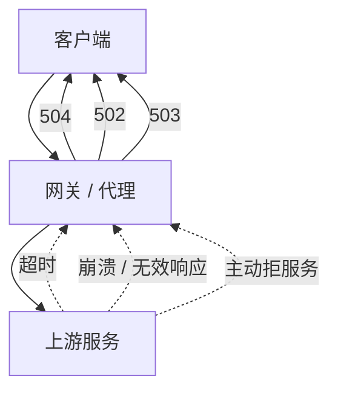

# HTTP 状态码怎么记才不会在面试时卡壳？

HTTP 状态码是服务器对客户端请求的“一句话结论”——它用一个三位数字告诉你这次请求到底成功了、要跳转、还是出了问题。面试里问状态码，不是为了让你背全表，而是看你能不能把“五类分段 + 高频几个 + 排障怎么用”讲明白。

## 为什么是三位数字、分五大类

状态码设计成三位十进制数，第一位表示大类，后两位是类内编号：

| 首位 | 大类       | 含义                       | 你最该记住的点                 |
| ---- | ---------- | -------------------------- | ------------------------------ |
| 1xx  | 信息       | 协议处理中的中间状态       | 101 切协议（升级到 WebSocket） |
| 2xx  | 成功       | 请求被正确处理             | 200 / 204 / 206                |
| 3xx  | 重定向     | 资源位置变了，要换个 URL   | 301 / 302 / 304 / 307 / 308    |
| 4xx  | 客户端错误 | 报文有问题，服务器没法处理 | 400 / 401 / 403 / 404 / 429    |
| 5xx  | 服务端错误 | 服务器自己出了问题         | 500 / 502 / 503 / 504          |

这个分段本身就是一个记忆骨架：先记住“每类代表什么”，再往里填高频码。

## 高频状态码逐个讲清

### 2xx 成功

- **200 OK**：最普通的成功。非 HEAD 请求一般会有 body。
- **204 No Content**：成功但无 body，常用于 PUT / DELETE 后“操作成功，无需返回内容”。注意它和 200 的区别就是没有 body，不是“没处理”。
- **206 Partial Content**：断点续传 / 分块下载专用，配合 `Range` 请求头，返回的是资源的一部分。

### 3xx 重定向

- **301 Moved Permanently**：永久重定向，资源永远换 URL 了，浏览器会缓存这个跳转。
- **302 Found**：临时重定向，资源暂时在另一个 URL。
- **304 Not Modified**：协商缓存命中——客户端带的 `If-Modified-Since` / `If-None-Match` 条件满足，服务器说“用你缓存里的就行”，不返回 body。
- **307 Temporary Redirect** / **308 Permanent Redirect**：和 302 / 301 对应，但**严格保留请求方法**——302 历史上会把 POST 变成 GET，307 / 308 不会，POST 还是 POST。

### 4xx 客户端错误

- **400 Bad Request**：报文有错，但这是个笼统说法，具体错在哪要看 body。
- **401 Unauthorized**：没认证（没带 token / 登录态失效）。注意名字叫 Unauthorized，实际语义是“未认证”。
- **403 Forbidden**：认证过了但没权限——服务器认识你，但不让你碰这个资源。
- **404 Not Found**：资源不存在。
- **408 Request Timeout**：客户端在规定时间内没把请求发完，服务器等不及了。
- **409 Conflict**：请求和资源当前状态冲突（比如并发改同一资源、注册已存在的用户名）。
- **413 Payload Too Large**：请求体太大，服务器拒绝。
- **429 Too Many Requests**：限流命中，配合 `Retry-After` 告诉客户端多久后重试。

### 5xx 服务端错误

- **500 Internal Server Error**：服务器内部崩了，笼统错误码。
- **502 Bad Gateway**：作为网关 / 代理的服务器，从上游收到无效响应——上游挂了或返回了乱七八糟的东西。
- **503 Service Unavailable**：服务器暂时没法服务，常见于过载、限流、维护，可能带 `Retry-After`。
- **504 Gateway Timeout**：作为网关 / 代理的服务器，等上游响应超时了——上游还在处理但没在时限内回。

## 三个最容易混的点

### 301 / 302 / 307 / 308：重定向要不要改方法

| 状态码 | 临时 / 永久 | 是否保留原请求方法           |
| ------ | ----------- | ---------------------------- |
| 301    | 永久        | 历史实现常把 POST 改成 GET   |
| 302    | 临时        | 历史实现常把 POST 改成 GET   |
| 307    | 临时        | 严格保留方法，POST 还是 POST |
| 308    | 永久        | 严格保留方法，POST 还是 POST |

面试一句话：**302 和 307 都是临时重定向，区别在 302 在历史上可能把 POST 变 GET、307 严格不改；301 和 308 同理对应永久。** 之所以又造了 307 / 308，就是因为 302 / 301 的“改方法”行为太广泛、太坑，需要一对严格语义的新码。

### 304：不是错误，是“用缓存”

304 不属于“重定向到新 URL”，而是协商缓存命中后告诉客户端“你本地的那份还能用”。它一定伴随 `If-Modified-Since` / `If-None-Match` 这类条件请求头出现，单独看到 304 没意义。

### 401 vs 403：没认 vs 不让

- **401**：你是谁？我不知道（没登录 / token 无效）。
- **403**：我知道你是谁，但你没权限干这件事。

一个判别办法：匿名访问受限资源返回 401 引导登录；登录了但仍被拒，返回 403。

## 排障视角：502 / 503 / 504 怎么分

线上报 5xx 时，先看是哪一类：

- **502**：网关后面那个上游服务**返回了不该返回的东西**（连不上、进程没了、返回了乱码）。典型是上游服务被 OOM kill、进程没起来。
- **503**：上游还在，但**主动说自己扛不住了**（过载、限流、维护中）。常配合熔断。
- **504**：上游**没在时限内回**，可能是上游慢、或者上游又去等更下游超时。

## 工程实践：HTTP 状态码 vs 业务 code

很多团队习惯在 body 里再放一个业务码（比如 `{"code": 0, "msg": "", "data": ...}`），于是出现两套码。取舍是：

- **HTTP 状态码负责“传输层 / 网关层”的语义**：2xx 表示请求被正确接收并处理，4xx / 5xx 表示在网关、路由、鉴权这一层就出了问题（404 路由不存在、401 没登录、503 服务挂了）。
- **业务 code 负责“业务层”的语义**：比如用户名重复、余额不足，HTTP 层是 200，但 body 里 code 非 0。

好处是网关、监控系统只看 HTTP 状态码就能判断“这一层通不通”，业务细节由应用自己解释。坏处是两套码容易让人混淆“到底哪层出了错”。一个常见反例是：业务逻辑失败（如余额不足）也返回 HTTP 500，这会把“业务失败”和“服务器故障”混在一起，监控告警会乱。

## 小结

- 状态码三位数，首位定大类：1xx 信息、2xx 成功、3xx 重定向、4xx 客户端错、5xx 服务端错，先记骨架再填高频码。
- 重定向四兄弟：301 / 302 历史上可能改方法，307 / 308 严格保留方法，记“临时 / 永久”和“改不改方法”两个维度。
- 401 是没认证、403 是没权限，304 不是错是协商缓存命中。
- 排障 5xx：502 上游崩了、503 上游主动拒、504 上游超时，按这个顺序定位。
- HTTP 状态码管传输 / 网关语义，业务码管业务语义，别把业务失败塞进 HTTP 500。

## 参考

本文综合公开 HTTP 面试题集与 RFC 9110（HTTP 语义）等公开规范，核对了状态码分类、高频状态码的工程含义与 307 / 308 等较新状态码的语义，并补充了网关层排障与业务码取舍的实践视角。
