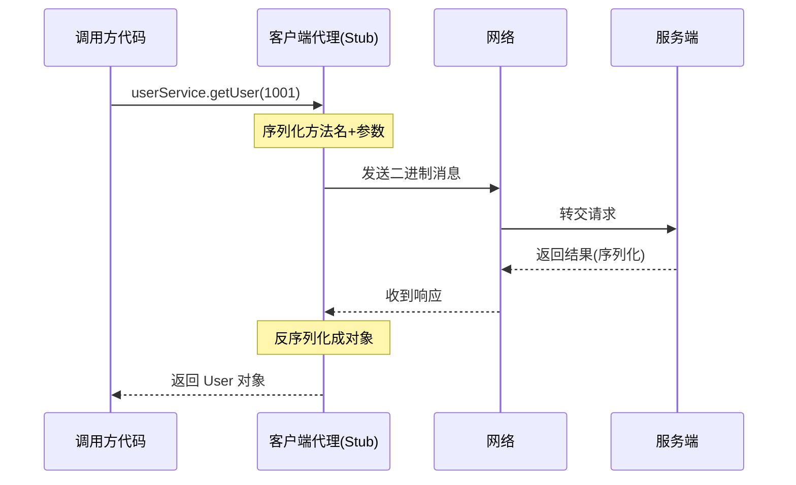

# HTTP 和 RPC 到底是不是一回事？怎么选？

> 不是同一维度：HTTP 是一个应用层通用协议，RPC 是一种“让远程调用像本地调用一样”的调用范式。两者经常被拉到一起比，是因为它们都解决“隔着网络怎么把一次调用说清楚”。

## 先把维度对齐：一个是协议，一个是范式

很多人第一反应是“HTTP 和 RPC 谁更强”，但这个问法本身就错位了。

- **HTTP**（HyperText Transfer Protocol）是一个具体的应用层协议，规定了请求行、Header、Body、状态码这套消息格式，谁按格式来就能互通。
- **RPC**（Remote Procedure Call）不是某一个具体协议，而是一种调用模型：让你在代码里写 `userService.getUser(1001)`，底下自动把方法名、参数、返回值序列化后发到远端，再把结果反序列化回来，屏蔽掉网络细节。



Dubbo、Thrift、gRPC 都是 RPC 框架的具体实现。所以更准确的说法不是“HTTP 和 RPC 谁强”，而是：**HTTP 是一种协议，RPC 是一种远程调用范式，具体实现可以用 HTTP、也可以不用。**

这里就埋了一个最容易绕晕的点：**gRPC 是 RPC，但它底层跑在 HTTP/2 上。** 它不是 HTTP 的对立面，而是在 HTTP/2 之上叠了一层 RPC 调用约定。所以“有了 HTTP/2 为什么还要 RPC”和“gRPC 为什么算 RPC”其实是一回事的两个面。

> 有些资料习惯把 HTTP 归到 B/S 架构、RPC 归到 C/S 架构。这作为历史背景看可以——早年浏览器要统一访问各家公司服务器，才有了标准化的 HTTP；而客户端软件连自家服务用私有 RPC 就够了。但今天 B/S 和 C/S 早就融合了，移动端、网页、PC 同时连一套后端很常见，按这个维度区分已经没什么意义。

## 都长在 TCP 之上，为什么还要再套一层

HTTP 基于 TCP，RPC 也常基于 TCP，那直接用裸 TCP 不行吗？理论上可以，实际上很麻烦。

裸 TCP 给的是一串无边界的字节流。你连续发两条：

```text
getUser:1001
getOrder:8888
```

对端收到的可能不是两条整整齐齐的消息，而是一团需要自己切分的字节。你得自己判断第一条从哪开始到哪结束，处理半包、粘包、编码、超时、错误码、请求 ID 配对……

所以凡是基于 TCP 的应用层协议，都要在字节流之上定义一套**消息格式**：典型做法是加一个消息头，头里写清楚这条消息有多长，头里还可以塞内容类型、压缩标记、序列号等。上下游约定好了，这就是“协议”。

HTTP 和各类 RPC 协议本质上都在做这件事——在 TCP 上定义消息格式，把一次业务调用说清楚。区别在于**建模方式**：

- HTTP / REST 围绕**资源**建模：`GET /users/1001`、`POST /orders`、`PUT /orders/888/status`。心智模型是“我在访问一个资源”。
- RPC 围绕**方法**建模：`userService.getUser(1001)`、`orderService.createOrder(req)`。心智模型是“我在调用一个方法”。

两者都能调通，区别在于你把远程交互当成一次“资源访问”还是一次“方法调用”。

## 一张表横向对比

为方便对着看，下面按典型形态对比（HTTP 取最常见的 HTTP/1.1 + JSON，RPC 取 Dubbo/gRPC 这类）：

| 维度     | HTTP（HTTP/1.1 + JSON）          | RPC（Dubbo / gRPC 等）                   | 备注                                |
| -------- | -------------------------------- | ---------------------------------------- | ----------------------------------- |
| 本质定位 | 应用层通用协议                   | 远程调用范式 + 具体实现                  | 不在同一维度                        |
| 传输承载 | 通常 TCP（HTTP/1.1、2、3）       | 通常 TCP，也可 HTTP/2（gRPC）甚至 UDP    | RPC 不绑定传输层                    |
| 序列化   | JSON（文本）                     | Protobuf / Hessian / Thrift（二进制）    | 性能差距的主要来源                  |
| 头部开销 | 文本 Header，字段名每次都带      | 紧凑二进制头，字段按位置约定             | HTTP/2 的 HPACK 也压缩头部          |
| 服务发现 | DNS + 负载均衡 / 网关            | 注册中心（Nacos / Consul / ZK）          | HTTP 也能配注册中心，是约定而非本质 |
| 连接复用 | Keep-Alive + 连接池              | 长连接 + 连接池                          | 双方都能做，**不是差异点**          |
| 调用模型 | 资源访问（URL + 方法）           | 方法调用（服务.方法(参数)）              | REST 偏资源，RPC 偏方法             |
| 契约强度 | 文档 / JSON，较松                | IDL（.proto / .idl），编译期校验         | 字段变更更容易在编译期暴露          |
| 治理能力 | 靠网关 / SDK / Service Mesh 拼装 | 框架内置超时、重试、熔断、限流、链路追踪 | HTTP 也能做，但要自己搭             |
| 调试友好 | curl / Postman / 浏览器直接看    | 需工具反序列化，二进制不易读             | 对外接口 HTTP 友好                  |
| 典型场景 | 对外 API、前后端、跨异构         | 内部微服务高频互调                       | 看调用对象，不是看谁更“高级”        |

> 不少对比会强调“RPC 有连接池所以更快”。这说法站不住：HTTP 客户端（Go、Java OkHttp、Python requests + 适配器）一样有连接池，HTTP/1.1 默认就是 Keep-Alive 长连接。连接复用是双方都能做的基础能力，不是 RPC 独有的优势。

## “RPC 更快”到底快在哪

性能是 RPC 在公司内部被选中的最常见理由，但要把“快”拆开看，别笼统背一句“RPC 比 HTTP 快”。

差距主要来自三块：

1. **序列化体积**。JSON 是文本格式，字段名、引号、括号、空格都算字节，`{"id":1001,"name":"zhang"}` 这种明文非常冗余。Protobuf/Hessian 这类二进制序列化用 tag + varint 紧凑编码，体积常只有 JSON 的几分之一，解析也更适合机器处理（不用逐字符解析字符串）。

2. **头部开销**。HTTP/1.1 的 Header 是文本，`Content-Type`、`Host`、`Cookie`、`User-Agent` 一堆字段名连同它们的值每次都要原样传过去。RPC 的二进制头通常把字段位置约定死，第几位是什么、什么类型都规定好，不需要重复传字段名。这在请求体很小、调用极频繁时尤其明显——头部比 body 还大。

3. **连接复用**。这一块严格说不是差异点（见上面的纠偏），但 RPC 框架通常默认就把长连接 + 连接池 + 多路复用配齐，开箱即用；HTTP/1.1 历史上有队头阻塞问题，单连接上多个请求得排队，所以早期 RPC 在高并发下吞吐更稳。

举一个直观对比，同样是查一个用户：

```http
POST /user/get HTTP/1.1
Host: api.example.com
Content-Type: application/json
Content-Length: 28

{"id":1001,"fields":["name"]}
```

HTTP/1.1 这一笔，头部动辄一百多字节，body 还要带 `id`、`fields` 这些字段名。换 gRPC over HTTP/2 + Protobuf，body 可能就是几个字节（一个 field tag + 一个 varint 编码的 1001），头部经 HPACK 压缩后也只传差异，整体报文常常只有 HTTP 那笔的零头。

但这里有个关键边界，资料里讲得不够的部分：

> **“RPC 一定比 HTTP 快”是错的。** 拿 HTTP/1.1 + JSON 去比 gRPC（HTTP/2 + Protobuf），后者在内部高频调用里通常更省；可一旦把 HTTP 也升到 HTTP/2 + Protobuf（或者 HTTP/2 + 压缩 JSON），序列化体积和头部开销这两块差距会大幅缩小。决定快慢的是序列化方式、报文大小、连接复用、压缩和框架实现，不是“它叫 RPC 还是叫 HTTP”。真正要比，应该拿你自己的接口、数据量和部署环境压测。

## gRPC 为什么偏偏选 HTTP/2

既然 RPC 常被说成“私有二进制协议”，gRPC 这个最主流的 RPC 框架却建立在 HTTP/2 上，看着有点反常识。原因主要有几点：

- **多路复用**。HTTP/2 在一条 TCP 连接上用 Stream 承载多个并发请求，没有 HTTP/1.1 的队头阻塞，正好契合内部服务高并发互调。
- **二进制帧**。HTTP/2 是分帧的二进制协议，天然适合承载二进制序列化的 RPC 消息，不用再自己造一套消息边界。
- **头部压缩（HPACK）**。重复的 Header 只传差异，降低头部开销。
- **生态兼容**。跑在 HTTP/2 上，更容易复用现成的网关、负载均衡、代理、TLS 基础设施，而不是又一个需要专门支持的私有协议。
- **流式调用**。HTTP/2 的 Stream 天然支持双向流，gRPC 据此提供 Unary、服务端流、客户端流、双向流四种调用模式，做日志订阅、长任务进度推送、批量上传这类场景更自然。

还有个容易忽略的工程细节：gRPC 正常响应里 HTTP 层通常是 `:status: 200`，**真正的调用结果放在 HTTP/2 Trailers 里的 `grpc-status` 和 `grpc-message`**。所以排查时不能只看 HTTP 状态码——HTTP 是 200 不代表这次 RPC 业务成功。这也带来一个现实问题：链路上的网关、负载均衡、代理、Service Mesh 是否正确支持 HTTP/2 Trailers，会直接影响 gRPC 调用，处理不好时问题很隐蔽。

> 有些资料把 gRPC 简单说成 “HTTP/2 + Protobuf”。这只能帮入门建立印象，不能当严格定义。更准确的说法是：gRPC 基于 HTTP/2 承载 RPC 调用，默认用 Protobuf 作为 IDL 和消息格式，但协议层允许 `application/grpc+proto`、`application/grpc+json` 或自定义编码。它还规定了一整套路径约定、Length-Prefixed-Message 封帧、Trailers 状态码等规则，是一套完整的 RPC 调用协议，不是只换了个序列化格式。
>
> 还要澄清一个边界：HTTP/2 只是传输层升级。它不会自动帮你定义服务接口、生成客户端代码、解决服务发现、超时重试和版本契约——这些还是要 RPC 框架或你自己补。所以“有了 HTTP/2 就不需要 RPC”同样不成立。

## 什么时候用 HTTP，什么时候用 RPC

不要按“谁更高级”选，按**调用对象**和**团队基础设施**选。

**优先 HTTP 的场景：**

- 对外开放 API，给 Web、App、第三方合作方接入——对方可能用任何语言，HTTP 通用、接入门槛低，curl/Postman 就能测，最怕别人接不动。
- 前后端通信，浏览器天然就是 HTTP/REST 的主场。
- 跨异构系统、调用频率不高、没有成熟 RPC 基础设施。
- 已经有统一 HTTP 网关 + SDK + 限流 + 鉴权 + 链路追踪这套体系，大家都习惯用 HTTP。

**优先 RPC 的场景：**

- 公司内部微服务高频互调，服务多、接口多、调用链复杂。
- 对超时、重试、负载均衡、服务发现、熔断降级、链路追踪要求高，不想每个服务自己拼。
- 团队接受 IDL + 代码生成的开发方式。

**别强行上 RPC 的场景：** 一个后台管理系统拆几个服务，调用频率也不高，用 Spring Boot 写几个 REST 接口配合 OpenAPI 文档就够用。这时候强上 RPC 要引入注册中心、维护 IDL、处理代码生成和本地调试，成本不一定值得。**如果你的系统用 HTTP 已经稳定跑着，也没有明显的调用治理痛点，就没必要为了“微服务味更浓”换 RPC。**

如果决定用 gRPC，提前想清楚几件事：浏览器不能直接调标准 gRPC，通常要 gRPC-Web 或代理层；网关和负载均衡是否支持 HTTP/2 Trailers；本地调试是否方便；团队是否接受 `.proto` 和代码生成；线上排查二进制消息带来的理解成本。

## 几个常见误区

**误区一：RPC 一定比 HTTP 快。** 不严谨。决定快慢的是序列化、报文大小、连接复用、压缩和框架实现，不是协议名字。HTTP/2 + Protobuf 之后，HTTP 这条路的性能并不差。真要选型，拿自己的接口压测，而不是背一句结论。

**误区二：RPC 只能走 TCP。** RPC 是调用模型，不绑定传输。gRPC 走 HTTP/2，早期也有基于 UDP 的 RPC 实验方案，Thrift 等也支持多种传输。别把“TCP 之上”当成 RPC 的定义。

**误区三：REST 和 RPC 互斥。** 不互斥，实际项目里经常混用：外部接口走 REST，内部服务走 RPC，很正常。它们只是建模方式不同。

**误区四：“HTTP 对外、RPC 对内”是铁律。** 这句话能帮入门，但真做项目要看调用对象、团队基础设施、排查成本和维护成本。规模不大、HTTP 跑得很稳，就别强上 RPC；内部调用越来越复杂、HTTP SDK 和网关越补越多，那再认真考虑 RPC。

**误区五：Service Mesh 时代还是非此即彼。** 边界其实在变模糊。Service Mesh 把服务发现、负载均衡、超时重试、熔断、链路追踪这些治理能力下沉到 sidecar，业务侧用什么协议（HTTP、gRPC、Dubbo）都能享受这套治理。换句话说，原本“RPC 框架内置治理”这个优势，正在被 Mesh 抽走一部分；选型的重心会更偏向“序列化 + 契约 + 调用体验”，而不是“谁自带治理”。

## 小结

- HTTP 是应用层通用协议，RPC 是一种远程调用范式；gRPC 是 RPC 框架，但跑在 HTTP/2 上，不是 HTTP 的对立面。
- 两者都在 TCP 之上定义消息格式，区别在于把远程交互建模成资源访问还是方法调用。
- “RPC 更快”主要快在二进制序列化体积和头部开销；连接复用双方都能做，不算 RPC 独有优势，HTTP/2 + Protobuf 之后差距明显缩小，“RPC 一定更快”不成立，要按自己场景压测。
- 对外 API、前后端、跨异构优先 HTTP；内部微服务高频互调、治理要求高优先 RPC；规模小且 HTTP 跑得稳就别强上 RPC。
- Service Mesh 把治理能力下沉到 sidecar，HTTP 和 RPC 的边界进一步模糊，选型重心转向序列化与契约。

## 参考

综合公开计算机网络教材与 RPC / Dubbo / gRPC 公开资料整理，并对照 HTTP/1.1、HTTP/2、Protobuf 官方说明对若干过时与绝对化说法做了修正。
