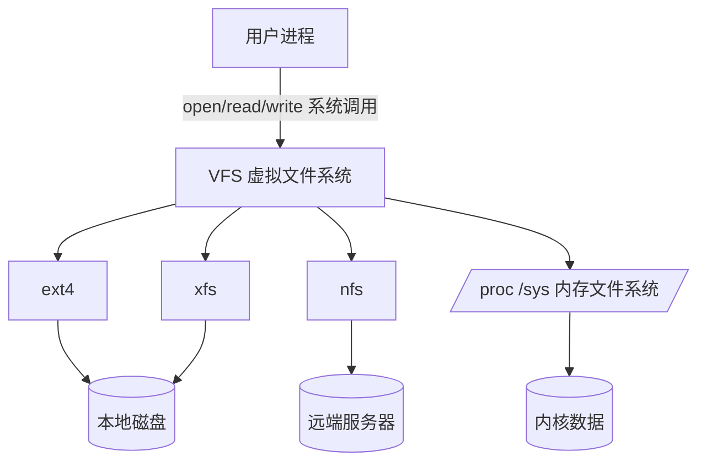
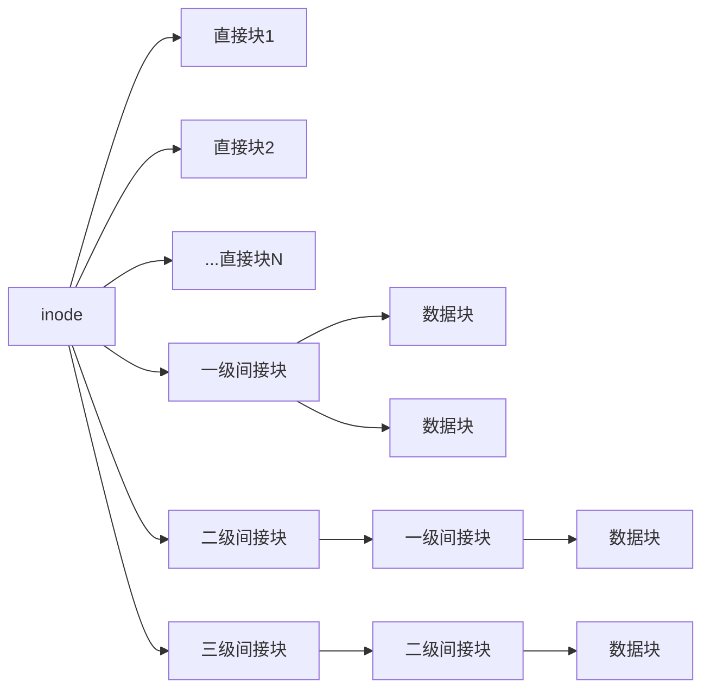
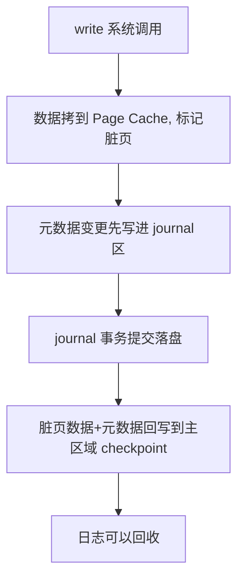
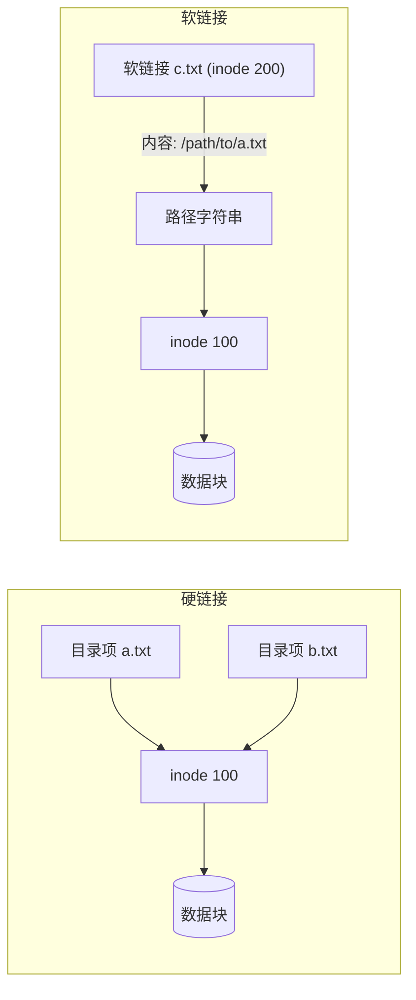

# 文件系统是怎么组织和管理数据的？

> 文件系统把无结构的磁盘块组织成按名存取的目录树，核心是把文件名和文件元数据分开存，再用 VFS 统一接口屏蔽底层差异。

## 文件系统到底解决什么问题？

裸盘上只有一个个扇区，没有文件、没有目录、没有权限。你直接对着块号读写也能存数据，但只要文件一多，问题就来了：哪个块属于哪个文件？文件叫什么名字？删了文件怎么回收块？断电了怎么不把半个文件留下？

文件系统就是来回答这些问题的。它做了几件事：

- 把磁盘划分成固定大小的块，统一管理分配和回收。
- 给每个文件建一份"元数据"，记录它的大小、权限、时间戳、以及数据块在磁盘上的位置。
- 用一层目录结构把文件按名字组织起来，让我们能 `cat /etc/hosts` 而不是 `cat block=1024`。
- 在上层提供统一的 open/read/write 接口，让程序不用关心底层是 ext4、xfs 还是 nfs。

这里有个关键设计：**元数据和数据是分开存的**。文件内容放在数据块里，而"这个文件有多大、属于谁、数据块在第几号"这些描述性信息单独放在 inode 里。这种分离让文件的查找、权限校验、空间分配都能先看元数据再决定要不要读数据，省掉大量无谓的 IO。

## inode：文件的身份，但不存文件名

inode（index node，索引节点）是文件系统给每个文件建的"档案"。一个文件对应一个 inode，inode 里大致存这些：

| 存什么     | 例子                  |
| ---------- | --------------------- |
| 文件大小   | 4096 字节             |
| 权限和属主 | rw-r--r--，root:root  |
| 时间戳     | atime / mtime / ctime |
| 数据块指针 | 块号 1024、2048……     |
| inode 号   | 文件系统内唯一编号    |

注意一个反直觉的点：**inode 里不存文件名**。文件名存在目录里。所以同一个 inode（同一份文件内容）可以有多个名字，这就是硬链接的来源。

你可以用 `ls -i` 直接看到 inode 号：

```bash
$ ls -i file.txt
1234567 file.txt
```

第一列那个数字就是 inode 号。也可以用 `stat file.txt` 看更完整的元数据。

inode 是存在磁盘上的（占磁盘空间），但访问文件时会被缓存进内存加速。inode 数量在文件系统创建时就定死了，所以会出现一种坑：磁盘还剩很多空间，但 inode 用完了，照样建不了新文件——通常是某个目录里堆了几百万个小文件。可以用 `df -i` 看 inode 使用率。

### 文件名在哪儿？说清"目录项"

这里要小心一个容易混淆的概念。很多人把"目录项（dentry）"理解成磁盘上的目录记录，其实要分两层：

- 磁盘上：目录本身就是一个特殊的文件，它的数据块里存的是一条条 `(文件名, inode 号)` 的记录。这层是持久化的。
- 内存里：VFS 用一个叫 `dentry` 的对象把磁盘上的目录记录缓存起来，组成 dcache，加速路径解析。这层是内核缓存，断电就没。

> 有些资料会把这两层混着讲，说"目录项不存磁盘、只在内存"。准确说法是：磁盘上的目录文件里确实存了文件名到 inode 的映射；内存里的 dentry 是 VFS 为了加速把这些映射缓存起来的对象。两者不是一回事，但名字容易撞。

为什么要分这两层？因为路径解析（`/a/b/c.txt` 要逐级查 a、b、c）如果不缓存，每一级都要读磁盘目录块，开销很大。缓存成 dentry 后，常用路径基本都在内存里命中。

## VFS：上层只认一套接口

文件系统种类很多：磁盘上的 ext4、xfs、btrfs；内存里的 /proc、/sys；网络上的 nfs、smb。如果每个文件系统都给应用一套自己的接口，写程序就太痛苦了。

Linux 的做法是在用户态和具体文件系统之间加一层 **VFS（Virtual File System，虚拟文件系统）**。它定义了一套统一的数据结构和接口，具体的文件系统只要实现这些接口就能挂上来。对应用来说，open/read/write 不用关心底下是 ext4 还是 nfs。

VFS 主要有四个核心对象：

| 对象       | 代表什么                 | 生命周期                  |
| ---------- | ------------------------ | ------------------------- |
| superblock | 一个已挂载的文件系统整体 | 挂载时进内存              |
| inode      | 一个文件/目录的元数据    | 被访问时进内存            |
| dentry     | 目录项，组成路径树       | 路径解析时缓存            |
| file       | 一个进程打开的文件实例   | open 时创建，close 时释放 |

注意 inode 和 dentry 是"一个文件一份"的全局对象，而 file 是"一次打开一份"——同一个文件被两个进程打开，就有两个 file 对象，但共享一个 inode。



VFS 的价值不止"统一接口"，它还顺带把 Page Cache、dcache、inode cache 这些缓存层挂在统一框架下，让所有文件系统都能享受缓存加速。

## 数据怎么落到磁盘：块、直接/间接块

文件数据存在数据块里，块大小常见 4KB。一个文件小到几字节、大到几十 GB，inode 里的块指针怎么设计才能既照顾小文件、又撑得住大文件？

经典做法（早期 Unix、ext2）是多级索引：

- 直接块指针：直接指向数据块。小文件只用这部分就够，没有间接开销。
- 一级间接块：指针指向一个"索引块"，索引块里再存一批数据块号。
- 二级间接块：指针指向一个索引块，那个索引块里又是索引块，再指向数据块。
- 三级间接块：再套一层，应对超大文件。



这样小文件用直接块、访问快、开销小；大文件走多级间接、能寻址到很大，但越深的层访问要读的索引块越多，随机读会变慢。

> 注意：这套"直接块 + 多级间接块"是 ext2 / 早期 Unix 的结构（早期 Unix 常见 10 个直接块 + 1/1/1 三级间接；ext2 是 12 个直接块）。ext4 对大文件改用 **extent**：用一个 extent 描述符直接表示"从第 X 块开始的连续 N 个块"，连续大文件的元数据开销大幅降低，随机寻址也不必一层层查间接块。所以现在看到的大文件寻址方式，和老资料里画的指针图已经不一样了。

磁盘空闲块怎么管？Linux 用的是位图（bitmap），每个块对应一个 bit，0 空闲 1 占用。inode 的分配也用位图。文件系统按"块组"组织，每个块组里有自己的超级块副本、位图、inode 表、数据块，这样既方便局部分配（减少磁头寻道），又有冗余便于恢复。

## 日志式文件系统：为什么 ext4/xfs 写之前先记一笔

裸写文件系统有个老问题：写一个大文件要改好几处——分配数据块、更新 inode 的块指针、更新目录项、更新位图。如果写到一半断电，就会出现"位图说块已分配、inode 却没指向它"这类不一致，轻则丢文件，重则整个文件系统损坏。传统 ext2 断电后得跑 fsck 全盘扫描修复，慢且危险。

日志式文件系统（ext4、xfs 都是）的思路是：**在改真正的主区域之前，先把"要改什么"当成一笔交易记到日志区**。日志写完、提交了，再回头把改动写回主区域（这步叫 checkpoint）。如果中途断电，重启时重放日志就能把文件系统恢复到一个一致的状态，不用全盘扫描。

写文件的流程大致是这样（和 Page Cache 那篇呼应）：



> 这里有个常见的简化说法："写 Page Cache → journal → 落盘"。更准确的理解是：数据本身通常是直接写 Page Cache 再回写到数据块；**journal 主要保护的是元数据**（块分配、inode 更新、目录修改）。数据要不要也进 journal，取决于日志模式：`data=ordered`（默认，数据先落盘再提交元数据）、`data=journal`（数据也写进日志，最安全但最慢）、`data=writeback`（只管元数据，数据可能丢）。所以"写进 journal"的更多是元数据，别理解成数据也原样进 journal。

为什么要分这几步？因为 journal 区空间有限、写 journal 也有开销，不可能所有数据都进 journal。把元数据的一致性用 journal 兜住，数据靠 Page Cache + 回写兼顾性能，是工程上的折中。

## 硬链接 vs 软链接

既然文件名在目录里、inode 才是文件本体，那"给文件起个别名"就有两种做法：

- 硬链接：在目录里再加一条记录，指向**同一个 inode**。两个名字地位平等，删一个不影响另一个，只有所有硬链接（包括"源文件"）都删了，inode 引用计数归零，数据块才真正回收。
- 软链接（符号链接）：新建一个**独立的文件**，有独立的 inode，内容是目标文件的路径字符串。访问软链接时，内核读出路径再去解析。

|                | 硬链接                   | 软链接                      |
| -------------- | ------------------------ | --------------------------- |
| inode          | 和源文件同一个           | 独立                        |
| 能否跨文件系统 | 不能                     | 能                          |
| 能否链接目录   | 一般不能                 | 能                          |
| 源文件删除后   | 仍然可用（还有别的入口） | 失效（路径找不到目标）      |
| 占用           | 几乎不额外占空间         | 占一个 inode + 一小段数据块 |
| 命令           | `ln src dst`             | `ln -s src dst`             |

硬链接为什么不能跨文件系统？因为每个文件系统有自己的 inode 表和 inode 编号空间，跨文件系统复用同一个 inode 号没有意义、还会冲突。为什么一般不能给目录做硬链接？为了避免在目录树里造出环，让路径解析陷入死循环（`.` 和 `..` 例外，那是文件系统特殊处理的）。



一个实用差别：软链接是"快捷方式"，源文件挪走或改名，链接就失效；硬链接是"同一份文件的另一个入口"，源文件删了，硬链接还能读出原数据，这正好可以用来防误删。

## 和数据库、Java 有什么关系

数据库是最在意文件系统行为的场景之一。MySQL InnoDB、PostgreSQL 写数据本质是写文件，但又不能完全信任默认的 buffered IO，原因有三：

- **双缓存浪费**：InnoDB 自己有 Buffer Pool 做数据缓存，如果再走 Page Cache，同一份数据在内核和用户态各缓存一份，浪费内存还多一次拷贝。所以 InnoDB 常用 `O_DIRECT` 绕过 Page Cache，自己管缓存。
- **落盘语义**：数据库写完一条事务，必须保证真的落盘了，否则机器一断电就丢数据。所以关键路径上要调 `fsync(fd)`，强制把数据和元数据刷到磁盘，并把 journal 事务提交。
- **fsync 延迟**：`fsync` 在日志式文件系统上要等 journal 提交，延迟受磁盘吞吐、journal 模式、写并发影响。数据库写性能抖动，很多时候是 fsync 在等文件系统提交日志，而不是 SQL 本身慢。

Java 侧也绕不开这些。标准 NIO 的 `FileChannel.force(true)` 底层就是 `fsync`，写日志、写消息队列持久化文件时常用。JDK 没有直接暴露 `O_DIRECT` 的标准 API（要自己搞对齐和 syscall），所以追求极致的中间件常用 native 或 JNI。Kafka 这类顺序写大流的系统反而更愿意用 Page Cache + sendfile 零拷贝，把内核缓存当友军。

文件系统选型和挂载参数对数据库影响很大：

| 维度         | 常见取舍                                                                                                                      |
| ------------ | ----------------------------------------------------------------------------------------------------------------------------- |
| ext4 vs xfs  | xfs 在大文件、高并发顺序写上更稳，是很多云数据库的默认选择；ext4 兼容性好、小文件场景也常用                                   |
| journal 模式 | 数据库一般用 `data=ordered`（默认）配合自己的 fsync；若已自保证一致性，也有人用 `data=writeback` 换性能，但要清楚数据丢失风险 |
| 挂载参数     | `noatime` 关掉访问时间更新，减少元数据写，对读密集的数据库有帮助                                                              |

一句话：数据库和文件系统的关系，是在"自己管缓存（O_DIRECT）"和"靠文件系统兜底一致性（fsync + journal）"之间找平衡。

## 小结

- inode 存大小、权限、块指针，是文件的唯一身份；文件名存在目录里、不存 inode，`ls -i` 看到的就是 inode 号，inode 用完了磁盘有空间也建不了文件。
- VFS 用 superblock / inode / dentry / file 四个对象提供统一接口，让上层无感底层是 ext4、xfs 还是 nfs。
- 日志式文件系统先记 journal 再回写主区域，保证崩溃后能重放到一致状态，journal 主要保护元数据，数据是否进 journal 看模式。
- 硬链接共用 inode、不能跨文件系统、不能给目录；软链接是独立文件存路径，能跨文件系统、源删了就失效。
- 数据库常用 O_DIRECT 绕过 Page Cache、用 fsync 强制落盘，写性能抖动往往来自 fsync 等 journal 提交而非 SQL 本身。

## 参考

基于公开 Linux 文件系统教材与内核文档、ext4 / xfs 设计说明、VFS 四对象与日志机制资料，并核对了 inode 与目录项分层、extent 与多级间接块、O_DIRECT 与 fsync 在数据库场景的工程边界。
