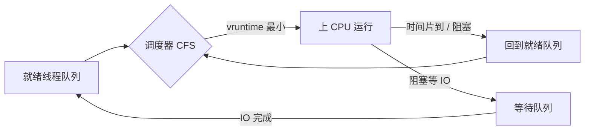

# 进程和线程是怎么被调度的？

CPU 只有一颗（或几颗）核，但跑着成百上千个进程线程，谁先用、用多久、什么时候被换下来，就是调度要解决的问题。调度影响的是“等待时间”——进程在就绪队列里排多久才能上 CPU，而不是它真正占用 CPU 干活的时间。

## 什么时候触发调度

CPU 调度发生在进程状态切换的几个时机：

1. 运行 → 等待（比如等 IO）
2. 运行 → 就绪（时间片用完）
3. 等待 → 就绪（等的事件来了）
4. 运行 → 终止（跑完了）

其中 1 和 4 是**非抢占式**调度——当前进程主动让出 CPU，调度器才能选下一个；2 和 3 是**抢占式**调度——当前进程可能正跑着，被时钟中断或更高优先级的就绪进程“抢”走 CPU。现代桌面 / 服务器系统基本都是抢占式，否则一个死循环就能把机器卡死。

## 经典调度算法：每个都在补上一个的坑

调度算法是一步步演进出来的，理解“上一种有什么问题”比背定义更有用：

| 算法              | 核心思想                           | 解决了什么               | 留下什么坑                            |
| ----------------- | ---------------------------------- | ------------------------ | ------------------------------------- |
| 先来先服务 FCFS   | 按到达顺序排队                     | 简单公平                 | 长作业在前，短作业饿死（护航效应）    |
| 最短作业优先 SJF  | 选预计运行时间最短的               | 提高吞吐                 | 长作业可能永远轮不上（饥饿）          |
| 高响应比优先 HRRN | 响应比 = (等待+服务)/服务，选最高  | 兼顾长短作业             | 需预估服务时间，难实现                |
| 时间片轮转 RR     | 每人一个时间片，轮流               | 响应快、公平             | 时间片太短切换开销大，太长退化成 FCFS |
| 最高优先级 HPF    | 选优先级最高的                     | 区分重要程度             | 低优先级饥饿                          |
| 多级反馈队列 MLFQ | 多队列、高优先级时间片短，用完降级 | 兼顾响应、吞吐、长短作业 | 参数调优复杂                          |

几个要点：

- **SJF 的饥饿**：如果短作业源源不断来，长作业一直排不上。HRRN 就是用“等待越久响应比越高”来救长作业。
- **RR 的时间片**：太短，上下文切换吃掉 CPU；太长，退化成 FCFS。经验值 20~50ms 是常见折中。
- **MLFQ 的精髓**：新进程进最高优先级队列（假设它是短的，给快速响应）；用不完时间片说明它是长作业，降级到下一层（时间片更长、优先级更低）；如果它在等 IO，可以提回上层（照顾交互型）。它把 RR 和 HPF 揉在一起，是大多数教科书调度的“最终形态”。

## Linux 真正用的：CFS

教科书算法讲完，真实的 Linux 普通进程用的是 **CFS（Completely Fair Scheduler，完全公平调度器）**，从 2.6.23 开始默认。

CFS 的思路很直接：**记录每个进程的虚拟运行时间 vruntime，谁 vruntime 最小谁就上 CPU**，因为 vruntime 小意味着它“被亏待”得最久，最该被补偿。

- 用**红黑树**按 vruntime 组织就绪进程，最左叶子就是 vruntime 最小的候选者，选取是 O(log N)。
- nice 值影响 vruntime 的累计速率：nice 越低（优先级越高），vruntime 累加越慢，于是它能更频繁地上 CPU。
- CFS 不用固定时间片，而是按“目标延迟”（target latency）把一个调度周期内的时间按权重分给各进程，让每个进程都“公平”地分到 CPU。

> nice 值的范围是 -20~19，默认 0，**nice 越低优先级越高**，但 nice 不是绝对优先级——它只影响 CFS 里 vruntime 的累计权重，不会让一个进程“独占”CPU，这正是“完全公平”的含义。

实时进程则用 **SCHED_FIFO / SCHED_RR**：FIFO 一旦上 CPU 就跑到自己主动让出或阻塞为止；RR 在同优先级内时间片轮转。实时进程优先级高于普通进程，会抢占 CFS 调度的进程。

## 优先级、亲和性与多核负载均衡

- **优先级**：Linux 把进程分成实时优先级（1~99）和普通优先级（nice）。实时优先级永远高于普通。
- **CPU 亲和性**：可以把进程“绑”在某几个核上（`taskset`、`sched_setaffinity`），减少跨核迁移导致的缓存失效。NUMA 架构下亲和性尤其重要。
- **负载均衡**：调度域（sched domain）会周期性地把任务从忙核迁到闲核，但迁移本身有缓存代价，所以调度器会权衡。

## 和 Java 的关系

Java 线程和 OS 线程是 1:1 映射（平台线程），所以 Java 线程的调度完全交给 OS：

- `Thread.yield()` 只是“建议”调度器让出，不保证真的让。
- `Thread.setPriority()` 改的是 Java 层优先级，映射到 OS nice，但不保证一定生效。
- 线程池线程数怎么定？**CPU 密集型**任务线程数 ≈ CPU 核数（再多也是抢 CPU，上下文切换反耗）；**IO 密集型**任务线程数可以远大于核数（大部分时间在等 IO，不占 CPU）。虚拟线程（Project Loom）则是把“IO 等待期间的占用”也省了，进一步打破线程数和核数的绑定。

## 小结

- 调度影响的是等待时间，不是真占 CPU 的时间；抢占式调度靠时钟中断和优先级抢占，现代系统基本都是抢占式。
- 经典算法是演进链：FCFS → SJF → HRRN → RR → HPF → MLFQ，每个都在补上一个的坑，MLFQ 是教科书形态。
- Linux 普通进程用 CFS：按 vruntime 最小选取，红黑树组织，nice 影响权重而非绝对优先级；实时进程用 FIFO / RR。
- CPU 密集任务线程数 ≈ 核数，IO 密集任务线程数可远大于核数，Java 线程调度全靠 OS。
- CPU 亲和性减少跨核缓存失效，多核负载均衡在迁移代价和均衡间权衡。

## 参考

本文综合公开操作系统教材与 Linux 内核调度文档，核对了 FCFS / SJF / RR / MLFQ 等经典调度算法的演进逻辑与 CFS 的 vruntime 红黑树模型，并对照了 Java 线程与 OS 调度的映射关系。
