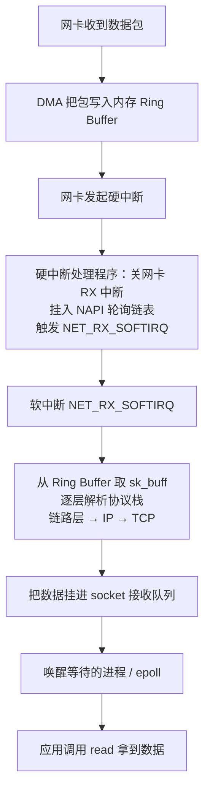

# 软中断是什么？和硬中断有什么区别？

> 硬中断是硬件“敲门”，软中断是内核把“开门后该干的活”推迟、放大、并行去做的那套机制。

## 中断到底解决什么问题

CPU 跑得飞快，外设（网卡、磁盘、键盘、定时器）慢且不可预测。如果没有中断，CPU 只能两种办法感知外设：要么轮询，不停去问“好了没”；要么一直阻塞等。前者浪费 CPU，后者没法干别的事。

中断的本质是**异步通知**：外设准备好、或需要 CPU 介入时，拉一根硬件信号线，CPU 立刻打断当前指令流，跳到内核里预先注册的中断处理程序去处理，处理完再回原来的地方继续跑。这样 CPU 在外设慢活儿期间可以跑别的进程，利用率才上得来。

但中断处理程序有一条铁律：**要短、要快**。原因是中断处理时通常会临时关掉本 CPU 的中断响应（`local_irq_disable`），如果处理太久，期间到来的其他中断要么排队、要么直接丢失。拿外卖打个比方：你跟第一个骑手电话里聊太久，第二个骑手打不进来，单子就丢了。

## 为什么要分上半部和下半部

如果中断处理程序又必须短，又确实有不少“耗时的活”要做（比如把一个网络包走完整个协议栈解析出来），矛盾就出现了：全塞进中断处理程序里，关中断时间太长，丢中断；不塞进去，活又没干完。

Linux 的解法是**把一次中断拆成两段**：

- **上半部（top half）**：硬中断处理程序本身。只做最紧急、和硬件强相关的几件事——确认中断、把数据从设备取进来（常常已经由 DMA 搬好了）、关掉网卡后续中断、然后立刻“触发一个软中断”就把活交出去。跑在中断上下文，本地中断关闭，不能睡眠。
- **下半部（bottom half）**：软中断。处理上半部没干完、耗时但不那么紧急的工作。跑在软中断上下文，本地中断**已经打开**（可以被新的硬中断打断），但仍不可睡眠。

| 维度       | 硬中断（上半部）             | 软中断（下半部）                              |
| ---------- | ---------------------------- | --------------------------------------------- |
| 触发者     | 硬件设备拉信号线             | 内核代码主动 raise                            |
| 执行上下文 | 硬中断上下文                 | 软中断上下文（高负载时由 ksoftirqd 兜底消化） |
| 本地中断   | 关闭                         | 打开                                          |
| 能否睡眠   | 不能                         | softirq/tasklet 不能；workqueue 能            |
| 时延要求   | 极快，越短越好               | 可稍延迟                                      |
| 典型工作   | 应答硬件、关网卡中断、收数据 | 协议栈解析、定时器、调度、RCU                 |

这里有一个资料里常见的**不严谨说法要纠正一下**：

> 有的资料把下半部笼统说成“以内核线程的方式运行”，并以此推出“软中断 = 内核线程”。严格说只有 work queue 是真正跑在可睡眠的内核线程里。softirq 和 tasklet 跑在**软中断上下文**，本质是原子上下文（关抢占、不可睡眠），通常在硬中断返回时由本 CPU 顺势执行；只有当这条“顺势执行”被撑爆、或不在合适的上下文时，才由每 CPU 一个的 `ksoftirqd` 内核线程兜底消化。所以软中断“经常在内核线程里跑”对，但“只能/必然在内核线程里跑”不准确。

软中断也不全是硬件中断的下半部。内核里很多纯软件事件也走软中断：定时器（`TIMER`）、调度（`SCHED`）、RCU 回收（`RCU`）、tasklet 调度等。换句话说，软中断是“内核里一套延迟执行机制”的总称，网络收包的下半部只是它最常被观察到的用法之一。

## Linux 下半部有哪几套机制

下半部不止一种实现，按“能不能睡眠、能不能动态创建、并发性如何”分三档：

| 机制      | 上下文                 | 能否睡眠 | 注册方式       | 并发性                                | 典型用途                                |
| --------- | ---------------------- | -------- | -------------- | ------------------------------------- | --------------------------------------- |
| softirq   | 软中断上下文           | 不能     | 静态编译进内核 | 同类型可在多 CPU 上并发，需重入安全   | `NET_RX`/`NET_TX`/`TIMER`/`SCHED`/`RCU` |
| tasklet   | 软中断上下文           | 不能     | 运行时动态创建 | 同一个 tasklet 全局串行，不必重入安全 | 驱动里零散的延迟活                      |
| workqueue | 内核线程（进程上下文） | 能       | 运行时动态创建 | 多 worker 线程并发                    | 需要睡眠、分配内存、做 IO 的下半部      |

- **softirq**：类型是内核编译期固定死的，就那十来个（`HI`、`TIMER`、`NET_TX`、`NET_RX`、`BLOCK`、`IRQ_POLL`、`TASKLET`、`SCHED`、`HRTIMER`、`RCU`）。因为同一类型的 softirq 能在多个 CPU 上同时跑，处理函数必须自己保证可重入（用自旋锁等）。它性能最高、约束也最强，留给协议栈这种热点路径用。
- **tasklet**：本质是建立在两个 softirq（`HI_SOFTIRQ` 和 `TASKLET_SOFTIRQ`）之上的动态包装。它做了个折中：同一个 tasklet 在任何时刻不会被多个 CPU 同时执行，所以驱动写起来不用操心重入，但代价是丧失了多核并行。需要注意 tasklet 在主线内核里已被长期标记为计划淘汰，新代码一般不再加，要么改用 softirq 加自旋锁，要么直接用 workqueue 或 threaded IRQ。
- **workqueue**：把工作交给内核 worker 线程（`kworker`）执行，跑在进程上下文，可以睡眠、可以持 mutex、可以分配内存、可以做阻塞 IO。这是驱动里需要“等点什么”的下半部首选。现代的 cmwq（concurrency managed workqueue）还能按需动态扩 worker，省心。

一句话记忆：**最快最硬核用 softirq，想偷懒不重入用 tasklet，要睡觉就 workqueue。**

## 网络收包是怎么用上软中断的

这是软中断最经典、也最该背下来的链路。一次网络收包从网卡到应用，硬中断和软中断各干一段：



几个关键点：

- **DMA 先把活干了**：数据不是 CPU 一个字节搬的，网卡通过 DMA 直接把包写进内核预分配的环形缓冲（Ring Buffer），CPU 此时可以干别的，只在写完后被一个硬中断通知。
- **上半部极轻**：硬中断处理程序基本就是“关掉网卡 RX 中断、把网卡挂到 NAPI 轮询链表、raise 一个 `NET_RX_SOFTIRQ`”然后立刻返回。注意它主动关网卡中断——这正是为了避免包风暴下硬中断把 CPU 打爆。
- **NAPI 是“中断 + 轮询”的混合**：第一个包来时走硬中断唤醒，之后驱动切换到轮询模式，在一个 softirq 轮次里批量从 Ring Buffer 拉包（有 budget 上限），拉完或预算耗尽再重新开中断。低负载时省 CPU（靠中断），高负载时省中断、靠轮询扛量。资料里说的“上半部先禁止网卡中断，避免频繁硬中断”，指的就是 NAPI 这套行为。
- **下半部是真正耗时的**：协议栈逐层解析（剥以太网头、IP 头、TCP 头）、校验、组装、把 `sk_buff` 挂进 socket 的接收队列，最后唤醒 `epoll_wait` 的进程——这些都跑在 `NET_RX_SOFTIRQ` 软中断里。

所以要记住：你应用层调 `read` 拿到数据之前，这个包已经先被硬中断接住、再被软中断走完协议栈塞进 socket 队列了。软中断这一段的快慢，直接决定网络延迟和吞吐。

## 生产里怎么定位软中断吃 CPU

软中断看不见摸不着，但有几个直接证据：

```bash
# 看每种软中断在各 CPU 上的累计次数
cat /proc/softirqs

# 实时看次数"变化速率"，比静态值有用得多
watch -d cat /proc/softirqs

# 看硬中断累计次数
cat /proc/interrupts

# top 里 si 列 = 软中断占 CPU 的百分比
top
```

排查思路：

1. **`top` 里 `si` 列高**，或者占用最高的进程是 `ksoftirqd`，基本可以判定开销压在软中断上。
2. **`watch -d cat /proc/softirqs`** 看哪一类在猛涨。Web / 网关类服务几乎都是 `NET_RX` 涨得最快。
3. 若是 `NET_RX`，用 `sar -n DEV` 看是哪块网卡在灌包，再用 `tcpdump` 抓包定性：非法流量上防火墙，正常流量打满就是该扩容或调优了。

一个常被忽略的坑是**软中断全压在一个核上**。多队列网卡（RSS）把不同 RX 队列的中断绑到不同 CPU，软中断也就自然分散；但如果网卡只有一队列、或中断亲和性没配，所有收包都走一个 CPU 的 `ksoftirqd`，这一个核被打到满 `si`，别的核闲着，整体吞吐也上不去。这时就要靠软件分流：

- **RPS（Receive Packet Steering）**：在软中断层把收到的包按 hash 派发到其他 CPU 的 backlog，让多个核一起跑 `NET_RX`。不需要多队列网卡，纯软件，适合网卡队列少、单核软中断瓶颈的场景。
- **RFS（Receive Flow Steering）**：在 RPS 基础上，把包派发到“正在处理这个 socket 的应用线程”所在的 CPU，提升 cache 命中。aRFS 是其硬件加速版本。
- 配合**中断亲和性**（`/proc/irq/<irq>/smp_affinity`）把硬中断也分散，从源头均衡。

| 手段       | 作用层          | 解决什么                         |
| ---------- | --------------- | -------------------------------- |
| RSS        | 网卡硬件多队列  | 硬中断从源头分散到多 CPU         |
| 中断亲和性 | 硬中断路由      | 指定某 RX 队列中断绑哪个 CPU     |
| RPS        | 软中断层        | 单队列网卡也能把收包处理分多核   |
| RFS        | 软中断层 + 应用 | 把包送到跑应用线程的核，提 cache |

## 和 Java/Netty 有什么关系

很多 Java 同学的认知停在“Netty = epoll + EventLoop”，再往下就断了。但 epoll 能不能及时拿到事件，前提是软中断已经把包送进 socket 接收队列。软中断这一层一旦慢或歪了，epoll 写得再漂亮也救不了。

几条实践认知：

- **EventLoop 线程和收包 CPU 的亲和性很关键**。理想链路是：某 RX 队列硬中断 → 某 CPU 跑 `NET_RX` 软中断 → 该包对应 socket 的数据落这个 CPU 的 cache → 跑在这个 CPU 上的 Netty EventLoop 线程 `epoll_wait` 命中、`read` 命中。一旦软中断在 A 核、EventLoop 线程在 B 核，每次都要跨核搬 cache，延迟和抖动都上来。这正是 RFS 要解决的，也是生产里给 Netty 的 EventLoop 线程做 CPU 绑核的意义所在。
- **为什么高并发网络服务必须盯软中断**：连接数再大，只要收包处理被单核软中断卡住，整个服务的 P99 就抖。先用 `top` 的 `si` 和 `/proc/softirqs` 判断软中断是不是瓶颈、是不是分布不均，再去优化 Netty 的线程模型和业务线程池，顺序别反。
- **别把内核侧和用户侧的优化混为一谈**。软中断、NAPI、RPS/RFS 都在内核侧决定“包怎么进 socket”；Netty 的直接内存、零拷贝、Pipeline、业务线程池在用户态侧决定“数据拿到后怎么搬、怎么处理”。内核侧没调好，用户态再优化也补不回延迟。

## 小结

- 中断是外设异步通知 CPU 的机制，处理程序必须短快，否则关中断期间会丢中断。
- Linux 把中断拆成上半部（硬中断，关中断、不可睡眠、极快）和下半部（软中断，开中断、可稍延迟）。
- 下半部有三套：softirq（静态、可重入、最热路径）、tasklet（动态、串行、已计划淘汰）、workqueue（可睡眠、最常用）。
- 网络收包走 硬中断 + NAPI 轮询 → `NET_RX_SOFTIRQ` 软中断走协议栈 → socket 队列 → 唤醒 epoll。
- 排障看 `top` 的 `si`、`/proc/softirqs` 的变化速率；软中断单核瓶颈用 RPS/RFS 和中断亲和性分散到多核。

## 参考

综合 Linux 内核源码中软中断、tasklet、workqueue 的实现，内核网络协议栈关于 NAPI、RPS、RFS 的公开文档，以及 epoll、`/proc/softirqs` 等运维接口的 man 页与社区资料整理，并对部分通俗描述做了准确性修正。
