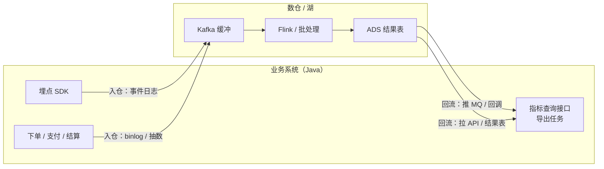

# Java 业务系统怎么对接数仓？埋点、CDC 和指标回流怎么设计？

> 对接是两个方向的事：**入仓**决定数仓能不能算对，**回流**决定业务能不能用好。前者技术味重、人人都讲；后者一旦设计错了，用户看到的就是"昨天下的单今天还没统计进去"或者"两个入口差了 8 个点"。

## 先把两个方向摆清楚



| 维度     | 入仓                             | 回流                                      |
| -------- | -------------------------------- | ----------------------------------------- |
| 谁发起   | 业务库或客户端推，数仓被动收     | 数仓推，或业务系统主动拉                  |
| 时效     | 秒级到 T+1 都能接受              | 用户在看，通常要求毫秒到秒                |
| 谁兜底   | 数仓侧重跑、补偿、对账           | 业务侧要幂等、降级、兜底文案              |
| 典型事故 | 字段漂移、重复、丢数、口径不一致 | 拿到旧口径、缓存没失效、把 draft 当 final |
| 常见问法 | 三条入仓路怎么选、CDC 有哪些坑   | 版本怎么生效、数还没算出来界面显示什么    |

入仓讲的是"数据怎么来"，回流讲的是"结果怎么用"，中间隔着一个**一致性窗口**——业务库写成功了，数仓还没算出来。这一段在面试里最能分出高低，因为它是产品和技术一起失守的地方。

## 入仓三条路：延迟、压力、口径风险各不相同

| 路径        | 延迟           | 对业务库压力                | 口径风险                                     | 适用场景                                 |
| ----------- | -------------- | --------------------------- | -------------------------------------------- | ---------------------------------------- |
| 埋点 / 日志 | 秒级到分钟级   | 几乎为零（走网关/日志采集） | 只有客户端能看到的动作才准；漏埋、重复、脏值 | 点击流、曝光、漏斗、页面性能、App 行为   |
| 业务库 CDC  | 秒级（近实时） | 读 binlog，主库压力小于抽数 | 只反映落库结果，中间态丢失；DDL 一变就断     | 订单、支付、库存等"必须与业务库逐行一致" |
| 批量抽数    | T+1 及以上     | 高（全表扫、大查询占用 IO） | 抽数窗口与业务改数时间打架，重跑易翻倍       | 历史同步、维表、T+1 报表、小表全量       |

三条路的本质区别是**你把压力放在了哪里**：埋点把压力放在客户端和服务端上报链路上，换来最丰富的用户行为；CDC 把压力放在数据库日志和解析服务上，换来与业务库的强一致；批量抽数把压力放在业务库的查询能力上，换来实现最简单。

一条经验线：**结果要和钱、库存、合同对得上，走 CDC；只有人和设备才产生的行为，走埋点；剩下的 T+1 场景，抽数最省心。**

## 埋点：事件模型先定，再谈发送

埋点最容易犯的错是"先埋点、后想模型"，埋到第三个版本发现每个事件的字段名都不一样，下游只能一个事件写一段 SQL。先用五个维度把事件模型钉死：

| 维度  | 字段示例                             | 说清楚什么                                 |
| ----- | ------------------------------------ | ------------------------------------------ |
| who   | `user_id`、`device_id`、`session_id` | 既能按人算，也能在未登录时按设备算         |
| when  | `event_time`、`receive_time`         | 一个是用户发生时刻，一个是服务端收到时刻   |
| what  | `event`、`page_id`、`action`         | 事件名要稳定，别用"按钮 3 被点了"这种描述  |
| props | `order_id`、`pay_amount`、`channel`  | 业务属性放 props，通用属性放主字段         |
| 版本  | `schema_ver`、`app_version`          | 语义变更要靠它区分，不然新旧数据混在一起算 |

```json
{
  "event_id": "9f2c1b4e-7a55-4f2e-9b0a-2c6d8e1f3a10",
  "event": "order_pay_success",
  "event_time": "2026-11-16T10:21:33.482+08:00",
  "user_id": 100234,
  "device_id": "d-8a71",
  "app_version": "6.4.2",
  "schema_ver": 3,
  "props": { "order_id": "SO20261116001", "pay_amount": 129.0, "pay_channel": "alipay" }
}
```

`event_id` 必须是**客户端生成、重发时不变**的 UUID，这是整条链路唯一的去重依据；`props` 里放业务键，让数仓能拿埋点和业务库对账（比如用 `order_id` 把支付事件和订单表 join 起来）。

**埋点四问，问不出来就别开工**：谁产生这条数据（客户端 / 服务端 / 第三方回调，决定了数据可信度）；粒度是什么（一次点击还是一次会话封口，决定了能不能相加）；怎么去重（`event_id` 还是业务键，决定了下游聚合的写法）；口径谁签字（指标 owner 是谁，决定了改定义时听谁的）。

## 埋点的三笔债：时间、重复、字段

**第一笔债是时间。** 客户端时钟能被用户改、能被越狱插件伪造、能返回 1970，所以三个时间要分清楚用：

| 时间           | 来源       | 该用它做什么             | 用错会怎样                                 |
| -------------- | ---------- | ------------------------ | ------------------------------------------ |
| `event_time`   | 客户端     | 业务归属（这一天算谁的） | 时区或时钟错乱，数据跑到未来或被永远过滤掉 |
| `receive_time` | 服务端网关 | 分区、水位线、延迟监控   | 拿它切窗口，离线补传的数据全算到晚到那天   |
| 处理时间       | 计算引擎   | 只用于排障与延迟分析     | 做业务窗口必然随任务重跑而变，结果不可复现 |

工程上的做法是**双写双用**：`event_time` 做业务归属但先做钳制（超前当前时间或早于 `app_version` 发布日的，标 `time_suspect`），`receive_time` 做分区和水位线。乱序与迟到在埋点这里比业务库严重得多——客户端断网会在本地排队几小时再批量上报，所以流式只能给"截至此刻"的临时数，**日粒度指标必须允许 T+1 重算**，水位线和迟到流的处理方式见[实时链路怎么保证不丢不重](/database/datawarehouse/dw-realtime-pipeline.html)。

**第二笔债是重复。** 上报重试、SDK 重发、Kafka 重复投递都会让同一条事件出现多次。去重节点必须放在**明细层**，而不是在最后聚合时想办法：`SUM(pay_amount)` 对重复零容忍，`COUNT(DISTINCT user_id)` 天然幂等——只要有一个可加度量，重复就会直接变成虚高。幂等键分两种：有 `event_id` 就按它建明细表主键、写入用 upsert，重放多少次都只有一行；没有 `event_id`（第三方支付回调、服务端自造事件）就用业务键，如 `(order_id, 'paid', status_version)`，并让状态机保证同一状态只发一次。重复消费在消费侧怎么兜，思路和[消息幂等怎么保证](/high-performance/high-performance-message-idempotency.html)是同一套：幂等键 + 唯一约束 + 状态机，别指望 MQ 只投一次。

**第三笔债是字段。** 埋点 schema 只允许"加"，不允许"改"：

| 变更类型     | 能不能原地做 | 正确做法                                            |
| ------------ | ------------ | --------------------------------------------------- |
| 加可选字段   | 可以         | 老数据为 NULL，下游必须按"缺省即未知"处理，不能当 0 |
| 改字段语义   | 不行         | 换新字段名 + 双写过渡期 + 指标口径升版本            |
| 改类型或单位 | 不行         | 新字段带单位后缀，如 `pay_amount_cent`，旧字段保留  |
| 删字段       | 别删         | 标 `deprecated`，等所有下游迁移完再下线             |
| 枚举加值     | 可以但要说   | 下游必须允许未知值透传，别写死 switch 直接抛异常    |

至于**丢失**：客户端要有本地队列和指数退避重试，服务端上报失败要落本地文件由补偿任务重放；关键事件（支付成功、签约）建议双通道——埋点一条、业务库事件表一条，用 `order_id` 对账，两边的缺口才看得见。埋点覆盖率要监控，最土的办法也最有效：拿支付事件数和订单表的支付单量按小时对比，比值突变就是链路出了问题。

## CDC：ROW 格式只是入场券

CDC 的坑几乎都在"日志里有什么、没什么"上：

| 配置                       | 必须的值                                   | 不这么配会怎样                                                                               |
| -------------------------- | ------------------------------------------ | -------------------------------------------------------------------------------------------- |
| `binlog_format`            | `ROW`                                      | `STATEMENT` 只记 SQL，`amount = amount + 1` 下游还原不出结果；`MIXED` 更坑，出错时才变行镜像 |
| `binlog_row_image`         | `FULL`                                     | `MINIMAL` 只记变更列，拿不到完整前镜像，整行比对和排序都没法做                               |
| `binlog_row_value_options` | 别开 `PARTIAL_JSON`                        | JSON 列只记差量，解析方不合并就是残缺值                                                      |
| 账号权限（Canal 一类）     | `REPLICATION SLAVE` + `REPLICATION CLIENT` | 权限不够连不上，报错还很不直观                                                               |

**DDL 要能传播。** 业务方加一列，如果 CDC 的 schema 缓存没更新，下游就会按旧列序解析，把 `phone` 塞进 `address` 里——数据全对、字段全错，最贵的一种错。Debezium 把 DDL 记在 schema history topic 里，Canal 记在 `meta.dat`，本质上都是"让 parser 能感知表结构变化"。工程纪律是 DDL 走审批 + 通知数据侧 + 按"先加列（下游忽略）→ 双写 → 再删列"三步走，别让业务同学半夜在线改表。

**大事务是流量洪峰。** 一句 `UPDATE t SET flag = 1 WHERE create_time < '2026-01-01'` 影响几百万行，在 binlog 里仍是一个事务：CDC 侧要一次性缓冲整段事件，Kafka 里可能变成一条超过 `max.request.size` 的巨型消息。业务侧要拆批（每批几千行 + 让出 CPU），数据侧要调 `max.batch.size` / `max.queue.size`，两边都得改。

**全量快照 + 增量切换靠位点对齐。** 位点和快照数据必须来自同一个一致性点：先取 binlog 位点，再在同一事务视图里读快照，之后从该位点续读增量。Debezium 默认 `snapshot.locking.mode=minimal`，只在读 schema 和取位点的那一瞬间加全局读锁，快照数据本身靠 `REPEATABLE READ` 的一致性读；改成 `extended` 会对整段快照持锁，一致但阻塞写入；`none` 不加锁，得自己确认期间没有 DDL 和长事务。位点错位的结果只有两种：**漏一段（快照后、位点前的变更没人管）或者重一段（位点后的变更算两次）**。顺便一提，连从库读 binlog 要求从库开 `log_slave_updates=ON`，不开就只能连主库。

**删除有语义，别只当 `op = 'd'`。** 物理删在 CDC 里是一条删除事件，下游必须留足够久的墓碑，否则旧事件晚到会把已删的行"复活"——这是典型的重放乱序问题，解法是主键分区保序 + 按源端时间戳/版本比较后再 upsert。软删（`is_deleted = 1`）只是普通更新，好处是能留历史、能做拉链表（见[缓慢变化维与拉链表怎么设计](/database/datawarehouse/dw-scd-zip-table.html)），代价是所有指标都得记得过滤，漏一个就是虚高。

**顺序问题只在同一个 key 内重要。** 跨用户乱序无所谓，但同一行的多次变更必须有序，所以 Kafka 分区键要用主键；即使如此，at-least-once 投递仍会重复，写入侧还是要靠主键 upsert + 版本比较收敛，重复与去重的完整做法见[离线数据管道怎么设计和运维](/database/datawarehouse/dw-offline-pipeline.html)里的主键去重那一节。

## 指标回流：推还是拉，版本怎么生效

| 方式            | 形态                                   | 时效         | 适合                                   | 代价                                      |
| --------------- | -------------------------------------- | ------------ | -------------------------------------- | ----------------------------------------- |
| 推（MQ / 回调） | 指标算完发 topic 或回调业务接口        | 秒级到分钟级 | 触发动作：额度调整、名单同步、佣金通知 | 业务方要幂等消费；失败要重试 + 死信       |
| 拉（查询 API）  | 业务系统带维度查数仓接口               | 按需         | 详情页展示分群、评分、画像标签         | 接口 P99 被数仓拖住，必须缓存 + 降级      |
| 结果表直查      | 结果表同步到业务库同实例，或走物化视图 | 准实时到 T+1 | 榜单、画像这类高频读                   | 跨库直连就是耦合，DDL、权限、连接池都得管 |
| 反向回写        | 数仓结果按主键写回业务库小表           | T+1 / 小时级 | 业务要拿它跟本地表 join、要事务        | 只能写独立表，绝不能覆盖业务字段          |

**推的坑是重复和顺序**：MQ 至少一次，业务侧必须有幂等键（通常是 `业务ID + 指标编码 + 数据截止时间`）；**拉的坑是缓存**：Redis 的 key 必须带 `metric_version` 和 `data_as_of`，TTL 不能超过下一个数据截止时间——否则用户会在 23:59 看到早上 6 点的数还以为没更新。

**口径版本是这个环节最容易漏的**。同一个指标换了算法，三件事要一起定：

| 问题             | 做法                                                                                                         |
| ---------------- | ------------------------------------------------------------------------------------------------------------ |
| 新版本从哪天生效 | 落 `metric_version` + `effective_from`，生效日之后按新口径算，之前不动                                       |
| 历史要不要重算   | 分两类：口径**纠错**必须重算 + 公告 + 重出报表；口径**优化**默认只影响未来，历史保留旧版本，趋势图上要标断点 |
| 下游缓存怎么失效 | 缓存 key 带版本号，切换时按版本前缀批量失效，绝不按时间模糊删                                                |

版本、生效日、双跑校验的完整流程见[指标体系怎么建](/database/datawarehouse/dw-metric-system.html)。另外别忘了**实时看板和结算必须是两条链路**，口径靠日终对账拉齐——大屏要秒级、允许近似，结算要可复现、可重算，把它们合成一条，要么大屏慢到没人看，要么结算单里混进"当时恰好在线"的数据。能源侧的这条实践见[采集数据怎么变成报表和结算单](/energy/energy-data-pipeline.html)。

## 一致性窗口：数还没算出来，界面该说什么

```text
T0  业务库写入成功，用户看到"提交成功"
T1  数据对业务可见（事件到达 Kafka 或落到明细表）—— 秒级到分钟级
T2  指标就绪（批次跑完，data_as_of 推进）—— 分钟级到 T+1
```

T0 到 T2 之间是**一致性窗口**，产品有三种负责任的做法：显式给出数据截止时间（"统计截至 11-16 06:00，T+1 更新"）、对刚发生的单据给明确状态（"本单 T+1 计入，当前显示不含本单"）、对尚未出数的指标给空态而不是 0。最不该做的是把它包装成"准实时"——用户一旦发现数字会偷偷变，就不再相信任何一个数。

接口层面建议所有取数响应都带三个字段：`data_as_of`（数据截止到哪一刻）、`metric_version`（这数是哪版口径算的）、`is_final`（是否会再变）。值班排障时这三个字段能直接回答"为什么你的页面和我的页面不一样"。

## 批量导出：最容易被低估的一段工程

导出看着只是"查出来写文件"，实际要处理从库负载、超大结果集、任务重跑和文件泄露：

```java
@Transactional
public ExportTask submit(ExportRequest req) {
    String key = DigestUtils.md5Hex(req.normalized());        // 同参数重复提交 = 同一任务
    ExportTask old = taskMapper.selectByKey(key);
    if (old != null && old.isRunning()) return old;           // 幂等：不重复跑
    ExportTask task = taskMapper.insertOrGet(ExportTask.pending(key, req, currentUser()));
    exportExecutor.submit(() -> run(task));                   // 异步执行，HTTP 立刻返回 taskId
    return task;
}

void run(ExportTask task) {
    long lastId = task.getCursor();                           // 断点续传：上次停在哪一行
    try (CsvWriter out = openAppend(task.getTmpPath())) {
        while (true) {
            List<Row> rows = slaveMapper.pageById(lastId, 1000);   // keyset 分页，不用 offset
            if (rows.isEmpty()) break;
            out.write(rows);
            lastId = rows.get(rows.size() - 1).getId();
            taskMapper.saveCursor(task.getId(), lastId);       // 每批落一次游标
            rateLimiter.acquire(rows.size());                  // 行级限速，别打崩从库
        }
        storage.commit(task.getTmpPath(), task.getFinalPath());     // 原子切换，读者看不到半成品
        taskMapper.markDone(task.getId());
    } catch (Exception e) {
        taskMapper.markFailed(task.getId(), e.getMessage());
        alert.fire("export failed: " + task.getId());
    }
}
```

几个不能省的点：**从只读副本读**，并用独立的账号和连接池，别让一个大导出把线上业务拖慢；**游标分页**，`LIMIT 1000000, 1000` 会先扫掉前 100 万行，按主键 `WHERE id > ?` 才是稳定的，要并行就按主键区间切分片、再在全局限速器上收敛；**任务表就是状态机**（PENDING / RUNNING / DONE / FAILED），分片进度和游标一起落库，失败带原因、可重试；**超大结果集别同步返回**，异步跑完给带签名的下载链接（设 TTL，比如 24 小时），超过一定行数拆文件或直接给流式 CSV。

## 权限与审计：导出是最容易出事的地方

| 手段       | 该落在哪                                         | 常见坑                                         |
| ---------- | ------------------------------------------------ | ---------------------------------------------- |
| 字段级脱敏 | 查询出口：视图、语义层或统一取数服务             | 建表时就把手机号写死成掩码，下游要原值只能重跑 |
| 行列权限   | 行按租户/站点注入 `WHERE`，列走字段黑名单 + 审批 | 只在前端隐藏列，接口照样返回全量字段           |
| 审计日志   | 谁、何时、什么条件、导了多少行、文件 hash        | 只记"登录过"，出事后查不到谁把全量客户导走了   |
| 测试数据   | 造数 + 生产数据脱敏抽样（不可逆哈希、泛化）      | 直接 dump 生产库进测试环境，一次泄露就是全量   |

导出的管控还要加两条：**行数上限 + 审批**（超过 N 行转人工，这个 N 由业务定），**文件水印与有效期**（下载链接带操作人标识、过期即失效）。手段细节见[数据脱敏和字段加密怎么落地](/system-design/security/security-data-masking-encryption.html)。

## 选型：三句话

只有 T+1、表量不大、团队里没人专职守流任务，DataX 或自研游标抽数加调度器最省事；要秒级（风控、大屏、个性化）就上业务库 CDC + Kafka + Flink，别用"定时扫 `update_time`"假装实时——扫不出删除、扫不出中间态，高峰延迟还不可控；**别自己写 binlog 解析**，握手、CRC 校验、GTID、DDL、字符集、压缩 binlog、半同步位点这些坑 Debezium / Canal / Flink CDC 都替你踩完了。

## 面试怎么答

四段，每段一句话立论 + 一个具体细节，比罗列工具名有效得多：

1. **入仓三条路**：埋点（行为，客户端产生）、CDC（交易，与业务库逐行一致）、抽数（T+1 与历史）；选型看"要不要秒级"和"谁维护流任务"。
2. **两条链各挑两个坑**：埋点是 `event_id` 幂等与客户端时间不可信，再加上 schema 只能加不能改；CDC 是 `ROW`/`FULL` 的日志前提、DDL 传播、快照与位点一致性、物理删与软删的不同表达。
3. **指标回流**：推用于触发动作、拉用于页面展示，缓存 key 带 `metric_version` + `data_as_of`；口径变更要定生效日、定历史是否重算、按版本前缀失效缓存。
4. **一致性窗口与对账**：接口回 `data_as_of`、`metric_version`、`is_final`，界面明说"截至"；实时看板与结算两条链路靠日终对账拉齐。

常见追问三个：**为什么数仓的数和业务库对不上**（一致性窗口 + 时区 + 软删没过滤 + 口径版本不同）；**重复埋点会不会让 GMV 翻倍**（会，所以去重必须在明细层，可加度量对重复零容忍）；**能不能直接读从库 binlog**（能，但要开 `log_slave_updates`，且要接受主从延迟带来的位点复杂度）。

## 容易踩的坑

- 拿 `receive_time` 当业务时间切窗口，客户端离线补传的数据全算到晚到那天，日报对不上、月报反而对得上。
- 埋点去重放在汇总层，用 `SUM(pay_amount)` 消重——可加度量一重复就翻倍，而且看起来像业务暴涨。
- CDC 没配 `binlog_format=ROW` / `binlog_row_image=FULL`，或者用 `MIXED` 图省事，出问题时数据是残缺的、日志是"有时是 SQL"的。
- 快照位点与全量数据不是同一个一致性点，切换时漏一段或重一段，通常在对账日才发现。
- 物理删不留墓碑，重放的旧事件把已删行写回来；软删忘了在指标里过滤 `is_deleted`，虚高一半。
- 缓存 key 不带 `metric_version`，口径切了但用户还在看旧数，且没有任何报错。
- 导出用 `LIMIT offset` 深翻页 + 同步返回，大客户一导就把从库和 Tomcat 线程一起打满。

## 小结

1. 对接是两个方向：**入仓**决定能不能算对（埋点 / CDC / 抽数三条路，压力位置不同），**回流**决定能不能用好（推 / 拉 / 结果表 / 回写）。
2. 埋点靠 `event_id` 在明细层去重，`event_time` 做业务归属、`receive_time` 做分区与水位；schema 只能加可选字段，改语义就换新字段并升口径版本。
3. CDC 的前提是 `ROW` + `FULL` 的 binlog，真正难的是 DDL 传播、大事务洪峰、快照与位点同一一致性点、删除语义和同 key 内的顺序。
4. 回流要带 `metric_version` + `effective_from` + `data_as_of`：口径变更定生效日、定历史是否重算、按版本前缀失效缓存；看板与结算两条链路靠日终对账拉齐。
5. 一致性窗口要显式告知用户，接口回 `data_as_of` / `metric_version` / `is_final`；批量导出走从库 + 游标分页 + 异步任务 + 审计，别用 offset 和同步下载。

## 参考

本仓库 `docs/` 下没有业务系统与数仓对接方向的内部资料，本篇以工程事实为准，综合自 Apache Flink CDC / Debezium（MySQL connector 对 `binlog_format=ROW`、`binlog_row_image=FULL` 的硬性要求，`snapshot.locking.mode` 的 `minimal` / `extended` / `none` 三种快照加锁语义，schema history 与 at-least-once 投递）、Canal（伪装 MySQL slave 所需的 `REPLICATION SLAVE` / `REPLICATION CLIENT` 权限、`meta.dat` 位点）、MySQL 官方文档（binlog 三种格式的差异、`binlog_row_value_options` 的 `PARTIAL_JSON`、从库读 binlog 需要 `log_slave_updates`）、DataX 与常见调度器的批量抽数实践，并做了核对与改写：把"埋点去重"落到可加度量与去重粒度的关系上，把"CDC 的坑"归到日志内容与一致性位点两类根因，把"指标回流"拆成推拉形态、缓存失效与口径版本三件事。站内与[离线数仓链路怎么搭](/database/datawarehouse/dw-offline-pipeline.html)、[实时链路怎么保证不丢不重](/database/datawarehouse/dw-realtime-pipeline.html)对齐入仓的分层与幂等口径、不重复其调度与 checkpoint 细节；[消息幂等怎么保证](/high-performance/high-performance-message-idempotency.html)提供消费侧幂等的通用做法，[湖仓一体解决什么问题](/database/datawarehouse/dw-lakehouse.html)承接"入仓之后存哪里"，[采集数据怎么变成报表和结算单](/energy/energy-data-pipeline.html)提供双链路对账的业务实例，[数据脱敏和加密](/system-design/security/security-data-masking-encryption.html)承接字段级管控。文中的事件 JSON、表名、版本号、行数阈值与任务状态均为占位，落地时按实际环境替换；导出批大小、限速阈值之类的经验值需按副本规格与字段宽度实测。
