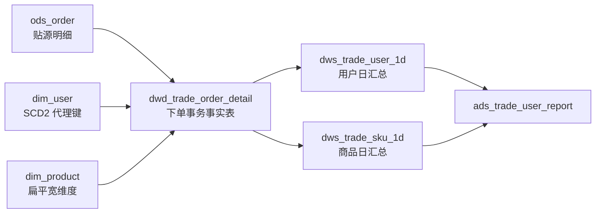

# 维度建模怎么落到数仓里？事实表和维度表怎么设计？

> 维度建模不是画 ER 图，而是先把「业务过程」和「粒度」用一句话钉死，再围绕它挂维度、挂度量。粒度钉错了，后面每一层都是歪的。

## 不建模，数仓会烂成什么样？

**宽表满天飞。** 报表要「用户 + 订单 + 商品 + 退款」，开发就 join 成一张 200 列的大宽表；下个需求换个组合，再写一张 180 列的。三个月后十几张字段大面积重叠、口径各不相同的表，没人敢删，也没人说得清哪张准。

**同一个指标三个数。** 「昨日成交额」在订单报表是 128 万、财务是 119 万、驾驶舱是 131 万。查一天才发现：一个按 `create_time` 过滤、一个按 `pay_time`、一个把运费也算进去、还有一个没剔除测试单。再加上源库商品表加个 `spu_id`、`order_status` 从数字改成字符串，没有中间层兜着，直连 ODS 的 SQL 全红。

| 症状         | 直接原因                     | 建模治的是哪一块                     |
| ------------ | ---------------------------- | ------------------------------------ |
| 宽表满天飞   | 一个需求一张表，没有公共维度 | 一致性维度 + 总线矩阵，维度只建一次  |
| 指标算不一致 | 口径散落在各条 SQL 里        | 度量定义沉到 DWD/DWS，上层只筛选聚合 |
| 变更冲击下游 | 直接读源表结构               | ODS→DWD 做屏蔽层，粒度稳定           |
| 无法下钻     | 只存了汇总                   | DWD 保留最细粒度                     |

建模真正解决的是三件事：**口径唯一、粒度稳定、维度可复用**，不是「图好看」。

## 建模四步法怎么走？

标准流程四步：**选业务过程 → 声明粒度 → 确定维度 → 确定事实**。顺序不能换，后一步依赖前一步的结论。

**① 选业务过程。** 业务过程是「业务上真实发生、并且会产生度量的一件事」，不是部门、不是报表、不是主题域。是业务过程的：下单、支付、发货、签收、退款、加购、评价、领券；不是的：「用户分析」「商品域」——那是分析主题，一个主题横跨好几个业务过程。一个业务过程通常对应一张事务事实表，所以先挑「下单」这一个动作，别一上来就想做整个交易域。

**② 声明粒度。** 一句话说清**这张表的一行代表什么**，要具体到被人反问不倒：一行 = 一个订单（订单头粒度），一行 = 一个订单里的一个 SKU（明细粒度）。写完就写进表注释，它是后面所有 join 和聚合的地基。

**③ 确定维度。** 维度回答「谁、什么、何时、何地、如何」：日期、用户、商品（SKU/SPU）、门店或仓、渠道、优惠券。判断标准是**描述性、相对稳定、你可能按它分组**。金额是度量不是维度；订单号没有属性，是退化维度。

**④ 确定事实。** 事实是业务过程产生的数值度量：件数、单价、订单金额、优惠金额、运费、分摊后金额。

四步走完，一行数据长这样：

```text
order_detail_id | order_id | date_key | user_key | product_key | sku_num | split_amount | freight
d20240602001    | O1001    | 20240602 | 88213    | 5510        | 2       | 100.00       | 0.00
```

## 粒度为什么必须最细？

因为**聚合是单向的**：日能上卷成月，月永远回不到日。DWD 只存汇总，等于放弃了「以后想按新维度切一刀」的可能，而这种需求一定会来。

用数字说明定错的代价。订单 `O1` 有两行明细：SKU-A 100 元、SKU-B 200 元，订单头 `order_amount = 300`。

- 在**订单头粒度**表里算 `avg(order_amount)`：一行 300，均值 300，对。
- 在**明细粒度**表里直接 `avg(order_amount)`：这个订单两行都是 300，看着也对；可下一个订单 `O2` 只有一行 50 元，均值就成了 (300+300+50)/3 = 216.7，正确答案是 (300+50)/2 = 175。**长订单被按明细行数加了权**。

正确写法是 `sum(order_amount) / count(distinct order_id)`，或者在订单头粒度上算。这就是「粒度决定算法」，不是风格问题。还有一个工程事实：明细表里要冗余订单级金额，必须做**分摊**（allocation），否则 `sum()` 翻倍——上例把 30 元订单级优惠按金额比例摊到两行是 10 元和 20 元，`100 + 200 = 300` 才和订单头对上，这就是事实表里常见 `split_amount`（分摊后金额）的原因。

## 事实表就三种，怎么选？

| 对比项     | 事务事实表           | 周期快照事实表           | 累积快照事实表                 |
| ---------- | -------------------- | ------------------------ | ------------------------------ |
| 一行代表   | 一次业务动作         | 某时点/周期末的实体状态  | 一个流程实例的完整生命周期     |
| 写入方式   | 只追加，不改历史     | 每周期追加一批           | 随流程推进更新同一行           |
| 度量可加性 | 通常全可加           | 多为半可加（余额、库存） | 阶段耗时、里程碑标志，可加性差 |
| 典型表     | 下单明细、支付流水   | 每日库存、每日账户余额   | 订单全流程、工单全流程         |
| 擅长回答   | 发生了什么、发生多少 | 到某时点还剩多少         | 流程卡在哪、各阶段多久         |
| 主要短板   | 状态问题要靠事件回推 | 只能看快照点，看不到过程 | 依赖更新能力，离线实现麻烦     |

**事务事实表**是主力：一次动作一行、只增不改，重跑用 `insert overwrite` 覆盖当天分区，天然幂等。**周期快照事实表**解决「存量」：流水能算「今天卖了多少」，但算不出「今天 24 点仓库还剩多少件」，那要每天给库存拍一张照；它的度量是半可加的，跨 SKU 能求和，跨日期求和是垃圾数。

**累积快照事实表**一行跟到底，字段是一排时间戳：`order_id`、下单时间、支付时间、发货时间、签收时间、下单到支付时长、支付到发货时长。它能直接回答「支付转化率」「平均发货时长」，不用把事件表拼来拼去。代价是**要更新**：Hive 默认的非事务表不支持原地 `update`，离线落地一般两种做法——按天整分区重刷全量最新状态，或者每天存一份带 `dt` 的快照（用存储换更新能力）。还有一种**无事实的事实表**：只存外键，度量靠 `count(*)`，比如「每天哪些用户到店签到」，用来算覆盖和触达。

## 维度表怎么设计？

**代理键还是自然键。** 自然键是源系统的业务键（`user_id`、`sku_id`），长度不定、可能被复用或清洗合并；代理键是维度表自己生成的整数，分配后不再变。

| 项            | 自然键                     | 代理键             |
| ------------- | -------------------------- | ------------------ |
| 来源          | 源系统业务字段             | 维度表生成         |
| 稳定性        | 可能被复用、格式变、被合并 | 一旦分配永不变     |
| 能否支撑 SCD2 | 难，同一业务键多个版本     | 天然支持，一版一键 |
| 事实表存哪个  | 仅做追溯                   | 存这个，join 维度  |

为什么要代理键：用户改了手机号、换了城市，按 SCD2 保留历史后 `dim_user` 里同一个 `user_id` 就有两行（`start_date`/`end_date` 不同）。事实表存 `user_id`，join 必然多对多；存 `user_key` 才能精确指到「下单那一刻的那个版本」。Hive/Spark 没有自增列，常见生成方式：Spark SQL 用 `xxhash64(concat_ws('|', user_id, start_date))` 或 `monotonically_increasing_id()`，Hive 用 `crc32(...)`、`hash(...)`。**要重跑幂等就选哈希类**——同样输入永远同样键；自增 id 每次重跑都变，全量重刷后事实表和维表直接对不上。

**退化维度：订单号直接放事实表。** 订单号没有可被分组的描述性属性，硬建 `dim_order` 只多一次 join，换不来任何东西。判断标准就一句：这个键有没有描述性属性？有就建维度表，没有就退化进事实表。

**维度属性冗余的取舍。** `dim_product` 里存不存 `category_name`、`brand_name`？冗余：少一层 join，写 SQL 的人不用背表关系，代价是类目改名要回刷维表；拆出去：类目品牌独立演化时更干净，代价是每次分析多 join 两三层。工程上默认**冗余**——变化频率低、被高频查询、字段不多就摊平，理由和偏爱星型是同一个。

**一致性维度与总线矩阵。** 一致性维度指同名、同含义、同取值的一套维度（同一张 `dim_user`、同一张 `dim_date`），被交易、流量、营销、履约共用。

| 业务过程 | 日期 | 用户 | 商品 | 门店/仓 | 优惠券 |
| -------- | ---- | ---- | ---- | ------- | ------ |
| 下单     | ✓    | ✓    | ✓    | ✓       | ✓      |
| 支付     | ✓    | ✓    | ✓    |         | ✓      |
| 退款     | ✓    | ✓    | ✓    |         |        |
| 加购     | ✓    |      | ✓    |         |        |

这张表就是**总线矩阵**：行是业务过程，列是一致性维度，逼你在动手前想清哪些维度要共享。如果交易域的 `dim_user` 和流量域的 `user_dim` 是两张表、口径还不一样，那「看过详情页的用户转化率」永远算不准——不是 SQL 写得不好，是模型从根上断了。顺带一个词：`dim_date` 常被用多次（下单日期、支付日期、发货日期），叫**角色扮演维度**，物理上只有一张表，查询时用别名区分。

## 星型还是雪花？

| 对比项    | 星型                       | 雪花                             |
| --------- | -------------------------- | -------------------------------- |
| 维度形态  | 一张扁平宽维度，属性全摊平 | 维度继续规范化，拆出子维         |
| join 层数 | 事实表 ↔ 维度表，一层      | 可能两三层（商品→类目→事业部）   |
| 可读性    | 一眼看懂                   | 要顺着外键一层层走               |
| 适用      | 绝大多数分析场景           | 维度极大、层级独立演化、存储敏感 |

数仓偏爱星型就三条：**join 层数就是成本**（Hive/Spark 上每次 join 一次 shuffle，事实表几十亿行时这一层是分钟级）；**可读性**（业务方看一遍就懂，雪花要顺外键再找一层）；**宽表化几乎免费**（列存加压缩把重复的 `category_name` 压得极狠，省下的存储不如省下的一次 join 值钱）。

雪花合理的场景：源系统本身是 ERP 型、层级极深且每层都有大量自有属性；或某子维被很多维表共用——但后者更应该说「它该升级成一致性维度」，而不是继续留在雪花里。

## 事实表里到底放哪些字段？

四类，缺一不可、多一分别扭：**外键**（指向维度的代理键 `user_key`）、**度量**（数值，可加性要标清）、**退化维度**（`order_id`）、**分区字段**（`dt`）。度量按可加性分三种，这个划分直接决定上层能不能无脑 `sum`：

| 类型   | 含义               | 典型字段                   | 正确用法                                   |
| ------ | ------------------ | -------------------------- | ------------------------------------------ |
| 可加   | 沿所有维度都能求和 | 件数、金额、运费、优惠额   | 直接 `sum`                                 |
| 半可加 | 沿部分维度可加     | 账户余额、库存量、积分     | 跨账户可加，跨时间不可加：取期末值或算均值 |
| 不可加 | 任何维度都不能求和 | 单价、转化率、占比、客单价 | 先算分子分母，最后再做除法                 |

半可加最容易翻车：DWS 里存「每日余额」没问题，但千万别再存「当月余额合计」——那个数没有业务含义。月汇总应该取月末那天快照，或算日均余额。一张 DWD 事务事实表的 DDL 大概这样：

```sql
CREATE TABLE dwd_trade_order_detail (
  order_detail_id string        COMMENT '明细行 ID，代理键',
  order_id        string        COMMENT '订单号，退化维度',
  user_key        bigint        COMMENT '用户代理键',
  product_key     bigint        COMMENT '商品代理键',
  date_key        string        COMMENT '下单日期，yyyy-MM-dd',
  sku_num         int           COMMENT '件数，可加度量',
  split_amount    decimal(16,2) COMMENT '分摊后成交金额，可加度量'
) COMMENT '交易域下单明细事务事实表'
PARTITIONED BY (dt string COMMENT '分区日期，yyyy-MM-dd')
STORED AS ORC
TBLPROPERTIES ('orc.compress' = 'SNAPPY');
```

两个细节：分区字段写在 `PARTITIONED BY` 里、不出现在数据文件中，所以别和业务字段重名（建表时通常报 `Duplicate column name`）；`dt` 用字符串 `yyyy-MM-dd` 而非整数，能直接用 `date_format` 产出。写入侧用 Hive 动态分区 `INSERT OVERWRITE ... PARTITION (dt)` 时，`dt` 必须是 SELECT 最后一列，且要开 `hive.exec.dynamic.partition`、把 `hive.exec.dynamic.partition.mode` 设成 `nonstrict`；join 维表时务必带上 SCD2 的 `end_date = '9999-12-31'` 之类的当前版本条件，漏了这条一个用户会关联出多个历史版本，明细行数直接翻倍——生产上最常见的炸法之一。

## 3NF 还是星型？

不是二选一，是分层选。

| 层  | 建模风格            | 为什么                                                   |
| --- | ------------------- | -------------------------------------------------------- |
| ODS | 贴源，基本不建模    | 保留原始形态，出问题能回原始数据重算                     |
| DWD | 维度建模 + 局部 3NF | 粒度最细、可追溯；规范化提供隔离性，上游加字段不冲击下游 |
| DWS | 星型 + 轻度汇总宽表 | 读多写少，用冗余换 join 次数，口径收在一处               |
| ADS | 面向应用的宽表      | 一个报表/接口一张表，直接出数                            |

道理一句话：**范式省存储、防更新异常；星型省 join、好理解**。ODS/DWD 要扛住源系统变化，需要规范化的隔离性；DWS/ADS 给分析用，查询性能和一目了然更重要。谁在明细层搞大宽表，谁就在第一次上游变更时被埋。

## 完整例子：一条电商链路



| 表                       | 一行代表（粒度）     | 键                    | 关键字段                                                                           |
| ------------------------ | -------------------- | --------------------- | ---------------------------------------------------------------------------------- |
| `ods_order`              | 源库订单明细一行     | `order_id` + `sku_id` | `user_id`、`sku_num`、`order_price`、`order_status`、`create_time`、`dt`           |
| `dim_user`               | 用户的一个版本       | `user_key`（代理键）  | `user_id`（自然键）、`city_name`、`member_level`、`start_date`、`end_date`         |
| `dim_product`            | 一个 SKU             | `product_key`         | `sku_id`、`spu_id`、`category_name`、`brand_name`                                  |
| `dwd_trade_order_detail` | 一个订单里的一个 SKU | `order_detail_id`     | `order_id`、`user_key`、`product_key`、`date_key`、`sku_num`、`split_amount`、`dt` |
| `dws_trade_user_1d`      | 一个用户一天         | `user_key` + `dt`     | `order_count_1d`、`order_amount_1d`、`order_count_7d`                              |

DWS 的写法（明细聚合出 1d，再开窗算 7d）：

```sql
INSERT OVERWRITE TABLE dws_trade_user_1d PARTITION (dt = '2024-06-02')
SELECT user_key,
       count(DISTINCT order_id)  AS order_count_1d,
       sum(split_amount)         AS order_amount_1d,
       sum(count(DISTINCT order_id)) OVER (PARTITION BY user_key ORDER BY dt
         ROWS BETWEEN 6 PRECEDING AND CURRENT ROW)  AS order_count_7d
FROM dwd_trade_order_detail
WHERE dt BETWEEN '2024-05-04' AND '2024-06-02'
GROUP BY user_key, dt;
```

必须知道的坑：`ROWS BETWEEN 6 PRECEDING` 假设日期连续，用户中间断几天，窗口就把 8 天算成 7 天。生产上 7d/30d 很少靠窗口，而是把 1d 表按日期偏移 join 起来，或先补 0 再开窗。

## 容易踩的坑

**1. 维度表当事实表用。** 拿 `dim_user` 直接做「用户留存报表」，看似能跑，但维度表存的是**当前状态**（或某版本），不是行为。用户今天城市改成北京，历史留存就跟着变——指标不再是当时的事实。

**2. 明细塞进 DWS。** DWS 的意义是「已经按某粒度聚过」，行数比 DWD 少一两个数量级。一旦塞进订单号级明细，行数打回原形，查询一点没变快，还多维护一层。

**3. 事实表混入非事实的描述字段。** 在明细里冗余 `product_name` 很省事，但商品改名后历史报表跟着改名，口径被静默改写。要么放维度按 `product_key` 取（要「下单时的值」就走 SCD2 或快照），要么明确这是当前值并写进注释。

**4. 用自然键做主键导致重复。** `dim_user` 用 `user_id` 做主键，遇到 SCD2 必然同一 `user_id` 多行；再叠加多渠道 id 复用，去重逻辑越写越乱。代理键 + `(自然键, start_date)` 唯一，才能同时满足「留历史」和「主键唯一」。

**5. 粒度不一致的表被 join 出翻倍数据。** 最典型的炸法，讲清为什么：

- `dwd_trade_order_detail` 里订单 `O1` 有 2 行明细；另有一张订单粒度表里 `O1` 只有 1 行，`order_amount = 300`。
- `SELECT ... FROM detail d JOIN order_head h ON d.order_id = h.order_id` 出来还是 2 行，但每行都带上了 `order_amount = 300`。
- 于是 `sum(order_amount)` = 600，实际只有 300。**订单级度量被明细行数放大了**，倍数等于每个订单的明细条数——这个倍数随订单大小浮动，不是固定值，事后修不回来。

同类变体症状一样：join SCD2 维表漏 `end_date` 条件、join 没带 `dt`（跨天笛卡尔式放大）、维表主键没去重。通用解法只有一条：**join 之前先把两边收敛到同一粒度**——明细先聚合到 `order_id` 粒度再去 join 订单级数据，或把订单级度量做成分摊字段放进明细。永远不要「先 join 再聚合」。

**6. 指标口径散落在 ADS。** 同一个「成交额」在五个 ADS 表里各写一遍，改一次口径改五处还得祈祷没人漏。口径应沉到 DWS（甚至在 DWD 就把分摊算好），ADS 只筛选和展示。

## 小结

1. 四步法：**选业务过程 → 声明粒度 → 确定维度 → 确定事实**，顺序不能换；粒度必须是一句能写进表注释的话。
2. **DWD 的底线是最细粒度**，聚合单向不可逆；粒度定错，「平均订单金额」会按明细行数加权，事后无法修复。
3. 三类事实表：事务事实表只增不改管「发生了什么」，周期快照管「到某时点剩多少」，累积快照管「流程走到哪、各阶段多久」，后者要更新，离线靠整分区重刷或每日快照。
4. 度量分可加/半可加/不可加，**余额和库存半可加**，跨时间求和没有业务含义；星型优于雪花，因为 join 层数就是 shuffle 成本，而列存压缩让冗余几乎免费。
5. **一致性维度 + 总线矩阵**决定能不能跨主题分析；join 翻倍的根因永远是粒度不一致，解法是「先各自聚合到同一粒度再 join」，不是加 `distinct` 硬补。

## 参考

- 方法论依据维度建模的公开标准流程：四步法、三类事实表、代理键与自然键、退化维度、一致性维度与总线矩阵、星型与雪花对比，均属该体系基础概念；本文用自己的话重写并以电商场景举例，未照抄原表述。
- 语法与参数逐项核对官方文档：Hive LanguageManual 的 DDL（`PARTITIONED BY`、`STORED AS ORC`、`TBLPROPERTIES ('orc.compress')`）、`INSERT OVERWRITE ... PARTITION` 动态分区与配置项 `hive.exec.dynamic.partition` / `hive.exec.dynamic.partition.mode`，内置函数 `date_format`、`concat_ws`、`crc32`，窗口函数 `OVER (... ROWS BETWEEN ...)`；Spark SQL 参考中的 `xxhash64` 与 `monotonically_increasing_id()`。
- 按工程事实做的补充与限定：代理键生成按引擎能力区分（Hive 用 `crc32`/`hash`，Spark 用 `xxhash64`）并强调重跑幂等要选哈希；累积快照在 Hive 非事务表上不能原地更新，故给出整分区重刷与每日快照两条落地路径；开窗算 7d/30d 依赖日期连续，缺日会错位，生产更常用按日期偏移 join。文中数字例子（订单 100 + 200 元、均值 216.7 与 175、join 后 `sum` 变 600）为说明手工构造，不对应真实业务数据。
