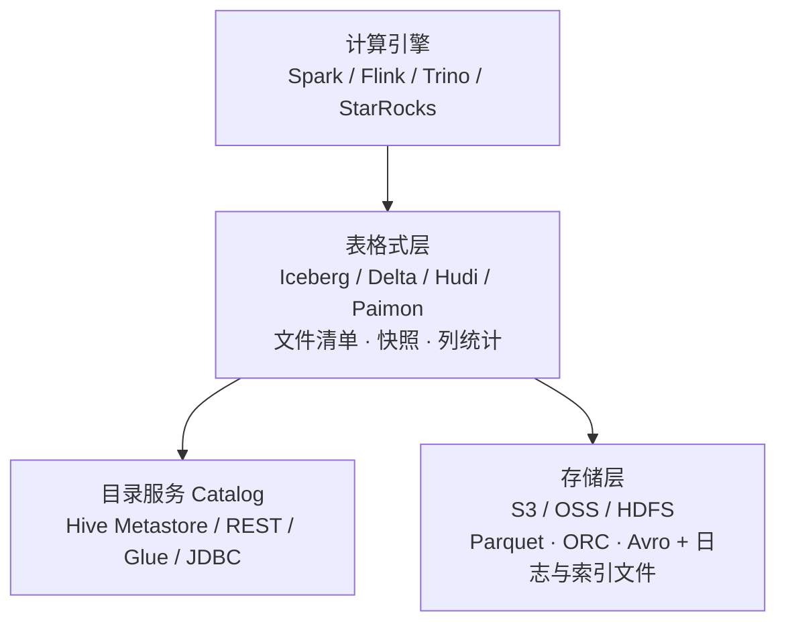
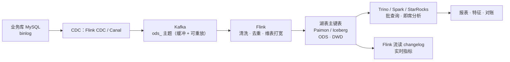

# 湖仓一体解决什么问题？Iceberg、Hudi、Paimon 该怎么选？

> 数据湖便宜、能存一切，但它只提供"文件"，不提供"表"——没有事务、没有元数据、不能增量更新、小文件没人收。湖仓就是在对象存储上把"表"这件东西重新造一遍：存储不动，靠**表格式**补事务与元数据，靠 **Catalog** 管住表名。这篇讲清它补了哪四件事、四种格式差在哪、以及养它要付什么账。

## 先看数据湖缺了什么

数据湖的原始形态很好理解：对象存储（S3 / OSS / HDFS）放 Parquet / ORC 文件，Spark、Flink、Trino 各自去读。成本优势是压倒性的——对象存储按 GB 按月计费，比块存储便宜一个数量级，原始日志、埋点、图片全扔进去也不心疼。

问题在于，"一堆 Parquet 文件"和"一张表"之间差着四件事：

| 缺口         | 具体表现                                                             | 后果                                         |
| ------------ | -------------------------------------------------------------------- | -------------------------------------------- |
| 没有事务     | 作业写一半失败，目录里一半新文件一半旧文件；两个作业同时写同一分区   | 下游读到残缺数据，而且不报错                 |
| 没有元数据   | 表 = 目录约定，有哪些文件、每列 min/max 是多少，只能靠 LIST 目录现算 | 查询规划在对象存储上又慢又按请求收费         |
| 不能增量更新 | 改一条记录 = `INSERT OVERWRITE` 整个分区（Hive 的模型里没有 UPDATE） | 一条订单状态变更重写几个 GB，CDC 无处落地    |
| 小文件失控   | 每小时、每个 checkpoint 都产出一批文件                               | 元数据膨胀、查询光是 open 文件就耗掉大半时间 |

传统数仓（Hive 表）补了一部分，但它的模型上限写死在"**分区 = 目录**"上：分区键变成路径里的 `dt=2024-09-01`，于是改一行要重写这个目录、换分区策略要重写全部历史、列定义和物理布局绑在一起。它能做"每天覆盖一批"，做不了"按主键更新一行"。

湖仓要干的事因此很明确：**在不放弃廉价存储的前提下，把这四件事补回来。**

## 湖仓的三层构成



**表格式不是数据库**，这句话值得反复强调。它不解析 SQL、不做 join、不缓存数据，也不管你并行度开多少。它只回答四个问题：

1. 这张表**现在**由哪些数据文件组成？
2. 每个文件里各列的 min/max、null 数是多少（用来裁剪）？
3. 刚才那次写入算不算成功（提交语义）？
4. 三天前的那个版本，又是由哪些文件组成？

真正干活的是上面的引擎。对比一下关系库：MySQL 把"表"落成 B+ 树页 + 数据字典；湖表把"表"落成一串元数据文件（Iceberg 的 metadata.json / manifest list / manifest file、Delta 的 `_delta_log`、Hudi 的 timeline、Paimon 的 snapshot + manifest）+ 数据文件。**表的定义从"目录结构"升级成"带版本号的清单"**，四件缺口就是靠这份清单补上的。

Catalog 的职责只有一条：存"表名 → 当前元数据文件指针"这个映射。有了它，`db.tbl` 才是一个名字而不是"某个路径的约定"；也正因为只有一条映射，它天然是个单点（后面讲代价）。

## 四种表格式，按真实差异对照

营销词都说自己"开放、ACID、支持流批"，真正的差异在**写入路径**和**引擎绑定**：

| 表格式     | 起源与主引擎                                                           | 更新能力                                                                                   | 流式写入 / 流读                                                                                                      | 国内落地与坑                                                          |
| ---------- | ---------------------------------------------------------------------- | ------------------------------------------------------------------------------------------ | -------------------------------------------------------------------------------------------------------------------- | --------------------------------------------------------------------- |
| Iceberg    | Netflix 2018 开源，2020 年成为 Apache 顶级项目；引擎中立               | `MERGE INTO` / `DELETE` 靠重写受影响的数据文件，没有主键索引，要靠分区与排序裁剪缩小范围   | Flink 能写，但高频 upsert 不是它的设计中心；changelog 视图（`tbl.changes`）有，却依赖写入端配合，流读生态不如 Paimon | 云厂商 EMR 普遍支持，"一份数据多引擎共享"最省心，运维面也最标准       |
| Hudi       | Uber 2016 开源，2020 年成为 Apache 顶级项目；Spark 出身                | COW / MOR 两种表：COW 写时合并、MOR 写日志文件读时合并；bloom / HBase 索引加速按主键定位   | Spark、Flink 都能写，MOR + 异步 compaction 能扛高频更新；流读偏"按 instant 增量拉"                                   | 早年滴滴、字节有落地，运维面最宽（compaction、clean、archive 三件套） |
| Delta Lake | Databricks 2019 开源，2022 年捐给 Linux 基金会（**不是 Apache 项目**） | 事务日志 `_delta_log` 记每次提交，`MERGE INTO`、`DELETE`、CDF 都齐                         | Spark Structured Streaming 原生，Flink 侧靠第三方 connector，非一等公民                                              | Databricks / Azure 生态里最顺；国内裸开源落地少                       |
| Paimon     | 阿里 Flink 团队，前身 Flink Table Store，2023 更名，2024 年成为顶级    | LSM 树 + 主键表，写时排序合并，天生适合高频 upsert；另有 partial-update / aggregation 引擎 | Flink 一等公民，`changelog-producer` 直接把 upsert 流变成 changelog 给下游流读                                       | 国内实时入湖增长最快，代价是与 Flink 绑定较深                         |

**结论句：选型先看"你的主引擎是谁"，再看"写入是批量覆盖还是高频 upsert"，最后才看社区热度。** 引擎错配的代价很具体——每次写入都要过一层不成熟的 connector，出问题没有人能定位。

具体到三句话：

- 离线为主、Spark + Trino + StarRocks 都要读同一份数据 → **Iceberg**，它的中立性是设计目标，不是宣传语。
- 已经有大量 Spark 批任务，核心诉求是"按主键不停 upsert 明细" → **Hudi**（或 Databricks 体系里的 Delta）。
- 实时链路是主体、Flink 是主力引擎、要让湖表既接 CDC 又给下游流读 → **Paimon**。

## 能力一：ACID 与并发写

**没有它会怎样**：两个作业同时往同一张 Hive 表同一分区 `INSERT OVERWRITE`。A 先跑完，B 后跑完把 A 的结果盖掉——数少了，但两边都不报错。或者 A 写到 60% 挂了，目录里新旧文件混着，下游读到"9 月 1 日只有 300 万行"的残缺分区，还得靠人去猜这是不是真的。

湖表的做法是把提交收敛成**一次原子元数据切换**：数据文件先写到新路径（这一步不加锁），最后提交一个指向新清单的指针；成功则所有人立刻看到新版本，失败则那些新文件成为孤儿，后面由清理任务收走。两个作业同时写时，后提交者发现基线变了，抛冲突异常，由业务决定重试还是放弃——这就是**乐观并发**，不加锁、冲突了再来一次。

| 表格式  | 冲突时的表现                                     | 多写注意事项                                                   |
| ------- | ------------------------------------------------ | -------------------------------------------------------------- |
| Iceberg | `CommitFailedException`                          | 重试即可，前提是你的写入是幂等的                               |
| Delta   | `ConcurrentAppendException` 等冲突异常           | 默认 `WriteSerializable` 隔离级别，冲突检测偏保守              |
| Hudi    | 需要 lock provider（ZooKeeper / HMS / DynamoDB） | 0.13 之后有非阻塞并发控制；多 writer 没配锁会直接写坏 timeline |
| Paimon  | 单 writer 靠文件系统锁，多 writer 需 HMS / ZK 锁 | 没配锁就跑多写，快照会互相踩                                   |

要记住的是：**ACID 只保证"表"这一层的原子性，不保证你的业务逻辑幂等。** 提交重试意味着同一批数据可能被处理两遍，主键和聚合逻辑必须可重放。

## 能力二：快照与时间旅行

**没有它会怎样**：昨天上线的 ETL 把一个分区算成了 0。没有时间旅行，你只能从原始日志重跑几个小时，跑完还不确定对不对；有的话，先把昨天和今天两个版本各查一遍，差异在哪儿一目了然。

```sql
-- Iceberg：按快照 ID 或时间戳回溯
SELECT count(*) FROM dwd_order VERSION AS OF 7284623984723948;
SELECT count(*) FROM dwd_order TIMESTAMP AS OF '2024-09-01 00:00:00';

-- Delta：同一件事的两种写法
SELECT count(*) FROM dwd_order VERSION AS OF 42;
SELECT count(*) FROM dwd_order TIMESTAMP AS OF '2024-09-01';
```

三个实际用途：**对账**（比两个快照的差异，而不是比两份导出的 CSV）、**复现**（"上周三那次跑批的结果"可以在沙箱里原样查出来）、**审计**（每次提交的 summary 里记着操作类型、读写了多少文件、加了多少行）。

但别把它当备份：快照是**指向文件的引用**，不是副本。`expire_snapshots` / `VACUUM` 一执行，回溯窗口就没了（Iceberg 默认保留 5 天历史，Delta 的 `VACUUM` 默认只清 7 天前的）；而且它保护不了"文件被误删"——那是对象存储版本控制该管的事。

## 能力三：增量读，让 CDC 直接落湖

**没有它会怎样**：binlog 抽出来要落 Hive，要么每次全量重写分区，要么自己写一套"今日变更表 + 全量合并"的拉链逻辑（见[拉链表和缓慢变化维怎么设计](/database/datawarehouse/dw-scd-zip-table.html)）。前者写放大到整个分区，后者维护成本高、还怕链断。

湖表自己记着"这次提交新加了哪些文件"，增量读就是"只扫这些文件"：

| 表格式  | 增量读写法                                                                                              |
| ------- | ------------------------------------------------------------------------------------------------------- |
| Iceberg | `option("start-snapshot-id", A).option("end-snapshot-id", B)`，或用 `start-timestamp` / `end-timestamp` |
| Hudi    | `hoodie.datasource.query.type=incremental` + `hoodie.datasource.read.begin.instanttime`                 |
| Delta   | Change Data Feed：`delta.enableChangeDataFeed=true` 后 `table_changes('tbl', 5, 10)`                    |
| Paimon  | 主键表配 `changelog-producer`（`input` / `lookup` / `full-compaction`），把 upsert 流变成 `+I/-U/+U/-D` |

支撑"分钟级同步"的关键不是湖表快，而是**它不要求你重写整张表**：每分钟一批 upsert 只产生几个新文件加一次提交，读侧按快照裁剪，写放大从"整个分区"降到"变化的文件"。Paimon 的 `changelog-producer` 更是把"表"直接当流用——下游 Flink 作业可以像消费 Kafka 一样消费一张湖表的变更。

## 能力四：schema 演进与隐藏分区

**没有它会怎样**：业务加了个 `coupon_id`。Hive 的 `ALTER TABLE ADD COLUMNS` 只能加在末尾，老 Parquet 文件读出来是 NULL（勉强能接受）；但只要涉及改列类型、重命名列、把日分区改成小时分区，就得重写全部历史数据——TB 级表意味着停机窗口。

湖表把列和分区从"物理布局的一部分"变成了"元数据里的描述"：

- **加列、删列、改名、调顺序**都是元数据操作，不碰数据文件。Iceberg 按 field id 追踪列，改名不影响老文件；类型提升（int → bigint、float → double）有明确规则，反向不行。
- **隐藏分区**：建表时 `PARTITIONED BY (days(order_time), bucket(16, shop_id))`，查询直接写 `WHERE order_time >= '2024-09-01'`，引擎自己推算出该扫哪些分区，不用像 Hive 那样必须手写 `WHERE dt = '2024-09-01'`。少写一个分区条件就少一类"全表扫描"事故。
- **分区演进**：老数据按天分区、新数据按小时分区也行，旧文件继续按旧 spec 读，不需要重写。

## 代价：五件必须养的运维

这一节才是"真做过"和"看过文章"的分界线。湖仓的四个能力没有一个是免费的。

**1. compaction 不做就烂尾。** 每次 Flink checkpoint 都写一批文件，MOR 表还额外写日志文件，一天下来几千个几 MB 的小文件。后果是 manifest 列表膨胀（每次提交都多一个 manifest，查询要先读清单）、open 文件的开销超过读数据本身、对象存储按请求计费。手段：Iceberg 的 `rewrite_data_files`（按目标大小重写，默认 512MB）配 `rewrite_manifests`、Delta 的 `OPTIMIZE ... ZORDER BY`、Hudi 的 `compaction` + `clean`、Paimon 的专职 compact 任务。**但根因在写入侧**：缩短 checkpoint 间隔、提高并行度都会成倍制造小文件，先调写入再谈清理，只删不控下周还是同样的量。

**2. 快照与孤儿文件不清，存储费悄悄翻倍。** 每个快照都还引用着旧版本的数据文件，`expire_snapshots` 之前它们不会被删。Iceberg 有 `expire_snapshots` + `remove_orphan_files`（后者专清失败提交留下的无用文件），Delta 的 `VACUUM` 默认只清 7 天前的，想调小得先关掉 `delta.retentionDurationCheck`。关键是**清理保留期就等于时间旅行的窗口**，它是个业务参数，别全用默认值。

**3. 对象存储的 LIST 与请求费。** Hive 表在对象存储上查一次要先 LIST 目录：S3 一次 LIST 最多返回 1000 个 key，按每千次请求计费，目录里几十万文件时规划阶段就能耗掉几分钟。湖表用 manifest 替代 LIST——**读一次清单就知道有哪些文件、每列的统计是什么**，这才是"元数据"的实际价值。另外 S3 / OSS 的 rename 实际是 copy + delete，Spark、Hudi 里依赖 rename 的提交逻辑在对象存储上要么慢要么错，得换 S3A committer 这类实现。

**4. Catalog 是新的单点。** 表名到元数据的映射在 Catalog 里（Hive Metastore / REST / Glue / JDBC）。HMS 挂掉，所有引擎都拿不到表定义、任务全停；metastore 背后的 MySQL 没备份，元数据丢了以后文件还在但"表"没了，重建比重灌还难。做法：元数据库定期备份、HMS 多实例并给查询侧只读从库、新架构优先选 REST Catalog（Iceberg 的 REST 规范把目录做成无状态服务，后端直接接对象存储）。

**5. 并发写靠乐观锁重试。** 两个作业同时 upsert 同一张表，后提交的必然撞冲突。业务代码要能安全重放（幂等主键 + 确定的结果），否则重试只是把脏数据写两遍。高频小批量并发写本来就是湖表最不擅长的场景，能用分区、分桶把写范围隔开就隔开。

## 一条典型链路：CDC 到湖表再到 Trino



四步走：CDC 抽 binlog 进 Kafka 解耦；Flink 做清洗去重打宽后按主键写湖表（写入节奏跟 checkpoint 走）；批查询走 Trino / Spark 直读湖表，看到的是最近一次提交；流读走 changelog，湖表同时充当实时链路的持久化层。

**"流批一体"在这里到底指什么**：不是"一个引擎包打天下"，而是**同一张表、同一份元数据，既能被流式写入（每分钟 upsert 几个文件），也能被批式读取（Trino 扫全表）**，两边看到同一个快照。好处是实时链路不必再用 Kafka 做长期存储——Kafka 只做缓冲，历史沉在湖表里，"回刷历史"就是从湖表重放。要小心的是："同一段 SQL 在流和批上跑出同一个数"仍然需要人工校验，join 与时间语义的差异在[实时链路怎么保证不丢不重](/database/datawarehouse/dw-realtime-pipeline.html)里讲过。

## 小团队要不要上

| 判断项          | 倾向湖仓                               | 倾向"数仓 + OLAP"              |
| --------------- | -------------------------------------- | ------------------------------ |
| 数据量          | TB 级以上，且长期只增不删              | 几百 GB 以内，单集群扛得住     |
| 有没有 CDC 更新 | 有：订单状态、库存、用户资料要按主键改 | 只有追加型日志和每日全量       |
| 团队引擎能力    | 已有 Flink / Spark 与调度体系          | 只有 SQL 和 BI 工具            |
| 查询引擎        | Trino / Spark / StarRocks 已就位       | 直接用 Doris / ClickHouse      |
| 运维人力        | 有人盯 compaction、清理、Catalog 备份  | 没人愿意半夜修 compaction 任务 |

**结论：没有 CDC 更新需求、数据量不大，先用"数仓 + ClickHouse / Doris"更省事。** Doris 的 Unique Key 模型加 Routine Load / Flink Connector 已经能吃掉大部分"按主键更新"的需求，还自带索引和点查能力。湖仓解决的是"海量 + 开放格式 + 多引擎 + 增量"这四个条件同时成立时的成本问题；条件不齐时，它是纯负担。

## 和站内几篇的关系

- 实时链路的准确性（checkpoint、端到端 exactly-once、维表 join）在[实时链路怎么保证不丢不重](/database/datawarehouse/dw-realtime-pipeline.html)；本篇只关心它落库那一端换成湖表之后多了什么。
- HDFS、YARN、Hive、HBase 各自的职责见[HDFS、YARN、Hive、HBase 到底各管什么](/database/datawarehouse/dw-hadoop-ecosystem.html)；本篇讲的是 Hive 表之上的表格式层，不重复组件介绍。
- 湖表的主键 upsert 让手写拉链的需求变少，但"按事实发生当时的维度算"这条口径没变，见[拉链表和缓慢变化维怎么设计](/database/datawarehouse/dw-scd-zip-table.html)。
- Java 服务把数据送到湖表的两条路（写 Kafka 还是直接 CDC），见[Java 业务系统怎么对接数仓](/database/datawarehouse/dw-bigdata-java-integration.html)。
- 湖表在真实业务链路里站在哪一格，见[采集数据怎么变成报表和结算单](/energy/energy-data-pipeline.html)。

## 面试怎么答

三段式，顺序别反：

1. **先定义**：湖仓 = 廉价存储 + 表格式 + Catalog。数据湖原本有四个缺口（无事务、无元数据、不能增量更新、小文件失控），表格式就是在这四件事上补课；它不是数据库，管的是文件清单、快照和元数据。
2. **再讲能力**：ACID 与并发写、快照与时间旅行、增量读支撑 CDC、schema 演进与隐藏分区——每条都配一个"没有它会怎样"，比背四条定义有说服力。
3. **最后讲代价**：compaction、快照与孤儿文件清理、对象存储 LIST 与请求费、Catalog 单点、乐观锁重试。**能主动讲代价的人，才像真跑过。**

选型一句话收尾：主引擎是 Spark 且要增量 upsert → Hudi / Delta；要多引擎共享、离线为主 → Iceberg；Flink 流为主、要流批一体 → Paimon。

## 容易踩的坑

- **把湖仓当数据库用。** 它没有二级索引、没有点查优化、也没有唯一约束（Hudi / Paimon 的主键是合并语义，不是约束）。高并发点查仍然要 Doris、ClickHouse、Redis。
- **以为 CDC 进湖就"实时"了。** 写入可以分钟级，查询仍是批的；要流读必须表格式支持 changelog，Paimon 还得显式配 `changelog-producer`。
- **把快照当备份。** 快照只是引用；`expire_snapshots` / `VACUUM` 之后时间旅行回不去，而且旧快照会让"已删除的用户数据"在历史版本里复活，合规上是真问题。
- **只做 compaction、不管写入侧。** 小文件是 checkpoint 间隔和并行度造出来的，清理只是止疼药。
- **忽略对象存储的语义差异。** rename 是 copy + delete，依赖 rename 的提交逻辑（老版本 Hudi、部分 Spark 输出提交器）在 S3 / OSS 上会变慢或出错。
- **把 Catalog 当无状态服务。** HMS 的 MySQL 不备份，元数据一丢，"表"就没了，文件还在也救不回来。
- **拿营销词选型。** 四种格式都能 ACID、都能时间旅行；差异在写入路径和引擎绑定，选错引擎，能力全打折。

## 小结

1. 湖仓 = **廉价存储 + 表格式 + Catalog**。表格式不是数据库，它管的是文件清单、快照与元数据；真正算数的是上面的 Spark / Flink / Trino。
2. 数据湖的四个缺口是**无事务、无元数据、不能增量更新、小文件失控**，表格式一一对应补上：ACID / 统计与裁剪 / 增量读 / compaction 与清单管理。
3. 选型先看主引擎：多引擎共享、离线为主选 **Iceberg**；Spark 批任务要高频 upsert 选 **Hudi**（Databricks 体系选 Delta）；Flink 流为主、要流批一体选 **Paimon**。
4. 代价是实打实的：compaction 不做就烂尾、快照与孤儿文件不清就烧钱、对象存储 LIST 与请求要计费、Catalog 是新的单点、并发写靠乐观锁重试——**清理保留期就是时间旅行的窗口**。
5. "流批一体"的准确含义是同一张表既被流写、也被批读，共用一份元数据；不是"一套 SQL 到处跑出同一个数"。数据量不大又没有 CDC 更新需求时，Doris / ClickHouse 更省事。

## 参考

- 综合自 Apache Iceberg 官方规范与文档：表元数据三层结构（metadata file / manifest list / manifest file）、`VERSION AS OF` 与 `TIMESTAMP AS OF`、增量读的 `start-snapshot-id` / `end-snapshot-id`、隐藏分区与分区演进、`rewrite_data_files` 与 `expire_snapshots`、REST Catalog 规范。
- Apache Hudi 文档：COW / MOR 两种表类型、timeline 与 instant、`_hoodie_commit_time`、索引（bloom / HBase / bucket）、incremental query 参数、compaction 与 clean 服务、多 writer 的 lock provider。
- Delta Lake 文档：`_delta_log` 事务日志与 checkpoint 间隔、`OPTIMIZE` / `ZORDER BY`、`VACUUM` 默认 7 天保留与 `retentionDurationCheck`、Change Data Feed、并发冲突异常类型。
- Apache Paimon 文档：主键表与 LSM 合并、`changelog-producer` 三种模式、partial-update / aggregation 合并引擎、snapshot 保留与 orphan 文件清理、Flink 作为一等公民的写入路径。
- 版本与归属做了逐一核对：Hudi 2019 年进 Apache 孵化器、2020 年顶级；Iceberg 2020 年顶级；Paimon 前身 Flink Table Store，2023 年更名、2024 年顶级；**Delta Lake 走的是 Linux 基金会，不属于 Apache 基金会**——这一点常被写错。DDL 语法（尤其 `PARTITIONED BY` 的 `days()` / `bucket()` 写法）在 Spark、Flink、Trino 上并不一致，落库前按所用引擎版本再核一次。
- 本仓库 `docs/` 下没有湖仓方向的资料，本文未引用二手教程，结论以官方文档语义加工程实践为准。
