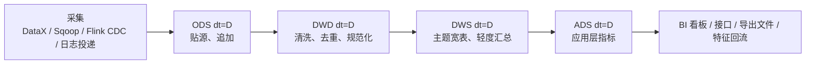

# 离线数据管道怎么设计和运维？调度、幂等和重跑怎么做？

> 离线管道的日常不是写 SQL，而是守住一条承诺：**任何一天、重跑任何一次，同一批数据只产出一份正确结果**。这条承诺靠三根柱子撑着——依赖对不对、写入幂不幂等、失败了能不能被发现。

## 一条管道：分层单向，每层只做一件事



这张图既是分层结构，也是调度上的 DAG 依赖链：箭头方向就是依赖方向，每个节点带同一个业务日期 `D`，最后一层交给业务方消费。

| 层  | 粒度                     | 写入方式 | 典型坑                         |
| --- | ------------------------ | -------- | ------------------------------ |
| ODS | 与源表一致，按 `dt` 分区 | 追加     | 源表改字段没同步，抽到错列     |
| DWD | 业务过程明细，一行一事实 | 分区覆盖 | 去重漏了，下游金额翻倍         |
| DWS | 主题 + 天/维度           | 分区覆盖 | 跨天依赖没配，7 日指标少 6 天  |
| ADS | 指标 + 维度组合          | 分区覆盖 | 没做就绪校验，空文件被下游消费 |

## 采集：同一份数据，三种入仓姿势

**DataX** 靠 `speed.channel` 控并发、`errorLimit` 控脏数据容忍度、`writeMode` 决定重跑是否翻倍：

```json
{
  "job": {
    "setting": {
      "speed": { "channel": 3, "byte": 10485760 },
      "errorLimit": { "record": 0, "percentage": 0.02 }
    },
    "content": [
      {
        "reader": {
          "name": "mysqlreader",
          "parameter": {
            "username": "reader",
            "password": "***",
            "splitPk": "id",
            "column": ["id", "order_id", "pay_amount"],
            "connection": [{ "table": ["t_order"], "jdbcUrl": ["jdbc:mysql://HOST:3306/db"] }]
          }
        },
        "writer": {
          "name": "hdfswriter",
          "parameter": {
            "defaultFS": "hdfs://namenode:8020",
            "path": "/warehouse/ods/ods_order/dt=${bizdate}",
            "fileType": "orc",
            "writeMode": "truncate"
          }
        }
      }
    ]
  }
}
```

`splitPk` 不填就是单通道拉，几百 G 的表能抽一整天；`writeMode` 用 `append` 就是"重跑一次翻一倍"——采集端和数据端要一起做幂等。

**Sqoop** 的 `--incremental append --check-column id --last-value` 把水位存在外部，重跑没回滚这个值就永久丢一段；按时间窗抽更稳，窗口由业务日期算出来，天然可重放：

```bash
sqoop import --connect jdbc:mysql://HOST:3306/db --username reader --password '***' \
  --query "SELECT * FROM t_order WHERE update_time >= '${start}' AND update_time < '${end}' AND \$CONDITIONS" \
  --split-by id --num-mappers 4 --delete-target-dir --target-dir /warehouse/ods/ods_order/dt=${bizdate}
```

**Flink CDC** 本质是"把 binlog 变成按天的追加文件"，要盯 `scan.startup.mode`（`initial` 先全量再增量）和 checkpoint 间隔——间隔太长，作业重启重放的数据就多，下游去重压力跟着涨。日志类数据一般是「Kafka/对象存储 → 按小时落 ODS」，这层最大的坑是**小时文件没落全就开始按天聚合**，得按文件数或行数判就绪，不能只看投递任务成功。

## 调度：业务日期 vs 运行日期

调度器只管两件事：什么时候跑（cron）、等谁跑完（依赖）。`dt=D` 是**业务日期**，任务被触发的那一刻是**运行日期**，两者差一天，混了就是新手最贵的一课。各家取业务日期的方式还不一样，照抄别家写法必然错位一天：

| 调度器           | 业务日期（分区值 `dt`）                               | 运行日期      | 11-16 凌晨跑 11-15 的批                       |
| ---------------- | ----------------------------------------------------- | ------------- | --------------------------------------------- |
| DolphinScheduler | `${system.biz.date}`，默认是运行日期前一天            | `$[yyyyMMdd]` | biz.date=`20261115`，`$[yyyyMMdd]`=`20261116` |
| Airflow          | `{{ ds }}`、`{{ data_interval_start }}`，数据区间左端 | `{{ ts }}`    | `ds`=`2026-11-15`，`ts`=`2026-11-16`          |
| Azkaban / 自研   | 无内置，启动参数或 `date -d` 算                       | 同左          | 由脚本决定                                    |

于是两大经典事故：DolphinScheduler 里把 `$[yyyyMMdd]` 当分区值，11-16 的批写进 `dt=20261116`，**里面装的却是 11-15 的数据，报表永远差一天**；Airflow 里以为 `{{ ds }}` 是运行日期又手动减一天，**每天少一天、昨天的分区被反复覆盖**。一个同时支持日常跑和手动补数的骨架：

```bash
#!/usr/bin/env bash
set -euo pipefail
BIZDATE="${1:-$(date -d 'yesterday' +%Y%m%d)}"   # 传参=补数，不传=取昨天
hive --hiveconf hive.exec.dynamic.partition=true \
     --hiveconf hive.exec.dynamic.partition.mode=nonstrict \
     --hivevar dt="${BIZDATE}" -f dwd_trade_order_di.sql
```

**跨天依赖**是第二个坑：7 日窗口指标要读 D-6 到 D 共 7 个分区，如果只配了"依赖 D 当天"，任务照样成功，只是窗口里少 6 天数据——**任务绿、数据错，比任务红难查得多**。补数要按日期正序，否则先补的那天读到的是后补出来的数。更隐蔽的一种叫**空跑**：上游节点成功但产出分区是空的，下游 `LEFT JOIN` 上去不报错，直接写出空分区，一路绿到看板。

## 幂等：分区覆盖写是生命线

离线任务一定会被重跑（失败重试、补数、修 bug、上游迟到）。**写入不幂等，重跑就是事故放大器**：`dwd` 重跑两次变 2 倍明细，`dws` 的 `SUM` 就是 2 倍金额，`ads` 的同比环比全错；最恶心的是**它看起来像业务暴涨**，而追加写没有"清分区"这个动作，只能人工删分区重跑才能修。

```sql
-- 反例：追加写。重跑一次进两份，指标直接翻倍
INSERT INTO TABLE dwd_trade_order_detail PARTITION (dt = '2026-11-15')
SELECT order_id, pay_amount FROM ods_order_binlog WHERE dt = '2026-11-15';

-- 正例：分区覆盖写。重跑多少次都只有一份结果
INSERT OVERWRITE TABLE dwd_trade_order_detail PARTITION (dt = '2026-11-15')
SELECT order_id, pay_amount FROM ods_order_binlog WHERE dt = '2026-11-15';
```

```sql
SET hive.exec.dynamic.partition = true;
SET hive.exec.dynamic.partition.mode = nonstrict;

-- 补多天：一条 SQL 覆盖 7 个分区；Hive 只重写 SELECT 结果里出现的分区，不动其他分区
INSERT OVERWRITE TABLE dwd_trade_order_detail PARTITION (dt)
SELECT order_id, pay_amount, dt FROM ods_order_binlog
WHERE  dt BETWEEN '2026-11-09' AND '2026-11-15';
```

**Spark 用户注意**：`spark.sql.sources.partitionOverwriteMode` 默认 `static`，此时 `INSERT OVERWRITE` 会清掉整张表再写，只有显式设成 `dynamic` 才按分区覆盖。这个默认值坑过一批从 Hive SQL 迁到 Spark SQL 的团队。

## 主键 + 版本号去重

同一行在 ODS 里会有多个版本（binlog 多次更新、快照多次落地），进 DWD 前必须收敛成一行：

```sql
INSERT OVERWRITE TABLE dwd_order_di PARTITION (dt = '2026-11-15')
SELECT order_id, user_id, order_status, pay_amount, update_time
FROM (
  SELECT order_id, user_id, order_status, pay_amount, update_time,
         ROW_NUMBER() OVER (PARTITION BY order_id
                            ORDER BY update_time DESC, etl_time DESC) AS rn
  FROM ods_order_binlog WHERE dt = '2026-11-15'
) t
WHERE rn = 1;
```

三个关键点：**排序要有兜底**（`update_time` 相同时按 `etl_time` 定序，否则同批数据两次跑出来的赢家可能不同）；**去重范围要覆盖迟到数据**（`update_time` 在 D-2 才改的单据只读当天分区就漏了，通常 lookback 到 D-2 并重算受影响分区）；**别把去重留到最后一层**，DWS/ADS 再去重等于每个指标各算一遍，成本翻几倍。

## 重跑与回溯：补数、并发、血缘、隔离

**补历史**就是按分区循环，成功才继续：

```bash
# 串行补 7 天，任何一天失败立刻停，避免用残缺上游算下游
for d in 09 10 11 12 13 14 15; do
  hive --hivevar dt="2026-11-${d}" -f dws_trade_shop_1d.sql || { echo "FAILED at ${d}"; exit 1; }
done
```

**并发要控**。补 30 天一把拉满并行，结果是队列塞满、正常链路被挤到 9 点还没出数。手段：调度器补数并发度设 2-3、`xargs -P N` 限并发、`spark.yarn.queue` 限队列容量、脚本里 `sleep` 错开。**并发度由队列剩余容量决定，不是由"想快点补完"决定。** 至于**下游要不要一起重跑，由血缘决定**：重跑了 DWD 的 D 日分区，则 D 日的 DWS 必跑；跨 D 的 7 日/30 日窗口要重跑到窗口右端；依赖这些 DWS 的 ADS 和导出文件全部要重跑；已发给业务方的日报要重新出数并说明。只重跑叶子节点，等于把错数据留在下游而以为自己修好了。

**读写隔离**的取舍不该拍脑袋，三种：直接覆盖分区最简单，但多文件写入时读者可能看到新旧混排；写影子表 `tbl_tmp`、校验通过后再覆盖正式分区，多一次写放大、但保证"要么旧要么新"；双分区轮换（`dt=D_v2` + 视图切换）隔离最好、改造量最大。绝大多数表直接覆盖就够——Hive 单分区覆盖是走 staging 目录再移动文件；**只有对账、财务、对外披露这类不能出现中间态的表，才值得上影子表或视图切换。**

## 失败处理：重试、告警、SLA、超时

重试只对**瞬时失败**有效：网络抖动、排队拿不到资源、上游短暂不可用。对**数据错误**重试是纯烧钱——SQL 写错、分区不存在，重试 3 次只是把同一个错误犯 3 遍，还占着队列 3 个窗口。

```text
Airflow 侧：
  retries=3                             # 重试次数
  retry_delay=timedelta(minutes=5)      # 固定间隔
  retry_exponential_backoff=True        # 退避，避免故障期连续打
  max_retry_delay=timedelta(minutes=30)
  execution_timeout=timedelta(hours=2)  # 超时被杀，别让僵尸任务占槽位
DolphinScheduler 侧：任务「重试次数 / 重试间隔」+ 工作流「超时告警 / 超时失败」+ 告警组。
```

**告警要分级**，否则等于没有告警：P0 核心链路（交易、支付、对账）失败 → 电话 + 值班群，15 分钟无人响应升级；P1 重要看板 → 群消息；P2 内部报表 → 邮件汇总，全员 P0 的体系两周后就会被静音。**SLA 与基线**同理要自动判定：核心 ADS 表定"每天 08:30 前就绪"，倒推上游每个节点最晚完成时间形成基线，靠探针（该就绪没就绪就告警）而不是靠值班的人早上刷看板。**超时杀掉**是兜底：一个跑 6 小时的 `JOIN` 通常是倾斜或笛卡尔积（见 [数据倾斜与调优](/database/datawarehouse/dw-skew-and-tuning.html)），有 `execution_timeout` 才能把资源让给正常链路。

## 数据就绪：任务成功 ≠ 数据可用

最贵的故障都是"任务成功、数据是空的"。每张对外表跑完至少要过三关：

| 检查项         | 手段                                                                        |
| -------------- | --------------------------------------------------------------------------- |
| 分区存在且有量 | `SHOW PARTITIONS tbl` 里有 `dt=D`；`COUNT(*)` 不为 0 且在历史波动区间内     |
| 量级正常       | `SUM(amount)`、`COUNT(DISTINCT id)` 同比环比不越界                          |
| 完成标记       | `_SUCCESS`（Hadoop 输出提交器生成；DataX 不生成，要自己在脚本末尾 `touch`） |

```sql
WITH cur AS (
  SELECT dt, COUNT(*) AS row_cnt, SUM(pay_amount) AS amt
  FROM ads_trade_gmv_1d WHERE dt = '2026-11-15' GROUP BY dt
), base AS (
  SELECT AVG(row_cnt) AS avg_cnt, AVG(amt) AS avg_amt
  FROM ads_trade_gmv_1d WHERE dt BETWEEN '2026-11-08' AND '2026-11-14'
)
SELECT cur.dt, cur.row_cnt, cur.amt,
       ROUND(cur.row_cnt / base.avg_cnt, 3) AS cnt_ratio,
       ROUND(cur.amt / base.avg_amt, 3) AS amt_ratio,
       CASE WHEN cur.amt < base.avg_amt * 0.7 THEN 'BLOCK' ELSE 'PASS' END AS verdict
FROM cur CROSS JOIN base;
```

思维陷阱：**空分区时它返回 0 行，而 0 行不是 PASS**。探针的判断必须是"拿到 `verdict=PASS` 才算就绪"，不是"SQL 没报错就算就绪"；同理 `hdfs dfs -test -e .../dt=2026-11-15/_SUCCESS` 要区分"文件不存在"和"目录本身不存在"。阈值规则怎么定、告警怎么降噪、异常怎么归因属于数据质量治理，见 [数据质量怎么治理](/database/datawarehouse/dw-data-quality.html)。

## 成本与资源

- **并行度**：`spark.sql.shuffle.partitions` 默认 200，小表浪费大表不够；按"每 task 约 128MB"估，再开 `spark.dynamicAllocation.enabled=true`。
- **队列、优先级、错峰**：`spark.yarn.queue`、`mapreduce.job.queuename` 把核心链路和探索性查询分开，`spark.yarn.priority` 让核心链路先出队；回刷宽表、补历史放 01:00-05:00，补数避开 07:00-09:00 出数高峰，别让人白天一个大查询吃掉夜里批处理的容量。
- **失败任务空转**：没超时的失败任务一直占容器；`set -e` + `execution_timeout` + 调度器「超时失败」能让失败快速释放资源。

## 工程化：让管道能被别人接手

- **库隔离与命名**：`dwd` / `dwd_dev` 分库或统一 `_tmp` 后缀，生产库只允许调度账号写——手改的数据下次重跑就没了，还会让两边对不上；表名按 `<层级>_<主题>_<粒度>_<频率>`，如 `dwd_trade_order_di`、`dws_trade_shop_1d`、`ads_trade_gmv_shop_1d`，任务名与表名对齐，能一眼从表找到任务。
- **评审清单**：是不是覆盖写、`WHERE` 有没有带 `dt`（漏了就是全表扫 + 结果翻倍）、资源参数、是否引入大表 join。
- **上线与 Owner**：开发库跑通 → 影子表与生产并行跑 3 天比对 → 差异在预期内再切 → 老逻辑留一版可回滚；任务卡片写清 Owner、产出表、下游、SLA、口径链接、补数命令，"这表是谁的"答不出来，故障就只能靠猜。

## 面试高频：今天这个任务没出数，怎么排查

按这个顺序走，覆盖 95% 的情况，每一步都能说清"为什么先查它"：

1. **调度是否触发**：实例存在吗？被上游阻塞、被人为暂停、cron 被改过、补数锁没释放？
2. **上游是否就绪**：依赖成功不等于有数据，查上游分区和行数——空跑就死在这一步。
3. **SQL 是否报错**：看首次失败原因，别只看最后一次重试（重试经常掩盖真正的错误）。
4. **数据是否为空**：过滤条件被业务改了枚举、`JOIN` 因维表缺失把数据丢光、分区路径错位一天。
5. **资源是否排队**：YARN 队列 pending、executor 申请不到、卡在 `ACCEPTED`——表现为"没报错也没跑完"。
6. **是否口径/代码改动**：昨天谁改过 SQL、上游字段类型、业务系统升级——变更记录通常能直接定位。

## 容易踩的坑

- 用 `$[yyyyMMdd]`（运行日期）当分区值，数据与分区永久错位一天；DolphinScheduler 要用 `${system.biz.date}`，Airflow 直接用 `{{ ds }}`、不要手动减一天。
- 写错覆盖方式：Spark 的 `INSERT OVERWRITE` 在默认 `partitionOverwriteMode=static` 下清整表；`INSERT INTO` 追加写再配上自动重试，**重试一次指标翻倍一次**，还看起来像业务增长。
- 只配"依赖当天"就上 7 日窗口指标，任务全绿、数据全错；拿"任务成功"当"数据就绪"，空分区一路流到看板。
- 补数几十天全并行把队列打满，正常链路跟着迟到；本地 macOS 调试 `date -d` 不可用（那是 GNU date），线上 Linux 正常、本地脚本跑不通。

## 小结

1. 分层单向：采集 → ODS（追加）→ DWD（清洗去重）→ DWS/ADS（覆盖写）→ 导出服务；每层只做一件事，故障才能定位到层。
2. 业务日期是分区值、运行日期是触发日，差一天；DolphinScheduler 用 `${system.biz.date}`，Airflow 用 `{{ ds }}`，混用必然错位。
3. 幂等只有一条路：**分区覆盖写**（`INSERT OVERWRITE ... PARTITION (dt=D)`）；追加写 + 重跑 = 指标翻倍，且不能自愈。
4. 重跑要顺血缘：重跑 DWD 就连带重跑下游和跨窗口指标；补数限并发、按日期正序、按表的敏感度选覆盖还是影子表。
5. 就绪判定看产出不看状态：分区存在 + 行数/金额在波动区间 + `_SUCCESS`，空分区返回 0 行不是 PASS；排查顺序是调度触发 → 上游就绪 → SQL 报错 → 数据为空 → 资源排队 → 口径改动。

## 参考

本仓库 `docs/` 下没有数仓方向的内部资料，本篇以工程事实为准，综合自 Apache Hive（`INSERT OVERWRITE` 与动态分区语义）、Apache Spark（`spark.sql.sources.partitionOverwriteMode` 默认值、动态资源分配、YARN 队列与优先级参数）、Apache Airflow（`ds` / `data_interval_start` 的数据区间语义、`retries` / `retry_exponential_backoff` / `execution_timeout`）、Apache DolphinScheduler（内置时间参数 `system.biz.date` 与 `$[yyyyMMdd]`、任务重试与超时告警）、DataX（`speed.channel`、`errorLimit`、hdfswriter 的 `writeMode`）与 Sqoop（`--incremental`、`--check-column`、`--last-value`）的官方文档与常见实践，并做了核对与改写：三个调度器业务日期取法的对照、Spark 分区覆盖默认行为与 Hive 的差异、`_SUCCESS` 由 Hadoop 输出提交器生成而 DataX 不生成、空分区时校验 SQL 返回 0 行不能视为通过。示例中的表名、主机、日期、阈值均为占位，落地时按实际环境替换。
