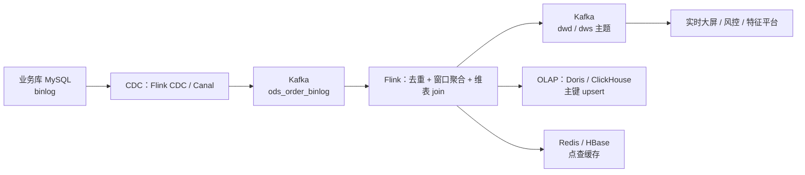

# 实时链路怎么保证不丢不重？Flink 的 checkpoint 和维表 join 怎么用？

> 离线管道错了可以重跑，实时管道没有这个按钮——它只能靠 checkpoint 把"算到哪、状态是什么"一起存下来，靠 sink 的事务或幂等把"重复"吃掉。这篇把这条链路上的准确性来源一块块拆开。

离线链路的正确性很好理解：修 SQL、改分区、重跑一遍，结果覆盖写。实时不行——作业在跑、数据在流、机器随时会挂，你没有"从今天 0 点重来"的按钮。所以实时数仓的准确性不是写对 SQL 换来的，是**恢复机制 + 写入语义**换来的。

## 先想清楚：你是真需要实时，还是只想要个大屏

| 场景                 | 为什么必须实时                  | 延迟要求    |
| -------------------- | ------------------------------- | ----------- |
| 风控（盗刷、羊毛党） | 事后发现已无意义，要在支付前拦  | 百毫秒~秒级 |
| 实时大屏 / 作战室    | 大促时要立刻看到 GMV 与履约异常 | 秒~十秒级   |
| 推荐 / 搜索特征      | 刚点的商品要马上进特征才"跟手"  | 秒级        |
| 实时告警             | 支付失败率飙升要分钟级发现      | 分钟级      |
| 常规经营报表         | T+1 完全够用，上实时是浪费      | 不需要      |

代价同样实在：**运维复杂度**（状态、checkpoint、背压、扩容都要人盯）、**状态管理**（状态越大快照越慢，扩容还要重分布 key）、**口径双轨**（实时一套 SQL、离线一套 SQL，算出不同数就得扯皮）。合理做法是"关键少数指标实时化"，而不是把整个数仓搬上流。

## 一条典型的实时链路长什么样

主流形态是：业务库 binlog 当唯一可信源，CDC 抽出来丢 Kafka 缓冲，Flink 清洗/聚合/关联维表，结果落 OLAP、消息队列或缓存。



- **中间为什么要过 Kafka，不让 Flink 直接读 binlog？** 解耦。同一份数据可能三个作业都要，Kafka 让它们各按自己的速度消费和重放；直连 CDC 的话一个作业挂了会拖住整条 binlog 通道。
- **ODS 层要不要去重？** 要。全量+增量切换、作业重启重放都可能重复，通常按主键 + 更新时间留最新一条。
- **结果写哪里？** 要"按主键更新"就写支持 upsert 的存储（Doris Unique Key、ClickHouse ReplacingMergeTree、HBase）；要"追加事件"就写 Kafka，由下游决定怎么消费。

## checkpoint 到底在解决什么问题

一句话：**把每个算子的状态 + 输入消费到哪，打包成一个一致的快照存到远程；作业挂了从最新快照恢复，从那个位置接着算。** 过程是 JobManager 注入 barrier、算子对齐后各自快照、全部 ack 后该次 checkpoint 才标记 completed。没有它更可怕：offset 从别处来、算子状态从零开始，窗口 count 归零、去重 map 空掉——数据错但不报错。

```java
StreamExecutionEnvironment env = StreamExecutionEnvironment.getExecutionEnvironment();
env.enableCheckpointing(60_000L);                              // 每 60s 触发一次
CheckpointConfig cfg = env.getCheckpointConfig();
cfg.setCheckpointingMode(CheckpointingMode.EXACTLY_ONCE);      // 本来就是默认值
cfg.setCheckpointTimeout(10 * 60_000L);                        // 单次超时
cfg.setMinPauseBetweenCheckpoints(30_000L);                    // 两次之间留呼吸时间
cfg.setMaxConcurrentCheckpoints(1);
cfg.setTolerableCheckpointFailureNumber(3);                    // 连续失败 3 次才让作业失败
cfg.enableExternalizedCheckpoints(
    CheckpointConfig.ExternalizedCheckpointCleanup.RETAIN_ON_CANCELLATION);
cfg.setCheckpointStorage("hdfs:///flink/checkpoints");
```

配置文件里是同一组东西（Flink 1.11 起陆续统一到 `execution.checkpointing.*` 前缀）：`execution.checkpointing.interval: 60s`、`execution.checkpointing.timeout: 10min`、`execution.checkpointing.min-pause: 30s`、`execution.checkpointing.max-concurrent-checkpoints: 1`、`state.checkpoints.dir`、`state.checkpoints.num-retained: 3`。三个参数的实际含义比背名字重要：**interval** 决定"最坏要重放多少数据"；**timeout / min-pause** 是给大状态留的呼吸时间，否则 checkpoint 会占着带宽把正常数据处理挤掉；**存储位置**必须放 HDFS/S3 这类共享存储，放本地磁盘的话 JobManager 换台机器就找不到快照了。

## 对齐、不对齐，以及状态后端怎么选

barrier 跟着数据流走。一个算子有两条输入时，两条流的 barrier 到达时间不同，于是有三种处理：

- **对齐（aligned）**：先到的那条流暂停消费，等齐了一起快照。语义干净，代价是等待期间数据压在缓冲区，反压会传到上游。
- **不对齐（unaligned，1.11 起）**：不等，把"在路上"的缓冲区数据一起存进快照。**它不降低语义等级**，仍是 exactly-once，只是快照更大，适合反压重、对齐总超时的场景。
- **`CheckpointingMode.AT_LEAST_ONCE`**：不做对齐，恢复时缓冲区数据会被重算一遍——"至少一次"就是这么来的。

| 状态后端                      | 状态放哪             | 快照方式   | 适合                                |
| ----------------------------- | -------------------- | ---------- | ----------------------------------- |
| `HashMapStateBackend`         | JVM 堆内存           | 全量       | 状态小（几 GB 内）、要低延迟        |
| `EmbeddedRocksDBStateBackend` | 本地磁盘上的 RocksDB | 全量或增量 | 状态大（TB 级）、窗口多、要增量快照 |

```java
env.setStateBackend(new HashMapStateBackend());              // 堆内，快
env.setStateBackend(new EmbeddedRocksDBStateBackend(true));  // true = 开增量 checkpoint
```

判据是**状态塞不塞得进内存、GC 会不会被拖崩**。堆内状态大 → Full GC 抖动 → checkpoint 超时 → 越滚越糟。RocksDB 把状态放堆外磁盘，代价是序列化开销，所以必须配增量 checkpoint，否则每次全量传 TB 级数据根本不现实。

## 端到端 exactly-once：三个条件缺一不可

先把两个概念分开：**算子内 exactly-once** 是 Flink 自己的保证——恢复后状态与输入位置一致，不漏算不重算；**端到端 exactly-once** 是对下游观察者的承诺——每条数据恰好影响一次。Flink 只负责第一件，第二件要三个条件同时成立：

1. **Source 可重放，且消费位置在 checkpoint 里。** Kafka 满足：offset 是算子状态的一部分，恢复时按快照重放，而不是按 consumer group 提交位点（后者只用于监控）。
2. **所有算子状态与输入位置在同一个快照里。** 由 barrier 保证，业务代码不用管。
3. **Sink 端事务性，或幂等。**

第三点才是真正的工作量。Kafka sink 走两阶段提交：

```java
KafkaSink<String> sink = KafkaSink.<String>builder()
    .setBootstrapServers("kafka-bootstrap:9092")
    .setRecordSerializer(KafkaRecordSerializationSchema.builder()
        .setTopic("dws_order_1min")
        .setValueSerializationSchema(new SimpleStringSchema())
        .build())
    .setDeliveryGuarantee(DeliveryGuarantee.EXACTLY_ONCE)
    .setTransactionalIdPrefix("dws-order-1min")
    .setProperty("transaction.timeout.ms", "900000")
    .build());
```

原理：checkpoint 开始开事务写，checkpoint 完成提交事务，checkpoint 失败或作业重启回滚事务。两条硬要求——**必须开 checkpoint**（否则没有提交时机，事务挂到超时）；**下游要设 `isolation.level=read_committed`**（否则读到未提交数据，看起来就是重复且乱序）。另外 `transaction.timeout.ms` 不能超过 broker 的 `transaction.max.timeout.ms`（默认 15 分钟），快照耗时贴着这个值，事务就会被 broker abort，表现为作业反复重启。

## 幂等写为什么能替代事务写

大多数结果表压根没有两阶段提交接口——Doris、ClickHouse、HBase、Redis 都没有。这时候用**主键 upsert**：

```sql
INSERT INTO dws_shop_gmv_1min
SELECT shop_id, window_start, window_end, SUM(amount) AS gmv
FROM TABLE(TUMBLE(TABLE ods_order, DESCRIPTOR(update_time), INTERVAL '1' MINUTE))
GROUP BY shop_id, window_start, window_end;
```

它成立是因为窗口聚合输出是**带主键的确定值**：`(shop_id, window_start)` 这一分钟算几遍都是同一个数，写第二遍只是覆盖第一遍。恢复后重放那 1 分钟，最终表里还是那一行，观察不到重复。条件有三：结果可重复计算且收敛（`SUM/COUNT/MAX` 可以，追加型输出和依赖明细的 `COUNT(DISTINCT)` 不行）；下游真按主键去重（Doris 要 Unique Key 模型，ClickHouse 要 `ReplacingMergeTree` 且查询收敛）；写入顺序不会用旧值覆盖新值（通常带版本号让存储取最大版本）。

一句话：**事务写保证"不写入重复"，幂等写保证"重复写入不产生重复结果"**。前者贵且挑存储，后者便宜几乎万能，但要你设计出可重复的主键。

## watermark：事件时间和"能容忍多久迟到"

处理时间（`PROCTIME()`）是算子看到数据的机器时间，简单但不可复现——同一份数据跑两遍窗口边界不同。事件时间用数据自带的业务时间，结果稳定，代价是处理乱序：网络抖动、CDC 攒批、上游重放都会让 `10:00:30` 的数据晚于 `10:00:25` 到达。watermark 表达的就是"我赌后面不会再来比这个更早的数据"：

```java
WatermarkStrategy.<OrderEvent>forBoundedOutOfOrderness(Duration.ofSeconds(5))
    .withTimestampAssigner((event, ts) -> event.getUpdateTime())
    .withIdleness(Duration.ofMinutes(1));
```

`forBoundedOutOfOrderness(5s)` 算出的水位是"见过的最大事件时间 − 5s − 1ms"，窗口要等水位越过结束时间才触发。`withIdleness` 解决另一个坑：某分区长时间没数据时水位不前进，而多并行度取所有输入的最小值，会把整个作业卡死。

| 迟到处理         | 做法                                                       | 代价                       | 适用                   |
| ---------------- | ---------------------------------------------------------- | -------------------------- | ---------------------- |
| 直接丢弃         | 窗口触发后到的扔掉                                         | 结果偏小                   | 迟到极少、指标不敏感   |
| side output 补录 | `sideOutputLateData(tag)` 引到旁路，另写修正表或下周期补算 | 多一条链路                 | 不能丢、能容忍延迟修正 |
| 更新结果表       | `allowedLateness` 内重新触发窗口，修正结果再 upsert        | 窗口状态多留一段，状态变大 | 结果表支持 upsert      |

`allowedLateness` 会**延长窗口状态存活时间**：1 分钟窗口 + 2 分钟容忍，每个 key 的状态就多留 2 分钟，窗口多、key 多时这是状态膨胀的常见原因。

## 窗口与状态：让状态别无限长大

- **滚动窗口**：`TumblingEventTimeWindows.of(Time.minutes(5))`，不重叠不遗漏，每条数据只进一个窗口。
- **滑动窗口**：`SlidingEventTimeWindows.of(Time.minutes(10), Time.minutes(5))`，窗口 10 分钟、每 5 分钟滑一次，一条数据落进 2 个窗口 → 状态和计算量翻倍。
- **会话窗口**：`EventTimeSessionWindows.withGap(Time.minutes(10))`，按"静默 10 分钟"切分，行为分析常用；边界不固定，靠 gap 触发清理。

控状态三板斧：一是 **TTL**——DataStream 用 `StateTtlConfig.newBuilder(Time.days(7))` 配到具体 state descriptor（`.enableTimeToLive(ttl)`），Flink SQL 用 `table.exec.state.ttl`（默认 1.5 小时）；二是**只留必要字段**，状态里存整个 `OrderEvent` 和只存 `(orderId -> amount)` 差一个数量级；三是**RocksDB + 增量 checkpoint**，增量模式下每次只传新产生的 SST 文件并保留引用链，快照时长和总状态量基本解耦。

## 维表 join 三种做法，怎么选

| 做法           | 怎么工作                               | 一致性               | 变更生效延迟  | 外部压力      | 适用 / 坑                                                          |
| -------------- | -------------------------------------- | -------------------- | ------------- | ------------- | ------------------------------------------------------------------ |
| lookup join    | 每条事实查一次外部存储，配本地缓存     | 弱，取决于缓存 TTL   | 0 ~ cache TTL | 与 QPS 成正比 | 大维表、变更少；坑是缓存不失效导致"改了维表结果不变"、维表库被打挂 |
| 广播状态       | 变更流广播到每个并行实例，存成本地状态 | 强，变更即时可见     | 秒级          | 不查外部      | 小维表、要立刻生效；坑是维表一大就 OOM                             |
| 预加载定期刷新 | 启动时全量拉进内存，定时重载           | 中，刷新周期内是旧值 | 刷新周期      | 低            | 实现最省事；坑是刷新瞬间抖动、多实例内存翻倍                       |

```sql
CREATE TEMPORARY TABLE dim_shop (
  shop_id BIGINT, shop_name STRING, city STRING,
  PRIMARY KEY (shop_id) NOT ENFORCED
) WITH (
  'connector' = 'jdbc',
  'url' = 'jdbc:mysql://mysql-dim:3306/dim',
  'table-name' = 'dim_shop',
  'lookup.cache.max-rows' = '10000',
  'lookup.cache.ttl' = '10min'
);

SELECT o.order_id, o.amount, s.shop_name
FROM ods_order AS o
LEFT JOIN dim_shop FOR SYSTEM_TIME AS OF o.proc_time AS s
  ON o.shop_id = s.shop_id;
```

`lookup.cache.ttl` 就是在回答那个经典取舍：**TTL 越短越准、维表库压力越大；越长越省、越可能用旧名字算新订单**。上面配 10 分钟，意味着门店改名后最多 10 分钟仍出现旧名——能接受就配长，不能接受就走广播状态或按天打宽维表快照。

广播状态的边界在于它把维表放进了每个 subtask 的**状态**里：维表 10 万行 × 200 并行度 = 2000 万行状态，还要进 checkpoint。"维表必须小"不是感觉，是这道乘法。

## 延迟突然变大，怎么查

1. **先定位在哪一段**：Kafka lag（`kafka-consumer-groups.sh --describe`）涨说明消费跟不上——上游放量、分区不够、或并行度与分区没对齐；lag 不涨但结果不出，说明卡在 watermark 或窗口。
2. **看背压**：Web UI 的 Backpressure 面板标 `HIGH` 的算子就是瓶颈，底层指标是 `outPoolUsage` / `inPoolUsage`。
3. **看 checkpoint 时长**：从 30s 涨到 3 分钟，基本是状态变大或远程存储变慢；而 checkpoint 抢带宽会加剧背压，形成正反馈，必须尽早打断。
4. **看 GC**：堆内状态后端下 Full GC 一次几秒，作业就一顿一顿的——`HashMapStateBackend` 配大状态是经典错误组合。
5. **看并行度与分区数**：6 个分区配 12 个 source 并行度，一半空转，剩下 6 个各扛一个分区，扩并行度完全无效。
6. **看数据倾斜**：某个爆款店铺 key 吃掉 80% 流量，手段是加盐打散两阶段聚合，或对热点 key 单独开作业。
7. **看外部存储**：sink 写 Doris 变慢会直接反压回整条链路，表现为 sink 的 `inPoolUsage` 高、`numRecordsOut` 掉下来。

## 实时和离线口径怎么对齐

同一张 GMV 报表，实时大屏和 T+1 差 3%，谁错了？Lambda 架构的代价就是两套 SQL 两套口径，所以必须做**同指标 T+1 对账**：

```sql
SELECT r.dt, r.gmv AS rt_gmv, b.gmv AS batch_gmv,
       ROUND((r.gmv - b.gmv) / b.gmv, 6) AS diff_rate
FROM rt_gmv_daily r FULL JOIN batch_gmv_daily b ON r.dt = b.dt
WHERE ABS(r.gmv - b.gmv) / NULLIF(b.gmv, 0) > 0.001;
```

差异来源就那几个，按清单查：**去重口径**（实时按主键 vs 离线按 `row_number`，留下的那条可能不同）、**时间口径**（事件时间 / 入库时间 / 支付完成时间）、**迟到数据**（实时丢了、离线算上了）、**维表快照**（实时用当前维表、离线用拉链表历史版本）、**状态过滤**（取消单、测试单有没有排）。

**Kappa** 干脆只留流链路，历史靠 Kafka 长期留存或数据湖重放来回刷，好处是"一套代码一个口径"，约束是存全量历史和重放 TB 级数据都很贵。**流批一体**（同一套 DDL 既能批读又能流读）是更务实的方向，但"同一份 SQL 在批和流上跑出同一个数"目前仍需人工校验，尤其是 join 和时间语义。

## 面试里最常被问的三句，怎么答

**「你怎么保证数据不丢不重？」**

> 分三层。源头不丢：Kafka 多副本 + 位点存进 checkpoint，恢复按快照重放，不依赖 group 提交。计算不重：checkpoint 把算子状态和输入位置做成一致快照，接着算。落地不重：sink 走两阶段提交，或结果表主键 upsert——窗口聚合输出是确定值，重放多少遍都是同一行。说到底 Flink 只保证算子内 exactly-once，端到端要三件事凑齐。

**「checkpoint 失败会影响作业吗？」**

> 不直接杀作业，但有代价。默认容忍 0 次失败，一次异常就可能重启；可用 `setTolerableCheckpointFailureNumber` 放宽，`-1` 表示永不因此失败。更常见的伤害是隐性的：一直超时 → 没有新鲜恢复点 → 真挂了要回退很多、重放大量数据；同时抢带宽加剧背压形成死循环。所以别只看成功与否，要看时长和大小趋势。

**「实时任务延迟突然变大怎么查？」**

> 先定位在哪一段：lag 涨是消费跟不上，lag 不涨但结果不出是卡在 watermark 或窗口。再看背压面板找瓶颈算子、checkpoint 时长与 GC 判断状态和内存、热点 key 判断倾斜，最后看 sink 侧存储是不是慢了——外部写入反压回整条链路非常常见。

## 容易踩的坑

- **"对齐 = exactly-once，不对齐 = at-least-once"是错的。** 语义开关是 `checkpointingMode`；unaligned checkpoint 只为绕过对齐等待，语义仍是 exactly-once。
- **`table.exec.state.ttl` 管不到 DataStream 状态。** 它只作用于 Table/SQL 运行时，DataStream 的 `ValueState` 要用 `StateTtlConfig`。
- **只开 checkpoint 就宣称端到端 exactly-once。** sink 是 at-least-once 照样重复写；下游没开 `read_committed` 还会读到未提交数据。
- **以为 `commit.offsets.on.checkpoint` 是恢复依据。** 它只是把位点提交给 Kafka 方便监控，恢复用的是状态里的 offset。
- **source 并行度大于分区数。** 多出的 subtask 空转，还会因"没数据 → 水位不前进"卡住全局水位。
- **加了缓存就当维表一致。** `lookup.cache.ttl` 是明确的一致性让步，业务上要能接受"最多旧 N 分钟"。
- **用 `COUNT(DISTINCT)` 做精确 UV 还指望幂等。** 精确去重要留明细状态，量大了得换近似算法，此时结果本身有误差，别再和离线精确值较劲。

## 小结

1. 实时的准确性来自**恢复机制 + 写入语义**：checkpoint 保证"算到哪、状态是什么"一致，sink 的事务或幂等保证"重复不产生重复结果"。
2. 端到端 exactly-once 要三件事齐活：source 可重放且位点进快照、算子状态与输入位置同一快照、sink 事务写或主键幂等；只做前两件叫算子内 exactly-once。
3. 状态后端看状态大小和 GC：小状态 `HashMapStateBackend`，大状态 `EmbeddedRocksDBStateBackend` + 增量 checkpoint，否则快照时长失控。
4. watermark 说的是"容忍多久的迟到"而不是"延迟多少"；迟到数据三条出路——丢弃、side output 补录、`allowedLateness` 更新结果表，按业务对准确性的要求选。
5. 维表 join 按"维表大小 + 变更时效 + 外部压力"三轴选：lookup join 配缓存、广播状态强一致、预加载定期刷新最省事但有延迟。
6. 排障顺序：Kafka lag → 背压算子 → checkpoint 时长 → GC → 并行度与分区对齐 → 数据倾斜 → 外部存储；对账清单：去重口径、时间口径、迟到数据、维表快照、状态过滤。

## 参考

- 综合自 Apache Flink 官方文档：Checkpointing（barrier 机制、aligned 与 unaligned、`CheckpointConfig`）、State Backends（两个 state backend 与增量快照）、Generating Watermarks、Windows（三类窗口、`allowedLateness`、side output）、Joins in Continuous Queries（lookup join、`FOR SYSTEM_TIME AS OF`、`lookup.cache.*`）、Kafka connector（`KafkaSource`、`KafkaSink` 的 `DeliveryGuarantee` 与 `transactionalIdPrefix`）。
- Apache Kafka 官方文档：producer 事务与 `isolation.level=read_committed`、`transaction.timeout.ms` 与 broker `transaction.max.timeout.ms` 的关系。
- 本文把示例按 Flink 1.x 的 DataStream API 与 Flink SQL DDL 逐个核对写法（`enableCheckpointing`、`setCheckpointingMode`、`setTolerableCheckpointFailureNumber`、`setCheckpointStorage`、`StateTtlConfig`、`table.exec.state.ttl`、`execution.checkpointing.*` 等），配置归属以 1.11 之后统一前缀的版本为准；差异较大的地方（如 `state.backend` 与 `state.backend.type`）以本机 `flink-conf.yaml` 注释为准。
- 本仓库 `docs/` 下没有大数据方向资料，本文未引用二手教程，结论以官方文档语义加工程实践为准。
