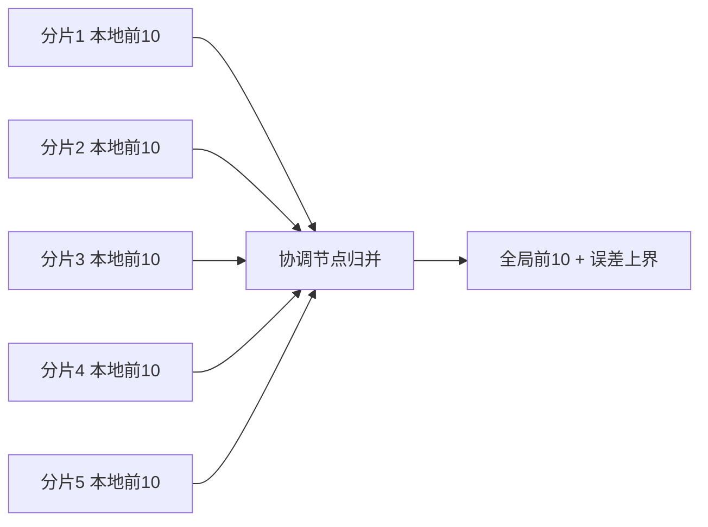

# ES 聚合的性能边界在哪？分片近似和大聚合怎么不爆？

> 一句话点题：ES 的聚合不是在一张全局表上做精确统计，而是"分片各自算 + 协调节点归并"的分片近似，数据靠 doc_values 列存读取。搞不清这层边界，要么拿近似值当精确值用，要么一个高基数大聚合就把堆打爆。

上一篇讲了聚合怎么用，这篇往下挖：聚合的精度边界、大聚合为什么爆内存、怎么让它不爆。这是区分"会用聚合"和"懂聚合"的分水岭。

## 聚合靠什么读数据：doc_values 与 fielddata

聚合/排序本质上要"按字段遍历命中的文档"，但倒排索引按词项组织，反查某字段的所有值并不高效。所以 Lucene 给每个字段额外存了一份**列式存储 doc_values**——按字段、按文档顺序排列，专门给排序、聚合、脚本读取用。

关键事实（ES 8.x 官方文档）：

- doc_values **默认开启**，支持绝大多数字段类型，但 **`text` 和 `annotated_text` 不支持**——这是直接对 text 聚合会报错的根因；只用于检索、从不聚合的字段可关掉省磁盘（`wildcard` 不能关），关掉再想聚合就失败。
- text 真要聚合走的是另一条路 **fielddata**：把字段值加载进 **JVM 堆**建成可遍历结构，默认关闭、按需加载、很贵，加载量随命中数和基数增长，失控就是 OOM 的常客。

正确做法是给 text 配 `keyword` 子字段，对 `field.keyword` 聚合——keyword 有 doc_values，走列存不进堆。

## 分片近似：为什么 terms 会漏桶

ES 是分布式的，一个 index 的数据散在多个分片上。聚合时不是把所有文档汇到一处再算，而是**每个分片先各自算自己的局部结果，协调节点再归并**。

对 `sum/max/min/avg` 这种可加/可比的聚合没问题——各分片 sum 加起来就是总和。但 `terms`（按出现次数取前 N）就有坑：每个分片只返回自己本地的前 N，协调节点归并时可能漏掉"全局排第 8、但在某个分片排第 N+1"的标签。

ES 因此在结果里给两个量让你心里有数：

- `doc_count_error_upper_bound`：每个桶的 doc_count **最多可能差多少**；
- `sum_other_doc_count`：没进前 size 的文档总数。

想看每个桶各自的误差，开 `show_term_doc_count_error: true`。

## 深度分桶：size 与 shard_size 的取舍

terms 有两个 size：`size` 是最终返回的桶数，`shard_size` 是每个分片返回的候选桶数。**`shard_size` 默认 `size * 1.5 + 10`**（官方文档确认）。

常见的取舍与现象：

| 现象                       | 原因                                       | 应对                             |
| -------------------------- | ------------------------------------------ | -------------------------------- |
| 结果带 `doc_count_error`   | 分片只返回 shard_size 个候选，全局候选被截 | 调大 `shard_size`                |
| `sum_other_doc_count` 很大 | 桶远多于 size，长尾被丢                    | 正常，想看更多就调大 size        |
| 调大 size 后结果漂移       | 之前漏掉的桶现在冒出来了                   | 说明之前是近似的，不是"数据变了" |

要更准调大 `shard_size`（代价：分片多传、协调节点多归并）；单分片索引少了归并这步，terms 精确——这也是小数据量场景精度问题突然消失的原因。

## 大聚合怎么不爆：高基数、断路器与 max_buckets

聚合吃内存主要两类场景：高基数字段（user_id、url）开 terms/cardinality，和多层嵌套分桶。控制手段从轻到重：

**1. 断路器先兜底。** ES 有内存断路器，聚合加载前估算内存，超限抛 `CircuitBreakingException`，宁可报错也不 OOM。默认值（官方文档确认）：

- **fielddata 断路器：堆的 40%**；
- **父断路器：堆的 95%**（`indices.breaker.total.use_real_memory=true` 时，否则 70%）；
- `indices.fielddata.cache.size` 控制 fielddata 缓存上限，**默认不设上限（unbounded）**——生产强烈建议显式设一个值（比如堆的 40%）。

**2. max_buckets 限制桶数。** `search.max_buckets` 默认 **65536**（官方文档确认），单次请求产生的桶超过这个数就报错。它是个"硬护栏"，防止一个失控的嵌套聚合炸出几百万桶。

**3. 高基数聚合换近似。** `cardinality`（去重计数，如 UV）基于 **HyperLogLog++**，内存固定约为 `阈值 × 8` 字节、跟数据量无关。精度阈值 `precision_threshold`（常用默认 3000）控制精度/内存权衡：低于阈值近乎精确，高于则误差增大（百万量级低阈值下误差约 1%~6%）。`percentiles` 用 TDigest，P50 一般准、P99 等尾部有误差。两者本质是"用一点精度换内存"，高基数场景正是它们的主场。

> 顺带纠个偏：`precision_threshold` 不是"卡住的文档数上限"，而是"低于这个基数时结果近似精确"的阈值；调高更准但内存也涨。

## 优化手段：先收窄、composite 分页、延迟聚合

- **用 query 先收窄范围**：聚合作用在 query 命中的文档集上，过滤掉无关文档，聚合遍历的数据就少了。能用 filter（不打分、可缓存）就别用 must。
- **composite 分页大分桶**：terms 的 size 有上限，全量枚举桶用 `composite`——像 search_after 之于深分页，用 `after_key` 游标一页页把桶流式取出来，不在一次请求里建几百万桶（composite 本身不便宜，上线前要压测）。
- **延迟聚合 / 必要时采样**：嵌套聚合可标记子聚合延迟计算减少峰值内存；扛不住用 random sampler 先采样再聚合，拿近似结果。

## 容易踩的坑

- **把 cardinality 当精确值**：它基于 HyperLogLog++ 近似、有误差，计费/财务场景别依赖，要么用可加的 sum，要么回 MySQL 算。
- **terms 结果不准还以为对**：分片归并有 `doc_count_error`，要更准调大 `shard_size`，或看 `sum_other_doc_count` 判断长尾。
- **对 text 字段直接聚合**：text 没 doc_values 会报错；正确做法是对 `field.keyword` 子字段聚合，别开 fielddata 把数据拉进堆。
- **高基数 terms 爆 OOM**：千万级 user_id 上开 size 很大的 terms，桶本身就把堆吃光；换 cardinality 或 composite 分页。
- **fielddata 缓存不设上限**：默认 unbounded，长期跑会把堆撑满，生产要显式设 `indices.fielddata.cache.size`。
- **拿 ES 聚合当 SQL GROUP BY 完全等价**：思路像，但 ES 多了分片近似、堆内存约束、桶数上限几层边界。

## 小结

- 聚合/排序靠 **doc_values 列存**读数据，默认开启，但 `text` 不支持——聚合要用 `field.keyword` 子字段，别开 fielddata 把数据拉进堆。
- terms 是**分片近似**：每个分片返回 `shard_size`（默认 `size*1.5+10`）个候选，协调节点归并，结果带 `doc_count_error_upper_bound` 和 `sum_other_doc_count`；要更准调大 `shard_size`，单分片索引精确。
- 大聚合防爆三道闸：**fielddata 断路器（堆 40%）、父断路器（堆 95%）、`search.max_buckets`（默认 65536）**；`indices.fielddata.cache.size` 默认不设上限，生产要显式设。
- 高基数场景用近似聚合：**cardinality 基于 HyperLogLog++（内存固定 ~阈值×8 字节）、percentiles 基于 TDigest（尾部有误差）**，用精度换内存。
- 优化靠**query 先收窄 + filter 缓存 + composite 游标分页 + 延迟聚合**，必要时采样。

## 参考

参考了 Elasticsearch 官方文档中 doc_values、fielddata、circuit breaker、terms / cardinality / composite 聚合及 search.max_buckets 等聚合限制相关内容，并结合社区 Elasticsearch 面试题集中关于聚合性能边界的常见问题整理。
