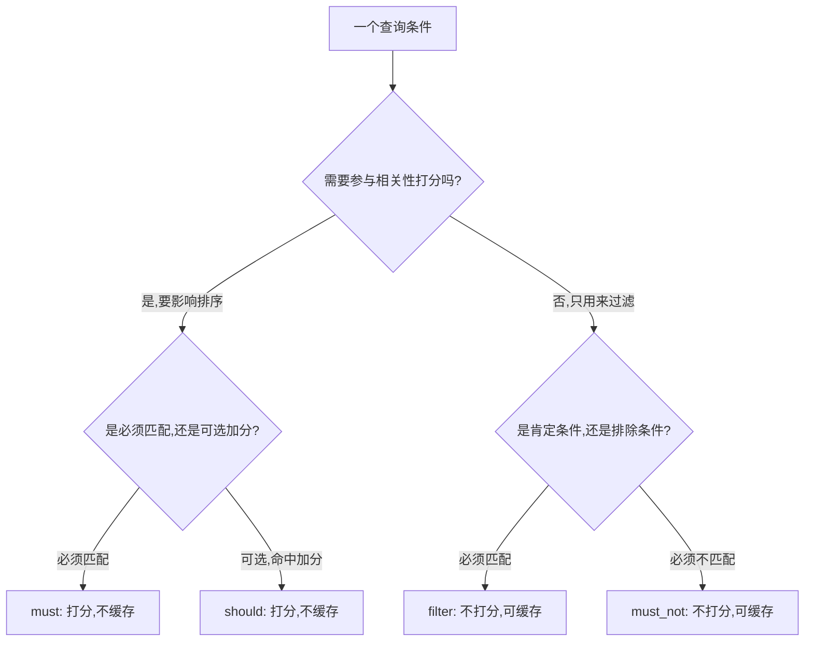

# bool 复合查询里 must/filter/should/must_not 怎么搭？

> 一句话点题：bool 不是把条件一股脑塞进去就行，filter 不打分还能吃缓存、must/should 算相关度，子句选错既拖慢查询又把排序带歪。

上一篇把打分讲透了，这篇接着往下走：真实查询几乎都不是单条件，"标题匹配关键词 + 状态已发布 + 最近 7 天 + 不是草稿"这种要用 `bool` 把多个子句拼起来。`bool` 看着简单——四种子句往里塞就行——但坑也正藏在这"塞"里：哪个条件该打分、哪个只过滤、`should` 到底要不要必须满足，答错一个，轻则慢、重则结果都不对。

## 先认清四子句：谁打分、谁不打分

`bool` 有四种子句，按 ES 8.x 官方文档的说法，它们的打分和缓存行为是这样分的：

| 子句       | 匹配要求         | 是否打分 | 是否参与缓存 | 一句话定位                         |
| ---------- | ---------------- | -------- | ------------ | ---------------------------------- |
| `must`     | 必须匹配         | 打分     | 不缓存       | 既要匹配、又要参与相关性排序       |
| `should`   | 可选匹配（加分） | 打分     | 不缓存       | 命中更好、不命中也行，主要用来加分 |
| `filter`   | 必须匹配         | 不打分   | 可缓存       | 纯过滤，只问匹不匹配               |
| `must_not` | 必须不匹配       | 不打分   | 可缓存       | 排除条件，走 filter 上下文         |

这里有两个关键点容易记混：

- **打分的是 `must` 和 `should`**：命中的 `must`/`should` 子句的得分会**累加**成文档的最终 `_score`，所以它们直接决定排序。
- **不打分的是 `filter` 和 `must_not`**：两者都在 **filter 上下文**里执行，"scoring is ignored"，而且"considered for caching"——结果可以被缓存。`must_not` 给所有文档返回 `0` 分，但它本身在 filter 上下文，不会污染 `_score`。

一句话区分：**要它影响排序就放打分子句，只要它筛掉/保留某些文档就放不打分子句。**

## Query 上下文 vs Filter 上下文：缓存的分界

上一篇讲打分时提过两个上下文，这里从 `bool` 的角度再压实一次，因为这是 `bool` 优化的核心。

- **Query 上下文**：`must`、`should` 跑在这里，每条文档都要算一遍相关性分，算完排序。算分依赖词频、文档长度、IDF，每次查询条件一变就得重算，**结果无法缓存**。
- **Filter 上下文**：`filter`、`must_not` 跑在这里，只回答"这篇文档匹不匹配"——是/否，不算分。因为不依赖打分，ES 可以把"哪些文档匹配"存成位图（bitmap）缓存起来，下次同样的过滤条件直接复用，跳过倒排遍历，飞快。

这个缓存不是理论上的：ES 节点有 **query cache**，会缓存那些"被多次使用、命中一定数量分段"的 filter 查询。所以一个高频过滤条件（比如 `status=published`）放进 `filter`，跑得越多越赚；放进 `must`，每次都白白算一遍分，还吃不到缓存。

判断一个条件该走哪个上下文，按这个决策树走就行：



经验法则一句话：**所有"只筛不排"的条件统统放 `filter`/`must_not`，把打分子句留给真正要按相关性排序的那一两个全文检索条件。**

## should 的 minimum_should_match：什么时候必须满足几个

`should` 是四子句里最容易被用错的，因为它"可选"的行为会随兄弟子句变化。关键就在 `minimum_should_match` 这个参数。

按 ES 8.x 官方文档的精确表述，默认值是这么定的：

> 如果 `bool` 查询**至少有一个 `should` 子句，且没有 `must` 或 `filter` 子句**，默认值是 `1`；**否则默认值是 `0`**。`must_not` 是否存在对这一默认值没有影响。

翻译成行为就是两条规则：

1. **只有 `should`、没有 `must`/`filter` 时**：`should` 实际上是"必须至少满足一个"，默认 `minimum_should_match=1`。比如纯 `should` 查"标题匹配 mysql **或** 标签匹配数据库"，至少命中一个才返回。

   ```json
   {
     "bool": {
       "should": [{ "match": { "title": "mysql" } }, { "match": { "tag": "数据库" } }]
     }
   }
   ```

   这条等价于"标题或标签任一命中"，至少满足一个。

2. **有 `must` 或 `filter` 同时存在时**：`should` 退化为**纯加分项**，默认 `minimum_should_match=0`——也就是说 `should` 命不命中也照样返回，命中只是给 `_score` 加点分。这正是很多人踩坑的地方：以为写了 `should` 就"应该"满足，结果文档一个 `should` 都没命中也照样出现在结果里。

   ```json
   {
     "bool": {
       "must": [{ "match": { "title": "mysql" } }],
       "should": [{ "match": { "tag": "数据库" } }]
     }
   }
   ```

   这里 `should` 命中只是让"带数据库标签的 mysql 文章"排更前，但只要标题含 mysql，不管标签如何都会返回。

如果你确实想要"满足 must 的同时，should 至少命中 N 个才返回"，就得**显式设 `minimum_should_match`** 覆盖默认值：

```json
{
  "bool": {
    "must": [{ "match": { "title": "mysql" } }],
    "should": [{ "match": { "tag": "数据库" } }, { "match": { "tag": "索引" } }],
    "minimum_should_match": 1
  }
}
```

这个值可以是整数（至少命中几个），也可以是百分比（如 `"75%"`），还能写 `"1<2"` 这种"少于 2 个条件时全要满足"的复合规则——不过面试和实战里记住"默认 0 或 1、需要时显式覆盖"就够用了。

## 打分到底怎么算：一个对比例子

光说"打分不打分"太抽象，拿两条等价结果、不同写法的查询对比一下，差别就出来了。假设有两篇文档：

- `doc1`：`title="mysql 索引优化实战"`，`status=published`
- `doc2`：`title="mysql 基础入门"`，`status=published`

**写法一：全塞 `must`**

```json
{
  "bool": {
    "must": [{ "match": { "title": "mysql" } }, { "term": { "status": "published" } }]
  }
}
```

`status=published` 这个本该纯过滤的条件进了 `must`，于是它也参与打分，跑在 Query 上下文里，每条文档都为它算一遍分；更要命的是它**吃不到缓存**。最终 `_score` = `title` 的 BM25 分 + `status` 这条带来的分，排序被一个和"相关性"毫无关系的状态条件搅进来，结果"看着排了，其实排得不太对"。

**写法二：过滤条件放 `filter`**

```json
{
  "bool": {
    "must": [{ "match": { "title": "mysql" } }],
    "filter": [{ "term": { "status": "published" } }]
  }
}
```

`status` 只过滤、不打分、可缓存。`_score` 干干净净只反映标题对 "mysql" 的相关性，`doc1`（标题更"对症")会合理地排在 `doc2` 前面。同时 `status=published` 的位图被缓存，下次再查"已发布"的文章直接命中。

两个写法**返回的文档集合一样**，但写法二更快、排序更准。这就是"该用 `filter` 用了 `must`"的真实代价：又慢、又乱打分。

想确认某条子句到底有没有算分，加 `"explain": true` 看明细，返回里会列出每个子句贡献的分；`filter`/`must_not` 子句那一栏不会出现在打分明细里——这是验证自己查询写得对不对的利器。

## 常见组合：filter 兜底 + must/should 排序

实战里 `bool` 最稳的搭法是一条经验：**`filter` 做精确兜底过滤，`must`/`should` 只负责按相关性排序**。下面是高频场景到组合的映射：

| 场景                                     | 推荐组合                                          | 为什么                                    |
| ---------------------------------------- | ------------------------------------------------- | ----------------------------------------- |
| 全文搜 + 状态/时间过滤                   | `must`(match) + `filter`(term/range)              | 文本算分排序，过滤条件走缓存              |
| 全文搜 + 排除某类（如屏蔽词、下架商品）  | `must`(match) + `must_not`(term)                  | 否定条件不打分、可缓存                    |
| 多关键词"任一命中即可"（无其它强制条件） | 仅 `should`(match)                                | 默认 minimum_should_match=1，至少命中一个 |
| 全文搜 + 期望某些标签命中加分、但不强制  | `must`(match) + `should`(match tag)               | should 默认 0，纯加分                     |
| 全文搜 + 至少命中 N 个标签               | `must`(match) + `should` + `minimum_should_match` | 显式覆盖默认，强制 should 满足数量        |
| 纯过滤、无文本相关性（按业务字段排序）   | 全 `filter` + `sort`(业务字段)                    | 全程不打分，最大化缓存，排序交给 sort     |

最后一条容易被忽视：如果一个查询压根没有文本相关性需求（"查最近 7 天已发布的文章，按发布时间倒序"），那就**整个查询都用 `filter`**，排序用 `sort` 指定 `publish_at`。这样没有任何打分开销，所有过滤都能吃缓存——这是把 ES 当"带倒排索引的过滤引擎"用时的最佳写法。

还有一招进阶：**把整个 `bool` 塞进 `filter`**，可以让一段本该打分的逻辑整体变成不打分。比如"标题匹配 mysql **且** 标签匹配数据库"这个组合，如果你不关心排序只要结果，就写成：

```json
{
  "bool": {
    "filter": [
      {
        "bool": {
          "must": [{ "match": { "title": "mysql" } }, { "match": { "tag": "数据库" } }]
        }
      }
    ]
  }
}
```

外层 `filter` 把内层 `bool` 整体压进 filter 上下文，内层的 `match` 也不再打分、可缓存。这招在做"存在性/精确过滤"又不得不用 `match` 时很管用。

## 容易踩的坑

- **该用 `filter` 却用了 `must`**：纯过滤条件（状态、时间范围、标签精确值）放 `must` 会白白算分、吃不到缓存，又慢又乱排序——这是 `bool` 优化第一问题。
- **以为写了 `should` 就一定会生效**：有 `must`/`filter` 时 `should` 默认 `minimum_should_match=0`，是纯加分项，不命中也返回；要让 `should` 必须满足若干个，得显式设 `minimum_should_match`。
- **纯 `should` 查询忘了默认要至少满足一个**：没有 `must`/`filter` 时 `should` 默认要求至少命中 1 个；如果本意是"全部可选、命中都返回但排序按命中数"，要意识到这条"至少一个"的默认门槛，必要时显式设 `0`。
- **`must_not` 误以为会影响排序**：`must_not` 在 filter 上下文、返回 0 分，不会影响 `_score`，它只是把不满足的文档剔掉，排序仍由 `must`/`should` 决定。
- **嵌套 `bool` 过深又不注意上下文穿透**：`bool` 套 `bool` 套 `bool`，可读性差、调试难；更要紧的是上下文会"穿透"——外层 `filter` 里的内层 `bool` 整体不打分，想在内层用 `should` 加分会失效。嵌套时想清楚每层处在哪个上下文。
- **把高基数的 range 全塞 `filter` 以为一定快**：`filter` 能缓存，但像"时间精确到秒的范围"这种高基数、几乎不复用的过滤，缓存命中率低，收益有限；缓存更适合低基数、高频复用的条件（状态、枚举、布尔）。

## 小结

- `bool` 四子句按打分分两类：`must`/`should` 打分且不缓存，决定排序；`filter`/`must_not` 不打分、走 filter 上下文、可缓存，只负责过滤。
- 两个上下文是 `bool` 优化的核心：**只筛不排的条件统统放 `filter`/`must_not`**，把打分子句留给真正要按相关性排序的全文检索条件。
- `should` 的默认门槛：**有 `should` 但没有 `must`/`filter` 时默认 `minimum_should_match=1`；否则默认 `0`**；`must_not` 是否存在不影响这一默认值。要让 `should` 必须满足若干个，显式设 `minimum_should_match`。
- 打分对比例子：同样的结果集，过滤条件放 `must` 既慢又把 `_score` 搅乱，放 `filter` 更快、排序更准——用 `"explain": true` 能验证每条子句是否参与打分。
- 实战搭法：`filter` 兜底精确过滤 + `must`/`should` 做相关度排序；纯过滤无文本相关性的查询全用 `filter` + `sort`，把打分开销彻底省掉。

## 参考

综合社区 Elasticsearch 面试题集与 Elasticsearch 官方文档（bool query、query context 与 filter context、query cache 相关章节）整理，并按 8.x 官方文档核对了 `minimum_should_match` 默认值规则与 `filter`/`must_not` 的缓存、打分行为。
