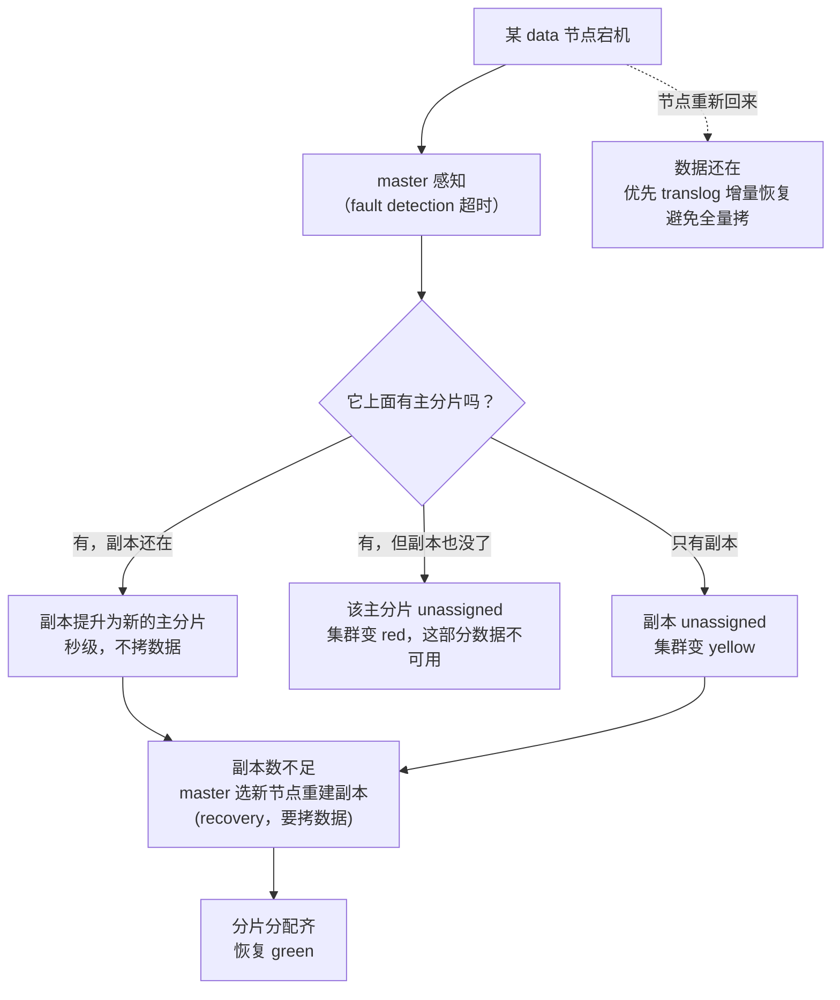

# ES 集群健康、路由和故障恢复怎么判断？

> 一句话点题：集群健康不是看个 green 就行——red / yellow / green 背后是分片有没有分配齐，而分片能不能分配、节点挂了之后怎么补回来，靠的是路由公式、分配决策器、集群协调三件事。排障时真正要看的是这些，不是那个颜色字。

前面几篇讲了分片/副本的静态结构和读写的动态流转。这篇把视角拉到集群运维层：健康状态怎么读、分片为什么分配不上去、文档靠什么路由、节点挂了集群怎么自愈、还有那个被旧资料反复提的"脑裂"——它在 7.x 之后其实已经不是你要操心的事了。

## 集群健康：green / yellow / red 到底在说什么

这三个颜色不是装饰，是分片分配状态的直接映射。官方定义很干脆：

| 颜色     | 官方定义                                                                       | 数据可用性               | 含义                         |
| -------- | ------------------------------------------------------------------------------ | ------------------------ | ---------------------------- |
| `green`  | All shards are assigned                                                        | 全部可用                 | 主分片和副本都齐             |
| `yellow` | All primary shards are assigned, but one or more replica shards are unassigned | 数据可用，但少了一份冗余 | 主分片都在，副本没配齐       |
| `red`    | One or more primary shards are unassigned, so some data is unavailable         | 部分数据不可用           | 有主分片没分配上，这是真故障 |

关键一句：**index 级健康取它最差的那个分片的状态，cluster 级健康取它最差的那个 index 的状态**。所以集群红，不代表整个集群瘫痪，只代表至少有一个 index 的主分片没分配上；其余 index 可能照样绿。

怎么查？不只看那个颜色，要往下钻：

```bash
GET _cluster/health                    # 看集群总览
GET _cluster/health?level=indices      # 下钻到每个 index
GET _cluster/health?level=shards       # 下钻到分片粒度
```

返回里除了 `status`，还有 `unassigned_shards`、`unassigned_primary_shards`、`active_shards_percent_as_number`。排障时这几个数比颜色更有用：`unassigned_primary_shards > 0` 才是红，`unassigned_shards` 里只有副本就是黄。

一个常见误读：**看到 yellow 就当故障处理**。单节点集群、或副本数 ≥ 节点数时，副本放不下必然 yellow，这是配置问题不是故障。反过来，**看到 green 就觉得稳了也不对**——green 只代表现在分片都分配上了，不代表磁盘快满了、不代表副本都同步完整。颜色是必要信息，不是充分信息。

## 分片为什么 unassigned：分配决策与恢复

red / yellow 的直接原因是"有分片没分配到节点上"，也就是 `unassigned`。ES 把一个分片放到哪个节点，不是随便挑的，要过一遍 **allocation decider（分配决策器）**，每个决策器对"这个分片能不能放这个节点"给出 `YES / NO / THROTTLE / ALWAYS` 之一，只要有决策器给 `NO`，这个分片就分配不上去。

常见决策器和高频触发原因：

| 决策器                             | 判什么                            | 常见触发 NO 的原因                       |
| ---------------------------------- | --------------------------------- | ---------------------------------------- |
| `same_shard`                       | 主副本不能同节点                  | 节点数 < 副本数 + 1，副本没地方放        |
| `disk_threshold` (磁盘水位)        | 节点磁盘用量是否超阈值            | **磁盘满，最常见的生产 red/yellow 元凶** |
| `filter` (include/exclude/require) | 按节点属性过滤（`node_attr` 等）  | 节点上下线时按角色迁移分片               |
| `awareness`                        | 按机房/机架打散，避免主副本同机房 | 可用区不够，副本无法满足 awareness 约束  |
| `total_shards_per_node`            | 单节点分片数上限                  | 节点少而分片多，超过上限的分片分配不上   |
| `throttling`                       | 单节点正在 recovery 的并发数      | 故障恢复时分配被限流，分片"排队中"       |

磁盘水位尤其要记牢，因为它会从"分配不上"升级成"连写都不让写"：

| 水位                    | 默认值 | 触发动作                                                            |
| ----------------------- | ------ | ------------------------------------------------------------------- |
| `watermark.low`         | 85%    | 不再往这个节点**分配新分片**（rebalance 受限）                      |
| `watermark.high`        | 90%    | 开始把这个节点上的分片**搬走**                                      |
| `watermark.flood_stage` | 95%    | 索引被置为 `read_only_allow_delete`，**写入直接报错**，只能删不能改 |

`flood_stage` 这条是高频翻车现场：磁盘一涨到 95%，业务写入突然全报 `index read-only / allow delete` 错误，排查半天才发现是磁盘。处理完磁盘后还要手动 `PUT _all/_settings {"index.blocks.read_only_allow_delete": null}` 解锁。

排查 unassigned 的利器是分配解释接口，它直接告诉你"这个分片为什么没分配上、被哪个决策器挡了"：

```bash
GET _cluster/allocation/explain
# 返回里 unassigned_info.reason 可能是：
# INDEX_CREATED  —— 建索引后还没分配
# NODE_LEFT      —— 所在节点离开了
# ALLOCATION_FAILED —— 上次分配尝试失败
# REROUTE_CANCELLED —— 被手动取消分配
```

`reason` 告诉你起因，`decisions` 数组里每个决策器的 `decision` 告诉你被谁拦了。生产里 90% 的 unassigned 都能靠这一个接口定位。

分配上去之后还有 **recovery（恢复）** 过程，这是分片"从无到可用"的实际工作：

- **主分片提升（promote）**：节点挂了，它上面的主分片没了，但有副本在——master 直接把副本提升成新主分片，秒级完成，不需要拷数据。
- **副本重建**：副本数不够了，master 选一个节点，从主分片把数据拷一份过去。这步要占网络和磁盘 IO。
- **重平衡（rebalance）**：没有节点挂，但分片分布不均，master 会在节点间挪分片凑均匀，也走 recovery。

recovery 有快有慢：如果分片数据还在本节点（只是节点重启回来了），可以靠 translog 增量恢复，很快；如果数据丢了要从副本全量拷，分片越大越慢——这正是上一篇说"单分片别撑到几百 GB"的另一个理由：故障恢复时整个大分片要拷，恢复窗口拉长，期间这个分片要么不可用要么冗余不足。

## 路由：文档怎么落到分片，自定义路由的代价

这一节上一篇讲过了，这里从"故障/健康"视角再钉一次，因为路由直接决定"文档该去哪个分片"，也就决定"分片数为什么不能随便动"。

> `shard = hash(routing) % number_of_primary_shards`

`routing` 默认是文档的 `_id`，取模结果落在 0 到 `主分片数-1`，就是这篇文档的主分片号。这条公式带出两条硬约束：

1. **主分片数建索引时定死，不能改**。改了 `number_of_primary_shards`，所有文档 `hash(id) % 新数` 的结果全变，路由错位，文档"查不到"。真要扩主分片数，只能 `split`（要求原分片数能整除新数）或 reindex 到新索引。
2. **副本不参与路由**。所以副本数能动态改，主分片数不能。

可以给文档指定自定义 `routing` 值：写入时带 `?routing=user_123`，让同一用户的文档都落同一分片；查询时也带相同 routing，ES 就只查那一个分片，不用广播给所有分片。好处是查询少扇出、省资源；代价是 **数据可能不均**——某些 routing 哈希后扎堆到同一分片，形成热点分片，那个分片特别大、QPS 特别高，反而成为瓶颈。所以自定义路由要用，就得提前评估分布，必要时配合分片数让它尽量打散。

## 故障恢复：节点挂了之后集群在干什么

把上面几件事串起来，节点挂掉时集群的自愈时序是这样的：



几个排障要点：

- **主提升优先于副本重建**。节点一挂，第一动作是把副本提成主分片保数据可用，这一步不拷数据、很快；之后才慢悠悠重建副本。所以一次故障里，"集群先短暂 red（提升中）→ 变 yellow（主齐了、副本在重建）→ 恢复 green"是正常节奏，别看到中间颜色跳变就慌。
- **delayed allocation（延迟分配）防抖**。节点离开，默认 ES 立刻开始重建副本。但如果这个节点只是网络抖动、几分钟后回来，那白拷一通，回来还要再平衡，反复折腾——叫"分片搬来搬去"。`index.unassigned.node_left.delayed_timeout`（默认 1 分钟）让分配延迟一会儿，给节点回归留时间。节点频繁抖动的场景务必调大这个值。
- **rolling restart 要先停分配**。逐个重启节点做升级时，每重启一个，分片就被重新分配一次，集群抖个不停。正确做法是先 `PUT _cluster/settings {cluster.routing.allocation.enable: "primaries"}`（只允许主分片分配、停掉副本迁移），重启完再恢复成 `"all"`，减少搬迁。

## 集群协调与脑裂：7.x/8.x 的根本变化（纠偏旧资料）

旧教程里"脑裂"是个高频词，但你大概率不需要再操心它。这里把版本变化讲清楚，省得回答时还停在老版本。

**老机制（6.x 及以前）**：靠 Zen Discovery，主节点靠 `discovery.zen.minimum_master_nodes` 这个值来定 quorum（最少几个 master-eligible 节点在线才能选主）。这个值要手动设，设错了——比如设成 1——网络一抖，两个分区各自觉得"我能凑够 quorum"，各自选出自己的主，**两个 master 同时存在，集群状态分叉，这就是脑裂**。脑裂后两边各自写数据，合并回来就丢数据。

**7.0 起的根本变化**：ES 用全新的集群协调子系统（cluster coordination）取代了 Zen Discovery。新机制有三个核心点：

1. **引导配置明确化**。`discovery.zen.ping.unicast.hosts` 被 `discovery.seed_hosts` 取代；首次组网要靠 `cluster.initial_master_nodes` 引导（只建集群第一次填，组网后清掉）。生产模式必须显式配置，不允许自动引导——因为自动引导天生不安全。
2. **投票配置自动维护**。`minimum_master_nodes` 这个手动值被废弃，不再需要、也不应该手动设。新机制自己维护一份"投票配置（voting configuration）"，记录哪些 master-eligible 节点参与投票，并随节点加入/离开**自动增减**，始终保住一个能过半的 quorum。
3. **少数派拿不到 quorum，选不出主**。分区后只有多数派那侧能凑够 quorum 继续工作，少数派侧选不出 master 直接停服。**两个 master 同时存在的脑裂，在新机制下基本不会再发生**。

> 纠偏：很多旧资料和面经还让你"配置 `discovery.zen.minimum_master_nodes` 防脑裂"。这个设置从 7.0 起废弃，设了也不生效、还会告警。正确回答是"7.x 起集群协调由新子系统接管，自动维护投票配置，不再手动设这个值"。

还有一个实用配置：**voting-only 节点**。设 `node.roles: [master, voting_only]`，这个节点能参与选主投票，但**永远不会被选成主节点**。它专门用来给小集群凑数——比如只有 2 个 master-eligible 节点的集群，两个节点对半分，谁也拿不到多数 quorum，挂一个就选不出主。加一个 voting-only 节点，凑成 3 个投票者，任意挂一个都还剩 2 票过半，选举稳定，又不会让这第三个弱机器真去当 master。8.x 沿用这套机制，并清理了遗留的 zen 相关设置，集群协调行为和 7.x 一致。

一句话收口：**脑裂是 6.x 的老问题，7.x 之后靠自动管理的投票配置根治，你现在的任务是别再设 `minimum_master_nodes`、按官方用 `seed_hosts`/`cluster.initial_master_nodes` 引导，必要时加 voting-only 节点稳定小集群选举**。

## 容易踩的坑

- **把 yellow 当 red 处理**：单节点或副本数 > 节点数时副本放不下必然 yellow，是配置问题不是故障，先看是不是节点不够。
- **看到 red 才急，green 就放任**：red 是有主分片没分配（真故障），要立刻 `allocation/explain` 定位；green 也要盯磁盘水位，别等 flood_stage 把索引变只读。
- **磁盘涨到 95% 业务写入全失败**：`flood_stage` 触发 `read_only_allow_delete`，写入报错；清磁盘后还要手动解除只读块。
- **节点抖动没开 delayed allocation**：节点短暂离开立刻重建副本，回来再平衡，分片搬来搬去拖垮集群，调大 `delayed_timeout`。
- **rolling restart 不停分配**：逐个重启导致分片反复迁移，要先设 `cluster.routing.allocation.enable: primaries`。
- **自定义 routing 导致热点分片**：某些 routing 哈希后扎堆，单分片 QPS/容量飙高，要提前评估分布。
- **还在按旧资料配 `minimum_master_nodes`**：7.x 起废弃，设了不生效，改用 `discovery.seed_hosts` + `cluster.initial_master_nodes`。
- **2 节点小集群选举不稳**：两个 master-eligible 节点对半分，挂一个就选不出主，加一个 voting-only 节点凑成奇数投票者。

## 小结

- 集群健康：`green` 主副本全齐、`yellow` 缺副本（数据在）、`red` 缺主分片（部分数据不可用）；index 级取最差分片、cluster 级取最差 index，排障要下钻到 `unassigned_primary_shards`。
- 分片 unassigned 查 `_cluster/allocation/explain`，看 `reason` 和决策器的 `decision`；磁盘水位（low/high/flood_stage）是高频元凶，flood_stage 会让索引变只读。
- 故障恢复顺序：副本提升为主（秒级、不拷数据）→ 重建副本（recovery、拷数据）→ 重平衡；delayed allocation 防 抖动，rolling restart 先停副本迁移。
- 路由 `shard = hash(routing) % 主分片数` 决定主分片数不可变；自定义 routing 能少扇出但要防热点。
- **脑裂是 6.x 老问题**，7.x 起新协调子系统用自动管理的投票配置根治，`minimum_master_nodes` 废弃，改用 `discovery.seed_hosts`/`cluster.initial_master_nodes` 引导，小集群加 voting-only 节点稳定选举，8.x 沿用并清理遗留设置。

## 参考

参考 Elasticsearch 官方文档中集群健康、分片分配与 allocation deciders、allocation explain、recovery、discovery 与集群协调、节点角色（含 voting_only）相关内容，结合社区 ES 面试题集中 red/yellow/green、路由、脑裂与故障恢复相关高频问题整理，并核对 7.x/8.x 集群协调版本变化。
