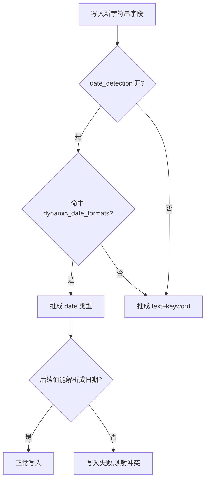

# 动态映射怎么不失控？text/keyword 和 date 怎么识别？

> 一句话点题：动态映射省事但容易把字段类型猜错，生产上靠显式映射 + dynamic strict 兜底。

上一篇把 mapping 的整体设计和 text/keyword 的区别讲透了，但留了一个口子：动态映射。开发阶段往一个新 index 随手丢一条文档，字段类型自动就有了，确实方便；可一旦上生产，这种"猜类型"的行为往往会埋雷——字符串被猜成 date、数值被猜成 long、第一条文档把类型定死后面全跟着错。这一篇就专门拆动态映射：它怎么识别类型、哪些地方容易猜错、以及怎么用 `dynamic` 的几档策略把它管住。

## 动态映射到底"动"在哪

动态映射（dynamic mapping）指的是：你不预先声明字段，直接往 index 写文档，ES 看到新字段就**按内置规则猜一个类型、自动加进 mapping**。和显式映射（explicit mapping，先定义后写入）相对。

它"动"在两件事上：

- **新字段自动上 mapping**：写入 `{"sku": "X-001"}` 时 ES 发现没有 `sku`，就给它推一个类型并写进 mapping；
- **类型一旦推定就固定**：之后这个字段所有文档都得符合这个类型，第二条文档想把 `sku` 写成数字就会报映射冲突。

这正是动态映射最危险的地方——**第一条文档决定了字段类型**。一条脏数据就能把一个本该是 keyword 的字段推成 date，而且没法回头改（字段类型有数据后基本不可改，只能 reindex，上一篇讲过）。所以动态映射的本质是"用第一条数据给整个 index 的 schema 投票"，生产上必须对这个"投票权"做限制。

## 字符串怎么识别成 text 还是 keyword

字符串是动态映射里行为最绕的一类。规则是：

> 从 5.x 起，`string` 这个老类型被拆成了 `text` 和 `keyword`，动态映射碰到一个普通字符串字段，默认会推成 **`text` 类型 + 一个 `keyword` 子字段**（`fields.keyword`，`ignore_above` 默认 256）。

也就是说，你随手写一个 `{"title": "MySQL 索引优化"}`，ES 给 `title` 建的不只是一个分词的 text，还附赠一个不分词的 `title.keyword`，方便做精确匹配和聚合。这其实是 ES 替你做了"既想全文搜又想精确匹配"的默认处理（上一篇讲过这种需求要用 `fields` 同时配）。写完之后 `GET /articles/_mapping` 看到的 `title` 长这样：

```json
"title": {
  "type": "text",
  "fields": {
    "keyword": { "type": "keyword", "ignore_above": 256 }
  }
}
```

注意那个 `ignore_above: 256`——超过 256 字符的值不会进 keyword 子字段的索引。这就是为什么有些长文本字段做聚合时数据"莫名其妙少了"。

但默认归默认，它不一定符合业务：

- 状态、ID、标签这种**本该纯 keyword** 的字段，被推成 text+keyword 后，`term` 查询会踩分词的坑（搜不到），而且多占一份倒排索引；
- `ignore_above: 256` 意味着超过 256 字符的字符串**keyword 子字段不索引**（值仍存在 `_source`，但 keyword 上搜不到、聚合不到），长文本字段聚合会莫名丢数据。

如果字段不固定又不想被无谓分词（典型是日志），用 dynamic templates 把字符串一律收成 keyword：

```json
"dynamic_templates": [
  { "strings_as_keyword": {
      "match_mapping_type": "string",
      "mapping": { "type": "keyword" }
  } }
]
```

这条规则覆盖默认推断：凡是会被推成 string 的字段，统统变成纯 keyword，不分词、不浪费。

## 日期怎么识别，又怎么识别错

日期是动态映射里最容易"自作聪明"的一类。`date_detection` 默认是**开**的，ES 会拿每个字符串字段去试默认的 `dynamic_date_formats`，命中就推成 `date`。默认格式里有 `strict_date_optional_time` 这种宽松匹配，于是像下面这些值都会被当成日期：

| 字段值                      | 会被识别成 date 吗 | 原因                             |
| --------------------------- | ------------------ | -------------------------------- |
| `2026-01-01`                | 会                 | 命中 `strict_date_optional_time` |
| `2026/01/01 12:00:00 +0800` | 会                 | 命中 `yyyy/MM/dd HH:mm:ss Z`     |
| `X-001`                     | 不会               | 不是任何日期格式                 |
| `2026-13-40`                | 不会               | 不是合法日期                     |

问题来了：业务里有些字符串长得像日期但根本不是。比如订单号 `2026-01-001`、版本号 `2026-01-01`、一批用 ISO 格式命名的 SKU。第一条文档这么一写，这个字段就被钉成 date，后面所有非日期值写进来都会**解析失败、整条文档写不进去**。



两条解决思路，按场景选：

1. **这个字段压根不该是日期** → 关掉日期识别，让它走 text/keyword：

```json
"mappings": { "date_detection": false }
```

2. **它确实是日期，但格式很固定** → 缩窄 `dynamic_date_formats`，只认你给的那几种，避免误伤：

```json
"mappings": {
  "dynamic_date_formats": ["yyyy-MM-dd HH:mm:ss", "yyyy-MM-dd"]
}
```

还有个配套开关 `numeric_detection`，默认**关**。开了之后，字符串里的 `"100"`、`"3.14"` 也会被推成 long/float。一般别开——它和 date_detection 一样爱"自作聪明"，开了等于把本该是 keyword 的编号字段推成数值，`term` 精确匹配照样能查，但聚合语义、前缀查询都会变。

> 纠偏：很多人觉得"字符串被推成 date 是 ES 的 bug"。不是，这是 `date_detection` 默认开的"特性"。要么 `date_detection: false`，要么缩窄 `dynamic_date_formats`，把识别权拿回自己手里。

## dynamic 的四档策略：true / runtime / false / strict

识别规则管的是"猜成什么类型"，而 `dynamic` 这个开关管的是"要不要猜、猜错了怎么办"。它有四档，行为差别很大：

| `dynamic` 值 | 行为                                                    | 新字段能否检索/聚合        | 适用场景                      |
| ------------ | ------------------------------------------------------- | -------------------------- | ----------------------------- |
| `true`       | 自动推断类型、建索引字段（默认值）                      | 能（已建索引）             | 开发期、字段稳定的小项目      |
| `runtime`    | 自动推断，但建成**运行时字段**而非索引字段（7.11 引入） | 能（查询时计算），不占存储 | 字段多但查询少、schema 不固定 |
| `false`      | **忽略**新字段，不建 mapping、不索引                    | 不能（值仍存于 `_source`） | 字段可能来但不关心、只留底    |
| `strict`     | 遇到未知字段**直接拒绝整条文档**（4xx 错误，不写入）    | —                          | 生产、要锁死 schema           |

四档的取舍其实是"灵活性 vs 可控性"的滑动条：`true` 最灵活但最不可控，`strict` 最可控但最不灵活。逐条说几个容易混的点：

- **`false` 不是"拒绝写入"**：文档照常写进去、`_source` 里新字段的值还在，只是这个字段没有 mapping、不建索引，**搜不到也聚合不了**。它是"留着但不索引"，不是"拦住不让写"。
- **`runtime`（7.11 起）是 `true` 的轻量替代**：新字段不进倒排索引、不占磁盘存储，查询时按运行时字段现算。代价是查询时计算开销大、且运行时字段**不能是 text**（分词类没法现算），所以普通字符串会被推成 `keyword`、对象字段则干脆不建字段。适合"字段又多又杂、但多数很少查"的场景，比如探查期日志。
- **`strict` 是生产的兜底**：任何没在 mapping 里声明过的字段，写进来直接报错、整条文档被拒。比如 index 开了 `dynamic: strict`，文档里多带一个没声明的 `unexpected_field`，写入会直接返回 `400`，报错信息形如 `strict_dynamic_mapping_exception`，并提示哪个字段未被识别。这能从源头堵住"脏字段污染 schema"——谁要加字段，得走显式 mapping 流程，不能偷偷靠动态映射塞进来。一条忘了关 strict 的脏数据写进来立刻报警，总好过它悄无声息地把 schema 污染了三个月才被发现。

`dynamic` 还能**按对象粒度覆盖**：index 级设 `strict`，某个确定要动态的字段对象内部再单独放开：

```json
"mappings": {
  "dynamic": "strict",
  "properties": {
    "metadata": { "type": "object", "dynamic": true }
  }
}
```

这样顶层字段锁死（多写一个就报错），但 `metadata` 这个对象里随便加字段都自动推断——兼顾"主体 schema 稳定"和"扩展字段灵活"。

## 显式映射 + strict：生产兜底

把前面几节串起来，生产上管住动态映射的标准组合是：

1. **能确定的字段，显式映射写死**：title 用 text+keyword 子字段、status 用 keyword、views 用 integer、publish_at 用 date 并指定 `format`。类型、分词器、`format` 都在写数据前定好，不交给推断。
2. **index 级开 `dynamic: strict`**：顶层不允许任何未声明字段，从源头拒绝 schema 漂移。
3. **个别需要灵活的子对象，单独 `dynamic: true` 或 `runtime`**：比如埋点数据里的 `extra`，字段不固定，单独放开，不影响主体。
4. **字段不固定又有规律（如日志）**：用 dynamic templates 收紧推断规则（字符串→keyword、long 当 long），而不是裸奔 `dynamic: true`。

一句话记：**显式映射定主干，strict 拒未知，dynamic templates / runtime 给该灵活的地方开口子。** 这样动态映射的"省事"用在该用的地方，"失控"的风险被 strict 挡在门外。

## 容易踩的坑

- **第一条文档定类型，脏数据埋雷**：动态映射下一条数据就把字段类型钉死，后续类型不符就写失败。上线前一定要想清楚哪些字段走显式、哪些允许动态。
- **把该精确匹配的字段推成 text**：状态、ID、标签被默认推成 text+keyword，`term` 直接查会踩分词坑，且 keyword 子字段 `ignore_above: 256` 对超长值不索引——长值聚合莫名丢数据。
- **字符串被误判成 date**：`date_detection` 默认开，`2026-01-01` 这种值会被推成 date，后续非日期值全写不进。要么 `date_detection: false`，要么缩窄 `dynamic_date_formats`。
- **误把 `dynamic: false` 当成"拒绝写入"**：`false` 是"忽略新字段不索引"，文档照写、值在 `_source` 里但搜不到；要"拒绝"得用 `strict`。
- **裸奔 `dynamic: true` 上生产**：推断不可控、schema 漂移、字段冗余（每个字符串字段都附赠一个 keyword 子字段多占一份索引）。生产至少上 strict 或 dynamic templates。
- **以为能直接改动态推出来的类型**：动态推出来的类型和显式声明一样，有数据后不可改，只能 reindex；所以早定 mapping 比事后改便宜得多。

## 小结

- 动态映射是新字段自动推断类型、写进 mapping；**第一条文档决定类型**，后续不符就冲突——这是它省事也是它危险的本源。
- 字符串从 5.x 起默认推成 **text + keyword 子字段**（`ignore_above` 256），状态/ID 类字段会踩分词坑；日志场景用 dynamic templates 把字符串收成 keyword。
- 日期识别靠 `date_detection`（默认开）和 `dynamic_date_formats`，长得像日期的字符串会被推成 date 并导致后续写入失败；不想要就 `date_detection: false`，格式固定就缩窄 `dynamic_date_formats`。
- `dynamic` 四档：`true`（推断+建索引）、`runtime`（7.11 起，推断成运行时字段不占存储）、`false`（忽略新字段不索引，文档仍写入）、`strict`（拒绝未知字段整条文档）。
- 生产兜底组合：**显式映射定主干 + index 级 `dynamic: strict` 拒未知 + 需要灵活的子对象单独放开 + 日志类用 dynamic templates 收紧规则**。

## 参考

综合社区 Elasticsearch 面试题集与 Elasticsearch 官方文档整理，其中 `dynamic` 四档策略、字段识别规则对照官方 8.x 动态映射与动态字段映射说明核对，运行时字段按 7.11 引入、字符串 text/keyword 按 5.x 起的版本特性核对。
