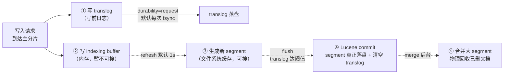
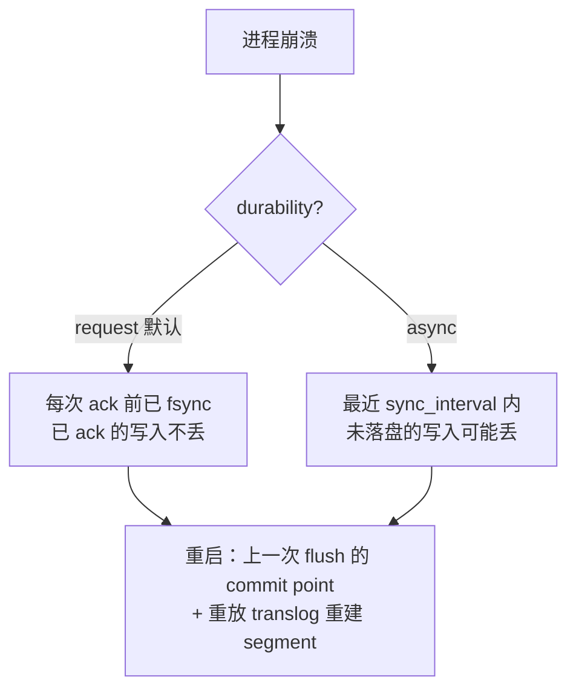

# ES 的近实时写入靠 refresh 和 flush 怎么做到？

> 一句话点题：ES 的"近实时"不是真实时，本质是 refresh 把内存里的 segment 刷成可搜、flush 把 segment 真正落盘这两个动作的组合——再加上 translog 兜底崩溃恢复，才让"1 秒可见"和"不丢数据"同时成立。很多人把这三者搅成一团，分不清谁管可见性、谁管持久性、谁管崩溃恢复，这篇就把它们拆开讲透。

上一篇讲了倒排索引为什么快，顺带提了 segment 不可变和"近实时 1 秒"的来历。这篇就专攻那条写入链路：一条文档写进去之后，到底要经过哪些环节才能被搜到、才能算安全落盘。理解这条链路，你才能解释为什么 ES 写入有延迟、为什么崩溃通常不丢数据、以及为什么写入调优总是围绕 refresh 和 translog 打转。

## 先把"近实时"这三个字说清楚

近实时（Near Real-Time，NRT）的含义很具体：**数据写进去之后，默认约 1 秒才能被搜索到**。注意是"约 1 秒"，不是"立刻"。

和 MySQL 对比一下就明白差在哪：

| 维度         | MySQL（InnoDB）                           | Elasticsearch                          |
| ------------ | ----------------------------------------- | -------------------------------------- |
| 写完多久可见 | 事务提交后立即可见                        | 默认约 1 秒后可见                      |
| 可见的代价   | 走 redo log + buffer pool，提交即对外可见 | 要等一次 refresh 把内存 segment 刷出来 |
| 一致性级别   | 强一致（事务保证）                        | 近实时，不是即时一致                   |

为什么 ES 要留这 1 秒？因为 ES 底层的 Lucene 靠 segment 组织索引，而 segment 一旦生成不可变。新写入的文档不能去改老 segment，只能先攒在内存 indexing buffer 里，攒到一定时机（refresh）再生成一个全新的小 segment。这"一定时机"就是默认的 1 秒。所以"近实时"的根因不是写入慢，而是**可见性被 refresh 的节奏卡住了**。

> 面试里如果只答"ES 是近实时的"，会被追问"近实时是多久、为什么"。答出"默认 1 秒、因为 refresh 才生成可搜 segment"才算到位。

## 一次写入要经过哪些环节

把近实时的机制讲透，先把一次写入的完整链路画出来：

五个环节各司其职，对应到三个核心动作：

| 动作    | 干了什么                                                                          | 默认频率                | 管什么   |
| ------- | --------------------------------------------------------------------------------- | ----------------------- | -------- |
| refresh | 清空 indexing buffer，把文档生成一个新 segment 放进文件系统缓存，之后文档**可搜** | 1 秒                    | 可见性   |
| flush   | 执行 Lucene commit：把 segment 真正持久化并写 commit point，**清空 translog**     | translog 达 10GB 或手动 | 持久性   |
| merge   | 后台把多个小 segment 合并成大的，物理删除带删除标记的文档                         | 后台自动                | 碎片回收 |

一句话记住分工：**refresh 管能不能搜到，flush 管落不落盘，merge 管碎不碎**。下面逐个拆。

## refresh：让数据"可搜"的那一下

refresh 是理解近实时的钥匙。它做的事其实很轻：

1. 把 indexing buffer 里攒着的文档"取出来"；
2. 生成一个**全新的 segment**，放进操作系统的文件系统缓存（page cache）；
3. 清空 indexing buffer；
4. 这个新 segment 立刻对查询可见——文档这才可搜。

注意几个细节：

- **refresh 不等于落盘**。新生成的 segment 只是写进了文件系统缓存，并没有 fsync 到磁盘，也没有写入 commit point。如果此刻掉电、操作系统 page cache 丢了，这个 segment 就没了——但它能从 translog 重建（见下一节）。所以"refresh 完就能搜到"和"refresh 完就持久化了"是两回事。
- **默认 1 秒一次**，对应 `index.refresh_interval`，默认值 `1s`。可以调大（如 `30s`）减少 segment 数量，也可以设成 `-1` 完全关闭自动 refresh。
- **它可调**，这正是写入优化最常用的手段。批量写入时把 `refresh_interval` 调大或临时设 `-1`，写完再调回 `1s`，能显著减少小 segment 的产生。

> 一个 8.x 容易被忽略的点：从 7.x 起 ES 引入了"搜索空闲"机制——如果一个分片在 `index.search.idle.after`（默认 30 秒）内没有收到搜索请求，它就不再做后台 refresh，直到下一次搜索到来才补一次 refresh。这是为了在"只写不查"的批量导入场景自动省掉 refresh 开销。所以批量写入时即使你没改 `refresh_interval`，空闲分片也不会每秒无谓地刷。但如果你显式设置了 `refresh_interval`（哪怕就是 `1s`），这个空闲行为就会被关掉——这点很多人不知道。

## translog：崩溃了到底丢不丢数据

这是最容易被答混的一节，也是面试真正想考的点。先给结论：**在默认配置下，ES 对客户端 ack 的写入，即使进程崩了也不会丢**。能保住它的就是 translog（transaction log）。

translog 是一个写前日志（write-ahead log）：每次写文档，主分片先把它记进 translog，再写 indexing buffer。它的作用是**在两次 flush 之间兜底崩溃恢复**——因为 refresh 生成的 segment 没落盘，进程崩了那些"可搜但没持久化"的 segment 会丢，重启时 ES 就用上一次 flush 的 commit point 加上重放 translog，把那些 segment 重建回来。

这里有个必须分清的概念：**translog 的 fsync（durability）和 flush 是两回事**，很多人把它们当成一回事，这是大错。

|          | translog fsync（durability）         | flush                                              |
| -------- | ------------------------------------ | -------------------------------------------------- |
| 干什么   | 把 translog 这个日志文件本身写进磁盘 | 执行 Lucene commit，持久化 segment + 清空 translog |
| 默认频率 | 每次写请求都 fsync（`request`）      | translog 达 10GB 或手动                            |
| 保护什么 | 保护"已 ack 但还没 flush"的写入不丢  | 释放 translog、给 segment 写 commit point          |
| 代价     | 每请求一次磁盘 fsync，影响写吞吐     | 代价高，不能频繁做                                 |

translog 的刷盘行为由 `index.translog.durability` 控制，两个取值：

- **`request`（默认）**：每次 index/delete/update/bulk 请求都 fsync 并 commit translog，然后才向客户端 ack。这意味着**只要客户端收到成功响应，数据就一定在磁盘的 translog 里**，硬件故障也丢不了。代价是写吞吐受磁盘 fsync 速度限制。
- **`async`**：不在每次请求都 fsync，而是后台每 `index.translog.sync_interval`（默认 `5s`，最小 100ms）统一 fsync 一次。吞吐更高，但崩溃时最近一次 sync 之后、还没落盘的写入会丢。

所以"ES 崩溃会不会丢数据"这个问题的标准答案要分情况：

> 一个常见误区：以为"refresh 不落盘，所以进程崩了一定丢数据"。在默认 `request` 下这是错的——丢的不是数据，是那个还没落盘的 segment，但 translog 里有完整记录，重启重放就能重建。真正会丢数据的场景是你主动把 durability 设成 `async` 又恰好崩溃在 sync 间隔里。面试答到这层区分，就比背"refresh 不落盘会丢数据"高一档。

## flush：真正"落盘"的那一下

flush 是真正意义上"持久化"的动作，它做三件事：

1. 执行一次 **Lucene commit**：把当前所有在文件系统缓存里的 segment 真正 fsync 到磁盘，并写一个 commit point（提交点，记录此刻有哪些 segment 属于这次提交）；
2. **清空 translog**（因为这部分写入已经被 segment + commit point 持久化了，translog 完成使命）；
3. 开一个新的 translog 文件继续接后续写入。

触发 flush 的条件，官方文档明确写的是**按 translog 大小**：当 translog 累积到 `index.translog.flush_threshold_size`（默认 `10GB`，且不超过磁盘容量的 1%）时自动 flush。也可以通过 `_flush` API 手动触发。

> 注意别把"30 分钟 flush 一次"当成铁律。早期版本确实有按时间周期 flush 的设置，但 8.x 官方文档主推的是按 translog 大小触发；而且 flush 代价不低（要 fsync 全部 segment、写 commit point），所以不会像 refresh 那样每秒做。如果听到有人说"默认每 30 分钟 flush 一次"，知道这是个偏老的说法就行，准确表述是"translog 满了（默认 10GB）才 flush"。

flush 为什么不能频繁做？因为它要做一次完整的 Lucene commit，涉及大量 segment 的 fsync，是个重操作。ES 的设计哲学是：**用频繁的 refresh 换可见性，用低频的 flush 换持久性，中间用 translog 兜底**。三者配合，才在"1 秒可见"和"不丢数据"之间取得平衡。

## segment 不可变，所以后台要 merge

refresh 每秒生成一个小 segment，写久了 shard 上会堆出成千上万个 segment，查询时要每个 segment 都查一遍再合并结果，性能会塌。而且 ES 的"删除"只是打 tombstone 标记，物理空间没释放。这两个问题都靠 **merge** 解决：

- 后台把多个小 segment 合并成大 segment；
- 合并时**物理丢弃**带删除标记的文档（更新=标记删除+新写，所以这里才真正回收空间）；
- 老的小 segment 在合并完成后被删除。

merge 是自动的（由 `index.merge` 相关策略控制），不需要你操心，但要知道它的存在——因为前面说的"refresh 调大减少小 segment"，本质上就是在给 merge 减负。

## 容易踩的坑

- **把 refresh 当成落盘**：refresh 只生成文件系统缓存里的可搜 segment，没 fsync、没 commit point；真正落盘是 flush。以为 refresh 完就持久化，是最大的误区。
- **以为进程崩了就丢数据**：默认 `request` durability 下，已 ack 的写入都 fsync 进了 translog，崩溃后靠重放 translog 重建，不丢。会丢的是把 durability 设成 `async` 又恰好崩在 sync 间隔里。
- **把 translog fsync 和 flush 混为一谈**：translog fsync（durability）是保日志落盘，flush 是做 Lucene commit 并清空 translog，两者频率和目的完全不同。
- **refresh 调到 1s 就不管**：写入猛时每秒一个 segment，小 segment 爆炸会拖慢查询并加重 merge；批量写入要把 `refresh_interval` 调大或临时设 `-1`，写完调回。
- **以为 translog 是 binlog**：translog 是短期崩溃恢复日志，flush 后就被清空，不像 MySQL binlog 那样长期保留、用于主从复制。
- **把"30 分钟 flush 一次"当铁律**：8.x 官方主推的是按 translog 大小（默认 10GB）触发 flush，时间周期是偏老的说法。

## 小结

- 近实时（NRT）= 默认约 1 秒可见性延迟，根因是文档先进 indexing buffer，要等一次 refresh 生成可搜 segment 才能被搜到；和 MySQL 事务提交即可见不同。
- 写入链路：写 translog + indexing buffer → refresh 生成可搜 segment（文件系统缓存）→ flush 做 Lucene commit 真正落盘并清 translog → 后台 merge 合并小 segment、回收已删文档。
- **refresh 管可见性、flush 管持久性、translog 管崩溃恢复、merge 管碎片**，四者各司其职别混。
- translog durability：默认 `request`（每请求 fsync，ack 即不丢），吞吐优先可设 `async`（默认每 5s sync，崩溃可能丢最近一段）。
- flush 触发：translog 达 `flush_threshold_size`（默认 10GB）自动触发，或手动 `_flush`；flush 代价高，不像 refresh 那样频繁做。

## 参考

Elasticsearch 官方文档（https://www.elastic.co/guide/）中索引模块、translog、refresh/flush 与 near real-time 写入相关内容；Apache Lucene 官方文档中 segment 与 commit 机制相关内容。版本特性（refresh_interval 默认 1s、translog.durability 默认 request、flush_threshold_size 默认 10GB）经官方文档 8.x 核对。
