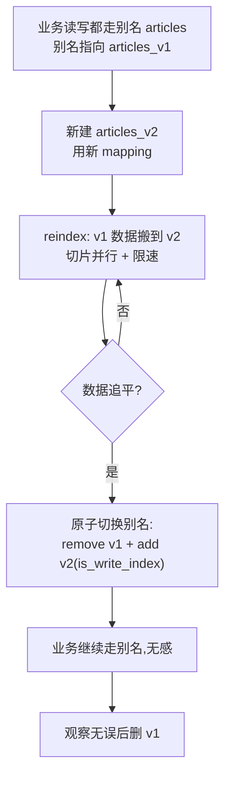

# ES 怎么零停机改映射？reindex 加别名怎么做？

> 一句话点题：映射一旦定下来大多改不了，要改字段类型只能 reindex 到新索引，靠别名做零停机切换。

上一篇收口了调优清单，里面留了一句"用别名访问 index，方便 reindex 和无感切换"。这篇就把这条线讲透：为什么改映射那么贵、reindex 怎么搬数据、别名怎么做零停机切换，最后捎带讲讲 ILM 怎么把"滚动索引"自动化。

## 映射为什么改不动

mapping 篇讲过一条硬约束：**字段类型一旦写入了数据，就不能再改**。`PUT _mapping` 改不了已有字段的类型，只能加新字段。

原因有两层：

1. 字段类型决定了数据在 segment 里的物理存储格式。integer 存数值、keyword 存不分词的整串、text 存分词后的 term。改类型等于要把已经落盘的所有数据换个格式重写一遍。
2. **segment 是不可变的**。Lucene 写好一个 segment 就封盘了，没有"原地改格式"这个操作，要改只能整体重建。

所以唯一彻底的改类型办法，是建一个 mapping 用新类型的新索引，把老索引数据搬过去——这就是 reindex。

> 纠偏：ES 有个 **runtime field（运行时字段）** 能不改 mapping 就在查询时算出新字段、做聚合，算是对"改映射"的一个折中补救。但 runtime field 不落倒排索引、查询要现算、性能差，只适合临时补救或低频字段，真正要改主体字段的类型和索引方式，还是得 reindex。

## reindex：把数据搬到新索引

`_reindex` API 的作用就是把源索引的文档复制到目标索引。最简形式：

```json
POST /_reindex
{
  "source": { "index": "articles_v1" },
  "dest":   { "index": "articles_v2" }
}
```

几个关键点先记牢：

- **reindex 不复制源索引的 mapping 和 settings**。你得先建好目标索引（带新 mapping），再 reindex，否则目标索引会按动态映射自己推断，类型又不对了。
- 目标索引必须和源索引**不同**，不能自己 reindex 到自己。
- reindex 走的是读源、写目标的流程，所以源要开 `_source`（默认就是开的）。

### 带上转换：script 改字段

reindex 真正的威力在于可以边搬边改。用 `script` 能改字段名、做类型转换、删字段：

```json
POST /_reindex
{
  "source": { "index": "articles_v1" },
  "dest":   { "index": "articles_v2" },
  "script": {
    "source": """
      // 把字符串的 views 转成 long，并改字段名
      ctx._source.view_count = ctx._source.views;
      ctx._source.remove('views');
    """
  }
}
```

这正是 reindex 改类型的用武之地：新索引 mapping 把 `view_count` 定成 long，reindex 时用 script 把老字段值搬过去并改名，一次搬迁完成"改类型 + 改名"。

`dest` 里还有两个常被忽略的开关：`op_type` 和 `version_type`。`op_type=create` 表示只写入目标里**不存在的文档**，已存在的直接跳过（报版本冲突，配 `conflicts=proceed` 可继续）；写到 data stream 时这个参数**必须**设成 `create`。`version_type` 控制版本处理：默认 `internal` 是无脑覆盖，想保留源版本号、只更新更老的文档可以用 `external`。增量补齐场景常靠 `op_type=create` + 版本号来只补缺失的部分，避免覆盖切换后又产生的新写入。

### 跨集群搬迁：remote reindex

源数据在另一个集群时，用 `source.remote` 做跨集群 reindex：

```json
POST /_reindex
{
  "source": {
    "remote": { "host": "https://oldcluster:9200", "username": "user", "password": "pass" },
    "index": "articles",
    "query": { "match_all": {} }
  },
  "dest": { "index": "articles_new" }
}
```

这需要在目标集群配 `reindex.remote.whitelist` 允许源集群地址。注意一个坑：**远程 reindex 不支持切片并行**（manual 和 automatic slicing 都不行），所以跨集群搬大索引会慢，要么限速慢慢来，要么提前把数据同步过来再本地 reindex。

### 加速：sliced 并行

大索引串行 reindex 很慢，用 `slices` 切片并行能显著提速，按主分片数对齐效果最好：

```json
POST /_reindex?slices=auto&refresh=true
{
  "source": { "index": "articles_v1" },
  "dest":   { "index": "articles_v2" }
}
```

`slices=auto` 让 ES 自动按源索引分片数定切片数（多源时取分片最少的那个为准）。`slices` 默认是 1（不切片）。本地 reindex 切片很有效，远程不行。

### 限速与控制

大索引 reindex 会抢资源、拖累生产查询，所以要限速：

| 参数                  | 作用                                        | 默认值     |
| --------------------- | ------------------------------------------- | ---------- |
| `requests_per_second` | 每秒最多索引多少文档（含所有切片）          | 不限（-1） |
| `max_docs`            | 最多搬多少文档                              | 全部       |
| `wait_for_completion` | true 同步等待；false 立即返回 task id，异步 | true       |
| `conflicts`           | 版本冲突时 `proceed` 继续、`abort` 中止     | abort      |
| `op_type`             | `create` 只写不存在的文档；`index` 覆盖     | index      |

大索引建议 `wait_for_completion=false` 拿 task id 走异步，配合 `_tasks` API 看进度；用 `requests_per_second` 把吞吐压住别打满，留余量给业务查询。

## 别名：零停机切换的关键

reindex 解决了"改类型"，但中间有搬迁时间，业务不能停。这就轮到**别名（alias）**登场。

别名是给索引起的"外号"：业务读写都用别名，别名背后指向真实索引。换索引时只改别名的指向，业务无感。

### is_write_index：多索引别名的写路由

一个别名可以指向多个索引（比如指向按时间切的多个日志索引，一次查全部）。但写操作要落到哪个索引？得用 `is_write_index: true` 指定写索引：

```json
POST /_aliases
{
  "actions": [
    { "add": { "index": "articles_v1", "alias": "articles", "is_write_index": true } }
  ]
}
```

别名只指向一个索引时，它会自动当写索引，不写这个标志也行；指向多个索引时，没指定写索引，写请求会被拒绝。

### 零停机切换：一次原子请求 remove + add

切换的关键是 `_aliases` API 支持在**一个请求里同时 remove 旧索引、add 新索引**，这个操作是原子的——别名不会出现"既不指向旧的也不指向新的"的中间态，也"不会同时指向两个写索引"：

```json
POST /_aliases
{
  "actions": [
    { "remove": { "index": "articles_v1", "alias": "articles" } },
    { "add":    { "index": "articles_v2", "alias": "articles", "is_write_index": true } }
  ]
}
```

把这套流程串起来就是零停机改映射的标准动作：



切换前后业务代码一行不用改——它访问的始终是 `articles` 这个名字，背后从 v1 变成 v2 是透明的。这就是别名最大的价值。

## 别名的多用途

别名不止用于 reindex 切换，它本身是个多功能工具：

- **读写分离 / 多索引统一查询**：一个别名指向多个时间索引（`logs-2026.07-*`），查询走别名一次查全部历史，写入走 `is_write_index` 指向当前那一个。
- **灰度切换**：新索引建好、reindex 完，先切一部分流量到新索引验证，没问题再全切；别名让这种切换成本极低。
- **过滤别名（filtered alias）**：给别名加 `filter`，让通过这个别名只能看到部分文档，相当于一个"带 WHERE 的视图"：

```json
POST /_aliases
{
  "actions": [
    { "add": { "index": "orders", "alias": "orders_paid", "filter": { "term": { "status": "paid" } } } }
  ]
}
```

`orders_paid` 这个别名查出来只有已支付订单，业务不用每次写过滤条件。

> 纠偏：filtered alias 的 filter 只在搜索时生效，按 `_id` 直取文档（GET）时不过滤。别误以为它是个安全边界。

## ILM：让滚动索引自动化

时序数据（日志、监控）天然要按时间或大小切索引。手动建索引、切别名很繁琐，**ILM（Index Lifecycle Management，索引生命周期管理）** 把这件事自动化了。

### 五个阶段

索引按条件在阶段间流转：**hot → warm → cold → frozen → delete**。

- **hot**：正在写入、查询频繁，主分片多、副本多。
- **warm**：不再写入但还常查，可以减少副本、迁到便宜机器。
- **cold**：很少查，可以冻结（freeze）省资源。
- **frozen**：几乎不查，转只读低成本存储。
- **delete**：到期直接删。

### rollover：滚动写索引

hot 阶段的核心动作是 **rollover**——当当前写索引满足条件时，自动建新索引接替写入。条件有三个：

| 条件                     | 含义                   | 备注                      |
| ------------------------ | ---------------------- | ------------------------- |
| `max_age`                | 索引创建满多久滚动     | 如 `30d`                  |
| `max_docs`               | 文档数达到多少滚动     | 如 `100000000`            |
| `max_primary_shard_size` | 最大主分片达到多大滚动 | **推荐用这个**，如 `50gb` |

> 纠偏：还有个 `max_size`（按所有主分片总和），官方已标注**废弃**，建议用 `max_primary_shard_size` 代替。因为分片大小才决定查询和合并性能，按总量滚动可能单个分片过大。

典型 ILM 策略：写到单分片 50GB 或 30 天就 rollover，老索引 shrink 到更少分片，30 天后删除：

```json
PUT /_ilm/policy/logs_policy
{
  "policy": {
    "phases": {
      "hot": {
        "actions": {
          "rollover": { "max_primary_shard_size": "50gb", "max_age": "30d" }
        }
      },
      "delete": {
        "actions": { "delete": { "delete_searchable_snapshot": true } }
      }
    }
  }
}
```

### rollover 的前提：别名 + is_write_index

rollover 要求索引通过一个**带 `is_write_index: true` 的别名**来写入。ILM 滚动时自动把这个别名的写索引从老的切到新建的，业务还是写同一个别名。所以前面讲的别名机制，正是 ILM 自动化的地基——没有别名，rollover 无从下手。

> 版本注意：ILM 在传统 Elastic Stack 部署上可用，但 **Elasticsearch Serverless 不支持 ILM**，它用的是 data stream lifecycle。集群里所有节点必须跑同一版本，否则含新动作的策略会报错。

## 容易踩的坑

- **reindex 不复制 mapping/settings**：目标索引没先建好，就按动态映射推断，类型又错了。务必先 `PUT` 好带新 mapping 的目标索引再 reindex。
- **大索引串行 reindex 拖垮集群**：不加 `slices` 切片、不设 `requests_per_second` 限速，reindex 抢满资源把生产查询压垮。本地用 `slices=auto`，跨集群远程不支持切片要额外小心。
- **别名单索引切换时漏配 is_write_index**：切到指向多个索引的别名却没指定写索引，写请求被直接拒绝，造成"丢写"。切换动作里记得带 `is_write_index: true`。
- **reindex 期间的双写一致性问题**：reindex 需要时间，期间老索引还在被写新数据。切换前如果不追平增量，会丢这部分写入。生产里要么切写之前先停写、reindex 完再放开，要么用别名把写入也接管后做增量补齐，再原子切换。
- **ILM 滚动窗口配错**：只配 `max_age` 不配 `max_primary_shard_size`，写入量大的索引可能单个分片撑到几百 GB 才滚动，查询和合并都慢。优先按分片大小滚动。用过时的 `max_size` 也会有这个问题。
- **以为改字段类型能靠 \_mapping 临时改**：已有数据的字段类型改不了，别在面试或生产里说"改个 mapping 就行"，正确答案是 reindex + 别名。

## 小结

- 字段类型改不动是因为 **segment 不可变 + 存储格式固定**，真要改类型只能 reindex；runtime field 是不改 mapping 的临时补救，不能替代 reindex。
- **reindex** 把源索引数据搬到新索引，支持 `script` 边搬边改、`slices` 切片并行、`requests_per_second` 限速、`wait_for_completion=false` 异步；**远程 reindex 不支持切片**，且不复制源索引的 mapping/settings。
- **零停机切换靠别名**：业务读写走别名，reindex 完用一个 `_aliases` 请求原子地 `remove` 旧索引 + `add` 新索引（带 `is_write_index`），业务无感。
- 别名还能做多索引统一查询、灰度切换、filtered alias（注意 filter 不挡按 id 直取）。
- **ILM** 让时序数据按 hot/warm/cold/frozen/delete 流转，hot 阶段 `rollover` 按 `max_primary_shard_size`/`max_age`/`max_docs` 滚动，前提是别名带 `is_write_index`；`max_size` 已废弃；Serverless 用 data stream lifecycle 代替 ILM。

## 参考

参考社区 Elasticsearch 面试题集与 Elasticsearch 官方文档中 reindex、索引别名、索引生命周期管理（ILM）及运行时字段相关内容整理。
