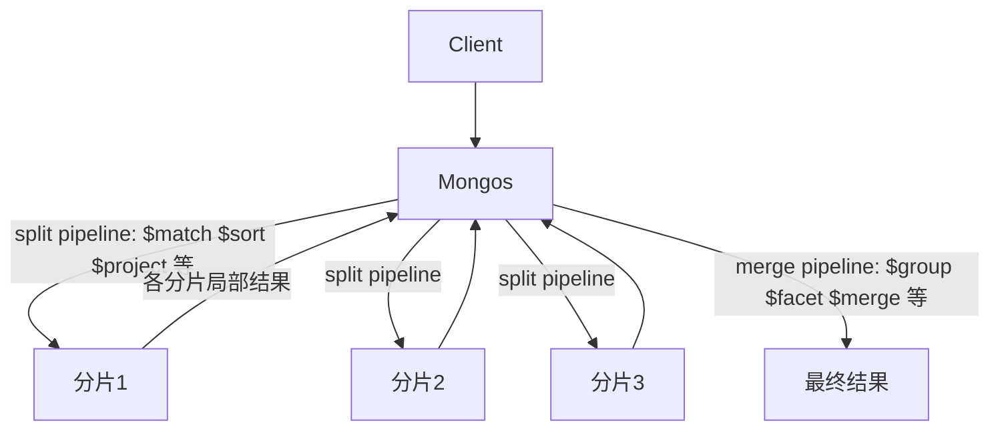

# MongoDB 聚合管道的进阶阶段和性能边界在哪？

> 一句话点题：基础阶段谁都会背，进阶阶段和 100MB 内存边界才是聚合能不能上生产的分水岭。

上一篇把 `$match`、`$group`、`$unwind`、`$lookup` 这些"主食"走了一遍。这一篇往下挖一层：当聚合不再是"算个 SUM 就返回"，而是要做报表分桶、多维度一次出、还要把结果写回集合长期用，就该上**进阶阶段**了；与此同时，每写一个阶段都要心里有根弦——**单阶段 100MB 的内存上限**，以及这条管道在分片集群上到底在哪台机器上跑。这两件事决定了你的聚合是"秒回"还是"OOM"。

## $facet：一次输入，多个分支结果

做后台报表最常见的一个场景：运营要在同一个页面看到"价格区间分布 + 分类销量 Top5 + 评分最高 10 件"。如果一条管道只产一个结果，你就得跑三次聚合，三次扫描同一份数据。`$facet` 解决的正是这个——**同一个输入文档流，开多条子管道并行算，最后把各分支结果装进一个文档**。

```javascript
db.products.aggregate([
  { $match: { status: "active" } },
  {
    $facet: {
      priceBuckets: [
        { $bucket: { groupBy: "$price", boundaries: [0, 100, 500, 1000], default: "other" } },
      ],
      categoryTop5: [
        { $group: { _id: "$category", sold: { $sum: "$sold" } } },
        { $sort: { sold: -1 } },
        { $limit: 5 },
      ],
      topRated: [
        { $sort: { rating: -1 } },
        { $limit: 10 },
        { $project: { name: 1, rating: 1, _id: 0 } },
      ],
    },
  },
]);
```

输出大致是：

```json
{
  "priceBuckets": [
    { "_id": 0, "count": 120 },
    { "_id": 100, "count": 80 },
    { "_id": "other", "count": 15 }
  ],
  "categoryTop5": [
    { "_id": "keyboard", "sold": 4300 },
    { "_id": "switch", "sold": 3100 }
  ],
  "topRated": [
    { "name": "Switch A", "rating": 4.9 },
    { "name": "Board X", "rating": 4.8 }
  ]
}
```

几个要点：

- `$facet` 的每个 key 是一条**独立的子管道**，输入都是 `$facet` 之前阶段的输出，彼此互不干扰；
- 所有子管道**都吃同一份文档流**，所以放在 `$facet` 前面的 `$match`、`$sort` 会复用，等于只扫一次数据；
- 子管道里各自的 `$limit`、`$group` 互不影响，非常适合"一页多块"的看板查询。

> 注意：`$facet` 不能再嵌套 `$facet`，而且每个子管道各自算各自的内存预算——开十条重子管道不是只占一份 100MB，是十份。

## $bucket / $sortByCount：把数值和标签切成桶

`$bucket` 是"显式边界分桶"：你给一组 `boundaries`，MongoDB 把 `groupBy` 字段落进对应区间，每个桶输出一个 `{ _id: 边界下界, count: 数量 }`。上面 `$facet` 例子里用的就是它。

`$bucketAuto` 让 MongoDB **自动选边界**，你只要给桶数：

```javascript
db.orders.aggregate([{ $bucketAuto: { groupBy: "$amount", buckets: 5 } }]);
```

`$sortByCount` 则是"按某字段去重计数再倒序"的快捷写法，等价于 `$group + $sort`，但更短：

```javascript
// 等价于 { $group: { _id: "$tags", count: { $sum: 1 } } }, { $sort: { count: -1 } }
db.products.aggregate([{ $unwind: "$tags" }, { $sortByCount: "$tags" }]);
```

这三个都是写报表时的高频阶段，但它们和 `$group`、`$setWindowFields` 一样属于"必须把中间结果留在内存"的类型，正好引出下一节的内存边界。

## $merge：把聚合结果写回集合

`$out` 能把结果落到一个集合，但它会**整表覆盖**，且只能写到当前库。`$merge` 更像"按主键 upsert"：可以跨库写、可以按 `on` 字段做 merge/replace/insert、可以累加，是做增量物化视图的主力。

```javascript
db.orders.aggregate([
  { $match: { createdAt: { $gte: ISODate("2026-07-30T00:00:00Z") } } },
  { $group: { _id: "$userId", dayAmount: { $sum: "$amount" }, cnt: { $sum: 1 } } },
  {
    $merge: {
      into: "userDailySummary",
      on: "_id",
      whenMatched: "merge", // 同一用户已有记录就合并
      whenNotMatched: "insert", // 没有就新增
    },
  },
]);
```

`$merge` 的关键选项：

| 选项             | 作用                 | 取值                                               |
| ---------------- | -------------------- | -------------------------------------------------- |
| `into`           | 目标集合             | 字符串（当前库）或 `{ db, coll }`（跨库）          |
| `on`             | 匹配字段，默认 `_id` | 必须有唯一索引支撑                                 |
| `whenMatched`    | 命中已有记录时怎么办 | `merge`/`replace`/`keepExisting`/`fail`/自定义管道 |
| `whenNotMatched` | 没命中时怎么办       | `insert`/`discard`/`fail`                          |

`whenMatched` 还能传一段**自定义聚合管道**，用来做"在已有记录基础上累加"这类细粒度合并。比如汇总表里已有某用户的累计金额，新数据进来要在它上面加，而不是覆盖：

```javascript
whenMatched: [
  {
    $addFields: {
      dayAmount: { $add: ["$dayAmount", "$$new.dayAmount"] },
      cnt: { $add: ["$cnt", "$$new.cnt"] },
    },
  },
];
```

管道里 `$$new` 指代本次要写入的那条新文档，原有字段用 `$dayAmount` 引用。这比 `merge`/`replace` 灵活，代价是得自己保证字段对齐、类型一致。

它的典型场景是**增量物化视图**：每天把当天订单聚合后 upsert 进汇总表，对外只查汇总表，不再碰明细。这把"重计算"从在线请求路径里挪走，正是上一篇里说的"大任务离线化"的具体落地。

## 100MB 内存上限和 allowDiskUse

聚合管道有一个很容易被忽略的硬边界：**单个阶段如果要累积中间结果，单阶段内存占用不能超过 100MB**（`$search` 是例外，不受此限）。会"攒着结果到最后"的阶段是受限的重灾区：

- `$group`、`$bucket`、`$bucketAuto`、`$sortByCount`
- `$sort`（当排序不能用索引时）
- `$setWindowFields`

为什么 `$group` 最容易爆内存？因为分组本质是"为每个不同的 `_id` 维护一组累加器状态"。如果分组键基数很高（比如按 `userId` 分组而 userId 有几百万个），MongoDB 就得在内存里同时维护几百万份 `{ sum, count, ... }`，很快逼近 100MB。

超过上限怎么办？这里有个版本分水岭。**MongoDB 6.0 引入了 `allowDiskUseByDefault` 参数**：

- 设为 `true`：超 100MB 的阶段**默认就把临时数据溢写到磁盘临时文件**，单个命令仍可用 `{ allowDiskUse: false }` 关掉；
- 设为 `false`：超 100MB 直接**报错中断**，要救就得在命令里显式 `{ allowDiskUse: true }`。

也就是说"溢写磁盘"不是免费的：它意味着排序/分组退化成"写盘-读盘"，速度比纯内存慢一个数量级。生产上经常遇到的"聚合突然从秒级变成分钟级"，往往就是触发了溢写。判断有没有溢写，看 `explain` 输出里各阶段的 `usedDisk` 字段，或者服务端日志里出现的 `Sorter`/`Spills` 之类条目；`totalDocsExamined`、`totalKeysExamined` 偏高，往往就是 `$group`/`$sort` 在全量上空转的信号。

所以正确思路是**让数据根本到不了 100MB**：`$match` 提前缩范围、分组键别选高基数、`$unwind` 前先过滤。

## 分片集合上，聚合到底在哪跑

分片集群里聚合的执行位置会显著影响成本。MongoDB 把管道切成两段：**分片上能跑的尽量下推到各分片跑（split pipeline），剩下的由 mongos 汇总（merge pipeline）**。



几条规则要记住：

1. `$match`、`$sort`、`$project`、`$unwind`、`$limit` 等通常能下推到分片，各分片并行处理自己的那份数据；
2. `$group`、`$facet`、`$sortByCount` 这种"全局聚合"必须在 mongos 汇总，因为不同分片可能含同一个分组键；
3. 如果管道以**精确匹配分片键的 `$match` 开头**、且**没有 `$out`/`$lookup`**，整条管道只在那一个分片上跑，等价于单机聚合；
4. 汇总点也不一定在 mongos：带 `$out` 时汇总在目标集合所在分片；`$lookup` 关联非分片集合时汇总在该集合所在分片；开了 `allowDiskUse` 的 `$sort`/`$group` 还会被随机分到某个分片上汇总，以减轻 mongos 内存压力。

用 `db.collection.aggregate([...], { explain: true })` 能看到管道被怎么切的，这是排查分片聚合性能的第一步。

## 索引能帮到哪些阶段

聚合不是所有阶段都能吃索引，这点决定了你写出来的顺序对不对：

| 阶段                | 能否用索引 | 说明                                               |
| ------------------- | ---------- | -------------------------------------------------- |
| `$match`            | 能         | 等同 find，命中索引就少扫文档                      |
| `$sort`             | 能         | 索引有序即可免内存排序                             |
| `$group`            | 否         | 要遍历全部输入做哈希聚合                           |
| `$project`          | 部分       | 覆盖查询可走索引，但改形后通常不行                 |
| `$unwind`/`$lookup` | 否         | 放大或关联，无索引红利（`$lookup` 的外键字段另说） |

推论很直接：**把能用索引的阶段尽量往前提**。一个经典反例：

```javascript
// 慢：$project 把 createdAt 改成了 month，后面 $match 就用不上 createdAt 索引了
[
  { $project: { month: { $dateToString: { format: "%Y-%m", date: "$createdAt" } } } },
  { $match: { month: "2026-07" } },
];
```

正确写法是先 `$match` 命中 `createdAt` 范围索引，再做投影和分组。优化器会在简单情况下自动调换阶段顺序，但跨 `$project`/`$unwind` 这种改形后它一般救不回来，得靠你自己排。

一条好记的口诀是"先缩、再排、后聚"：`$match` → `$sort` → `$group`/`$project`，把能用索引的阶段顶到最前面。需要全表分组的报表，先把时间窗、状态这些等值或范围条件用 `$match` 过滤掉，剩下的量级通常就够塞进 100MB 了。

## map-reduce 和 $function/$accumulator：能不用就不用

资料里常把"聚合方式"列成"聚合管道 + 单目的聚合 + map-reduce"三种。这里必须做版本纠偏：

- **map-reduce 从 MongoDB 5.0 起官方不再推荐**，新逻辑用聚合管道替代，性能和可用性都更好。维护老系统才需要碰它。
- 更进一档：`$function` 和 `$accumulator` 这两个"在聚合里写 JavaScript"的算子，**从 MongoDB 8.0 起也被标记为弃用**（连同 `$where`，官方统称 server-side JavaScript functions deprecated）。它们要 `javascriptEnabled` 开着、有性能损耗，8.0 后属于明确不推荐方向。

所以现在的答案很清晰：能用管道算子表达的就别上 JS。确实需要自定义表达式，优先用 `$expr` + 内置算子拼；只有拼不出来、又必须在线算，才考虑 `$function`，并且要做好它被进一步移除的准备。

## 容易踩的坑

### 大聚合直接 OOM

`$group` 按高基数键分组、`$sort` 在没索引的大集合上排，都是典型内存杀手。要么在前面加 `$match` 缩范围，要么接受 `allowDiskUse` 的磁盘代价，要么干脆离线化。

### 阶段顺序写反，性能差一个数量级

`$project` 改形后再 `$match`、`$unwind` 后再过滤、`$sort` 全量后再 `$limit`，都会让本该用索引或缩范围的步骤失效。记住"越早缩小数据集越好"。

### $lookup 拉成笛卡尔积

`$lookup` 关联大集合、`localField`/`foreignField` 又没索引、过滤条件又弱，结果会被放大成笛卡尔积。关联字段务必建索引，能用 `$match` 缩小主集合就先缩，必要时用 `pipeline` 形式的 `$lookup` 带过滤条件，而不是无脑 `as` 进数组。

```javascript
{
  $lookup: {
    from: "users",
    let: { uid: "$userId" },
    pipeline: [
      { $match: { $expr: { $eq: ["$_id", "$$uid"] }, status: "active" } },
      { $project: { name: 1, _id: 0 } }
    ],
    as: "user"
  }
}
```

这种写法把过滤下推到关联集合内部，比先全量关联再在主管道里 `$match` 干净得多，也避免了把整张 `users` 拉回来再丢掉。

### 以为 100MB 是"整个管道"的预算

不是。**100MB 是单个阶段的限制**，`$facet` 下每条子管道各算各的。别因为"我只超一点点"就放心开多条重子管道。

## 小结

1. 进阶阶段里 `$facet` 做多分支看板、`$bucket`/`$sortByCount` 做分桶、`$merge` 做增量写回，分别对应报表、分桶统计和物化视图三类场景。
2. `$group`、`$sort`（非索引）、`$bucket`、`$setWindowFields` 等阶段单阶段内存上限 100MB，超了要么溢写磁盘要么报错；6.0 起由 `allowDiskUseByDefault` 控制默认行为。
3. 分片集合上聚合分 split/merge 两段：`$match`/`$sort` 尽量下推到分片，`$group`/`$facet` 在 mongos 汇总；精确匹配分片键开头且无 `$out`/`$lookup` 时整条管道只在单分片跑。
4. 索引只对 `$match`、`$sort` 有效，`$group`/`$project` 用不上；阶段顺序直接影响能不能吃索引。
5. map-reduce（5.0 起不推荐）和 `$function`/`$accumulator`（8.0 起弃用）都不再是新项目首选，能用内置管道算子就别上 JS。

## 参考

基于 MongoDB Manual 中 Aggregation Pipeline、Aggregation Pipeline Limits、Aggregation on Sharded Collections、`$facet`/`$bucket`/`$merge`/`$function` 等算子章节整理；版本边界（100MB 受限阶段、6.0 的 `allowDiskUseByDefault`、5.0 的 map-reduce 不推荐、8.0 的 server-side JavaScript 弃用）经官方文档核对；并交叉参考社区 MongoDB 面试题集中聚合与分片部分。
