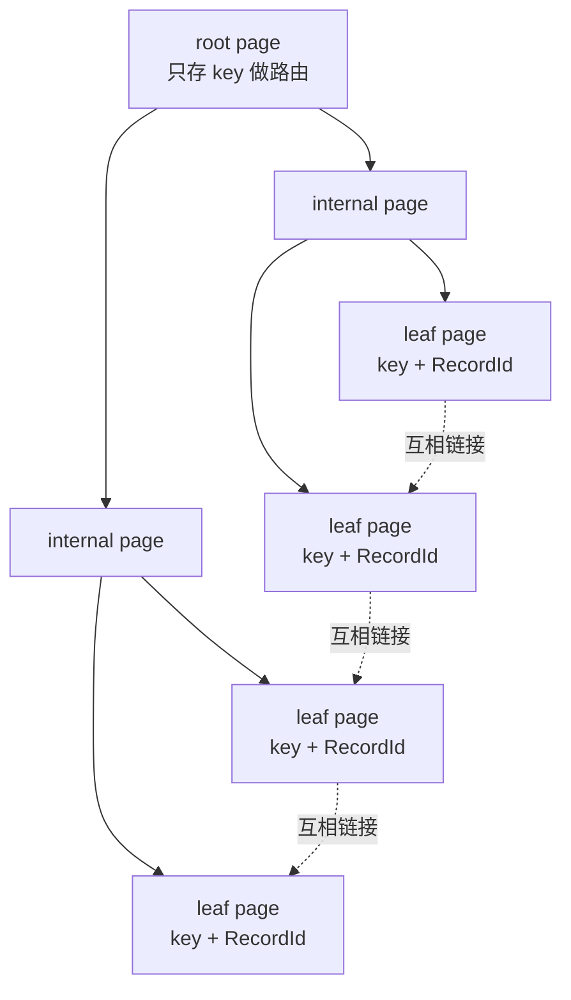
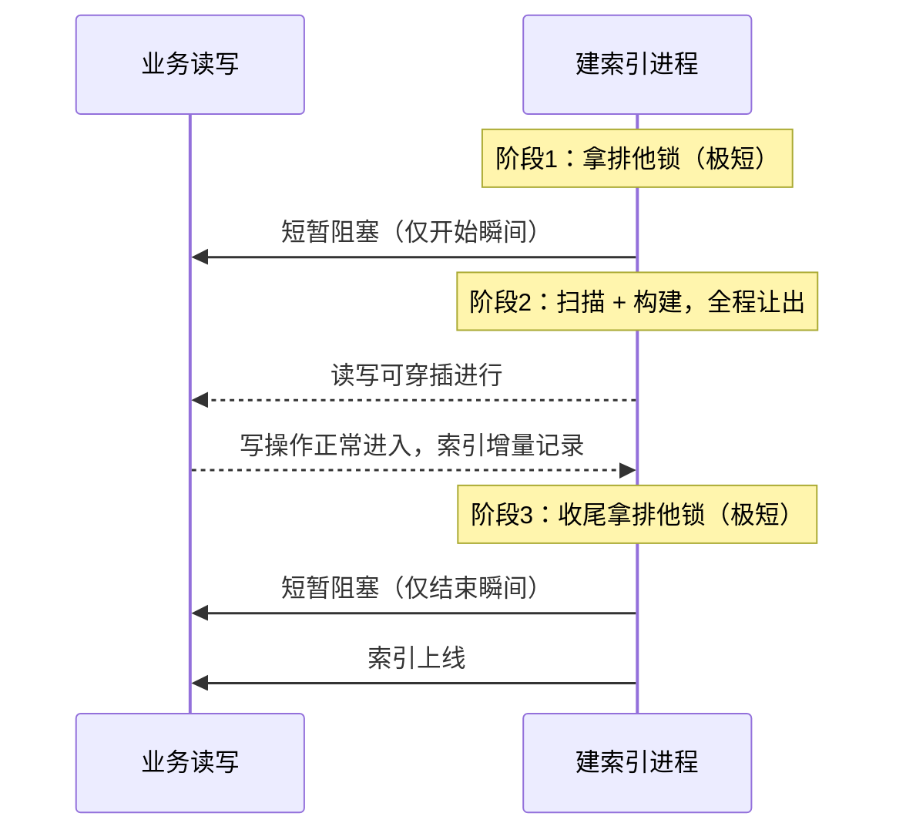
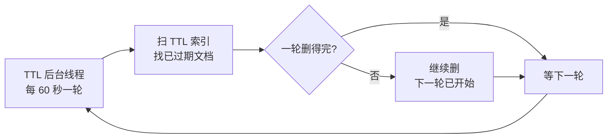

# MongoDB 索引底层和那些容易答错的索引选项？

> 一句话点题：MongoDB 索引不是"建了就走"，底层是 WiredTiger 的 B+树，选项和建索引代价决定了它能不能扛生产。

## WiredTiger 的索引，底层是 B+ 树不是 B 树

自 MongoDB 3.2 起，默认存储引擎就换成了 WiredTiger（更早的 MMAPv1 在 MongoDB 4.x 起被移除）。WiredTiger 内部用一棵 B+ 树来组织一张表的数据，索引本身也是一棵独立的 B+ 树。

> 纠偏：不少老资料和八股文说"MongoDB 用的是 B 树"，这是错的。WiredTiger 官方原话就是 "B-Tree (B+ Tree to be specific)"——名字上叫 B-Tree，实质是 B+ 树。面试别答成 B 树。

WiredTiger 把 B+ 树的每个节点叫做一个 page，三类 page 各司其职：

- root page：根节点，查找的入口；
- internal page：内部节点，只存 key 用来路由，不放实际数据；
- leaf page：叶子节点，存 key 和 value，才是真正放索引项的地方。

对索引这棵 B+ 树来说，leaf page 里的 value 并不是文档本身，而是一个指向文档的定位符（RecordId）。所以走索引找到叶子，只是拿到"文档在哪"，还要再回集合那棵 B+ 树里把整篇文档取出来——这就是 MongoDB 版的"回表"。

叶子页之间互相串起来，范围扫描时顺着链表往后走，不用回到上层节点。这是 B+ 树相比 B 树在范围查询上的核心优势，也是 WiredTiger 选 B+ 树的原因之一。



## 和 InnoDB 的 B+ 树比，MongoDB 的索引差在哪

MySQL 的 InnoDB 和 MongoDB 的 WiredTiger 底层都是 B+ 树，但"数据放在哪"这件事两家思路不同，这决定了索引怎么用。

| 维度               | InnoDB（MySQL）                    | WiredTiger（MongoDB）                        |
| ------------------ | ---------------------------------- | -------------------------------------------- |
| 表数据存哪         | 聚簇索引（主键）的叶子页直接存整行 | 文档存在集合自己的 B+ 树里，按 RecordId 排布 |
| 二级索引叶子存什么 | 索引列 + 主键值                    | 索引键 + RecordId                            |
| 取整行怎么走       | 二级索引 → 主键 → 聚簇索引         | 索引 → RecordId → 集合 B+ 树                 |
| 叶子页相连         | 是，双向链表                       | 是，叶子页互相链接                           |
| 默认压缩           | 默认不开（可配页压缩）             | 索引默认前缀压缩，集合默认 Snappy 块压缩     |
| 并发粒度           | 行锁                               | 文档级，写时乐观检测冲突                     |

一句话总结：InnoDB 的表本身就是聚簇索引，行数据在主键 B+ 树的叶子页；MongoDB 的集合和索引是两棵独立的 B+ 树，索引叶子只放 RecordId。所以 MongoDB 几乎所有索引都像 InnoDB 的"二级索引"，基本都要回表拿文档——除非用上覆盖查询。

举个例子，订单集合在 `userId` 上有索引：

```javascript
db.orders.find({ userId: 10086 });
```

走索引拿到一堆 RecordId，再逐个去集合 B+ 树 fetch 文档。如果文档很大、返回字段却只要两三个，每条都回表取整篇就浪费——这时候把要返回的字段也塞进索引，做成覆盖查询，就能省掉回表。

## 索引也存在内存里：热点页和前缀压缩

B+ 树不是整棵都驻留内存。WiredTiger 维护一块内部缓存（默认大约是「内存减 1GB」的一半），常被访问的 root / internal page 和热点 leaf page 留在缓存里，冷的页被淘汰到磁盘。查询能不能快，很大程度上取决于"要走的那些索引页有没有在缓存里"——索引设计得再好，要走的页全在磁盘上也是慢的。

索引本身也有压缩。WiredTiger 对索引默认用前缀压缩（prefix compression）：相邻索引项如果 key 有公共前缀，就只存差异部分，而不是把整个 key 重复存一遍。这对 ObjectId、时间戳这类前缀重复度高的字段，能显著压小索引体积，让更多索引页挤进内存。

集合数据则是另一套：默认用 Snappy 做块压缩，追求的是速度和压缩比的平衡（大约 3～5 倍），CPU 代价可控。需要更高压缩比可以换 zlib 或 zstd（zstd 从 MongoDB 4.2 起可用），代价是更多 CPU。

## unique / sparse / partial / hidden：这些选项到底区别在哪

面试里常被问到"建索引时除了排序方向还能配什么"，下面这几个最容易答混。

| 选项    | 作用                                                | 什么时候用                                    | 容易答错的点                                                      |
| ------- | --------------------------------------------------- | --------------------------------------------- | ----------------------------------------------------------------- |
| unique  | 保证索引键不重复                                    | 唯一约束字段，如手机号、邮箱                  | 已有重复数据时建会失败；缺省字段视为 null，多个 null 也算重复     |
| sparse  | 只对存在该字段的文档建索引项                        | 字段稀疏（大部分文档没有这个字段）            | sparse 不等于 partial，它不能按条件过滤，只是"没这字段就不进索引" |
| partial | 用 partialFilterExpression 只给满足条件的文档建索引 | 只关心子集，如只给 status=active 的文档建索引 | 查询条件必须是过滤表达式的子集，否则不走这个索引                  |
| hidden  | 对查询规划器隐藏，但照样维护                        | 想试删索引又怕删错                            | 还在更新、还占空间，只是查询用不上                                |

逐个说清楚：

**unique** 最常见，但坑在 null。MongoDB 里一个文档没某字段和该字段为 null，在唯一索引看来都算 null，而多个文档都是 null 会违反唯一约束。所以如果字段允许缺失又想要唯一，得配合 sparse：sparse 让"没这字段"的文档根本不进索引，自然不会和 null 撞车。

**sparse** 只解决"字段不存在"的情况，它不带过滤条件。如果你要的是"只给满足某个条件的文档建索引"，那是 partial 的事，别拿 sparse 硬凑。

**partial** 比 sparse 更强：它带一个 `partialFilterExpression`，只给符合条件的文档建索引。比如只给活跃用户建索引：

```javascript
db.users.createIndex({ email: 1 }, { partialFilterExpression: { status: "active" } });
```

好处是索引小、维护省。代价是查询条件得是这个表达式的子集——查 `{ status: "active", email: ... }` 能用上，查 `{ email: ... }`（不带 status）就用不上，会退回扫集合或找别的索引。

**hidden** 是"先藏后删"的安全网。把索引藏起来，查询规划器看不见它，但写入照样更新它、磁盘照样占着。观察一段时间线上查询没变慢，再正式 drop；如果变慢，unhide 回来即可，比删了重建省事。hidden 索引需要 featureCompatibilityVersion 6.0 及以上才能用。

## 建大集合索引，会不会把线上打挂

这是面试很爱问的"线上能不能直接给大表建索引"。

早期 MongoDB 有两套建索引方式：

- foreground（前台）：快、产出的索引结构紧凑，但构建期间锁住库，读写全堵；
- background（后台）：不锁库、能读写，但更慢、索引也更松散。

> 纠偏：很多资料还在讲"建索引要加 background: true"，这在现在的版本已经过时。较新版本统一走一套"混合构建"：只在构建开始和结束的瞬间拿排他锁，中间全程让出给读写，产出的索引结构和前台一样紧凑。`background: true` 现在传进去就是个空操作，会被忽略。

所以别再纠结要不要加 `background`。但"非阻塞"不等于"零影响"，大集合建索引仍要小心：

- 构建期间要扫全表，CPU、磁盘 IO 会涨；
- 构建期间需要额外的磁盘空间（新旧索引共存），别在磁盘快满的时候建；
- 写入虽然不被堵，但构建和写入抢资源，写延迟可能上升；
- 副本集上，Secondary 构建索引可能落后，影响读流量分布。

实操建议：低峰期建、提前估算磁盘余量，必要时在维护窗口里分批轮转。



## TTL 索引：是清道夫，不是定时器

TTL 索引给文档一个过期时间，到点自动删，适合日志、会话、验证码这类"留一段时间就清"的数据。

```javascript
// 方式一：字段存"最后活跃时间"，过期 3600 秒
db.sessions.createIndex({ lastActive: 1 }, { expireAfterSeconds: 3600 });

// 方式二：字段直接存"过期时刻"，expireAfterSeconds 设 0
db.sessions.createIndex({ expireAt: 1 }, { expireAfterSeconds: 0 });
```

它的删法是后台清道夫式的，不是精确触发：

- TTL 监控是一个后台线程，默认每 60 秒跑一轮（`ttlMonitorSleepSecs` 可调），扫 TTL 索引找出已过期文档删掉；
- 删除是单线程的，量大时一轮删不完，下一轮又开始了，过期文档可能比"应删时刻"晚几十秒甚至更久才真正消失；
- 只在 Primary 上执行删除，Secondary 靠 oplog 复制删除操作，自己不跑 TTL 线程。

> 纠偏：别把 TTL 当定时任务用。它不保证"到点立刻删"，也不保证"整点触发"。需要精确秒级业务调度（比如到点发券、到点改状态），上消息队列或调度系统，TTL 只管数据保留期。

TTL 的限制也要记牢：只支持单字段（复合索引不能加 TTL）、`_id` 不能做 TTL、固定集合（capped collection）上不能建 TTL、同字段已有非 TTL 索引就别再建 TTL。



## hint、覆盖查询、选择性：让索引真的起作用

**hint 强制走某个索引**。优化器偶尔会选错（比如统计信息不准、可选索引太多），用 `hint` 指定：

```javascript
db.orders.find({ userId: 10086, status: "PAID" }).hint({ userId: 1, status: 1, createdAt: -1 });
```

注意 hint 是"强制的"——就算你指定的索引明显更差它也会用，所以一般用来定位问题或临时兜底，不要长期写死在业务代码里。

**覆盖查询**：查询条件和返回字段都在同一个索引里，就不用回表。前面讲的"回表"在这里就能省掉。细节（比如要显式写 `_id: 0` 排除默认返回的 `_id`）在上一篇索引设计里讲过，这里不重复，只强调一点：覆盖查询的价值是少读文档，文档越大、返回字段越少，收益越明显。

**选择性怎么判断**：一个索引"值不值得走"，看它能把扫描范围缩到多小。粗略地说，选择性 = 不同值数量 / 总行数，越接近 1 越好。性别、状态这种两三个取值的字段，单独建索引基本没用——优化器一算，走索引还要回表，不如直接扫集合。判断办法看 `explain()`：

```javascript
db.orders.find({ status: "PAID" }).explain("executionStats");
```

重点看 `totalKeysExamined`（扫了多少索引项）和 `nReturned`（返回多少）。两者接近说明索引很精准；扫了十万项只返回十条，说明选择性差，这索引在拖慢查询。复合索引把高选择性的等值条件放前面，能整体抬升索引的选择性。

## 容易踩的坑

- "建索引加 `background: true` 才安全"——过时了，现在会被忽略，非阻塞是默认行为，但首尾仍有短暂排他锁，大集合仍要低峰建。
- "TTL 到点就删"——不会，后台线程 60 秒一轮、单线程，量大还会积压，只适合数据保留期治理，不是定时器。
- "选择性差的索引顶多没用"——不止没用，还可能更慢：优化器若选了它，扫一堆索引项再回表，比直接集合扫描还费。
- "唯一索引配 sparse 就万无一失"——方向对，但 sparse 只管"字段不存在"；如果多条文档是"字段存在但值为 null"，sparse 救不了，得靠业务保证或改用 partial。
- "hidden 索引等于删了"——没有，它照样更新、照样占空间，只是查询用不上；忘了 unhide 或 drop，磁盘和写入成本一直在。

## 小结

1. MongoDB 索引底层是 WiredTiger 的 B+ 树（不是 B 树），索引叶子存 RecordId，取整篇文档要回集合那棵 B+ 树"回表"。
2. 和 InnoDB 比，MongoDB 的集合与索引是两棵独立 B+ 树，几乎所有索引都像"二级索引"，所以覆盖查询省回表的收益更突出。
3. unique / sparse / partial / hidden 各有定位：unique 管唯一、sparse 管"字段不存在"、partial 按条件缩小索引、hidden 用来安全试删索引。
4. 建大集合索引：`background` 已是空操作，统一走非阻塞混合构建，但首尾有锁、扫全表、占额外磁盘，仍要低峰 + 估磁盘。
5. TTL 是后台清道夫不是定时器，60 秒一轮单线程、只在 Primary，不保证精确删除；判断索引值不值看 `explain()` 里扫描项与返回数的比值。

## 参考

基于 MongoDB Manual 中 WiredTiger Storage Engine、Indexes、TTL Indexes、Index Builds、Hidden Indexes 等官方章节整理，并对照当前稳定版（8.3）核对了 B+ 树结构、非阻塞建索引行为、hidden 索引的 featureCompatibilityVersion 6.0 要求等版本相关说法；TTL 删除机制的单线程、60 秒周期、仅 Primary 执行等细节以官方文档为准。
