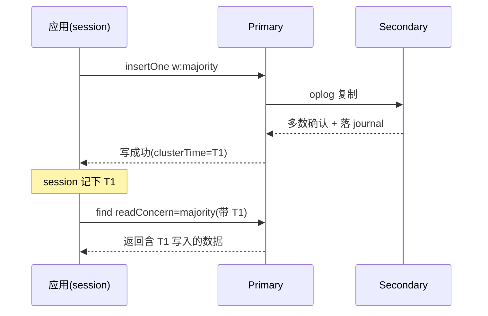

# MongoDB 读写关注和因果一致性怎么不答飘？

> 一句话点题：副本集不是"配一下就好"。`writeConcern` 决定写多安全，`readConcern` 决定读多新，二者加 `readPreference` 和因果一致性才是一致性面试的核心，而不是"MongoDB 支持事务"一句话能带过的。

上一篇讲副本集时提到：主节点写、oplog 同步、从节点回放。但有个问题没展开——客户端发出一条写之后，到底要等多久、等到哪些节点确认才算"成功"？从从节点读，读到的数据是主节点最新的，还是可能比主旧的？这就落到 `writeConcern` / `readConcern` / `readPreference` 三套关注（concern/preference）上，再加上保证"读自己刚写"的因果一致性和实时变更流 change stream，凑齐 MongoDB 一致性这一摊。

## writeConcern：写到什么程度才算成功

`writeConcern` 用在写操作上，回答"这条写要被几个节点确认、要不要落盘才算成功"。三个核心参数：`w`（确认数量）、`j`（要不要落 journal）、`wtimeout`（最多等多久）。

`w` 的取值是面试必考：

| `w` 值         | 含义                                             | 主挂了会不会回滚 / 丢                              | 典型场景                                   |
| -------------- | ------------------------------------------------ | -------------------------------------------------- | ------------------------------------------ |
| `w:0`          | 不等任何确认，fire-and-forget                    | 会丢，网络返回前主挂了这条就没了                   | 监控埋点、日志、可丢的批量写               |
| `w:1`（默认）  | 只等主节点确认（默认是确认到内存）               | 会回滚，主在复制到从节点前挂掉，这条写会被新主拒绝 | 默认行为，对丢失容忍的开发环境             |
| `w:"majority"` | 等多数数据承载投票节点（含主）把写落到本地 oplog | 不会回滚，多数已持久化即"事实"                     | 关键业务、和 `readConcern:"majority"` 配套 |

几个容易被问穿的细节：

- `w:majority` **默认隐含 `j:true`**。副本集配置里有个 `writeConcernMajorityJournalDefault`，默认 `true`，意思是多数确认不仅要求节点"收到"，还要求它把写刷到磁盘 journal 上。所以 `w:majority` 实际上是"多数 + 落盘"双重保险。如果把那个开关关了（比如某些节点没开 journaling），`w:majority` 就只保证多数内存确认，极端情况多数节点同时崩溃仍可能回滚——这是个可以拿来"纠偏"的点。
- `j:true` 单独用时，是要求被 `w` 指定的那些节点都落盘才算成功；`j:false` 是确认到内存即可。`w:0` 配 `j:true` 时，`j:true` 优先生效。
- `wtimeout` 只在 `w>1` 时生效。超过这个毫秒数还没凑够节点，MongoDB 返回 `writeConcernError`，但**已经写到主上的数据不会被撤销**——也就是写其实成了，只是"确认"超时了。所以拿到 `wtimeout` 错误不代表写失败，应用层要不要重试得看幂等性，不能无脑重发。不设 `wtimeout` 且 `w:majority` 不可达时，写会**无限阻塞**，这点很坑。

一句话记忆：`w` 管"几个节点"，`j` 管"内存还是磁盘"，`wtimeout` 管"等多久"，三者正交但 `w:majority` 默认把 `j` 也拉上了。

## readConcern：能读到多新的数据

`writeConcern` 解决"写多安全"，`readConcern` 解决"读多新"。同一个从节点，用不同 `readConcern` 读到的数据新旧不一样：

| `readConcern`   | 读到多新                                                         | 在哪能读     | 关键限制                                               |
| --------------- | ---------------------------------------------------------------- | ------------ | ------------------------------------------------------ |
| `local`（默认） | 本节点内存里最新的，**包括尚未被多数确认的**                     | 任意节点     | 从节点上可能读到随后会被回滚的数据                     |
| `available`     | 分片场景下分片上"可用的"                                         | 主要给分片用 | 和 `local` 像，处理孤儿文档，单副本集少用              |
| `majority`      | 只读已被多数节点确认、**不会回滚**的版本                         | 任意节点     | 和 `w:majority` 配套；从节点上仍可能是"旧的但已确认"   |
| `snapshot`      | 事务内某个快照时间点的一致性视图                                 | 事务中       | 多文档事务用，4.0 起的事务依赖它                       |
| `linearizable`  | 最强：读到"读开始前所有已 `w:majority` 完成的写"，且反映实时顺序 | **仅主节点** | 3.4 引入；只能配唯一过滤的单文档读；必须带 `maxTimeMS` |

两个最常被混淆的点：

- **`majority` 读不等于"读到最新"**，它只保证"读到的不会被回滚"。如果从节点 oplog 还没拉到最新，`majority` 读照样返回旧数据——只是这个旧数据是已经被多数确认的、安全的旧。很多人答成"`majority` 读就是强一致读到最新"，这是错的。
- **`linearizable` 是真正的强一致读**，但代价大：它只能在主上读、只能读单条文档（查询条件要能唯一定位一条）、要向从节点确认主确实还能拿 `w:majority`，所以慢。官方明确建议永远配 `maxTimeMS`，否则多数节点不可用时这条读会一直阻塞。

```js
// linearizable 必须带 maxTimeMS，且只读单文档
db.orders
  .find({ _id: ObjectId("...") })
  .readConcern("linearizable")
  .maxTimeMS(10000);
```

> 纠偏：有的资料把 `majority` 和 `linearizable` 都笼统叫"强一致"。准确说，`majority` 是"读已提交且不回滚"的语义级保证（多文档可用、可在从节点读），`linearizable` 才是"实时顺序"的线性一致（单文档、仅主）。面试要能区分这两层。

## readPreference：读写分离往哪读

`readConcern` 管"读多新"，`readPreference` 管"这个读请求路由到哪个节点"。二者正交，组合起来才是完整的读语义。

| `readPreference`     | 路由策略               | 适用场景                                      |
| -------------------- | ---------------------- | --------------------------------------------- |
| `primary`（默认）    | 总走主                 | 强一致读的默认；避免从节点延迟带来的脏读      |
| `primaryPreferred`   | 优先主，主不可用才走从 | 想强一致，又想在 failover 期间读不中断        |
| `secondary`          | 总走从                 | 读写分离把报表/分析打到从库；主挂了读也跟着停 |
| `secondaryPreferred` | 优先从，没有从才走主   | 读多写少，想卸主库压力但要兜底                |
| `nearest`            | 选网络延迟最低的节点   | 多机房、对延迟敏感、不强求一致                |

举个常见翻车例子：业务图省事把读全设成 `secondary`，结果主从有几百毫秒延迟，用户刚下单就去查订单列表（读打到从节点），查不到自己刚下的单——这就是"读不到自己写"。解法要么改 `primary` 读关键链路，要么上下面要讲的因果一致性。

## 因果一致性：读自己刚写怎么保证

"读自己刚写"（read-your-writes）在异步复制的副本集里其实不天然成立。MongoDB 的解法是 **客户端会话 + 因果一致性**（3.6 起，需要 3.6+ 的驱动）。

开一个 `causalConsistency: true` 的 session，这个 session 会跟踪每次操作的 `clusterTime` 和操作时间。后续操作带着这个上下文去读，MongoDB 就能保证读到的数据至少包含"你这个 session 之前的写"。它给出四条保证：

- **Read Your Writes**：能读到本 session 之前的写。
- **Monotonic Reads**：后续读不会读到比之前读更旧的版本。
- **Monotonic Writes**：本 session 的写按发出顺序生效。
- **Writes Follow Reads**：本 session 后续的写发生在之前读看到的值之后。

但前提很硬：**因果一致性要求写用 `w:majority`、读用 `readConcern:"majority"`**。只用默认的 `w:1` + `local` 是没有因果保证的——因为写可能被回滚，因果关系本身就站不住。

```js
const session = client.startSession({ causalConsistency: true });
// 写：必须 majority
db.orders.insertOne({ user: "u1", status: "paid" }, { session, writeConcern: { w: "majority" } });
// 读自己刚写：majority + 同一个 session
db.orders.find({ user: "u1" }).readConcern("majority").session(session);
```



注意一个边界：因果一致性只保证**因果相关**的操作顺序，它不是线性一致，也不是事务。跨 session、并发别的客户端的写，不在保证范围内。真要跨多文档原子 + 隔离，那是 4.0/4.2 的多文档事务（`snapshot` readConcern + 事务），不是因果一致性。

## change stream：基于 oplog 的实时变更流

轮询数据库拿变更又笨又费——得记上次查到哪、怕漏、怕重复。change stream（3.6 起）给了一条更顺的路：它基于副本集的 **oplog**，把"集合上的增删改"以事件流的形式推给客户端，本质上是一个永远在 tail oplog 的聚合管道。

几个面试要点：

- **resume token**：每个变更事件 `_id` 字段里带一个 resume token，标识"流读到这个点了"。还有一类 highwatermark token，表示"没有变更但集群时间推进了"。靠 token 就能断点续传。
- **resumeAfter vs startAfter**：`resumeAfter` 从某个事件之后继续，但遇到 `invalidate`（集合被删/重命名等）就不能再续；`startAfter`（4.2 引入）能在 `invalidate` 之后**新开**一条流，适合集合被重建后继续。
- **要求**：副本集或分片集群、WiredTiger、副本集协议版本 pv1。分片集群上 `mongos` 会在每个 shard 各开一条流，再按 clusterTime 合并排序后吐给客户端。
- **和轮询的差别**：轮询靠时间戳/版本号去查，延迟高、易漏边界、压力随频率上升；change stream 是推送模型，延迟低、自带至少一次语义、能跨重启续传。但要付的代价是它**强依赖 oplog**——oplog 是定长上限集合，如果客户端停太久、oplog 被覆盖，resume token 就失效了，只能从头全量重算。

```js
const cs = db.orders.watch([], { fullDocument: "updateLookup" });
let token = null;
while (cs.hasNext()) {
  const ev = cs.next();
  token = ev._id; // 存下来当断点
  handle(ev);
}
// 重启后用存的 token 续上
db.orders.watch([], { resumeAfter: token });
```

> 纠偏：change stream 不是"实时同步到 Kafka"那种独立组件，它就是 mongod 上的一个长聚合游标。它和因果一致性共享同一套 clusterTime 机制——这也是为什么 3.6 把 session、因果一致性、change stream 一起放出来。

## 选举与故障转移：选举期间写为什么会被拒

回到副本集本身。上一篇讲了主挂了会选举新主，这里补三个和读写关注直接相关的点：

- **心跳与选举超时**：成员之间默认每 2s 互发心跳，`electionTimeoutMillis` 默认 10s。某个从超过这个时间没收到主的心跳，就会发起选举。
- **优先级**：`priority` 高的成员更可能被选为主，`priority:0` 的成员永远不参选（可用作纯备份或异地节点）。
- **rollback**：老主恢复后，如果发现自己身上有些写在当选时没被多数复制（即不在新主的 oplog 里），这些写会被回滚到 `rollback` 目录，不会并回主数据。这就是 `w:1` 写不安全的根因。

**选举期间写为什么失败**：主挂到新主选出这段时间没有主，所有写都会被拒（错误类似 `NotWritablePrimary` / `NotPrimaryNoSecondaryOK`），客户端必须重试。更隐蔽的是：即使老主还活着但已被选举判定为"落后"，它也会主动降级拒绝写——这是为了防止脑裂双写。配合 `w:majority` 写，能保证"凡是被客户端确认成功的写，一定在新主上存在、不会被回滚"，这正是 `w:majority` 在故障转移里真正的价值。

## 容易踩的坑

- **`readConcern:"majority"` 读仍可能是旧的**：它只保证不回滚，不保证最新。要"最新已确认"得在主上读或上 `linearizable`。
- **`w:majority` 有延迟代价**：每次写都要等多数节点落盘确认，跨机房副本集延迟会被放大。别图"安全"全业务无脑上 majority，可丢的写（埋点、日志）用 `w:1` 甚至 `w:0` 更合适。
- **`wtimeout` 超时不是写失败**：数据可能已经写成了，只是确认没凑齐。重试前先判断幂等，别制造重复写。
- **选举期间写要重试**：拿到 `NotWritablePrimary` 不是 bug，是故障转移的常态；驱动一般有自动重试（`retryable writes`，3.6+），但应用层也要兜底。
- **`linearizable` 三限制**：仅主、仅单文档、必带 `maxTimeMS`，漏一个就答错了。
- **change stream 续传依赖 oplog 不被覆盖**：消费者停机时间不能超过 oplog 保留窗口，否则 resume token 失效要全量重灌。
- **因果一致性不是事务**：它保证因果顺序，不保证跨文档原子；多文档原子得用 4.0+ 事务。

## 小结

- `writeConcern` 管"写到几个节点、落不落盘"：`w:0` 不等、`w:1` 等主、`w:majority` 等多数落盘（默认隐含 `j:true`）；`wtimeout` 超时只影响确认、不撤销已写。
- `readConcern` 管"读到多新"：`local` 本节点最新、`majority` 已多数确认不回滚（但可能旧）、`snapshot` 事务快照、`linearizable` 最强但仅主单文档。
- `readPreference` 管"往哪读"：`primary` 强一致默认、`secondaryPreferred` 读写分离、`nearest` 挑低延迟，和 `readConcern` 正交组合。
- 因果一致性（3.6 起）靠 session + `majority` 读写实现"读自己刚写"，但不是事务；多文档原子用 4.0+ 事务。
- change stream（3.6 起）基于 oplog 推送变更，resume token 断点续传，比轮询省但有 oplog 保留窗口限制。
- 选举期间写被拒是正常的故障转移行为，`w:majority` 是保证写不回滚、跨 failover 不丢的关键。

## 参考

- 综合自社区 MongoDB 面试题集（上/下）副本集、oplog、读写分离部分，并用 MongoDB 官方文档核对：
- Write Concern：<https://www.mongodb.com/docs/manual/reference/write-concern/>（核对 `w`/`j`/`wtimeout` 语义、`writeConcernMajorityJournalDefault`）
- Read Concern / Causal Consistency：<https://www.mongodb.com/docs/manual/core/read-isolation-consistency-recency/>（核对因果一致性需 3.6+ 驱动、四条保证）
- Linearizable Read Concern：<https://www.mongodb.com/docs/manual/reference/read-concern-linearizable/>（核对 3.4 引入、仅主单文档、`maxTimeMS`）
- Change Streams：<https://www.mongodb.com/docs/manual/changeStreams/>（核对 resume token、`resumeAfter`/`startAfter`、pv1 与 WiredTiger 要求）
- 本篇在资料未展开的 `writeConcern`/`readConcern`/`readPreference`/change stream 细节上以官方文档为准做了补全与措辞重写。
