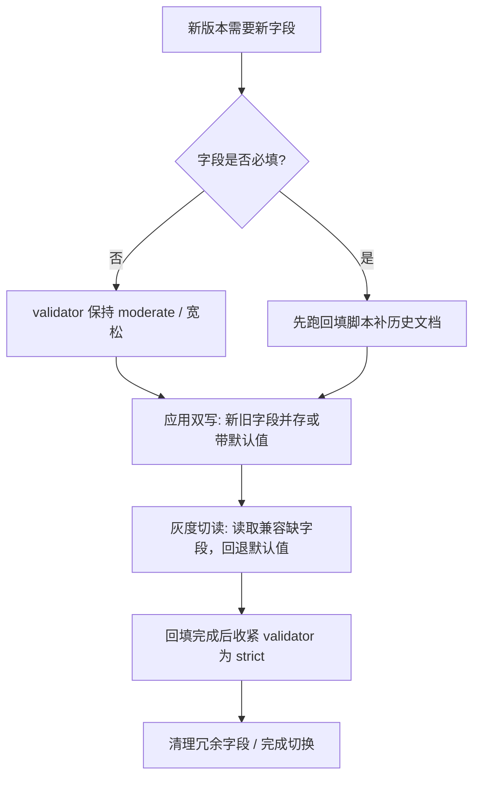

# MongoDB 模式怎么设计才不像无脑堆字段？

> 一句话点题：MongoDB 不是"无模式"，是无固定模式——模式设计反而要在嵌入/引用、校验、演进上做工程取舍。

上一篇把文档模型的轮廓和 MySQL 选型讲清楚了。这篇要钻进模式设计里最容易被跳过的部分：怎么给文档加结构底线、怎么让 schema 平滑演进、以及字段级加密到底值不值得上。MongoDB 的"自由"不是免设计费，而是把设计责任从数据库的 `DDL` 挪到了应用和 `validator` 这一层——挪了位置，没消失。

## 集合"无固定模式"，但模式没有消失

MongoDB 的集合不要求每条文档字段一致，你可以往同一个集合里塞结构不同的文档。这是它"无固定模式"的字面含义。

但"集合无固定 schema" 不等于"单文档无结构"。每条文档本身仍然是一个有字段、有类型、有层级的 BSON 对象，应用代码、查询条件和索引都依赖这些结构稳定。一旦 `userId` 一会儿叫 `uid`、一会儿是数字、一会儿是字符串，范围查询和排序就会出怪事，索引也跟着失效。

> 纠偏：有的资料把"无模式"直接列为 MongoDB 的优点，单看这点容易误导。集合不强制固定列，校验责任只是从数据库 `DDL` 转到了应用和 validator 层——不是没有了，是换了地方管。不设计，治理成本就会转移到业务代码、数据迁移和线上排障上。

所以 MongoDB 的模式设计仍然要回答：哪些字段必填、字段什么类型、哪些字段建索引、哪些字段要校验、结构变了怎么兼容老数据。区别只是这些约束大多写在应用层和 `validator` 里，而不是写在建表语句里。

## 嵌入还是引用：第一道分水岭

文档建模的第一个决策就是：相关数据要不要塞进同一个文档。基本概念上一篇已经讲过，这里换一个角度——把它当成一组可量化的维度来判断，而不是凭感觉。

| 维度     | 倾向嵌入                       | 倾向引用                       |
| -------- | ------------------------------ | ------------------------------ |
| 访问模式 | 总是一起读、一起展示           | 经常被独立查询、分页、统计     |
| 数量     | 可控、有上限                   | 持续增长、可能无限膨胀         |
| 一致性   | 需要强一致，靠单文档原子性兜住 | 可接受最终一致，多文档各自更新 |
| 更新频率 | 整体读写为主，改动随父对象     | 子对象频繁独立更新             |
| 文档大小 | 远小于 16MB 上限               | 可能逼近 16MB，或单条就很重    |
| 关系基数 | 一对一、一对少量               | 一对多海量、多对多             |

嵌入换来的核心收益是"一次读取拿回完整聚合根"和"单文档写入的原子性"——一次 `update` 改完订单状态和明细，要么全成要么全不成，不需要跨文档事务。引用换来的是文档大小可控、子对象能独立分页查询、更新不牵连父文档。

但两条红线要记住：

1. **单文档硬上限 16MB**。超过就建不了，海量明细该拆集合引用，超大的二进制走 GridFS 分块存。
2. **数组无限增长是定时炸弹**。WiredTiger 以文档为更新单位，往一个大数组追加一个元素也会触发整个文档重写，写入放大、热点和索引膨胀会一起冒出来。所以"能嵌入"的前提永远是"数量可控"。

反过来也别走另一个极端：把所有关系都拆成引用、靠 `$lookup` 拼，那就退化成"用 MongoDB 模拟关系库的 join"，丢掉了文档模型少往返的优势。引用只在"该拆"的时候拆。

## validator：给文档加一层结构底线

MongoDB 支持基于 JSON Schema 的文档校验（`$jsonSchema` 自 3.6 起可用，自 5.1 起校验失败信息会带上 `description` 字段，方便定位）。它不是要把 MongoDB 变成 MySQL，而是给关键集合加底线，防止脏数据把查询和索引拖垮。

建集合时就能挂上校验：

```javascript
db.createCollection("orders", {
  validator: {
    $jsonSchema: {
      bsonType: "object",
      required: ["userId", "status", "totalAmount", "createdAt"],
      properties: {
        userId: { bsonType: "long", description: "用户 ID 必须是 long" },
        status: { enum: ["PENDING", "PAID", "CANCELLED"] },
        totalAmount: { bsonType: "long", minimum: 0 },
        items: {
          bsonType: "array",
          items: {
            bsonType: "object",
            required: ["skuId", "price", "quantity"],
            properties: {
              skuId: { bsonType: "long" },
              price: { bsonType: "long", minimum: 0 },
              quantity: { bsonType: "int", minimum: 1 },
            },
          },
        },
      },
      additionalProperties: true,
    },
  },
  validationLevel: "moderate",
  validationAction: "error",
});
```

`$jsonSchema` 支持的关键字和标准 JSON Schema 基本对齐：`bsonType`/`type` 限类型（注意 MongoDB 不支持 `"integer"`，整型要用 `bsonType: "int"`/`"long"`）、`required` 必填、`enum` 枚举、`pattern` 正则、`minimum`/`maximum` 范围、`minLength`/`maxLength` 长度、`properties`/`items` 套娃校验、`additionalProperties` 控制是否允许未知字段。除了 `$jsonSchema`，`validator` 里也能直接用查询表达式（但 `$near`、`$text`、`$where` 等几个不能用）。

两个开关决定了校验的"松紧"和"宽严"，是平滑收紧的关键：

| 选项               | 取值             | 含义                                                     |
| ------------------ | ---------------- | -------------------------------------------------------- |
| `validationLevel`  | `off`            | 不校验                                                   |
|                    | `strict`（默认） | 插入和所有更新都校验                                     |
|                    | `moderate`       | 插入校验；更新只校验"本来就合法"的文档，对历史脏文档放行 |
| `validationAction` | `error`（默认）  | 不合法就拒绝写                                           |
|                    | `warn`           | 允许写，但记日志告警                                     |

`moderate` 是给历史脏数据留的逃生口：上线 validator 时，已经存在的不合规文档不会被卡住，只有新写入和"本来就合规"的文档更新才校验。`warn` 是"先观察再收紧"的灰度工具：先让不合规写进来但记下来，看清楚再决定要不要转 `error`。

校验规则不是一次定死的。已有的集合也能用 `collMod` 改 validator，`validator`/`validationLevel`/`validationAction` 三个选项一起带：

```javascript
db.runCommand({
  collMod: "orders",
  validator: {
    $jsonSchema: {/* 新规则 */},
  },
  validationLevel: "strict",
  validationAction: "error",
});
```

`additionalProperties: false` 是把"未知字段"也挡掉的严格模式开关，能防止字段名拼错悄悄写进去。但它在 schema 经常演进的集合上要慎用——加新字段时它会先挡住你自己，得配合回填和灰度一起上。

## 模式怎么演进才不中断线上

业务一定会加字段、改类型。MongoDB 没有跨表 `ALTER` 的负担，但仍然有"老文档没有新字段、老字段类型不对"的问题。稳的做法是按"先兼容、再回填、最后收紧"的顺序走，而不是一上来就把 validator 拧到最紧。



几个典型场景的处理：

- **加字段**：最好先让它可选。新文档带新字段、老文档没有，应用读取时给默认值兜底。等回填完再决定要不要把它加进 `required`。
- **回填历史数据**：用 `updateMany` 批量补，只补还没有该字段的文档，避免全表重写：

  ```javascript
  db.orders.updateMany({ currency: { $exists: false } }, { $set: { currency: "CNY" } });
  ```

  数据量大时分批 `limit` + 游标跑，别一次锁太大。

- **改类型**：比如金额从"分（int）"换成 `Decimal`，新旧字段并存双写，读取时优先取新字段、回退旧字段，回填完成后再下线旧字段。这种比"原地改类型"安全得多。
- **收紧校验**：永远放在回填之后。先 `moderate` + `warn` 观察一轮，确认没有大量违规，再切 `strict` + `error`。

一句话：把"加约束"当成发布动作，先让数据合规，再让校验生效，别让 validator 抢在数据前面拒写。

## 字段级加密：能用，但要算清代价

MongoDB 有两套客户端加密机制：更早的客户端字段级加密（CSFLE，自 4.2 起提供）和更新的可查询加密（Queryable Encryption，QE）。两者的差别不在"加不加密"，而在"加密后还能不能查"。

CSFLE 里确定性加密（deterministic）能支持等值查询，但相同明文会生成相同密文，会泄漏取值频率；随机加密则完全不能查。QE 更进一步：客户端加密后，服务端存的是随机化密文，却仍能直接对密文跑等值和范围查询，服务端全程不知道明文。

截至资料版本（MongoDB 8.x，手册当前版本 8.3）的状态大致是：

- QE 的**等值查询自 7.0 起正式可用（GA）**，范围查询也已进入 GA，可在生产使用；
- 前缀、后缀、子串匹配自 8.2 起进入**公开预览**，官方明确不建议在生产用，且未来 GA 版会与预览版不兼容；
- QE 会从部分诊断命令和查询日志里抹掉加密字段信息，排障和性能分析会受限，官方建议搭配第三方 APM 工具看指标。

所以字段级加密的边界很清楚：**只给真正敏感的字段（身份证号、手机号、银行卡号这类 PII）上**，别图省事把整张表都加密。代价是实打实的——存储膨胀、可执行的查询类型受限、预览特性不稳定、排障变难。一个 16MB 文档里如果一半字段都加密，索引和聚合的灵活度会被砍掉一大半。能用、有场景，但要按需取舍。

## 容易踩的坑

### "MongoDB 无模式，字段随便加"

不对。没有 validator 和字段约定，迟早出现同字段多类型、多命名、新老文档混存。校验成本没有消失，只是从 `DDL` 转移到了业务代码和排障上，越晚管越贵。

### "嵌入越多越省事"

不对。数组无限增长会撞 16MB 上限，还会带来写入放大和索引膨胀。嵌入只适合数量可控、和父对象一起读写的数据，海量明细该拆集合引用。

### "拆成引用才像关系库规范"

不对。把所有关系都拆成引用、靠 `$lookup` 拼，会退化成用 MongoDB 模拟关系库的 join，丢掉文档模型少往返、单文档原子的优势。引用只在"该拆"时拆。

### "validator 一上线就设 strict + additionalProperties:false"

不对。历史里如果有不合规文档，`strict` 会让它们的更新直接失败，新字段也可能被自己挡住。正确顺序是先 `moderate`/`warn` 观察、回填合规后再收紧到 `strict`。

### "敏感字段都套上字段级加密"

不对。QE/CSFLE 有存储和查询代价，预览特性还不稳、查询日志受限。只给真正敏感的字段加密，别把整张表都裹进去。

## 小结

1. MongoDB 集合无固定 schema，但单文档有结构；模式责任从 `DDL` 挪到了应用和 validator 层，不是没有了。
2. 嵌入换一次读取和单文档原子性，引用换可控大小和独立查询；用维度表判断，别凭感觉，盯住 16MB 上限和数组无限增长两条红线。
3. `validator` 用 `$jsonSchema` 给文档加底线，`validationLevel` 选 `moderate`、`validationAction` 先 `warn`，是平滑收紧的工程手法。
4. 模式演进走"先兼容、再回填、最后收紧校验"的顺序，把加约束当发布动作，别让 validator 抢在数据前面拒写。
5. Queryable Encryption 适合真正敏感字段，等值/范围已 GA，但前缀/后缀/子串仍预览、查询日志受限，按需取舍别滥用。

## 参考

综合社区 MongoDB 面试题集与 MongoDB Manual 中 Schema Validation、`$jsonSchema`、`collMod`、Queryable Encryption、CSFLE、Data Modeling 等章节整理。版本特性经官方文档核对：手册当前版本 8.3，QE 等值查询自 7.0 起 GA、前缀/后缀/子串自 8.2 起公开预览，`$jsonSchema` 校验自 3.6 起可用、`description` 自 5.1 起出现在校验错误中。
