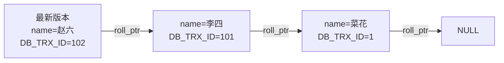

# MVCC 和 ReadView 是怎么工作的？

> 一句话：MVCC 让"读"不用加锁也能读到一份一致的快照，靠的是每条记录留着多个历史版本（版本链）+ 一张"谁的修改我能看见"的判定表（ReadView）。

## MVCC 到底解决了什么

先说痛点。如果没有 MVCC，事务 A 在读一行，事务 B 想改这行，要么 B 等 A 读完，要么 A 读到 B 改了一半的脏数据。读写互相卡，并发就上不去。

MVCC 的思路很朴素：**写的时候不把旧值直接丢掉，而是把旧值留在 undo log 里，让读操作去读"属于自己那个时间点"的那一份**。这样：

- 在 RC、RR 下，普通快照读不申请记录锁，因此不会因为写事务持有该行的排他锁而等待，写事务也不必等待这种读操作；
- RR 下同一事务的快照读复用一致性视图，但仍能看到自己的修改。**两个事务修改同一行依然会发生写写锁等待**，MVCC 没有取消写锁。

所以你会经常听到一句话：MVCC 实现了"一致性非锁定读"。这里的"读"特指普通 `select`，也叫**快照读**。注意它不是万能的，下面会讲它管不到的地方。

## 三个隐藏字段

InnoDB 给每一行聚簇索引记录都偷偷塞了几个隐藏列，MVCC 全靠它们：

| 字段          | 大小   | 干嘛的                                                                                              |
| ------------- | ------ | --------------------------------------------------------------------------------------------------- |
| `DB_TRX_ID`   | 6 字节 | 最近一次"改"这行的事务 id。注意 `delete` 内部也算一次更新，只是在记录头打了个 `deleted_flag` 标记。 |
| `DB_ROLL_PTR` | 7 字节 | 回滚指针，指向 undo log 里这行的**上一个版本**。顺着它就能往回翻历史。                              |
| `DB_ROW_ID`   | 6 字节 | 只有在**没主键、也没唯一非空索引**时才有，InnoDB 拿它当聚簇索引的隐式主键。                         |

这里要拎清一个常见误读：有的资料把 `DB_TRX_ID` 说成"最后一次插入或更新该行的事务 id"。"插入"当然也算，但更准确的说法是**最近一次改动该行的事务 id**（插入、更新、删除都算改动）。另外 `DB_ROW_ID` 跟 MVCC 其实没啥关系，它纯粹是没主键时用来兜底建聚簇索引的，别把它当成版本控制的一部分。

## undo log 版本链

每次修改一行，InnoDB 会把**修改前的样子**写进 undo log，然后用新记录的 `DB_ROLL_PTR` 指向这个旧版本。同一行被改了好几次，这些旧版本就被 `roll_pointer` 串成一条链——链头是当前最新值，往后越翻越老。

举个例子：一行数据 `name = 菜花`（最早由事务 1 写入并提交），事务 101 改为 `李四` 并提交后，事务 102 才能把同一行改成 `赵六`。在这些旧版本尚未被清理时，链就长这样：

一个事务来读这行时，到底应该停在链上的哪一节？这就要靠 ReadView 来判断了。

> 顺带一提：`insert` 产生的 undo log 在事务提交后就能直接删，因为提交前别人看不到这条新行、提交后也没人需要它的旧版本（它本来就没旧版本）。而 `update`/`delete` 的 undo log 要留着给 MVCC 用，得等没有任何活跃事务可能再读它时，由 purge 线程清理。

## ReadView 的四个字段

ReadView 是事务在某个时刻给"整个数据库的活跃事务状态"拍的一张快照照片。它记的不是数据，而是**当下有哪些事务还没提交**。四个字段：

- `m_ids`：生成这个 ReadView 时，还**活跃且已分配事务 id** 的其他读写事务 id 集合。纯只读事务可能不分配这种事务 id，不能把所有执行过 `BEGIN` 的连接都算进去。
- `min_trx_id`：`m_ids` 里**最小**的那个 id（`m_ids` 为空时等于 `max_trx_id`）。
- `max_trx_id`：**下一个将要分配**的事务 id，也就是当前最大事务 id + 1。常叫它"高水位"。注意它不是 `m_ids` 的最大值，而是一个还没人用的、未来的 id。
- `creator_trx_id`：创建这个 ReadView 的事务**自己**的 id；尚未分配读写事务 id 时为 0，之后转为写事务时会更新。

> 旧资料（比如 InnoDB 源码）里这几个字段叫 `m_up_limit_id`（小于它都可见）和 `m_low_limit_id`（大于等于它都不可见），对应到这里就是 `min_trx_id` 和 `max_trx_id`。换个名字而已，含义一样，看到别懵。

## 可见性判断：拿 DB_TRX_ID 跟 ReadView 比

读一行时，取出这个版本的 `DB_TRX_ID`，跟 ReadView 比，分三种情况（自己改的总是可见，这条优先）：

1. `DB_TRX_ID < min_trx_id`：改这行的事务在我拍快照**之前就已经提交**了 → **可见**。
2. `DB_TRX_ID >= max_trx_id`：改这行的事务是在我拍快照**之后才取得这个事务 id** 的 → **不可见**。事务 id 的分配时刻不一定就是 `BEGIN` 的时刻。
3. `min_trx_id <= DB_TRX_ID < max_trx_id`：处在中间地带，再看它在不在 `m_ids` 里：
   - **在** `m_ids` 里 → 拍快照那一刻它还没提交 → **不可见**；
   - **不在** `m_ids` 里 → 说明它已经提交了 → **可见**。

如果当前版本判定为**不可见**，就顺着 `DB_ROLL_PTR` 翻到 undo log 里更老的那个版本，拿它的 `DB_TRX_ID` 再跑一遍上面的判断，直到找到一个可见的版本为止（或者翻到头，返回空）。

### 带数字走一遍

设有一行 `name=菜花`（最早事务 1 写入，早就提交了）。现在按顺序发生三件事：

- 事务 101 把它改成 `李四`，持有这行的排他记录锁，**未提交**；
- 事务 102 也想把它改成 `赵六`，但拿不到同一行的排他锁，**UPDATE 正在等待，尚未产生 `赵六` 版本**；
- 只读事务 R 执行第一次普通 `SELECT`，它不需要等待这把记录锁。

为便于演算，假设此时只有 101、102 两个活跃读写事务，没有其他新事务分配 id。R 的 ReadView 为：`m_ids = [101, 102]`，`min_trx_id = 101`，`max_trx_id = 103`（下一个待分配的 id），`creator_trx_id = 0`（R 尚未分配读写事务 id）。

版本链（链头是最新）：

R 从链头开始判断：

1. 最新版本 `DB_TRX_ID=101`，落在 `[101, 103)` 区间，查 `m_ids`——在里面（101 未提交）→ **不可见**，翻下一版。
2. 旧版本 `DB_TRX_ID=1`，`1 < min_trx_id(101)` → **可见**。

所以 R 读到 `name=菜花`。这里一定要区分：**102 已经活跃，不代表它已经成功改过这行**。只有等 101 提交释放锁，102 的 UPDATE 才能继续执行，版本链才会变成 `102 → 101 → 1`。

## RC 和 RR 的关键差异：ReadView 什么时候生成

对于**一致性非锁定读**，RC（读已提交）和 RR（可重复读）都使用版本链与可见性判断，关键差异是 ReadView 的生成时机：

- **RC：每次快照读都重新生成一个新的 ReadView。**
- **RR：事务里第一次快照读时生成一个，后续快照读复用它。** `START TRANSACTION WITH CONSISTENT SNAPSHOT` 可以在 RR 下立即建立快照，单独执行 `BEGIN` 不会立即建立。

这不是两个隔离级别的全部差异。锁定读和写操作的锁行为也不同：RR 的范围扫描通常使用 next-key lock；RC 对一般搜索和索引扫描关闭间隙锁，但外键约束检查、重复键检查仍可能使用。RC 还会释放不匹配 WHERE 条件的记录锁，UPDATE 涉及半一致性读。详见[加锁规则](/database/mysql/mysql-lock-rules.html)。

接着上面的例子往下走，看一条完整时间线：

| 时刻 | 写事务 101              | 写事务 102                      | 只读事务 R                |
| ---- | ----------------------- | ------------------------------- | ------------------------- |
| T1   | 更新为 `李四`，暂不提交 | —                               | —                         |
| T2   | 持有记录锁              | 尝试更新为 `赵六`，等待锁       | —                         |
| T3   | —                       | 仍在等待                        | 第一次快照读，得到 `菜花` |
| T4   | 提交并释放锁            | 获得锁，UPDATE 完成，但暂不提交 | —                         |
| T5   | —                       | 持有记录锁                      | 第二次快照读              |
| T6   | —                       | 提交                            | —                         |
| T7   | —                       | —                               | 第三次快照读              |

下面分别把 R 的隔离级别设为 RC、RR 来推演；R 在三次读取之间不提交，也不修改这行。实际复现时应在开启 R 的事务前设置隔离级别。

**RC 下（每次重新生成 ReadView）：**

- T5 读：101 已提交，重新生成 ReadView → `m_ids = [102]`，`min_trx_id = 102`，`max_trx_id = 103`。链头 102 不可见，翻到 101 的版本，`101 < 102` 可见 → 读到 `李四`。和 T3 的 `菜花` **不一样了 → 不可重复读**。
- T7 读：101、102 都提交了，重新生成 ReadView → `m_ids = []`，此时 `min_trx_id = max_trx_id = 103`。链头 102 满足 `102 < 103` 可见 → 读到 `赵六`。

每次都拿最新的活跃事务名单去比，所以别人一提交你下次就看得见，于是同一事务里前后读不一致。

**RR 下（一直用第一次的 ReadView）：**

- T3 生成 `m_ids = [101, 102]`，`min_trx_id = 101`，`max_trx_id = 103`，之后复用。
- T5 读：还是这张 ReadView，101、102 在创建视图时均未提交，其版本都不可见，一路翻到 `DB_TRX_ID=1` → 读到 `菜花`。
- T7 读：依旧用这张 ReadView，结果还是 `菜花`。

哪怕 101、102 中途都提交了，对 R 这张旧视图来说，它们在"拍照那一刻"尚未提交，其写入版本仍不可见。这个结论针对 R 的快照读；若 R 自己修改数据，或者改用锁定读，就不能再把所有结果都理解为冻结在旧快照里。

一句话记忆：**RC 的快照读是"每次现拍现看"，RR 是"第一次快照读拍一张，后续复用"。**

## 快照读 vs 当前读

这俩概念是 MVCC 的边界，面试常被追问。

- **快照读（snapshot read）**：RC、RR 下普通的非锁定 `select ... from ...`。走 MVCC，读的是对当前 ReadView 可见的版本，**不申请记录锁**，但仍有元数据锁等其他机制。
- **当前读（current read）**：读最新版本并**加锁**。包括：
  - `select ... for update`（对记录加 X 锁）
  - `select ... lock in share mode`（加 S 锁）
  - `update` / `delete` / `insert`（本质都要先定位到最新行再改）

锁定读和写操作不按旧 ReadView 选择历史版本，而是基于当前记录进行加锁处理；遇到其他事务尚未释放的冲突锁，通常需要等待，不能把对方未提交的数据直接当成可用结果。事务也能读到自己的修改。

## 一个要点：RR 没有"完全解决"幻读

很多资料一句话带过"RR 解决了幻读"，这话不严谨，得拆开看：

- **重复快照读**：RR 复用同一张 ReadView。其他事务在快照建立后才提交的新行，其事务 id 要么在创建视图时的活跃名单里，要么不小于高水位，都不会因为后来提交而突然对这张视图可见。
- **当前读下的幻读**：MVCC 管不到。因为当前读读的是**最新**数据，别人插进来的行如果落在你的查询范围里，你 `for update` 一查就看见了。这种幻读靠的是 **next-key lock（记录锁 + 间隙锁）**——把范围连同间隙一起锁住，不让别人往里插。

所以严格说法是：**RR 下，快照读靠 MVCC、当前读靠 next-key lock，两者配合才把幻读压住，而且也只是"很大程度避免"而非数学上彻底消灭**（典型反例：先快照读一条不存在的行、之后又对同一条做 update，update 是当前读，可能让后续快照读"突然看见"了之前看不见的行）。next-key lock 的细节放在《MySQL 有哪些锁？》那篇讲。

## 容易踩的坑

- **把 `DB_ROW_ID` 当成 MVCC 的一环**。它只在没主键时兜底建聚簇索引，跟版本可见性无关。
- **以为 `max_trx_id` 是 `m_ids` 里的最大值**。不是，它是"下一个待分配的 id"，是个比所有现存事务都大的高水位。
- **以为 begin 了事务就生成了 ReadView**。RR 下是事务里**第一条快照读语句**才生成 ReadView，不是 `begin` 那一刻（除非用 `start transaction with consistent snapshot` 强制立即开启）。
- **把"自己的修改"忘进可见性判断**。事务对自己改过的行总是可见的，这条优先于上面四步比较。
- **以为 RR 就彻底没幻读**。只对快照读成立；当前读那条线得靠锁。

## 小结

- MVCC = 版本链（undo log 串起来的历史版本）+ ReadView（可见性判定表），让快照读不加锁也能读到一致快照，读写不互相阻塞。
- 三个隐藏字段：`DB_TRX_ID`（最近改这行的事务 id）、`DB_ROLL_PTR`（指向上一版本的回滚指针）、`DB_ROW_ID`（无主键时兜底）。
- 可见性判断核心：`< min_trx_id` 可见、`>= max_trx_id` 不可见、中间地带看在不在 `m_ids` 里；不可见就顺 `roll_pointer` 往老版本翻。
- RC 每次快照读生成 ReadView，RR 通常在第一次快照读时生成并复用；这是快照读的关键差异，两者的锁行为也有区别。写写冲突仍由锁协调。
- "RR 完全解决幻读"不准确：快照读靠 MVCC，当前读靠 next-key lock，两者配合且也只是很大程度避免。

## 参考

- [MySQL 8.0：Consistent Nonlocking Reads](https://dev.mysql.com/doc/refman/8.0/en/innodb-consistent-read.html)：核对快照建立时机、快照读与自身修改的边界。
- [MySQL 8.0：Transaction Isolation Levels](https://dev.mysql.com/doc/refman/8.0/en/innodb-transaction-isolation-levels.html)：核对 RC/RR 的快照与锁行为差异。
- [MySQL 8.0：InnoDB Locking](https://dev.mysql.com/doc/refman/8.0/en/innodb-locking.html)：依据排他记录锁冲突规则重排写写等待时间线。

结合本地事务与 MVCC 参考资料交叉整理，修正了“两个未提交事务已先后改写同一行”和“RC/RR 只有 ReadView 时机不同”的表述。本文时间线按官方机制推演，未附数据库实测结果。
