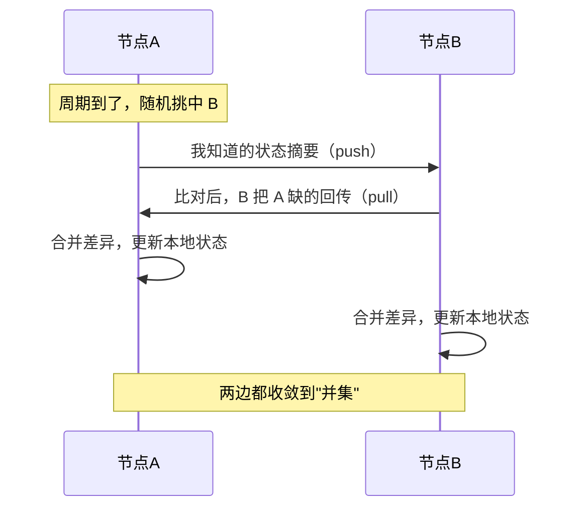
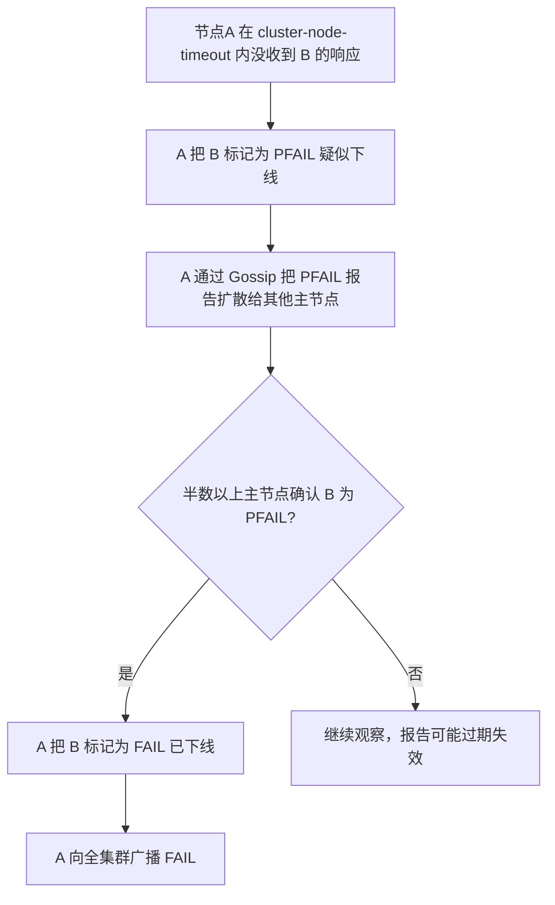

# Gossip 协议为什么适合大规模集群的状态传播？

> 很多人一听 Gossip 就想到"传八卦"，再往下就卡在"反正就是节点互相聊天的协议"。更稳的理解是：**Gossip 是一种借用流行病传播模型的去中心化状态传播协议，解决的是"大规模集群里，每个节点怎么在没中心节点的情况下，最终都知道全集群的状态"，它不是共识算法。**

先看一个典型场景：

- 集群里有 1000 个节点
- 其中一台宕机了
- 另一台新加进来
- 还有一台换了 IP

这些"成员变更"要让全集群所有节点都感知到。你怎么传？

最朴素的办法是搞一台中心节点，谁有变化就告诉它，它再逐个广播给所有人。但这样有两个硬伤：

- 节点越多，中心节点负担越重，复杂度是 `O(N)`
- 中心节点一旦挂了，整个状态传播就停摆，单点故障

Gossip 给的思路是：**别要中心节点了，每个节点都当"小广播站"，周期性地随机挑几个邻居聊一聊，把我知道的状态告诉它，也听它讲它知道的。聊着聊着，全集群就都知道了。**

## 先抓一句话：Gossip 是"流行病式传播"，不是"广播"

Gossip 也叫 Epidemic Protocol（流行病协议），名字就来自这个直觉：**一个病毒怎么从一个人传到全村，状态就怎么从一个节点传到全集群。**

这套思路最早来自 Demers 等人 1987 年的论文《Epidemic Algorithms for Replicated Database Maintenance》，最初是为了解决分布式数据库副本同步问题提出的。

它的核心定义可以压成一句：

**每个节点周期性地、随机地选择若干个邻居，和它们交换自己掌握的状态信息；经过多轮交换后，在没有永久网络分区、节点持续在线的前提下，所有节点的状态会收敛到一致（最终一致性）。**

几个关键特性：

- **去中心化**：没有中心节点，所有节点地位平等，谁挂了都不影响传播
- **容错性强**：容忍节点宕机、网络抖动、动态增删节点
- **概率收敛**：每轮指数级扩散，大约 `O(log N)` 轮就能让消息传遍全集群
- **消息冗余**：同一条消息可能被一个节点收到很多次，所以得配去重机制

> 有一个最容易答错的点：**Gossip 不是共识算法**。它只保证"最终大家会一致"，不保证"什么时候一致、一致之前不会读到旧值"。选主、日志复制、事务这种需要线性一致的场景，得用 Raft / Paxos，Gossip 干不了这活。两者解决的根本不是同一个问题，后面会专门对比。

## 三种方向：push、pull、push-pull 分别在做什么

Gossip 按信息流动的方向，分三种基本形态：

| 方向      | 谁主动           | 做什么                                  | 适合场景                     |
| --------- | ---------------- | --------------------------------------- | ---------------------------- |
| Push      | 知道新消息的一方 | 主动把自己的状态推给随机邻居            | 自己刚拿到新数据，急着扩散   |
| Pull      | 不知道的一方     | 主动向邻居拉取自己缺的                  | 自己数据陈旧，怀疑别人更新了 |
| Push-Pull | 双向             | 先 push 再 pull（或同时），互相比对差异 | 最常用、收敛最快             |

push-pull 之所以最常用，是因为它把"我告诉你我的"和"你告诉我你的"合在了一次交互里，既能扩散新消息，也能补上自己漏掉的旧消息。一次握手，双向对账。

一次 push-pull 大致长这样：



> 这里要纠一个常见混淆：**push / pull / push-pull 是"信息流动方向"的维度，而"反熵 vs 谣言传播"是"交换什么内容"的维度，两者是正交的。** 很多资料把 push / pull / push-pull 直接列成"反熵的三种实现方式"，这个归类不严谨——谣言传播同样可以是 push 或 push-pull。别把它们混成同一棵分类树。

## 收敛为什么是 O(log N)：指数级传播

Gossip 最漂亮的地方在于：**传播是指数级的，不是线性的。**

直觉上，集中式广播要 `O(N)` 轮（中心节点一个个通知），而 Gossip 每一轮，所有"已经知道消息"的节点都会去告诉若干个新节点，于是"知道消息的节点数"每轮翻倍（fanout=1 时）甚至翻更多倍。

用 fanout=1（每轮每个已知节点告诉 1 个新邻居）走一遍：

```text
第 0 轮：只有 A 知道         → 1 个节点
第 1 轮：A 告诉 B            → 2 个节点
第 2 轮：A、B 各告诉 1 个新节点 → 4 个节点
第 3 轮：4 个节点各告诉 1 个  → 8 个节点
第 k 轮：                   → 最多 2^k 个节点
```

要覆盖 N 个节点，需要 `k ≈ log₂(N)` 轮。N=1024 时大约 10 轮；N=100 万时大约 20 轮。规模越大，这个"对数级"的优势越明显。

这里有两个关键参数：

- **fanout（传染因子 / 扇出数）**：每轮每个节点挑几个邻居。fanout 越大，扩散越快，但每轮带宽越大。生产里常见 3~5。
- **gossip interval（传播周期）**：多久发起一轮。越短收敛越快，但消息风暴越猛。常见几百毫秒到 1 秒。

代价不是没有：指数扩散靠的是"重复传播"，同一条消息会被反复转发，**消息总量是 `O(N log N)` 量级**，存在大量冗余。所以 Gossip 是用"带宽换简单性和容错性"。

> `O(log N)` 不是无条件的承诺，它有几个前提：**fanout 是常数、邻居是均匀随机选的、网络不存在永久分区、是非拜占庭环境**（节点不会伪造或篡改消息）。真实工程里丢包、网络抖动、节点动态进出都会拉长收敛时间，所以更准确的说法是"高概率在 `O(log N)` 轮内收敛"，而不是"保证几轮一定收敛"。

## 谁在用 Gossip：成员管理、状态同步、故障检测

Gossip 在工程里最典型的用途是三件事：**成员管理（谁在集群里）、状态同步（各自什么状态）、故障检测（谁挂了）**。几个主流系统都靠它：

| 系统          | 用 Gossip 干什么                 | 特点                                                |
| ------------- | -------------------------------- | --------------------------------------------------- |
| Cassandra     | 节点成员与状态传播、故障检测     | 配 Phi accrual 故障检测、反熵 repair 用 Merkle Tree |
| Redis Cluster | 节点状态、槽位分配、故障标记传播 | 用 PING/PONG 增量 gossip，不做 Merkle 反熵          |
| Consul / Serf | 成员发现、故障探测、事件广播     | 基于 SWIM 协议（带 suspicion 改进）                 |
| Amazon Dynamo | 副本最终一致、成员传播           | 反熵 + Merkle Tree 校正差异                         |

以 Redis Cluster 为例看一遍具体怎么用。它的 Gossip 消息有几类：

| 消息类型 | 用途                                          |
| -------- | --------------------------------------------- |
| `MEET`   | 把一个新节点拉进集群（相当于强制握手的 PING） |
| `PING`   | 周期性发送，顺便捎带集群状态                  |
| `PONG`   | 响应 PING/MEET，携带自身状态                  |
| `FAIL`   | 广播某节点已下线                              |

> 严格说，`MEET` / `PING` / `PONG` 在实现里共用同一套消息结构，`PONG` 是对 `PING` / `MEET` 的响应，`MEET` 可以理解为"强制握手版的 PING"。这点不用死记，记住"它们是一家人"即可。

Redis Cluster 的故障检测是个典型的"疑似→确认"两段式，和 Gossip 配合得很紧：



这里有个关键细节：**`PFAIL` 只是"我怀疑它挂了"，`FAIL` 才是"全集群认定它挂了"**。从 `PFAIL` 升到 `FAIL` 要过半数主节点确认，且报告未过期。这避免了某一个节点因为自己网络问题就误判别人下线。

> 要分清一点：**Redis Cluster 是用 PING/PONG 里的增量 gossip 来传播节点和槽位信息的，并不是像 Dynamo / Cassandra 那样用 Merkle Tree 做反熵对账。** 两者的"传播什么"策略不同：Redis 偏谣言式增量传播，Cassandra/Dynamo 偏反熵式全量对账。别把"用 Gossip"等同于"一定用 Merkle Tree"。

## anti-entropy 与谣言传播：两种"传播什么"的策略

前面把方向（push/pull/push-pull）讲清了，这里讲另一个正交维度——**每次 gossip 交换的是全量数据还是只传新增**。这分两种策略：

**反熵（Anti-Entropy）**：节点间交换完整数据（或数据摘要）来消除差异，目标是把大家的副本拉齐。熵在这里指"节点间数据的差异程度"，反熵就是"压低差异、提升一致性"。

**谣言传播（Rumor Mongering）**：节点拿到新数据后进入"活跃"状态，周期性地把这个新数据（增量 Delta）讲给随机邻居，讲够若干次（按计数 / 概率 / TTL 策略）后停下来。

两者对比：

| 要点     | 反熵                     | 谣言传播                 |
| -------- | ------------------------ | ------------------------ |
| 传播内容 | 完整数据（或摘要）       | 仅新增数据（Delta）      |
| 目标     | 消除历史差异，拉齐副本   | 快速扩散新更新           |
| 消息开销 | 较大                     | 较小                     |
| 收敛范围 | 收敛到最新全量           | 收敛到"已知"增量，可能漏 |
| 适用     | 节点数适中、要兜底防漂移 | 节点多、增量小、变化频繁 |

反熵最大的问题是：**全量数据交换太贵**。Cassandra、Dynamo 这种存储节点动辄 TB 级数据，不可能每次都把整库搬过去比对。所以生产系统普遍上 **Merkle Tree（默克尔树）**：

- 每个节点把一定范围的数据按 key 组织成 Merkle Tree，叶子是数据条目的哈希，父节点是子节点哈希再哈希
- 两个节点先交换根哈希；根相同说明这棵子树没差异，直接跳过
- 根不同就递归往下比对子树，在树高 `O(log M)` 的层级定位到具体哪些条目不同（M 是该范围条目数）
- 最后只传真正有差异的那一小块增量数据

这样就把"全量对账"的成本从 `O(M)` 压到 `O(log M)` 级别，是大规模存储系统能用反熵兜底的关键。

谣言传播则反过来，它只关心"新东西"，配合版本号或消息 ID 去重，避免反复处理同一条消息。它扩散快，但没有反熵那种"定期把历史差异全补上"的兜底，所以**很多系统是两者混着用的**：谣言传播负责日常增量扩散，反熵负责后台周期性兜底修复。

## 工程上最容易踩的坑

Gossip 原理不难，但工程落地时有几个点不控制好就会出事。

**消息冗余和带宽控制**。指数扩散天生冗余，fanout 开太大、周期设太短，几千个节点一起 gossip 就是带宽风暴。常见手段：

- 控制 fanout 和 gossip interval，别图快猛堆
- 用 **Jitter（随机抖动）** 打散每轮发起时机，避免所有节点同一时刻一起发，造成同步雪崩
- 控制单个 gossip 包大小，尽量落在一个网络包内不分片

**anti-entropy 兜底防漂移**。谣言传播有可能漏更新（某条消息没传到就停了），所以不能只靠谣言传播，得有反熵周期性兜底，把长期漂移的数据补齐。这就是 Cassandra 会跑 repair、Dynamo 会做反熵同步的原因。

**节点变更与故障检测的心跳 / PHI**。集群节点会动态增删，故障检测不能简单用"固定超时 = 挂了"来判断，因为网络抖动会误判。两种主流做法：

- **Cassandra 用 Phi accrual 故障检测器**：不输出"挂 / 没挂"二值，而是根据心跳到达间隔的统计分布，输出一个怀疑度 φ，φ 越大越可能真挂。阈值可调，适应不同网络环境。
- **Consul / Serf 用 SWIM 协议**（带 suspicion 改进）：直接和间接探测结合，疑似下线先标"suspicion"再扩散，降低误判，避免某个节点网络不好就全网误判。

**去重**。同一条消息被收到多次是常态，必须靠版本号或消息 ID 去重，否则状态会被反复覆盖、日志会被反复记。

## Gossip 不适合什么场景

Gossip 的优势在大规模、去中心化、能容忍最终一致，反过来这几条不满足时它就不合适。

- **要强一致的**：选主、事务、日志复制这类需要线性一致的场景，Gossip 给不了，得上 Raft / Paxos。
- **要低延迟写的**：Gossip 有"不一致窗口"，写下去不能立刻保证全集群可见，对写延迟和一致性敏感的业务不适合。
- **集群很小**：就三五台机器，搞个中心节点广播又简单又快，上 Gossip 反而引入冗余和复杂度，属于杀鸡用牛刀。

和共识算法放一起看会更清楚：

| 维度       | Gossip                         | Raft / Paxos                       |
| ---------- | ------------------------------ | ---------------------------------- |
| 解决的问题 | 状态传播、最终一致             | 共识、线性一致                     |
| 拓扑       | 去中心化、节点平等             | 通常 leader-based 或多数派         |
| 一致性强度 | 最终一致                       | 强一致（线性一致）                 |
| 收敛速度   | `O(log N)` 轮                  | 多数派一个 RTT 级提交              |
| 容错偏好   | 容忍动态增删、分区（最终收敛） | 容忍少数派故障，多数派不可用则停服 |
| 带宽       | `O(N log N)` 冗余              | 较可控                             |
| 典型用途   | 成员管理、元数据传播           | 选主、日志复制、分布式事务         |

一句话总结：**Gossip 管"最终大家都会知道"，Raft / Paxos 管"大家按什么顺序、什么时候必须一致"。**

## 小结

- Gossip 是借用流行病传播模型的去中心化状态传播协议，核心是每个节点周期性、随机地挑几个邻居交换信息，靠指数级扩散在 `O(log N)` 轮内把消息传遍全集群。
- push / pull / push-pull 是"信息流动方向"，反熵 vs 谣言传播是"交换什么内容"，两者正交，别混成一棵分类树；push-pull + 反熵 + Merkle Tree 是大规模存储系统的常见组合。
- 它保证的是最终一致性，不是共识；选主、日志复制、事务这类要线性一致的场景得用 Raft / Paxos，Gossip 干不了。
- 典型应用是成员管理、状态同步、故障检测：Cassandra 用它配 Phi accrual 检测和 Merkle Tree 反熵，Redis Cluster 用 PING/PONG 增量 gossip 加 PFAIL/FAIL 两段式故障判定，Consul/Serf 用 SWIM。
- 工程上要管住 fanout、周期和 Jitter 控制带宽，用反熵兜底防长期漂移，用心跳 / PHI 这类自适应检测避免误判，并靠版本号或消息 ID 去重。

## 参考

基于公开分布式系统教材与 Cassandra / Redis Cluster / Consul(Serf) 公开文档整理，并结合 Demers 等人流行病算法论文、SWIM 与 Phi accrual 故障检测相关公开资料做了交叉校验。
