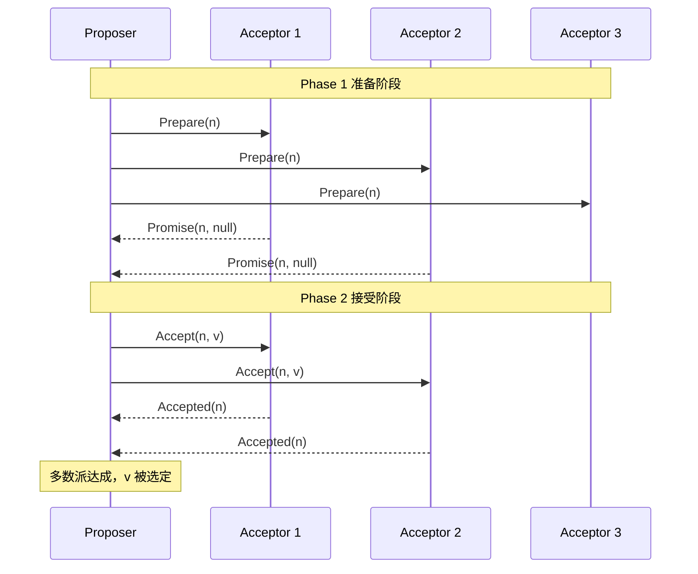

# Paxos 到底难在哪里？为什么是共识算法之母？

分布式系统里，多个节点要对“一个值”达成一致，还要容忍少数节点宕机、网络丢包——这件事比想象中难得多。Paxos 是 Leslie Lamport 在 1990 年提出的共识算法，是后来 Raft、ZAB 等一系列算法的理论源头，所以被叫“共识算法之母”。它难，难在要在“异步网络 + 可能宕机”的前提下，既能保证一致性又不被活锁拖死。

## 共识问题到底难在哪

先说清楚“共识”要解决什么：N 个节点，客户端发一个值 v，要能让所有正常节点最终都同意 v，并且：

- 一旦某个值被选定，之后选定的也必须是这个值（一致性 / safety）；
- 多数节点活着时最终能选定一个值（可终止性 / liveness）。

难点的根源是**异步网络**：消息会延迟、会丢、会乱序，节点还会随时宕机。你没法区分“对方宕机了”和“对方只是很慢”，于是任何“等所有人都回”的方案都不靠谱——必须靠“多数派”来容忍少数派故障。

## Basic Paxos：三角色 + 两阶段

Basic Paxos 解决“就单个值达成共识”，有三个角色：

- **Proposer（提议者）**：接收客户端请求，发起提案，提案包含编号 n 和值 v。
- **Acceptor（接受者）**：对提案投票，要记住自己投过什么。
- **Learner（学习者）**：在值被选定后学习结果，回放给客户端。

一个节点可以身兼多职。一个提案要被**半数以上 Acceptor 接受**才算选定——这就是多数派容错（少于一半节点故障仍能工作）的来源。

整个算法分两个阶段：

### Phase 1：Prepare / Promise

Proposer 选一个全局唯一且递增的编号 n，向多数 Acceptor 发 `Prepare(n)`。

Acceptor 的处理：

- 如果 n 比它见过的最大编号大，就回 `Promise(n, max_v)`——承诺不再接受编号 < n 的提案，并附带“之前接受过的最大编号提案的值” max_v（如果有）。
- 否则拒绝 / 忽略。

这一阶段的目的有两个：**抢编号**（让别的 Proposer 知难而退）和**摸底**（看看有没有已经被接受过的值，避免冲突）。

### Phase 2：Accept / Accepted

Proposer 收到多数 Promise 后，选 Promise 里 max_v 最大的那个值（如果没有就用自己的值 v），向多数 Acceptor 发 `Accept(n, v)`。

Acceptor 的处理：只要 n 不小于它在 Phase 1 承诺过的最大编号，就接受，记录 (n, v) 并回 `Accepted(n)`。

当 Proposer 收到多数 `Accepted(n, v)`，值 v 就**被选定（chosen）**，通知 Learner。

## 提案编号与多数派：为什么这么设计

- **提案编号必须全局递增**：这是“抢锁”的依据。编号小的 Prepare 会被拒绝，保证同一时刻只有一个足够大的提案能往前走。
- **Phase 2 必须复用已接受过的最大值**：这一条是一致性的命根子。如果 Phase 1 摸到“已经有值被接受过”，Proposer 就不能再用自己的新值，必须用那个已接受的值——否则可能出现两个不同的值都被多数派接受，一致性就破了。
- **多数派**：任何两个多数派必有交集，所以只要“多数接受即选定”，就能保证不会同时选定两个不同值。

## 活锁：Paxos 的命门

Basic Paxos 有个致命问题——**活锁**。两个 Proposer 互相抢编号：

1. P1 发 `Prepare(1)`，P2 发 `Prepare(2)`，Acceptor 们觉得 2 大，承诺给 P2。
2. P1 发现被超过，发 `Prepare(3)`，Acceptor 又转投 P1。
3. P2 又发 `Prepare(4)`……

谁也进不了 Phase 2，算法永远不收敛。注意这是**活锁不是死锁**——大家都在动，但没法前进。

解法是**随机退避**：Prepare 被拒后，等一个随机时间再重试，错开竞争者，最终某个 Proposer 能跑完两阶段。但这只是缓解，真正的解法是 Multi-Paxos 引入 Leader。

## Multi-Paxos：选个 Leader 省掉 Phase 1

Basic Paxos 只定一个值，真实系统要定一连串值（日志条目）。每条都跑两阶段太贵。Multi-Paxos 的核心优化：

- **选出唯一稳定的 Leader**，所有提案都由它发起。
- Leader 稳定后，**后续提案直接进 Phase 2**（只跑 Accept），省掉一轮 Prepare / Promise，延迟从 2-RTT 降到 1-RTT。
- 给每条提案分配递增的**日志索引（log index）**，保证全局顺序。

还有一个绕不开的坑——**日志空洞**：前任 Leader 可能在某个 index 上已经让部分 Acceptor 接受了值但没提交就崩了，新 Leader 不知道。如果新 Leader 在这个 index 上提自己的新值，会覆盖已选定的值，破坏一致性。所以 Multi-Paxos 规定：新 Leader 上线时重跑 Phase 1 收集已接受值，**已接受的位置必须复用原值**，没值的位置用 **NOP（空操作）** 占位——NOP 占日志位但状态机回放时跳过，不影响业务。

> Multi-Paxos 只是一种**思想**，Lamport 原文没给实现细节（怎么选主、怎么处理空洞都没说），所以工程上很难直接落地。这也是 Raft 后来能流行的根本原因——它把这些细节都定死了。

## Paxos vs Raft

Raft（2014）借鉴了 Multi-Paxos 的思想但重新设计，更易懂、更易实现：

| 维度     | Multi-Paxos                                     | Raft                                         |
| -------- | ----------------------------------------------- | -------------------------------------------- |
| 日志     | 允许乱序提交、允许日志空洞                      | 强制顺序追加、**不允许空洞**                 |
| Leader   | 只是性能优化手段，非必须                        | **强 Leader**，数据只从 Leader 流向 Follower |
| 选主防御 | 需额外随机退避 / 外部选主                       | 协议内置随机超时选主                         |
| 落地     | Google Chubby、ZooKeeper（ZAB，类 Multi-Paxos） | etcd、Consul、TiKV                           |

一句话：**Raft 把 Multi-Paxos 没说清的实现细节都规定死了**——强 Leader、无空洞日志、随机超时选主——牺牲了 Paxos 的灵活性换来了可理解性和工程可用性。理解 Paxos，才能真正理解 Raft 为什么这么设计。

## 小结

- 共识问题难在“异步网络 + 节点可能宕机”，靠多数派而非“等所有人”来容错。
- Basic Paxos 用三角色 + 两阶段（Prepare / Promise、Accept / Accepted），提案编号全局递增、Phase 2 必须复用已接受的最大值，是一致性的命根子。
- 活锁是 Basic Paxos 的命门，靠随机退避缓解，靠 Multi-Paxos 的 Leader 彻底解决。
- Multi-Paxos 选稳定 Leader 省 Phase 1（2-RTT → 1-RTT），但要处理日志空洞——已接受位置复用、空位置用 NOP 占位。
- Raft 不是 Paxos 的变体而是受其启发的重新设计：强 Leader、无空洞日志、内置选主，牺牲灵活性换可理解性。

## 参考

本文综合公开分布式系统教材与 Lamport 的《The Part-Time Parliament》《Paxos Made Simple》及《In Search of an Understandable Consensus Algorithm》（Raft 论文）等公开资料，核对了 Basic Paxos 两阶段、活锁与 Multi-Paxos 的 Leader 优化、日志空洞处理，并对照了 Paxos 与 Raft 的设计差异。
