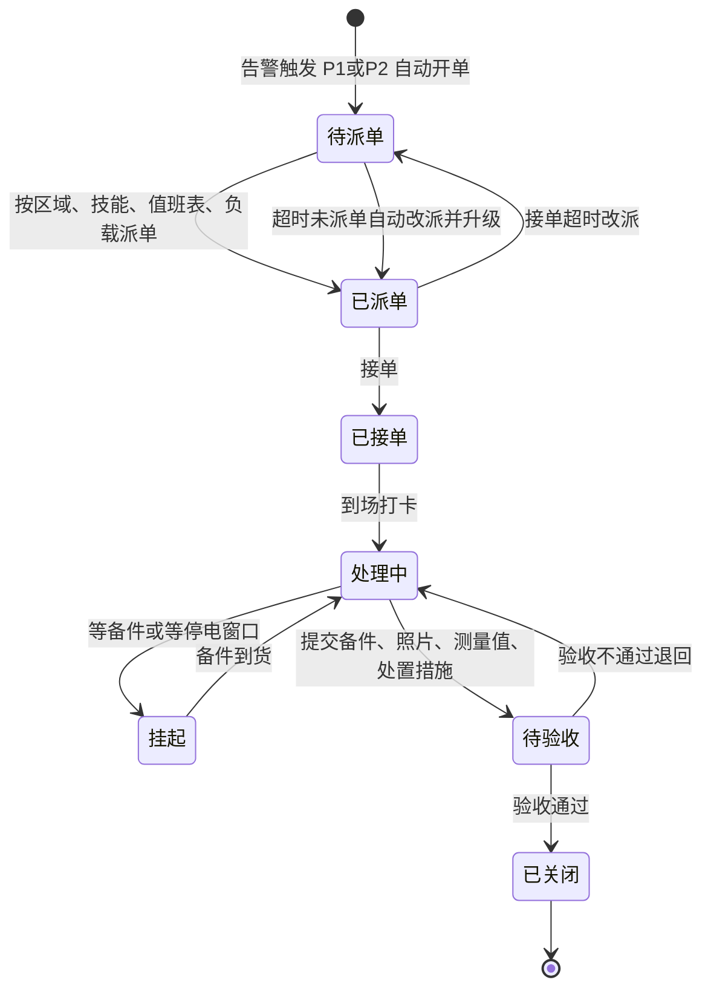

# 电站告警怎么分级、怎么抑制？工单闭环该怎么设计？

> 告警系统的成败不在"能不能报出来"，而在"值班的人敢不敢信、能不能在一个班次里处理完"；分级决定谁在多长时间内动，抑制决定告警量是否超过人的处理能力，工单决定它最终有没有被真正修好。

## 先看一场事故：一根光纤断掉，值班室被打爆

某 100 MW 光伏站，2 台边缘网关、40 台箱逆变一体机（2.5 MW/台）、每台约 120 个点位，加上箱变、汇流箱，全站登记点位约 8,000 个。夜里 02:10，集电线路侧一根光纤被施工挖断。

如果告警只做"单点阈值判断"，接下来两分钟会发生什么：

| 事件                       | 产生的告警条数 | 值班看到的东西                  |
| -------------------------- | -------------- | ------------------------------- |
| 网关 1 下挂设备全部失联    | 约 4,800       | 4,800 条"通信中断"              |
| 点位数值保留最后值、不更新 | 约 3,000       | 3,000 条"数据超时 / 点品质无效" |
| 越限坏点（断线读满量程）   | 数十           | "直流电压 1500 V 越上限"        |
| 真正的原因（线路跳闸）     | 1              | 埋在第 7,800 条里               |

短信网关按 3 条/秒限流，这个量要发 40 多分钟；值班手机在 02:12 被打成静音，第二天早上运维才发现昨天夜里停了 6 小时。**这类事故在行业里不是个例，而是默认状态**——所以本篇最值钱的一节是"抑制"，不是"检测"。

## 告警的四个来源：动作不同，抑制手段也不同

告警不是一个东西，它的来源决定了它该走哪条链路。混在一起做，就会出现"设备故障码被翻译错"和"通信断了还在报温度高"这两种典型事故。

1. **设备自身**：逆变器故障码（厂商码表，同一个码在不同型号上含义可能不同）、BMS 保护（单体过压/欠压、压差、过温、绝缘、SOC 保护）、PCS 报警（直流母线过压、孤岛、过温、防逆流失败）、箱变与 SVG 本体信号。这类告警**必须保留厂商原始码**（`vendor_code`），业务侧再做一层"码 → 中文描述 + 建议动作"的映射，映射表要按型号版本化。
2. **采集侧**：通信中断（链路或设备失联）、点品质无效（`quality` 不是 good，含越限、时钟偏移、插值填充）、越限坏点（断线读满量程、读 0、跳变）。这类告警的语义是"**我不知道现在什么情况**"，不是"设备坏了"，两者绝不能混成同一个级别。
3. **业务规则**：发电量异常偏低（同辐照区间对比）、组串离散率超限、PR 下降、SOC 越限、需量越限、RTE 异常、可用率低于目标。这类告警的判据来自[指标口径](/energy/energy-metrics-definition.html)，**必须声明数据源与评估时段**，否则白天拿尚未刷新的日冻结电量去算"发电量偏低"，第一天就误报一片。
4. **外部**：调度限电指令、气象预警（大风、冰雹、暴雨、沙尘）、电网通知（计划检修、电压异常）、消防与安防联动。这类告警往往同时是"控制输入"，控制类动作的分级要与[储能 EMS 的策略怎么设计](/energy/energy-ems-strategy.html)保持一致口径——防逆流失败既是一个告警，也是一次必须立刻执行的策略干预。

## 分级：影响面 × 紧急度，落到 SLA 和通知渠道上

分级最容易犯的错是按"数值超了多少"来定：温度超 50 ℃ 报 P1、超 45 ℃ 报 P2。这样分出来的级别和"要不要半夜叫人起床"毫无关系。正确的两维是：

- **影响面**：全站 / 单设备 / 单支路 / 仅数据质量。
- **紧急度**：是否停机、是否涉及人身与消防、是否违反并网考核、是否正在损失电量、是否只是趋势。

两维交叉后落到四档，每档必须绑定三个东西：**确认时限、处理时限、通知渠道**。没有 SLA 的级别等于没有级别。

| 级别 | 判据                           | 典型例子                                                                                   | 确认时限 | 处理时限   | 通知渠道             | 开单         |
| ---- | ------------------------------ | ------------------------------------------------------------------------------------------ | -------- | ---------- | -------------------- | ------------ |
| P1   | 停机 / 安全 / 并网违规         | 主变或集电线路跳闸、消防动作、BMS 热失控预警、防逆流失败倒送、调度限电未执行、涉网保护动作 | ≤ 5 min  | ≤ 2 h 到场 | 电话 + 短信 + 值班群 | 自动，不可关 |
| P2   | 单设备停机或降额，正在损失电量 | 单台逆变器停机、PCS 降额、支路电流归零、SOC 越限停机、需量即将越限                         | ≤ 15 min | ≤ 8 h      | 短信 + 值班群        | 自动         |
| P3   | 效率与趋势类，暂不影响出力     | 组串离散率偏高、PR 环比降 5%、风扇转速异常、通信闪断已恢复                                 | ≤ 4 h    | ≤ 3 工作日 | 站内消息 + 日报      | 人工         |
| P4   | 统计与合规类                   | 月可用率低于目标、清洗周期到期、备件低于安全库存                                           | 不要求   | 按周期     | 周报                 | 不开单       |

三条补充规则，比表本身更重要：

- **级别可以随时间升级。** P3 持续 7 天自动升 P2，P2 超过处理时限升 P1——级别是状态的函数，不是创建时写死的字段。
- **确认时限从"首次发生时间"算，不是从"通知送达"算。** 否则短信网关堵半小时，SLA 自动变好看。
- **采集侧告警默认不高于 P3。** "这台设备的数据不可信"要通知，但要通过"数据质量看板 + 日报"走，不占用电话通道；否则一次断链就会把 P1 通道挤爆，真故障叫不出来。

顺带把和通用可观测体系的关系说清：[可观测三支柱](/high-availability/high-availability-observability-pillars.html)里"指标负责发现异常"，那套做法面向的是"值班看板 + 重启服务"；电站告警的处置动作是**派人到现场**，所以告警除了数值，还必须带对象（哪台设备、哪个点位）、拓扑（在哪个方阵、受哪条线路影响，这套层级就是[光伏电站和储能站怎么建模](/energy/energy-domain-model.html)里的站点—设备—点位三层）和处置建议，否则值班只能打电话问人。

## 抖动抑制：六个机制，逐条给机制、配置和反例

这一节是全篇的重点。下面六个机制按"投入产出比"排序，前三个是结构性手段（不改判据、不会引入漏报），后三个是运行期手段。

### 1. 延时确认：持续 N 秒 / 连续 N 个采样点

- **机制**：规则带 `duration_sec` 或 `consecutive_n`，条件满足持续够久才升级为 active。
- **配置**：逆变器"有功为 0"用连续 2 个 5 min 周期；通信中断用连续 3 个探活周期（60 s → 180 s）；温度类用持续 300 s。
- **反例**：为了"及时发现"把 duration 设 0，云层飘过、MPPT 重启一次就报停机，一天几十条；反过来设 30 min，真停机 28 min 后才报，P1 的 5 min 确认时限已经被吃掉一半。

### 2. 回差：active 与 clear 用两个阈值

- **机制**：`active_expr` 与 `clear_expr` 分开，恢复要回到更宽松的位置才允许 cleared。
- **配置**：组串离散率用"基线 + 偏移"而不是绝对值：active > 基线 + 5 个百分点、clear ≤ 基线 + 2 个百分点（基线取同型号、同辐照区间近 30 天的 P95，示例约 8%）；SOC 上限 active ≥ 95%、clear ≤ 90%；温度 45/40 ℃。
- **反例**：单一阈值 8%，实际值在 7.9%~8.1% 之间抖动，一夜产生 200 对 active/clear，值班干脆给这个规则设静默——于是真故障也一起静默了。**回差不是为了好看，是为了让"静默"这个动作不必被滥用。**

### 3. 父子归并：通信中断时，其下所有点位告警必须被抑制

- **机制**：告警对象天然是一棵树：站 → 网关/线路 → 设备 → 点位。父级告警处于 active 时，子级新告警落库但标 `status=suppressed`、`suppress_reason=parent_alarm`，**不发通知、不自动开单**；父级 cleared 后触发一次"补偿评估"，仍在持续的子告警复活并按自己的级别正常走。
- **配置**：抑制关系表按 `parent_scope`（gateway_id / feeder_id / device_id / station_id）配置，根因规则优先（通信中断、线路跳闸、网关离线）。
- **反例**：不做归并 → 就是个例子里那 7,800 条；做过头 → 抑制做成永久标记，父告警恢复后子告警不复活，真实的组串断流跟着丢了。**抑制必须是"状态跟随"，不是"一次性过滤"。** 另外判断"通信中断"不能只看"这个点没更新"：配了 `deadband` 的缓变量（水温、机内温度）稳态时本来就不上报，按单点无更新判会大面积误报，正确做法是**链路级心跳探活 + 遥信周期全量校核**。

### 4. 检修／调试静默窗口：带审批、带过期时间

- **机制**：静默是一条有生命周期的数据（设备范围 + 起止时间 + 申请人 + 关联工单号），不是设备上的一个布尔开关。
- **配置**：默认最长 8 h，超时需二级审批；静默期内告警照常落库（`suppressed`，`reason=maintenance`），只是不发通知、不自动开单；到期前 30 min 提醒，到期后自动恢复并做一次补偿评估。
- **反例**：为了"图清净"给整站设永久静默，半年后 UPS 电池组全坏没人知道，UPS 又是消防和通信的电源——静默的滥用不会当场出事，会在某次停电时集中爆发。

### 5. 同 key 去重 + 频次限制

- **机制**：`dedup_key = (rule_id, object_type, object_id, alarm_code)`；窗口内同 key 不新建告警，只更新 `last_ts`、`count++`、`max_value`；通知按"首次立即发、之后每 30 min 一条汇总"节流，级别升级时立即发。
- **配置**：单 key 通知上限 1 条/30 min；汇总里带"累计 N 次、首次时间、最近时间"。
- **反例**：去重做成"同 key 永久一条"，第二次真故障时 `last_ts` 不更新，MTTR 统计全失真；或者拿告警描述文本当 key，而描述里拼了实时温度值（"温度 63.2 ℃ 超限"），每条都不一样，去重等于没做。

### 6. 风暴保护：宁可聚合上报，不可静默丢弃

- **机制**：按站统计单位时间新增告警数，超过阈值进入风暴模式：后续告警照常落库与聚合，但通知合并成一条"XX 站 5 min 内新增 412 条告警，涉及 6 类规则，已聚合"。
- **配置**：阈值 50 条/站/5 min；持续 10 min 自动通知值班主管；风暴结束时发一条"已结束，期间聚合 XXX 条"。
- **反例**：风暴保护实现成"超阈值直接丢弃"，事故复盘时查不到那 412 条是什么、什么时候开始的，等于把证据一起删了。**聚合是通知层的动作，不是存储层的动作。**

## 告警的生命周期：ack 不等于恢复，恢复必须由数据驱动

| 状态    | 谁触发                                     | 值可能仍异常 | 是否发通知     | 确认时长 | MTTR / 闭环时长 |
| ------- | ------------------------------------------ | ------------ | -------------- | -------- | --------------- |
| active  | 规则命中                                   | 是           | 是             | 起点     | 起点 / 起点     |
| ack     | 人（值班确认）                             | **是**       | 否             | 终点     | 进行中          |
| cleared | **数据**（回差恢复 / 通信恢复 / 规则下线） | 否           | 是（恢复通知） | —        | 终点 / 进行中   |
| closed  | 人（验收完）或自动                         | 否           | 否             | —        | 不计 / 终点     |

注意 MTTR 与"闭环时长"是两个数，别混用：MTTR 到 `cleared`（设备恢复了、电发出来了），闭环时长到 `closed`（备件到了、验收签了）。拿 `closed` 当 MTTR，会把备件采购周期算进修复能力，指标永远改不好；反过来只看到 `cleared`，又会忽略"恢复很快但拖两个月才验收"的流程问题。

这里有一条必须写进设计文档的红线：**`cleared` 只能由数据产生，不能由人点。** 一旦允许人工"关掉告警"，运维在被电话催的时候就会点一下"已处理"，于是列表干净了、故障还在，而且没有任何记录能证明它曾经存在过。人工能做的只有 `ack`（我看到了，正在处理），以及工单侧的"已修复待验证"——验证由下一轮数据完成。

配套的还有**重复告警合并**：一条逻辑告警保留 `first_ts`、`last_ts`、`count`、`max_value`、`min_value`，列表页默认按逻辑告警展示，详情页展开成活动记录。不合并的后果是同一个故障刷出几百行，"这个故障到底持续了多久、峰值多少"要靠人肉数行。

## 工单闭环：状态机、派单、SLA 升级和幂等开单

告警只是"发现问题"，工单才是"解决问题"。两者的连接点只有一个：`alarm_id`。



**派单四个维度**，缺一个就会出现"派给隔壁省的人"或者"全压在一个老手身上"：

| 维度     | 实现                                        | 不做会怎样                     |
| -------- | ------------------------------------------- | ------------------------------ |
| 区域     | 组织树 + 站点所属区域，跨区需主管授权       | 派人跑 300 公里，到场已超 SLA  |
| 技能     | 工单类型 → 技能标签（逆变器/BMS/高压/消防） | 电工去拆电池簇，安全事件       |
| 值班表   | 7×24 轮值 + 备班，节假日单独配              | 半夜无人可派，工单挂到天亮     |
| 负载均衡 | 在手工单数 + 当日完成数加权                 | 一个能人手上 30 单，其余人空闲 |

**SLA 超时升级要一级一级往上走，并且要落库**：`escalation_level` 从 0 递增，每次升级记录对象、渠道、时间。接单超时 → 改派 + 通知班组长；再超时 → 通知运维经理；再超时 → 通知区域负责人。没有升级链的 SLA 只是一张纸。

**幂等开单**是重灾区：告警风暴时，同一条告警可能被消费多次，或者规则每 5 分钟重新命中一次。做法是以 `alarm_id` 做幂等键，工单表上加约束，关闭后允许再开：

```sql
-- 未关闭的工单里，同一个 alarm_id 只能有一条
ALTER TABLE work_order ADD COLUMN open_alarm_id BIGINT UNSIGNED NULL;
ALTER TABLE work_order ADD UNIQUE KEY uk_open_alarm (open_alarm_id);
-- 关闭工单时把 open_alarm_id 置 NULL（唯一索引允许多个 NULL），alarm_id 另存一列长期保留
```

思路与[幂等设计](/high-availability/high-availability-idempotency-design.html)里"用唯一约束兜底，而不是靠先查后写"完全一致：并发下"查到没有就插"必然重单。

## 数据模型：五张表，规则必须能按型号、地区、季节差异化

| 表                   | 关键字段                                                                                                                                | 要点                                      |
| -------------------- | --------------------------------------------------------------------------------------------------------------------------------------- | ----------------------------------------- |
| `alarm_rule`         | 表达式、阈值、`duration_sec`、`clear_expr`、级别、适用型号/站点/区域、生效时段、`version`、`status`                                     | 阈值不许写死在代码里；变更要有版本和回滚  |
| `alarm`              | `rule_id` + `rule_version`、对象类型/ID、级别、`first_ts`/`last_ts`/`count`、状态、`suppress_reason`、`parent_alarm_id`、`workorder_id` | 存 `rule_version`，才能解释"当时为什么报" |
| `alarm_notification` | `alarm_id`、渠道、接收人、发送时间、结果、重试次数                                                                                      | 通知失败要能补发，不能被当成已送达        |
| `work_order`         | `alarm_id`、站点、类型、优先级、负责人、`sla_due_ack`/`sla_due_finish`、状态、关闭时间                                                  | SLA 截止时间在开单时算定，不随后续改      |
| `work_order_log`     | 工单 ID、原状态、新状态、操作人、时间、备注、附件                                                                                       | 流转历史是验收和追责的唯一证据            |

规则差异化不是"高级功能"，是**上线后第一周就会被迫做的事**：

- **按型号**：不同厂商故障码含义不同，同型号在不同容配比下"低功率"基线也不同——拿 1.5 倍容配比机组的经验阈值去套 1.1 倍机组，常年误报。
- **按地区**：沙尘区的清洗周期、沿海的腐蚀类信号、高海拔的降额曲线，都不该共用一个阈值。
- **按季节**：夏季高温时 PR 天然掉 3~5 个点（组件温度系数约 −0.3%/℃），拿冬季基线报警，整个夏天都在响；冬季低温又限制充电功率。
- **按生效时段**：组串离散率只在辐照 > 200 W/m² 且功率 > 20% 额定时才有意义，夜间评估必然是垃圾数据；PR 同理，低辐照时段不参与统计。

## 规则引擎怎么选：从硬编码到流式计算

| 方案                                | 适用规模                   | 实时性  | 变更成本     | 典型坑                                    |
| ----------------------------------- | -------------------------- | ------- | ------------ | ----------------------------------------- |
| 硬编码 if-else                      | < 20 条规则、单站试点      | 秒级    | 改一条要发版 | 规则长进代码，没人敢动，最后全站一套阈值  |
| 配置化表达式（元数据 + 表达式引擎） | 几百条、区域级             | 分钟级  | 改配置即生效 | 缺版本与灰度，改错一次全站刷屏            |
| 流式计算（Flink 窗口 / CEP）        | 几千条、秒级、需要跨点关联 | 秒级    | 需要发布作业 | 状态管理、乱序水位、checkpoint 恢复没人测 |
| 规则引擎产品                        | 复杂事实推理               | 秒~分钟 | 中           | 小团队过度设计，学习成本高过收益          |

选型判断只看两件事：**规则条数**和**是否需要跨测点/跨时间的状态**（"连续 N 个周期"、"与同方阵其他组串比较"、"断链时抑制"都是状态）。前者小、后者不需要，配置化表达式就够；一旦要做窗口聚合和父子状态机，硬扛的成本会超过引入 Flink。

无论选哪种，**规则变更必须可回滚、可灰度**：规则带 `version` 与 `effective_from`；新版本先以 shadow 模式跑 7 天（只落库不通知），对比新旧命中率与差异样本再放量；放量按站点比例灰度；回滚时把 `effective_to` 改回并按版本重算，产生的告警标记 `recomputed` 而不是删除——**删掉的告警等于没发生过的故障**。

## 噪声治理的度量：没有数字，这事交不了差

| 指标         | 定义                                     | 参考目标                 | 用来看什么                   |
| ------------ | ---------------------------------------- | ------------------------ | ---------------------------- |
| 日均告警量   | 单站每日新增逻辑告警数                   | 与站规模匹配，不设统一值 | 值班能否处理完               |
| 有效率       | 真故障告警数 ÷ 总告警数                  | ≥ 80%                    | 阈值是否离谱                 |
| 误报率       | 1 − 有效率                               | ≤ 20%                    | 现场是否开始无视告警         |
| 重复率       | 同 key 窗口内重复次数 ÷ 总次数           | ≤ 10%                    | 去重与回差是否生效           |
| 平均确认时长 | avg(`ack_ts` − `first_ts`)，按级别分组   | 满足各级 SLA             | 通知渠道通不通、值班在不在   |
| MTTR         | avg(`clear_ts` − `first_ts`)，按级别分组 | 逐季下降                 | 备件、技能、派单是否合理     |
| 闭环时长     | avg(`close_ts` − `first_ts`)，按级别分组 | 与 MTTR 分开考核         | 备件、验收流程是否拖沓       |
| 自动开单占比 | 自动开单数 ÷ 应开单告警数                | ≥ 70%                    | 闭环是否靠人肉推动           |
| 静默覆盖率   | 被静默时长 ÷ 总运行时长（按设备）        | 越低越好                 | 反向指标：静默多说明规则不准 |

这些数字最终要落到运维日报和月报里，口径必须和结算报表同源——[采集数据怎么变成报表和结算单](/energy/energy-data-pipeline.html)那条链路上的分档聚合与版本号，告警统计同样要遵守，否则"告警条数"和"损失电量"两张表各自成立、凑在一起对不上。

把误报从 70% 压到 20%，顺序不能乱，**先做结构性的、再动判据**：

1. **第 1 周：父子归并 + 风暴保护。** 不动任何阈值，纯粹减少噪声条数。通常能砍掉 40%~50% 的量，误报率数字不变，但值班重新开始读告警了。
2. **第 2~3 周：同 key 去重 + 延时确认。** 再砍 20%~30%，这两步同样不引入漏报，只是把"抖动"从告警里拿掉。
3. **第 4 周起：才动阈值。** 按型号/地区分组，把经验值换成该组历史分布的 P95/P99，叠加"持续 N 点"，每条规则 shadow 对比 7 天再放量。动阈值必然在漏报和误报之间做交换，所以必须最后做、必须带灰度。

## 面试里怎么讲

1. **先分级**：影响面 × 紧急度 → P1~P4，每级绑死确认时限、处理时限、通知渠道和是否自动开单；级别随持续时间升级，采集侧告警默认不占电话通道。
2. **再讲抑制，父子归并放第一个说**：通信中断是根故障，其下点位告警必须"状态跟随"地抑制并在父级恢复后复活；配上延时确认、回差、静默窗口、去重节流、风暴保护，这六条一起才叫抑制。
3. **然后闭环**：告警 → 幂等开单（`alarm_id` 做键，唯一索引兜底）→ 派单四维度 → 接单到场处理验收 → SLA 超时逐级升级。
4. **最后用数字收尾**：有效率、重复率、平均确认时长、MTTR、自动开单占比，以及"先归并、再去重、后调阈值"的治理顺序——这一步能证明你真的运维过一个站，而不是只写过告警表。

## 容易踩的坑

- **把"没数据"和"设备坏了"混成一个告警。** 前者是"我不知道"，后者是"我知道它坏了"，级别和处置动作完全不同。
- **用单点无更新判通信中断。** 配了 `deadband` 的缓变量稳态本来就不上报，会大面积误报；要用心跳与周期全量校核。
- **抑制做成一次性过滤。** 父告警恢复后子告警不复活，真故障被永久埋掉。
- **允许人工关闭告警。** 电话一催就点"已处理"，故障还在、记录没了。
- **拿实时温度/功率拼进告警描述再去重。** 每条描述都不同，去重形同虚设。
- **静默没有过期时间。** 半年后没人记得某台设备一直静默着。
- **白天拿尚未刷新的日冻结电量算"发电量偏低"。** 每天上午固定误报一片；规则要声明数据源与评估时段。
- **PR、离散率用全站统一阈值。** 高容配比、高温、不同朝向的电站基线完全不同，写死数字要么天天响要么抓不到。
- **开单没有幂等键。** 风暴时一条告警开出十几张工单，派单表直接失控。
- **SLA 从通知送达开始算。** 短信网关一堵，指标全变好看，问题一点没解决。

## 小结

1. 告警分四个来源：设备自身（故障码/保护）、采集侧（通信中断/点品质无效/坏点）、业务规则（发电量、离散率、PR、SOC、需量）、外部（限电、气象、电网），来源决定语义与抑制方式，"没数据"永远不等于"设备坏"。
2. 分级用影响面 × 紧急度落成 P1~P4，每级必须绑定确认时限、处理时限、通知渠道与是否自动开单；级别随持续时间升级，采集侧告警不占电话通道。
3. 抑制六件套：延时确认、回差、父子归并、检修静默（带审批与过期）、同 key 去重去抖、风暴保护（聚合通知而非丢弃）。其中父子归并优先级最高——一次断链刷几千条，值班会直接失去能力。
4. 状态机是 active → ack → cleared → closed：`ack` 只代表"人看到了"，`cleared` 必须由数据驱动，允许人工关闭告警等于主动掩盖故障；重复告警用首末时间 + 次数合并。
5. 工单以 `alarm_id` 做幂等键，按区域/技能/值班表/负载派单，SLA 超时逐级升级；规则要能按型号、地区、季节、时段差异化，并且可灰度、可回滚；治理噪声的顺序是**先归并、再去重、最后调阈值**。

## 参考

本篇按光储电站运维实践组织：告警分级与工单流转对照 ITIL 的事件/问题/变更分层做取舍（告警对应事件，规则缺陷对应问题，阈值调整走变更），设备告警的语义边界对照 GB/T 19964《光伏发电站接入电力系统技术规定》与 GB/T 36547《电化学储能系统接入电网技术规定》中涉网保护与调度信息的要求，BMS 保护类告警的定值口径对照 GB/T 34131《电化学储能电站用锂离子电池管理系统技术规范》与 GB 51048《电化学储能电站设计规范》中的消防与安全要求，指标判据（PR、离散率、需量、SOC）沿用本专题[指标口径](/energy/energy-metrics-definition.html)与[设备建模](/energy/energy-domain-model.html)两篇的结论。核对重点三处：`deadband` 与"无数据"的判别差异、父子归并必须"状态跟随"而非一次性过滤、`cleared` 由数据驱动而 `ack` 只表示人已确认。厂商故障码表各家不统一且随固件版本变化，本篇只给"保留原始码 + 按型号版本化映射"的做法，不给统一码表。
