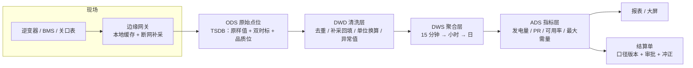
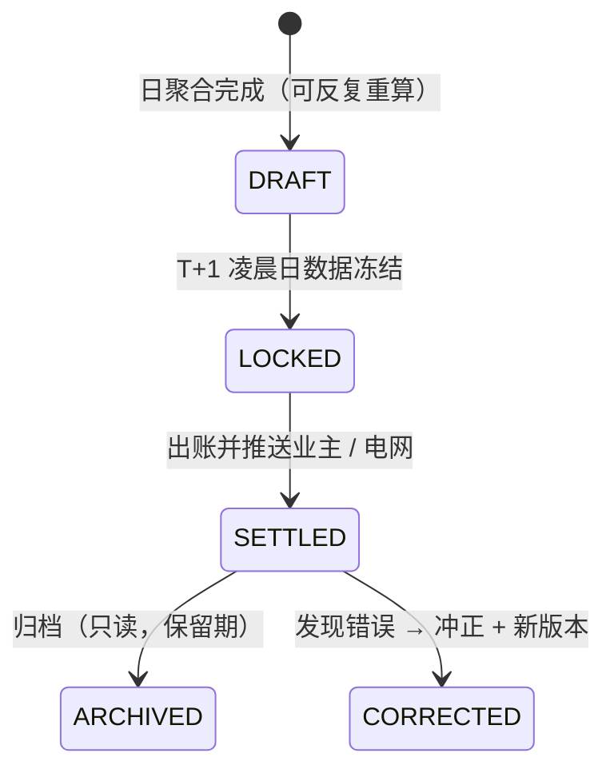
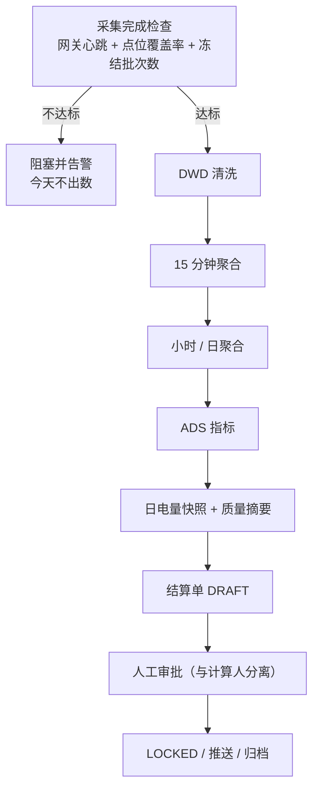

# 采集数据怎么变成报表和结算单？指标链路怎么对齐？

> 采集只是把数字搬回家，报表和结算单才是让人相信这些数字的地方。一条合格的链路要同时守住三件事：**任何一个数都能倒查到某个点位的某个时刻**、**重跑任何一次都不会翻倍**、**算错了能改，但不许把历史悄悄改掉**。

## 分层：从点位到结算单，五层各管一段



| 层  | 落什么                                            | 这一层必须做的动作                                                  | 不做会怎样                                       |
| --- | ------------------------------------------------- | ------------------------------------------------------------------- | ------------------------------------------------ |
| ODS | 点位的原样值，含越限、哨兵值、设备时标与入库时标  | 只落不清洗；保留 `raw_value`、`quality`、`device_ts`、`ingest_ts`   | 事后想复查"当时到底报了什么"，原始数据已经找不回 |
| DWD | 一行一事实：点位 × 时刻 × 有效值                  | 按 `(point_id, device_ts)` 去重、回填补采标记、统一 SI 单位、标坏点 | 重复点位直接让下游 `SUM` 翻倍，且看不出是重复    |
| DWS | 15 分钟 / 小时 / 日三层聚合，冻结量与积分量分列存 | 两层电量物理上分开落列（`e_freeze` / `e_integral`），不许合成一列   | 结算要用冻结值时发现只剩一个混合数，只能全链重算 |
| ADS | 指标 + 维度 + 口径版本 + 质量摘要                 | 出数时快照 `metric_version`、`quality_summary`，并留回溯键          | 报表只剩一个数字，永远失去"这个数怎么来的"       |

**原始层必须可回溯**，这不是洁癖，是排障的现实需求。月度结算单比平台低 7%，你得能一路点下去：月 1,102,340 kWh → 定位到 11-06 至 11-08 这三天 → 那天 09:15 的 15 分钟桶（平台 3,150 kWh、表计折算 1,260 kWh）→ 原始点位里那条记录的倍率配置到底是多少。**在 ADS 只存数字不存来源键，等于把这条路径永久切断**，以后所有差异只能靠猜。

分层建模本身的方法论（ODS/DWD/DWS/ADS 各自怎么写、分区怎么覆盖）见[离线数仓链路怎么搭](/database/datawarehouse/dw-offline-pipeline.html)，本篇只讲能源侧的加工细节：时标、补数、重算、口径。

## 硬点一：按事件时间聚合，别按入库时间

点位数据的 `ts` 有两个：设备打的 `device_ts` 和平台入库的 `ingest_ts`。断网补采、网关排队、批量回放都会让两者差几十分钟到几天。**如果用 `ingest_ts` 切窗口，11-06 的数据会在 11-09 的批里被算进 11-09 的电量**——报表总量看着没错，分日曲线全乱，而对账偏偏是按天对的。

窗口应该是左闭右开的事件时间区间，桶关闭条件由水位线（watermark）决定：

```text
窗口：[09:00, 09:15) 归 09:00 这个桶，跨零点按表计冻结时刻归属，不按行时间戳切
水位线：watermark = 已见最大 device_ts − 允许迟到 10 min
关窗：watermark ≥ 09:25 时关闭 09:00 桶；之后再来的点走迟到流，触发该桶及其下游重算
```

15 分钟冻结电量与分钟遥测的换算是这条链路上最容易被糊弄的一段。冻结值是表计自己在整 15 分钟边界锁存的一组数据，精度由法定计量器具保证；分钟遥测是瞬时功率，用积分近似。假设某窗口功率从 0 线性升到 8 kW：

| 取数方式                             | 计算             | 结果              |
| ------------------------------------ | ---------------- | ----------------- |
| 表计 15 分钟冻结增量（真值）         | 表内积分         | **1.000 kWh**     |
| 15 个 1 分钟采样点均值 × 0.25 h      | 4.00 kW × 0.25 h | 1.000 kWh，对     |
| 只取窗口末瞬时功率 × 0.25 h          | 8.00 kW × 0.25 h | 2.000 kWh，翻倍   |
| 丢 3 个点，按剩余 12 点均值 × 0.25 h | 2.93 kW × 0.25 h | 0.733 kWh，低 27% |

三行结论：**瞬时值乘时长在爬坡段必然错**；积分近似对丢点极度敏感，而且偏差方向不定（缺的点补 0 会偏低，末值保持会偏高）；**只有冻结值能拿去结算**。所以规矩是——结算取 `e_freeze`，看板与损失分析取 `e_integral`，两者日累计差异设阈值（经验值 2%）做偏差告警，但**绝不用积分值去"修正"表计值**。

顺带一个常被跳过的坑：冻结电量到底是累计值还是区间增量，取决于表型和配置。把增量当累计去相邻相减，日电量会算出负数；把累计当增量直接求和，电量翻几百倍。接表第一天就得拿两块表比对确认。

## 硬点二：补采落回原时段，已出账不覆盖

断网补采的正确姿势是**时间戳不变**：网关本地环形缓存（一般存 7 天）在恢复后按原始 `device_ts` 回放，额外写 `is_backfill = 1` 和 `backfill_batch`，去重键仍是 `(point_id, device_ts)`。一旦把补采点的时间戳改成"当前时间"，昨天缺的电量就会算到今天，而报表看起来毫无异常——这是最贵的一类错误，因为它不报错。

重算要有明确的窗口和锁定边界，不能"想改就改"：



- **当日可重算**：`DRAFT` 状态随便跑多少次，口径小改、补采回填都在这天消化掉。
- **T+1 锁定**：日数据冻结后，重算要带变更单；月度出账后进入 `SETTLED`。
- **已出账不覆盖**：重算生成 `v2`，`v1` 原样保留，两边都带 `metric_version` 与 `calc_batch`。差额不是"把 v1 改成 v2"，而是走冲正流程（后面章节）。

还有一个必须闭合的东西：**重算范围**。一条 T+2 才补上来的数据，要重算它影响的所有下游粒度——15 分钟 → 小时 → 日 → 月。只重算日不重算月，月报就和日报之和对不上，对账时又变成"两个平台都对不上电网"的扯皮。

## 硬点三：幂等 — 报表翻倍事故的唯一根因

聚合任务一定会被重跑：失败重试、补数、改口径、上游迟到。所以聚合结果表必须有业务唯一键，**重跑是覆盖同一行，不是插入新行**：

```sql
-- 唯一键：(station_id, object_id, metric_code, period_start, metric_version)
-- 同一次重跑 → 命中唯一键 → 幂等更新；跨版本 → 新增一行（这是"重算不覆盖"的实现方式）
INSERT INTO dws_metric_day
  (station_id, object_id, metric_code, period_start, value, quality, metric_version, calc_batch)
VALUES (1001, 'STATION', 'E_GRID', '2026-11-07', 1260.40, 1, 3, 'RC20261110-01')
ON DUPLICATE KEY UPDATE
  value = VALUES(value), quality = VALUES(quality), calc_batch = VALUES(calc_batch);
```

靠 `INSERT INTO ... SELECT` 追加写、靠任务"只跑一次"的假设来保证正确的方案，在真实项目里活不过三个月。翻倍事故有三种典型形态，共性都是"看起来像业务变好"：

1. **调度器重试 + 追加写**：任务超时被杀但数据已写一半，重试再写一遍，日电量 ×2。
2. **流式任务从 checkpoint 恢复**：at-least-once 语义下窗口结果重发，下游是累加而非覆盖，电量 ×2。
3. **结算单重算生成第二张单**：单号按"账期+站点"生成但没有唯一约束，同月出两张单，业主只付一张，另一张变成对不上的应收。

判断标准很简单：**把这条聚合任务连跑三遍，结果必须一字不差。** 做不到就别上线。通用幂等设计（token、状态机、唯一索引取舍）见[幂等设计](/high-availability/high-availability-idempotency-design.html)，分区覆盖写那条路线见[离线数仓链路怎么搭](/database/datawarehouse/dw-offline-pipeline.html)。

## 硬点四：停机是 0，缺采是 NULL

这两个值在数据库里长得像，在业务上完全相反。**停机是有事件、有状态位、确定发生的事实，电量就是 0；缺采是"不知道"，只能是 NULL。** 混用会同时污染两个方向的指标：

| 错误写法                   | 典型场景                   | 后果                                                      |
| -------------------------- | -------------------------- | --------------------------------------------------------- |
| 缺采写成 0（或哨兵值当 0） | 网关断 3 小时，写入 0 功率 | 发电量偏低、PR 虚低；可用率虚低，把通信故障算成了设备停机 |
| 真实停机 0 当 NULL 丢掉    | `AVG` 跳过 NULL            | 均值只统计有出力的时段，发电量与 PR 虚高；停机被悄悄隐藏  |
| 用 `count(*)` 算数据完整率 | 缺采已经填成 0             | 行数一个不少，完整率 100%，问题永远进不了质量看板         |

正确表达是三态：有效值、停机 0、缺失 NULL，再配 `quality` 与 `status` 两个字段说清"为什么是这个值"。SQL 上要盯住几个默认行为：`AVG(col)` 自动跳过 NULL（分母变小）、`SUM(col)` 把 NULL 当不存在（和 0 同效但语义不同）、`COUNT(col)` 才数非空。完整率与可用率的写法：

```sql
SELECT count(*)                                                       AS expect_cnt,
       count(value)                                                  AS actual_cnt,
       1 - count(value) * 1.0 / count(*)                              AS missing_rate,
       sum(case when status = 'RUN' and value is null then 1 else 0 end) AS suspicious_cnt
FROM dwd_point_15m
WHERE point_id = 8812 AND bucket_ts >= '2026-11-16' AND bucket_ts < '2026-11-17';
```

可用率的分母必须是**应统计时长**，不是"有数时长"——拿有数时长当分母，缺采越严重可用率越漂亮。这三态怎么在点表里定义、多来源冲突时谁覆盖谁，见[光伏电站和储能站怎么建模](/energy/energy-domain-model.html)；时序库侧"缺失标记、绝不补 0"的存储约定见[采集数据该存时序库还是 MySQL](/iot/iot-time-series-storage.html)。

## 数据质量：四个能直接算出来的度量

能源链路的质量不看"六维度全绿"，看四个数（通用维度与规则体系见[数据质量怎么治理](/database/datawarehouse/dw-data-quality.html)，这里只填能源特有的口径）：

| 度量     | 公式                                                   | 参考阈值（按项目定）        | 超过之后做什么                     |
| -------- | ------------------------------------------------------ | --------------------------- | ---------------------------------- |
| 缺采率   | 1 − 实到点数 / 应到点数（应到 = 频率 × 时长 × 点位数） | 15 分钟粒度 > 1% 报警       | 阻断日聚合，先补采再出数           |
| 坏点率   | (越限 + 长时间不变 + 跳变) 点数 / 总点数               | > 3% 进缺陷清单             | 标 `quality=2`，人工确认后决定取舍 |
| 补采率   | 补采点数 / 总点数，同时看补采时延                      | 单日 > 10% 视为通信不可靠   | 派工单查网关与链路，别只改数据     |
| 时标偏差 | \|device_ts − ingest_ts\| 的 P50 / P95                 | P95 > 5 min 标 `clock_skew` | 校时；跨零点前必须处理             |

三条判定规则值得单独记：**越限**（超出点表量程，比如功率出现 −32768 这种哨兵值）、**长时间不变**（功率连续 6 个周期完全相等，大概率是采集卡死而不是真的稳）、**跳变**（相邻点变化率超过额定功率的 20%/分钟，多为倍率错或串位）。规则怎么写、误报怎么降噪，别在这里拍脑袋，按质量治理那套"按同型号基线 + 连续 N 周期抑制"来做。

更关键的是**质量标记必须随数据往下游传**：点位 `quality` → 15 分钟桶取最差品质 → 日指标带 `quality_summary`（缺采率、坏点率、时标异常数）→ ADS → 报表角标和结算单的"数据质量声明"。**报表上要能显示"这天的数不可信"**，否则业务会把一个缺了 4 小时采样的日电量当成真实下降，去追问运维为什么发电掉了 30%。

## 存储与计算：四条链路各干各的活

| 放什么                   | 选型                         | 读写特征                    | 保留期           | 关键约束                               |
| ------------------------ | ---------------------------- | --------------------------- | ---------------- | -------------------------------------- |
| 原始点位                 | 时序库（TDengine / IoTDB）   | 写多读少、按时间范围读      | 原始精度 7–30 天 | 唯一键 `(point_id, device_ts)`；双时标 |
| 清洗明细与聚合           | 数仓 / 湖仓（Hive、Iceberg） | 大批量顺序写、按分区重算    | 3–5 年           | 分区覆盖写，可整段重跑                 |
| 报表多维查询             | OLAP（ClickHouse / Doris）   | 大范围扫描 + 多维聚合，亚秒 | 与数仓同步       | 只读副本，别承担写入                   |
| 配置、口径、结算单、审批 | 关系库（MySQL / PG）         | 强事务、行级更新、审计留痕  | 永久（合规保留） | 账务只增不改，靠冲正                   |

**「实时大屏」和「结算」为什么必须是两条链路**：大屏要的是秒级可见，接受近似（当前窗口还没关、可能缺几个点、可能重发一遍），用流式计算；结算要的是精确且可重算，必须等窗口关闭、数据补齐、口径版本确定，用批量计算。把两者合成一条，要么大屏慢到没人看，要么结算单里混着"当时恰好在线"的数据。

两条链路的口径最终必须靠**日终对账**拉齐：每天批量任务用同一口径重算一遍，与实时链路的日累计比对，偏差超阈值就查（常见是实时侧丢了迟到点、或者实时侧用的还是旧口径版本）。**对账不是流程仪式，它是唯一能发现"两条链路已经悄悄漂移"的机制。**

## 调度与依赖：数据没到就别跑，而不是跑了算出 0



**依赖检查要分三档，只查第一档等于没查**：① 上游任务成功；② 数据就绪（覆盖率、行数/电量在历史波动区间、冻结批次数够）；③ 口径配置已发布（`metric_version` 有生效版本）。只配第①档的后果非常具体：网关那天没上传，清洗任务读到 0 行照样成功，日电量算出 0，一路绿灯进结算单发给业主，第二天电话就来了。**"任务成功"和"数据可用"是两件事**，就绪判定要拿产出（行数、电量、覆盖率）说话。

其余三条纪律：

- **重试只对瞬时失败有效**。网络抖动、队列排队值得重试；SQL 写错、点位不存在、口径冲突重试三遍只是把同一个错犯三遍，还占着出数窗口。分级告警：核心结算链路失败电话 + 值班群，报表失败群消息，内部明细邮件汇总。
- **补数按日期正序、限并发**。先补后一天会让前一天读到"未来"的数据；补 30 天全并行会把队列打满，正常链路跟着迟到。并发度由队列剩余容量决定，不由"想快点补完"决定。
- **历史回刷要先划清账期**。改完口径或修完倍率要回刷历史，但已出账区间不能直接刷——先在账期状态上把 `LOCKED` / `SETTLED` 的区间挡掉，回刷结果落新 `metric_version`，需要改账的走冲正，不动原单。
- **血缘是改规则的刹车**。改一条单位换算（0.1 倍率漏乘修成 1）或改品质过滤规则，必须能回答：影响哪些 DWS、哪些 ADS、哪些已出账单、要不要冲正。表级血缘 + 字段级血缘都要有，上线前用影响面清单 review，而不是靠人肉 grep 报表代码。

## 结算单的工程化：冻结、分离、留痕、冲正

结算单是这份数据里唯一有合同效力的产物，它的工程要求比报表高一档：

1. **口径冻结**。结算单落 `metric_version`（或一份 `calibre_snapshot` JSON：公式、边界、倍率、数据源、版本生效时间）。三年后有人问"这张单的发电量怎么算的"，能直接复现，而不是靠翻聊天记录。
2. **计算与审批分离**。系统算出 `DRAFT`，人工审批后转 `LOCKED`；审批人不能是触发计算的人，审批意见与依据留痕。这不是流程洁癖——一个人既能改口径又能出账，等于没有控制。
3. **导出与归档**。导出 PDF / Excel 时同时生成内容摘要（hash）与签章，原件存对象存储的不可变桶（合规保留期），库里只存指针和 hash。归档件要能自证未被篡改。
4. **冲正 / 红冲**。这是最容易写错的一段：**已出账的单据只允许改状态位，不允许改金额和电量**。修正靠"反向凭证 + 新单"成对完成。

```sql
-- 原单只改状态，金额字段一个都不动
UPDATE bill SET status = 'CORRECTED', corrected_by = 'B202611-1001-002'
WHERE bill_no = 'B202611-1001-001';

-- 反向凭证（负数）+ 重开单（正确数），净额 = 原单 + 红冲 + 重开
INSERT INTO bill_item (bill_no, metric_code, quantity, amount, reason) VALUES
  ('B202611-1001-002', 'E_GRID', -1260.40, -1386.44, '冲正 B202611-1001-001：倍率配置错误'),
  ('B202611-1001-003', 'E_GRID',  1180.00,  1298.00, '按修正后倍率重开，口径 v4');
```

审计表固定记五项：谁发起的、什么时候、依据哪条差异台账、原单号、修正后净额。**账务表只增不改**，这样任何一次修改都能被完整还原，也不用去猜"这行 `update_time` 为什么变了"。

## 三方对账：差异要能归因，台账要能关闭

平台至少要对三方，而且三者用途完全不同：

| 对账对象   | 拿什么对                  | 频率         | 典型差异来源                 | 处理原则                     |
| ---------- | ------------------------- | ------------ | ---------------------------- | ---------------------------- |
| 电网结算单 | 关口表正反向有功冻结值    | 月（出账前） | 时标、倍率、表计与平台时钟差 | 以结算单为准，平台修正并留痕 |
| 财务系统   | 应收电费、购电成本        | 月           | 电价版本、补贴、含税/不含税  | 电量按结算单，单价按合同     |
| 厂商云平台 | 逆变器/储能设备侧累计电量 | 日           | 未扣损耗、固件算法变更       | 只作设备健康参考，不进结算   |

差异归因表要固定成六项，让它能当工单用：

| 差异项       | 典型量级           | 判定方法                   | 归属        |
| ------------ | ------------------ | -------------------------- | ----------- |
| 线损与变压器 | 1% – 3%            | 长期稳定、随负载率缓变     | 系统固有    |
| 站用电       | 0.5% – 2%          | 夜间明显，与发电量弱相关   | 系统固有    |
| 时标错位     | 0% – 3%，跳变      | 差异集中在跨零点或某几天   | 采集配置    |
| 漏采 / 补采  | 0% – 10%，跳变     | 某时段原始点缺失，平台偏低 | 通信 / 网关 |
| 倍率错配     | 整数倍（2/2.5/10） | 比值恒定，五分钟能定位     | 计量配置    |
| 口径版本     | 一次性台阶         | 差异从某个日期起整体平移   | 变更评审    |

**容差不能设 0，也不能拍脑袋设 5%。** 下限由表计精度决定：0.2S 级关口表 + 采集丢失 + 时标余量，日容差约 1%–2%，月容差可收到 0.5% 左右（时标误差被大数摊薄）。设 0 会天天报警、两周后全员静音；设 5% 则真实的倍率错误被"在容差内"放过。容差的意义是让报警有信噪比，不是让差异合法化。

台账要能关闭，字段至少包含：差异 ID、账期、站点、指标、平台值、对端值、差异率、归因项、责任人、处理方式（接受 / 调账 / 冲正）、关闭人、关闭时间、证据链接。两条纪律：**同一归因项连续 3 期超容差，升级为缺陷**（说明不是偶发，是配置或模型问题）；**差异项不允许"挂账不关"**，挂超过一个账期就进月度复盘。

## 面试怎么答这条链路

三段式，先说结构再说硬点，最后落到"错了怎么办"：

1. **分层与可回溯**：ODS 原始点位（原样、双时标、品质位）→ DWD（去重、补采、单位、坏点）→ DWS（15 分钟/小时/日）→ ADS（指标、报表、结算单）。核心承诺是任何一个报表数字都能倒查到具体点位和时刻，所以 ADS 必须留回溯键。
2. **四个工程硬点**：按事件时间聚合并用水位线处理迟到；补采落回原时段、当日可重算、T+1 锁定、已出账不覆盖；聚合结果按（对象, 指标, 时段, 版本）唯一约束做幂等，重跑不翻倍；停机 0 与缺采 NULL 严格区分，否则可用率和 PR 同时失真。
3. **对账与冲正**：三方对账（电网结算单、财务、厂商云），差异按六项归因，容差按表计精度定（日 1%–2%、月 0.5%），台账闭环；出错不 UPDATE 已出账单，用红冲加分项并留痕。

这条答法之所以好用，是因为它直接对上行业现实：**在能源行业，"大约对"等于"不对"**，客户和电网只认能复现、能追溯、能审计的数。追问通常有四个——为什么大屏数不能拿去结算、重跑会不会翻倍、迟到的数据怎么办、出了错怎么改已出账单，上面每一段都能直接接住。

## 容易踩的坑

- **用 `ingest_ts` 切窗口**。补采数据一进来，前几天的电量就跑到今天，总量正常、分日全错，对账时才发现。
- **缺采补 0**。均值、`MIN`、PR、可用率一起失真，而且完整率还显示 100%——错得最安静的一种。
- **聚合表没有业务唯一键**。任务重试一次电量翻一倍，看起来像业务变好，往往到月度对账才暴露。
- **重算直接覆盖已出账数据**。合同依据被静默改掉，事后无法证明当时出的是哪个数，审计直接不通过。
- **冻结量当累计值处理（或反过来）**。相邻相减得负数、直接求和翻几百倍，都是接表第一天该确认的事。
- **容差设 0 或设 5%**。前者报警疲劳，后者把倍率错误放过去；容差按表计精度定，别按"希望差异多大"定。
- **只配"上游任务成功"这一档依赖**。网关掉线那天照样跑通、出 0 电量、进结算单，第二天业主电话。

## 小结

1. 分层单向、原始层可回溯：ODS 原样存（双时标 + 品质位）→ DWD 清洗 → DWS 分粒度聚合 → ADS 指标与结算；**ADS 不存来源键，就等于放弃追溯**。
2. 时标按事件时间：窗口左闭右开、水位线关窗、迟到数据触发重算；结算只取 15 分钟冻结值，积分近似只用于看板与损失分析，两者差异设阈值告警而不用来互相修正。
3. 补采不改时间戳（`(point_id, device_ts)` 去重 + `is_backfill` 标记），重算范围必须闭合到月；当日可重算、T+1 锁定、**已出账只出 v2 不覆盖 v1**。
4. 幂等靠（对象, 指标, 时段, 版本）唯一约束，重跑覆盖而非追加——这是报表翻倍事故的唯一根因；「连跑三遍结果一字不差」是上线门槛。
5. 停机是 0、缺采是 NULL，混用会让可用率与 PR 双向失真；质量标记必须传到报表上，容差按表计精度定（日 1%–2%、月 0.5%），差异走归因台账闭环，改错靠冲正不靠 UPDATE。

## 参考

本仓库 `docs/` 下没有数字能源方向的内部资料，本篇以工程事实为准，综合自：DL/T 645 与 IEC 60870-5-104 中电能量冻结与带时标遥测的通行做法（15 分钟冻结、品质位）、IEC 61724 系列对光伏系统监测与性能比的口径思路，以及时序库与数仓的通用语义（去重键、分区覆盖写、水位线处理迟到数据、`AVG` 跳过 NULL 的聚合行为）。站内与[离线数仓链路怎么搭](/database/datawarehouse/dw-offline-pipeline.html)、[数据质量怎么治理](/database/datawarehouse/dw-data-quality.html)对齐分层与质量方法论、不重复其内容；与[发电量、等效小时、PR、SOC 这些指标怎么算](/energy/energy-metrics-definition.html)对齐指标口径与对账容差，本篇承接"指标算完之后怎么落成结算单"这一段；点位定义、双时标与多来源覆盖规则见[光伏电站和储能站怎么建模](/energy/energy-domain-model.html)，幂等实现见[幂等设计](/high-availability/high-availability-idempotency-design.html)，异常数据的存储约定见[采集数据该存时序库还是 MySQL](/iot/iot-time-series-storage.html)，指标异常触发工单的闭环见[电站告警怎么分级、怎么抑制](/energy/energy-alarm-workorder.html)。

文中的电量数值（1.000 / 2.000 / 0.733 kWh 的积分对照，1,260.40 与 1,180.00 的冲正示例）均为构造算例，可按"功率 0→8 kW 线性爬坡、15 分钟窗口"直接复算；缺采率、坏点率、容差阈值为常见工程范围，落地须按点表量程、表计精度等级与购售电合同替换。真实项目中的表名、单号、站点编码均为占位。
