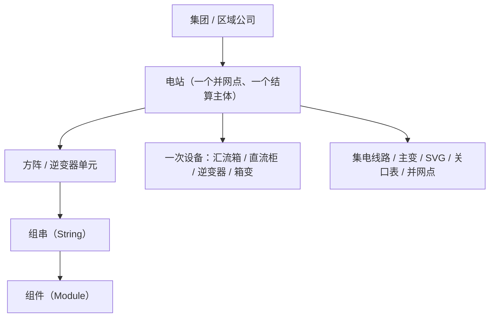
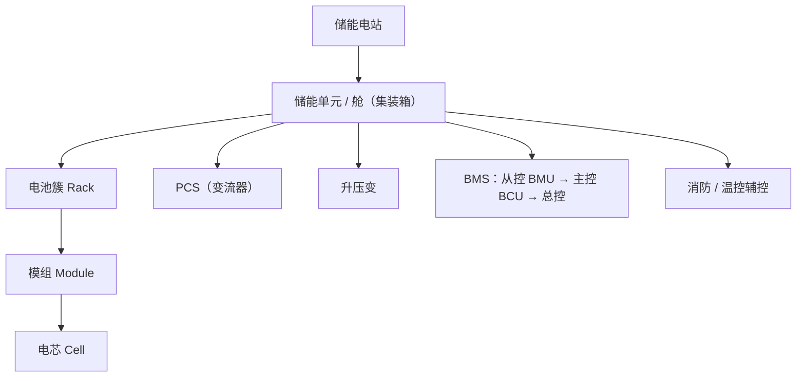

# 光伏电站和储能站怎么建模？设备、点位和主数据怎么摆？

> 新能源系统的底座不是"几张表加一块大屏"，而是三层对象：组织与站点说清"谁的、在哪、多大"，设备说清"谁在发电、谁在储电"，测点说清"这台设备能报哪些数"。三层里任何一层含糊，报表、告警、结算会一起错，而且错得很像真的——曲线平滑、数字合理，没人会怀疑。

## 先破除一个误解：这不是 CRUD 加大屏

刚接这类项目时，需求清单看起来极其普通：电站列表、实时曲线、日/月/年发电量、告警推送、导出报表。照这个清单设计，就是几张表加一堆接口，两周能出 demo。

真正的麻烦在于：**这些需求里几乎没有一个是"取一个字段"，全是比值和差值。** 比值 = 分子来自时序，分母来自主数据；分母一旦是错的，分子越准越离谱。

| 指标         | 分子（时序数据） | 分母（主数据）            | 分母错了会怎样                                    |
| ------------ | ---------------- | ------------------------- | ------------------------------------------------- |
| PR（性能比） | 实际发电量       | 装机容量 × 倾斜面峰值日照 | 容量没更新或辐照仪脏污，PR 常年 >100%，绩效说不清 |
| 等效利用小时 | 发电量           | 装机容量                  | 扩容后没改容量，等效小时虚高，同业对标失真        |
| 可用率       | 可用时长         | 统计时长                  | 停机与缺数不分，可用率虚低                        |
| 储能 RTE     | 放电电量         | 充电电量                  | 充放电点挂错设备，效率算出 120%                   |
| 结算电量     | 关口表冻结电量   | ——                        | 拿遥测积分替代表计值，月底和财务差几个点          |

所以第一件事不是建表，是把"谁的、在哪、多大、有哪些设备、能测什么"钉死。这就是三层对象模型：**站点（组织）→ 设备 → 测点**。这一篇沿用 [设备接入平台的整体链路怎么搭？](/iot/iot-device-access-overview.html) 的分层结论，但往下走一层，讲业务对象怎么摆；寄存器地址、字序、组帧那些属于采集侧，不在这里重复。

## 第一层：站点层级，光伏和储能是两棵树

同一套系统要同时管光伏和储能，很容易被硬塞成一张 `station` 表加一个 `type` 字段。实际上两者的**下钻维度根本不同**，混着建模后面每个功能都要写 `if type`。

光伏是按电气拓扑往下拆：



储能是按电池成组方式往下拆，另挂一条电气与辅助链：



两棵树不能只当展示用，它们各自锁死三个功能：

- **容量归集**：PR 要按方阵算，因为辐照仪装在某个方阵里，拿全站容量当分母、拿一个方阵的辐照当分子，PR 立刻失真。储能的 RTE 要按"储能单元"算，因为 PCS、升压变、辅控损耗都发生在单元这一层，算到舱级才知道哪台效率低。
- **故障定位**：逆变器报"输入功率低"时，如果没有组串这一层，运维只能到现场一根根量；有组串电流，就能按"同方阵同 MPPT 内横向比较离散率"直接指到第几串——这是现场最常用的定位手段，单点阈值反而天天误报。
- **权限**：区域运维只看自己区域的站。这意味着数据权限必须挂在**组织树**上，而不是在每张报表里加 `stationId in (...)`；否则新增一个区域要改十处代码。

层级不是无限深。**电芯级数据要特别小心**：按主流 280 Ah 电芯算，100 MWh 的站是十万只量级的电芯，每只至少一个电压加两个温度点，合起来二三十万个测点；按秒级采集，一年就是万亿行量级，而且 99% 的时间没人看。行业里的常见做法是——电芯级原始数据留在 BMS 本地，平台只存**派生指标和事件**（单体最高/最低电压、最大压差、最高温、SOC 极差、内阻异常），拓扑到电芯级只是为了定位和展示，不是为了全量入库。

## 第二层：设备台账，所有指标的分母

设备台账（主数据）是这类系统里最枯燥、也最容易糊弄的部分。它的价值在半年后体现：客户问"为什么 3 号方阵的 PR 比别的低 8 个点"，你答"因为 3 号方阵换了 4 台逆变器，但台账还写着原来的容量"——这一句话就能决定是技术问题还是数据问题。

台账至少要有四类字段：

| 类别       | 光伏                                                     | 储能                                                   |
| ---------- | -------------------------------------------------------- | ------------------------------------------------------ |
| 容量与规格 | 装机容量 kWp（直流侧）、交流容量 kW、组串数 × 每串组件数 | 额定功率 MW、额定容量 MWh、簇数 × 每簇串并数、电芯型号 |
| 关键设备   | 逆变器型号 / 额定功率 / MPPT 路数、箱变容量、组件型号    | PCS 型号与效率曲线、BMS 三级型号、消防与温控型式       |
| 时间与责任 | 投产日期、质保起止、EPC 与运维单位                       | 投产日期、质保起止（电芯质保常按循环次数另有约定）     |
| 身份       | 设备 SN、资产编号、并网点编号、计量点编号                | 同左，另加消防验收与并网调度编号                       |

再补三个常被忘掉的东西：

1. **生命周期状态**：在建 / 在运 / 停机（计划检修、故障、限电）/ 退役。它决定这个站今天算不算进可用率和分母——在建站还没发电，塞进"全区域等效小时"里就是自己给自己挖坑。
2. **变更历史**：扩容、技改（比如加装储能）、换机。做法是设备实例与设备型号分离，换机时**不覆盖原记录**，新建一条并把旧记录标退役、记 `successor_id`。覆盖的后果是历史曲线被"重写"，那台旧逆变器过去三年的数据突然挂到一台新型号下面。
3. **口径备注**：容量是直流侧还是交流侧、含不含储能、含不含自用电。这几个字不写清，跨部门对数时永远在吵。

**台账是全系统唯一的分母来源。** 后面 [发电量、等效小时、PR、SOC 这些指标到底怎么算？](/energy/energy-metrics-definition.html) 里的所有公式，分母都从这里取；分母和现场铭牌差 5%，PR 就差 5 个点，而这种偏差在曲线上看不出来。

## 第三层：测点模型，设备到底能报哪些数

测点模型回答的是"这台设备能报哪些数、每个数的业务语义是什么"。电力行业用"四遥"分类，落到表里就是一个 `signal_type` 字段：

| 类型 | 名称       | 典型点位                                | 形态与存储方式                     |
| ---- | ---------- | --------------------------------------- | ---------------------------------- |
| 遥测 | 模拟量测量 | 有功功率、直流电压、SOC、温度           | 瞬时值，周期采集，落时序           |
| 遥信 | 开关量状态 | 断路器位置、告警字、门禁、消防动作      | 状态量，变位上报 + 周期全量校核    |
| 遥调 | 设定值下发 | 有功功率设定、无功/电压目标、SOC 上下限 | 低频写，要回读确认，不是"发了就算" |
| 遥控 | 开关控制   | 断路器分合、PCS 启停、逆变器复位        | 一次动作，必须有返校、超时与状态机 |

注意一个容易被点表带偏的地方：**电量（kWh）通常被归到遥测，但它的物理意义不是瞬时量，而是表计内部按区间冻结的累计量。** 把"正向有功总电量"和"有功功率"配成同一个采集周期、同一种插值方式，是后面所有电量对账问题的起点。冻结值和遥测积分值必须分开存、分开用。

一张真实的逆变器 + 关口表混编点表长这样（节选）：

| 点号            | 名称           | 类型 | 量纲 | scale | 精度 | 周期   | 计量点 | deadband |
| --------------- | -------------- | ---- | ---- | ----- | ---- | ------ | ------ | -------- |
| INV01.AC_P      | 交流有功功率   | 遥测 | kW   | 0.01  | 2 位 | 5 min  | 否     | 1%       |
| INV01.DC_V      | 直流输入电压   | 遥测 | V    | 0.1   | 1 位 | 5 min  | 否     | 0.5%     |
| INV01.E_DAY     | 当日发电量     | 遥测 | kWh  | 0.1   | 1 位 | 15 min | 否     | 无       |
| INV01.STATE     | 运行状态       | 遥信 | 枚举 | 1     | ——   | 变位   | 否     | 无       |
| INV01.P_SET     | 有功功率设定   | 遥调 | %    | 0.1   | 1 位 | 按需   | 否     | 无       |
| METER01.E_FWD   | 正向有功总电量 | 遥测 | kWh  | 40    | 2 位 | 15 min | 是     | 无       |
| METER01.P_TOTAL | 总有功功率     | 遥测 | kW   | 0.001 | 3 位 | 15 min | 是     | 0.2%     |
| BRK01.CMD       | 断路器分合     | 遥控 | 枚举 | 1     | ——   | 按需   | 否     | 无       |

每个字段都不是凑数的，错一个就有一类现象：

| 字段       | 为什么必须有                                 | 配错的典型现象                               |
| ---------- | -------------------------------------------- | -------------------------------------------- |
| 量纲       | 决定单位换算与前端格式化                     | kWh 与 MWh 混存，月报数字差 1000 倍          |
| scale      | 原始值到工程值的倍率，通常还要叠 CT/PT 变比  | 变比和 scale 乘两遍，发电量整体放大 40 倍    |
| 精度       | 展示与入库的小数位，避免 0.30000000000000004 | 前端显示 12 位小数，报表导出被客户退回       |
| 上下限     | 判断坏值（越限即标记不可信，而不是直接删）   | 传感器断线读满量程，被当成真实高功率参与均值 |
| 周期       | 采集调度与总线时间预算的依据                 | 全点位 1 秒，总线轮不过来，遥信大面积超时    |
| 是否计量点 | 区分结算口径与展示口径                       | 报表把逆变器自报电量当结算量，和电网差 3%    |
| deadband   | 变化死区，稳态不重复上报                     | 温度这类缓变量秒级上报，存储被无效数据写爆   |

**点位配置和测点定义是两层东西**，混在一起是新手最常见的浪费：寄存器地址、数据类型、字序、功能码属于采集侧映射，跟换一台网关就变；而点号、量纲、量程、口径属于业务侧定义，十年不变。前者可以随驱动走，后者必须进主数据并留版本。

## 数据模型怎么落：为什么不是 3000 列宽表

一个省的几百个电站，单站几千个点位，第一反应往往是"一个站一张宽表，每个点一列"。这条路走不通，而且不是性能问题，是**建不出来**：

- InnoDB 单表最多 1017 列，行大小上限约 8126 字节（16 KB 页的一半）。3000 个 `DOUBLE` 列，光数据就 24 KB，DDL 直接报错。
- 加一个点位就是一次 `ALTER TABLE`：大表上要么锁表，要么走 online DDL 重建，历史分区要跟着迁移。
- 宽表天生稀疏且难演进：新增一类设备（比如加装储能）就多几百列，老数据全是 NULL。
- 换个角度也不行：列存宽表虽然能建更多列，但历史 part 没有新列的值只能填空/默认值，稀疏问题换了个地方出现。

正确形状是"元数据 + 时序值"，三张表分工：

```text
md_station   电站（组织、并网点、容量、状态）
   └─ md_device   设备（类型、型号、SN、额定参数、投运与退役）
        └─ md_point    测点定义（点号、四遥类型、量纲、scale、量程、周期、是否计量点）
             └─ ts_point_value   时序值（point_id, ts, value, quality）
```

测点定义表的骨架（值表按 [采集数据该存时序库还是 MySQL？](/iot/iot-time-series-storage.html) 里的形状走，这里只给元数据侧）：

```sql
CREATE TABLE md_point (
  id            BIGINT UNSIGNED NOT NULL AUTO_INCREMENT,
  station_id    BIGINT UNSIGNED NOT NULL,
  device_id     BIGINT UNSIGNED NOT NULL COMMENT '站级点位挂虚拟设备，不留 NULL',
  point_code    VARCHAR(64)     NOT NULL COMMENT '站内业务点号，如 INV01.AC_P',
  name          VARCHAR(64)     NOT NULL,
  signal_type   TINYINT         NOT NULL COMMENT '1遥测 2遥信 3遥调 4遥控',
  unit          VARCHAR(16)     NOT NULL,
  scale         DECIMAL(12, 6)  NOT NULL DEFAULT 1 COMMENT '含 CT/PT 变比',
  offset_val    DECIMAL(12, 6)  NOT NULL DEFAULT 0,
  precision_num TINYINT         NOT NULL DEFAULT 2,
  min_val       DECIMAL(18, 4)  NULL,
  max_val       DECIMAL(18, 4)  NULL,
  period_sec    INT             NOT NULL DEFAULT 300,
  deadband      DECIMAL(12, 6)  NULL,
  is_meter      TINYINT(1)      NOT NULL DEFAULT 0,
  is_alarm      TINYINT(1)      NOT NULL DEFAULT 0,
  PRIMARY KEY (id),
  UNIQUE KEY uk_station_code (station_id, point_code),
  KEY idx_device (device_id)
) COMMENT '测点定义（主数据）';
```

几个设计决定值得单独说：

- **所有时序、缓存、接口内部都用全局 `id` 做键，`point_code` 只用于人和 Excel 对账。** 只把 `(station_id, point_code)` 设成唯一、却拿 `point_code` 去当 Redis key 和时序表主键，两站各自有 `INV01.AC_P` 时就会串台——这是真实发生过的线上事故，表现是 A 站的曲线偶尔出现 B 站的尖峰。
- **站级点位不留 `device_id NULL`。** 关口表、气象站、并网点这些不属于任何一台逆变器，做法是建一个 `device_type = STATION` 的虚拟设备挂上去。留 NULL 的话，按设备聚合、按设备授权、设备退役时都会漏掉这批点。
- **`scale` 里含变比。** 关口表经 CT 200/5（变比 40）接入时，要么在读表时乘、要么在 `scale` 里乘，只能乘一次。设计上写进 `scale` 并加注释，比指望每个新人记得乘要靠谱。
- **测点定义要有版本和生效时间。** 改 `scale` 不是改配置，是改历史口径：老数据按老版本、新数据按新版本，重算时要能按 `effective_from` 取到当时的值。

## 多来源数据怎么对齐：谁覆盖谁

电站的数据不是一条链路进来的。同一个"今日发电量"，可能同时有五个来源，而且它们互相不相等：

| 来源             | 时标是谁打的   | 粒度                      | 可信度                       | 主要用途           | 常见坑                               |
| ---------------- | -------------- | ------------------------- | ---------------------------- | ------------------ | ------------------------------------ |
| SCADA / 边缘网关 | 设备时间       | 1–5 min                   | 中                           | 分析、告警、曲线   | 设备时钟漂移、断网补采               |
| 关口表 / 光伏表  | 表内时钟       | 15 min 冻结               | 高（法定计量，0.2S/0.5S 级） | 结算、考核         | 表计与主站时钟不一致、变比没乘       |
| 逆变器厂商云 API | 厂商服务器时间 | 5 min / 1 h               | 中低（口径不公开）           | 兜底、交叉验证     | 限流、停服、"发电量"含不含自用电     |
| 功率预测系统     | 预测发布时间   | 超短期 15 min、短期 96 点 | 中                           | 申报、考核         | 预测是"未来"的时标，不能直接和实测拼 |
| 气象站 / 辐照仪  | 采集器时间     | 1 min                     | 中                           | PR、理论发电量     | 水平面辐照当倾斜面用、脏污与积雪     |
| 运维工单 / 清洗  | 人工填写       | 事件级                    | 低但唯一不可替代             | 损失电量剔除、对标 | 时间区间随手填、跨天不闭合           |

对齐原则只有三条，但要在项目一开始就和客户确认并写进验收口径：

1. **结算以计量表为准。** 关口表冻结电量是唯一能和电网、财务对上的数；采集侧再怎么自洽，也不能用来替代它。
2. **分析以采集数据为准。** 分项损耗、组串离散率、设备效率这些只能靠采集，因为站内绝大多数分项没有装计量表。
3. **计量缺失时用厂商 API 兜底，并且必须标注来源与置信度。** 接口和报表都要能说明"这个数是估算的"，而不是让两个来源的数字在同一个字段里悄悄替换。

还有一类最容易被当成"系统 bug"的现象：**分项之和与关口表对不上，差 2%–5%。** 常见原因按出现频率排——表计变比或倍率配错、CT 极性接反、站用电与辅控未计入、线损与变压器损耗没建模、逆变器自报电量含自用电、限电时段采集缺失。先按这个清单排除，别急着改代码；大概率是口径问题，不是程序问题。

## 时间和时标：最容易在验收会上翻车的地方

新能源系统的所有争议最后都会落到"这一段时间怎么算"。四件事必须先定：

- **设备时钟漂移。** 现场逆变器、BMS 的时钟一天漂几秒到几分钟很常见，很多设备根本不支持 NTP。做法是每条记录打两个时标：设备时标和平台入库时标，两者差值超过阈值就标 `clock_skew` 并进数据质量看板，别偷偷用平台时间覆盖设备时间。
- **15 分钟冻结电量与分钟级遥测的对齐。** 冻结电量是表计在整 15 分钟边界自己锁存的一组数据，**它是累计值还是区间增量取决于表型和配置**，取数前必须确认——把增量当累计去相邻相减，日电量会算成负数或趋近 0；反过来把累计当增量直接求和，电量会翻几百倍。分钟遥测是瞬时功率，用遥测积分算电量，和表计冻结值必然有差（采样丢失、限功率爬坡、表计精度、线损）。**结算用冻结值，分析用积分值，两者日累计差异设阈值（比如 2%）做偏差告警**——但绝不能用积分值去"修正"表计值。
- **跨零点归属。** 日发电量要按表计日冻结（表内 00:00 锁存）归属，而不是按采集行的时间戳切。按时间戳切的话，23:59 到 00:00 之间那一段要么丢、要么重复计入两天。海外项目还要处理时区与夏令时：库里统一存 UTC，结算按电站当地时区，遇到夏令时切换那天只有 23 小时，任何"24 小时等分"的算法都会算错。
- **补采数据的时间戳不能改。** 断网恢复后补传的数据，时间戳必须保留设备原始时标，只额外记入库时标和 `is_backfill` 标记。去重键用 `(point_id, device_ts)`，唯一索引冲突就忽略或按质量位更新。一旦把补采数据的时间戳改成"当前时间"，昨天的电量就会算到今天，而报表看上去毫无异常。

这四件事定完，才轮得到聚合与对账：分层聚合、补数与重算、结算差异归因，是 [采集数据怎么变成报表和结算单？](/energy/energy-data-pipeline.html) 的内容；建模阶段能做的，就是别让时标和口径在这里留下无法追回的缺口。

## 主数据治理：点表 Excel 是最脏的代码

平台上线后，真正天天在变的不是 Java 代码，是那张点表 Excel。它有几个天然属性：多人编辑、没有测试、改一个格子影响全站、还没人 review。更麻烦的是它的质量在**调研阶段就定型了**——点表谁给、多少个坏点、口径谁签字，这些问题该在现场走访时就问清（方法见 [需求调研和可行性分析](/engineering/engineering-requirements-feasibility.html)），等到联调期才发现，只能靠加班补。落到平台上，治理手段不复杂，但要一开始就立规矩：

**1. 点表进版本管理。** 每次变更带变更单号（谁提的、改了什么、影响哪些规则），元数据表存 `version` 与 `effective_from`；平台侧维护"点位 → 告警规则 / 报表指标 / 对外接口字段"的引用关系，改 `scale` 前先查影响面，而不是靠人肉 grep。

**2. 上站调试用三点核对表，而不是"能读到数就行"。**

| 核对项 | 怎么做                                     | 不通过意味着                 |
| ------ | ------------------------------------------ | ---------------------------- |
| 点号对 | 按点表逐点读，确认能通、不超时             | 地址或通信配置有系统性偏移   |
| 量纲对 | 和现场表计显示、钳形表、铭牌比对数值       | 倍率、变比、字序错           |
| 变化对 | 人为制造变化（拉合开关、加负载、遮挡组串） | 点号映射串位，读的是隔壁的点 |

第三项最容易被跳过，也最能抓出问题：数值"看起来对"但其实是同型号另一台设备的同位置点位，只有让它变化才能证伪。

**3. 两个覆盖率指标进运维看板。** 应采点数（点表登记且启用）对比实际有数点数（近 24 h 有非空值），按电站和设备类型分组，低于 95% 进缺陷清单；另一个是有效率（数值落在量程内、非冻结值、非时钟异常）。覆盖率掉下去通常先于业务发现故障。

**4. 与现场铭牌对账，投运前一次性做干净。** 装机容量、组串数、逆变器台数、电池簇数，合同、铭牌、点表实际采到的三份数据必须一致。这一步不做，后面所有以容量为分母的指标都带着一个固定偏差，而且没人怀疑它。

## 面试里怎么讲

问"你怎么给电站建模"，别从建表语句开始，按这个顺序讲最清楚：

1. **先画三层对象**：组织/站点（谁的、在哪、多大）→ 设备（谁在发电、谁在储电）→ 测点（能报哪些数）。每层顺口说一句它的键：站点用并网点/结算主体标识，设备用 SN 加内部 ID，测点用全局 ID、点号只做人机对账。
2. **给两句口诀**：台账是分母，点表是证据，时序是事实。指标算错先查分母，数据可疑先查点表，事实只在时序里。
3. **讲清两棵树为什么不同**：光伏按方阵/组串拆是为了 PR 归集和组串级定位；储能按舱/簇拆是为了 RTE 与单体一致性告警；电芯级只存派生指标，不全量入库。
4. **最后给一个真踩过的坑。** 例如：关口表经 CT 变比 40 接入，`scale` 里又配了 0.01 的二次侧系数，代码里再乘一次变比——发电量整体放大 40 倍，曲线平滑合理，直到月底和财务对账才发现。处理方式是按倍率反算重刷历史、把 `scale` 定义写进点表模板、把"日发电量与关口表偏差 >2%"做成常驻告警。另一个常见的是点位重号导致两站串台，只能靠全局 ID 加唯一约束根治。

## 容易踩的坑

- **用 IP 或设备名当设备主键。** 换网段、换机后历史全部断代。设备必须是"内部 ID + SN"，IP 只是采集配置。
- **只建两层（站 + 点），没有设备层。** 换一台逆变器，历史曲线接不上，PR 也没法按方阵归集。
- **站级点位硬塞进某台设备。** 关口表挂到 1# 逆变器下面，那台机一退役，全站结算数据跟着"消失"。
- **点号只在站内唯一，却拿它做全局键。** 两站串台，现象是曲线偶尔出现别人的尖峰，极难定位。
- **3000 点建 3000 列。** 不是慢，是建不出来：InnoDB 单表 1017 列、行上限约 8126 字节。
- **把 `scale` 写成展示精度。** 变比、二次侧系数、单位换算三件事混在一个字段里，乘几次全凭记忆。
- **拿遥测积分当结算电量。** 和账面差几个百分点，且无法解释差在哪一步。
- **缺数补 0。** 停机是有效值 0，缺数是 NULL，混在一起可用率和 PR 全部虚低，事后也分不清是没发电还是没采到。
- **补采时改时间戳。** 昨天的电量记到今天，报表看起来完全正常。
- **台账覆盖原记录做换机。** 历史数据被"重写"，旧设备的三年曲线突然挂到新型号名下。

## 小结

1. 新能源系统的底座是三层对象：组织/站点、设备、测点。站点层解决"谁的、在哪、多大"，设备层解决"谁在发电"，测点层解决"能报哪些数"，三层错一层，报表、告警、结算一起错。
2. 光伏按方阵/组串拆，储能按舱/簇/模组拆，两棵树服务三件事：容量归集（PR、RTE 的分母）、故障定位（组串离散率、单体一致性）、数据权限（组织树）；电芯级只存派生指标，不全量入库。
3. 台账是所有指标的分母，必须存铭牌参数、生命周期状态与变更历史；换机用"新记录 + 退役 + successor"而不是覆盖。台账和铭牌差 5%，PR 就差 5 个点。
4. 测点模型用四遥分类，关键是量纲、scale（含变比）、量程、周期、是否计量点、死区；电量是表计冻结的累计量，不能和瞬时功率同粒度处理。存储用"元数据表 + 时序值表"，内部键用全局点 ID，点号只用于人机对账。
5. 多来源要对齐分层：结算以计量表为准、分析以采集为准、缺计量时用厂商 API 兜底并标注来源；时间上双时标、补采不改原始时标、日电量按表计冻结归属。主数据治理靠点表版本、三点核对、覆盖率指标和铭牌对账。

## 参考

本篇按光伏与储能电站的工程实践组织，标准侧对照了 GB/T 19964《光伏发电站接入电力系统技术规定》与 GB/T 36547《电化学储能系统接入电网技术规定》中关于并网点、计量与调度信息的要求，PR 的定义与计算边界对照 IEC 61724-1《光伏系统性能 第 1 部分：监测》，储能 BMS 的从控/主控/总控三级架构对照 GB/T 34131《电化学储能电站用锂离子电池管理系统技术规范》，电能表通信与冻结机制对照 DL/T 645 系列。核对重点四处：四遥中电量的物理语义（区间累计而非瞬时量）、宽表方案的列数与行大小上限（InnoDB 1017 列、约 8126 字节）、冻结电量与遥测积分的口径差异、补采数据的时标处理。厂商云 API 的发电量口径各家不同（是否含逆变器自用电、是否扣线损），本篇只给"逐家核对并标注来源"的做法，不给统一结论。
