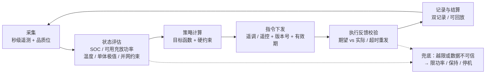

# 储能 EMS 的策略怎么设计？峰谷套利、需量控制、防逆流怎么落？

> 储能 EMS 的价值不在于算出一条漂亮的计划曲线，而在于三件事都管得住：决策用的是秒级可信数据、指令带版本和有效期、任何异常都往保守方向退。策略再聪明，只要错一次时段放电或越一次限，赚的钱就还回去了。

## 先划清分工：谁看见、谁动作、谁算账

评审会上最常被问的一句是"储能放电指令从平台下发，两秒延迟能接受吗"。答案取决于这条指令是什么：如果它是"今天下午峰段放 800 kW"，延迟两秒毫无影响；如果它是防逆流，两秒足够让并网点反向送出一大截电量，逆功率保护直接动作跳闸。所以第一件事不是选算法，而是把三层的时间尺度切开。

| 层             | 典型周期                       | 职责                                                   | 部署位置             | 依赖云端会怎样                   |
| -------------- | ------------------------------ | ------------------------------------------------------ | -------------------- | -------------------------------- |
| SCADA / 采集   | 1–5 s 采集，遥信变位上送       | 把站内状态"表示出来"：遥测、遥信、告警、SOE            | 站控层 / 边缘网关    | 曲线断、看板空，但不影响设备安全 |
| PCS / BMS      | 电流环 µs 级、保护 ms~百 ms 级 | 功率跟踪、过流过压过温保护、单体电压温度保护、孤岛解列 | 设备本地控制器       | 保护失效，这是不可接受的方向     |
| 防逆流闭环     | 100 ms–1 s                     | 采样并网点净功率，实时压制 PCS 出力                    | PCS 内置或专用控制器 | 逆流、跳闸、考核                 |
| EMS            | 1–15 min 滚动                  | 给定电价、负荷预测、需量目标，算每段该充多少放多少     | 站控层 / 边缘服务器  | 少赚，或策略失效退回默认时段表   |
| 平台（III 区） | 分钟级~小时级                  | 多站汇总、收益核算、报表、远程观察与参数下发           | 管理信息大区         | 只能看不能控，控也不许它控       |

**毫秒级保护绝不能放到云端或平台侧。** 三个理由，任一条都足够：

1. **链路物理上做不到**。公网/4G 的往返时延 50 ms 起，抖动到秒级很常见，丢包重传更久；而保护动作窗口是毫秒级，信号在链路上就已经失去意义。
2. **安全分区明确不允许**。生产控制大区（安全 I/II 区）与管理信息大区（III 区）之间有正反向物理隔离装置，控制指令回程要过反向隔离并通常要求人工确认，架构上就不存在"毫秒级自动闭环"这个选项（分区与四遥语义见[电站的点表和三遥四遥怎么接](/energy/energy-station-protocols.html)）。
3. **失效模式不可接受**。保护是最后一道防线，它的可用性等级和"看板能不能打开"不是一回事；把保护挂到依赖运营商网络的链路上，等于把安全交给了第三方。

一句话收口：**EMS 只在"秒到分钟"的尺度上做决策，毫秒级动作留在 PCS/BMS 本地；EMS 对下只给两个东西——功率设定值和功率上限。**

## 控制闭环：一圈六步，少一步就不可解释

六步各自要写清的东西，缺一个就会出现"说不清为什么这么放"：

- **采集**：必须带品质位和时标。用 `IV`（无效）、`NT`（非当前）的值参与计算，等于拿三个月前的数做今天的决策——这种数据看起来完整，破坏力比缺数大。
- **状态评估**：不是读一个 SOC 就完事，要算**当前允许的充放电功率**：`min(PCS 额定, 电池允许倍率 × 可用容量, 变压器余量, 并网与逆流约束, 温度降额)`。算出来通常只有额定的六到八成，策略直接按额定排计划，到点必然执行不了。
- **策略计算**：目标（收益最大）与硬约束（SOC 区间、需量上限、逆流余量）分开表达，**约束优先，目标在可行域内优化**。写成一个大公式一起优化，最后一定会出现"为了多赚两百块把 SOC 放到 3%"。
- **指令下发**：有功/无功目标走遥调，启停复归走遥控；遥控按选择-执行，遥调带版本号与有效期。这两类写入必须与采集链路在服务层就分开。
- **执行反馈校验**：期望功率与实际功率偏差持续超阈值（如 ±5% 额定、10 s）就判本次执行失败，走重发或告警；判据是遥测读数，不是"接口返回 200"。
- **记录与结算**：每次执行留两行数（期望、实际）加上参数快照，这是后面所有对账和复盘的原料。

## 四类策略：目标、约束与失败模式

| 策略               | 目标                     | 硬约束                                         | 典型失败模式                             |
| ------------------ | ------------------------ | ---------------------------------------------- | ---------------------------------------- |
| 峰谷套利           | 谷充峰放，最大化价差收益 | 谷/峰窗口 ≥ 满充满放所需时长、SOC 上下限、DOD  | 窗口不够、SOC 估偏半途到限、电价时段错位 |
| 需量控制           | 压住月度 15 分钟最大需量 | 滑差窗口与提前量、SOC 备用、回差与死区         | 预测漏掉尖峰、削峰后抖动反复触发         |
| 防逆流             | 并网点净功率始终 ≥ 0     | 放电 ≤ 负荷 − 光伏；本地 100 ms–1 s 闭环       | 链路太慢、CT 位置错、通信中断不降功率    |
| AGC/AVC 与需求响应 | 跟住调度指令、按邀约履约 | 死区、爬坡率、调节精度、P-Q 容量、响应基线规则 | 超调被考核、基线含削峰导致响应量虚低     |

## 策略一：峰谷套利——先算清分母，再谈两充两放

套利的算法本身很朴素，难的是把"能充多少、能放多少"算准——以 1 MW / 2 MWh（0.5C）为例，谷价 0.30、峰价 1.10 元/kWh，RTE 按 PCS 交流侧 0.88，一天一充一放：

| 步骤                 | 计算                             | 结果         |
| -------------------- | -------------------------------- | ------------ |
| 谷段充电量（交流侧） | 额定容量满吞吐 2,000 kWh         | 2,000 kWh    |
| 充电成本             | 2,000 × 0.30                     | 600 元       |
| 峰段放电量           | 2,000 × RTE 0.88                 | 1,760 kWh    |
| 放电收入             | 1,760 × 1.10                     | 1,936 元     |
| 毛价差收益           | 1,936 − 600                      | 1,336 元     |
| 辅助用电             | 热管理 + 辅控日均 60 kWh × 0.70  | 约 42 元     |
| 衰减摊销             | 2,000 kWh × 1.0 元/Wh ÷ 6,000 次 | 约 333 元    |
| 日净收益             | 1,336 − 42 − 333                 | 约 960 元    |
| 年净收益             | 960 × 330 天（扣检修与限发）     | 约 31.7 万元 |

三个口径必须钉住，不然这张表没法和别人对：

- **RTE 要写分界点**。0.88 是 PCS 交流侧，所以变压器损耗与辅控要单列；若按并网点测，同一套设备会掉到 0.83–0.85，收益差 5%–8%（口径见[发电量、等效小时、PR、SOC 这些指标怎么算](/energy/energy-metrics-definition.html)，本篇不重复定义）。
- **DOD 假设要写明**。这里按"整容量吞吐一次"算（2,000 kWh）；同专题上一篇 1 MWh 的算例按 DOD 90% 算（充电 1,022.7 kWh），两者不冲突，是假设不同。实际策略里 DOD 由约束清单决定，不能为了多赚把 DOD 拉到 100%。
- **电价是示例值**。这篇给 0.30 / 1.10，上一篇给 0.30 / 1.20，属于不同项目的示例报价；真实测算必须替换成本地目录电价与购售电合同价。

**两充两放不是"更优"，是"用寿命换现金流"。** 在出现午间谷段（光伏大发时段）的地区，一天可以做两次循环：

| 维度                     | 一充一放     | 两充两放（午间也是谷段）      |
| ------------------------ | ------------ | ----------------------------- |
| 日毛收益                 | 1,336 元     | 2,672 元                      |
| 年循环次数（330 天）     | 330 次       | 660 次                        |
| 6,000 次循环寿命对应年限 | 约 18 年     | 约 9.1 年                     |
| 主要风险                 | 峰谷价差收窄 | 电池先到寿，第 9 年要再投一次 |

判断标准很清楚：先看当地电价文件里到底有没有午间谷段（很多地区没有，硬排就是白充），再看电池循环寿命的标定条件——`80% DOD 6,000 次`和`100% DOD 4,500 次`是完全不同的资产，两充两放如果每次满吞吐，实际寿命比标称更短。

## 策略二：需量控制——省的是"最大那 15 分钟"

需量电费按月最大需量计收，而最大需量取当月所有 15 分钟滑差窗口平均功率的最大值（公式与单价示例见[指标篇](/energy/energy-metrics-definition.html)）。这决定了策略的性质：**它省的不是总电量，是峰值那一段；它不是"每天都做"，是"关键几次别越过线"。**

算例：申报需量 2,600 kW，负荷预测显示某日 14:00–14:15 会到 2,900 kW。

| 步骤             | 计算                     | 结果            |
| ---------------- | ------------------------ | --------------- |
| 需量削减目标     | 2,900 − 2,600            | 300 kW          |
| 窗口内需放电量   | 300 kW × 0.25 h          | 75 kWh          |
| 事后补回电量     | 75 ÷ RTE 0.88            | 约 85 kWh       |
| 补电成本         | 85 × 0.30                | 约 26 元        |
| 衰减边际成本     | 按 333 元/2,000 kWh 折算 | 约 14 元        |
| 月度需量电费节省 | 300 × 35 元/kW·月        | 10,500 元       |
| 净收益           | 10,500 − 26 − 14         | 约 10,460 元/月 |

对比一下量级：套利用掉 2,000 kWh 的能量换 960 元/天；需量控制只用 85 kWh 换 10,500 元/月。所以工商业储能的推荐主序是**先需量、后套利**——需量的能量代价几乎可以忽略，套利则在实打实消耗循环寿命。

四个落地细节：

- **触发要用滑差预测，不是瞬时功率**。窗口是滚动的，14:07–14:22 这样的窗口跨在整点两侧，等到 14:10 才反应已经晚了；提前量 = 预测刷新周期 + 下发与响应时间 + 一点裕度。
- **退出要有回差**。放电退出后如果立刻恢复满功率，会来回抖动。加死区（±3% 额定）和最小保持时间（5 min）。
- **SOC 要给需量留备用**。连着几天都有尖峰时，为套利把 SOC 放空，第二天需量事件来了只能干看着。
- **对账看表内需量**。计费依据是表计的最大需量及其发生时间，平台算的滑差值只能做参考；两者差超过 2% 先查窗口对齐和采样点位置。

失败模式值得单独说一句：需量电费是"按月取最大"，**只要有一天漏掉一个尖峰，整月基数就被抬高，前面所有削峰都白做**。所以策略要"防尖峰"而不是"省平均"，宁可多留 5% 裕度，也别赌预测准确。

## 策略三：防逆流——放电功率必须 ≤ 实时负荷

并网点不允许向电网送电时，约束写出来只有一行：`P_放电 ≤ max(0, P_负荷 − P_光伏)`，且并网点净功率始终 ≥ 0（或 ≥ 并网协议允许的反送值）。

数字感受一下：负荷 600 kW、光伏出力 800 kW、PCS 再放电 300 kW，并网点净功率 = 800 + 300 − 600 = **+500 kW 向电网送电**。若项目按不允许逆流设计，逆功率保护（常见定值 2% 额定、延时 0.5–2 s 动作，具体以继保定值单为准）一跳，整站停机——代价远大于那 300 kW 带来的收益。四件事决定它做得成不成：

**1. 必须是本地快速闭环，100 ms–1 s 级。** 走"Modbus 轮询 → 边缘服务 → 平台决策 → 下发"这条路的链路预算是：采样 1 s + 传输 0.3–0.5 s + PCS 响应 0.3–1 s ≈ 2 s 起，这期间 500 kW 的逆流已经送出 0.28 kWh，且足够让保护动作。所以防逆流一定落在 PCS 内置逻辑或专用控制器上，EMS 只负责给"放电功率上限"这个设定值。

**2. CT 采样点位置决定你能看见什么。** 这是最容易在图纸阶段就做错的地方：

| CT 位置                   | 看得见       | 看不见             | 后果                                              |
| ------------------------- | ------------ | ------------------ | ------------------------------------------------- |
| 并网点（关口表侧）        | 净交换功率   | 站内负荷与光伏分量 | 只能闭环"净功率 ≥ 0"，无法主动放电，需配合分表    |
| 变压器低压侧总进线        | 站内总负荷   | 接在其上游的光伏   | 误判"有 600 kW 可放"，实际光伏已 800 kW，直接逆流 |
| 光伏出线 + PCS 出线分别装 | 两个分量都齐 | —                  | 可做功率平衡校验，推荐方案                        |

有了分表就能做校验：`P_并网 ≈ P_光伏 + P_PCS − P_负荷`，三只表读数偏差超过 5% 说明某只 CT 位置、极性或倍率配错——这类错误在图纸上看不出来，只有做平衡校验才会暴露。

**3. 通信中断的保守行为。** 防逆流闭环失去采样后必须"限功率/停机"，不是"保持最后一条指令"。分档设计：采样中断 < 2 s 保持；2–10 s 压到当前功率的 50%；> 10 s 降为 0 并告警。原则只有一句：**失去观测能力时，宁可不出力。**

**4. 逆变器与 PCS 同时出力的叠加风险。** 光储同站时，逆流判据必须用"并网点总功率"，不能用"PCS 功率"。而且两个源要定优先级：优先压 PCS 放电（毫秒到秒级可降），再考虑光伏限功率（MPPT 需要重新跟踪，响应常是秒级，还带发电量损失）。

## 策略四：AGC/AVC 与需求响应——跟踪类策略靠参数

调度侧的策略不是"优化收益"，而是"跟得住、不越考核线"。AGC 把有功指令追准，AVC 把并网点电压/功率因数追准，两个都是**参数工程**：

| 参数     | 常见取值                        | 不设好会怎样                         |
| -------- | ------------------------------- | ------------------------------------ |
| 调节死区 | ±1% 额定                        | 指令在噪声里频繁动作，设备磨损、考核 |
| 爬坡率   | 10%–20% 额定/分钟（储能可更高） | 超速被考核，过慢跟不上指令           |
| 调节精度 | ±2% 额定                        | 稳态偏差进考核统计                   |
| 响应时间 | 收到指令到出力变化，秒级        | 储能的核心卖点，也是取值钱的依据     |

AVC 有个容易被忽略的耦合：PCS 的容量是视在功率 S，满有功时无功余量大幅缩小，所以 `P-Q 曲线`必须进约束——否则调度要无功时，要么给不出，要么被迫降有功。

**调频**是两块收入：容量补偿（按可用调节容量，元/kW·月）+ 里程补偿（按实际调节里程，元/MW）。里程 = 统计期内每次调节的 `Σ|ΔP|`；算例：一天 240 次指令、平均 `|ΔP| = 0.4 MW`，里程 = 96 MW，按示例单价 8 元/MW 计约 768 元/天。要点是**调频和套利抢的是同一块 SOC**，同一时刻只能选一个，优先级要写进配置而不是写在文档里。

**需求响应**的关键在基线，不在控制：

- 邀约给出响应时段与容量，日前、小时级、分钟级通知的履约难度完全不同。
- 基线常取"事件日前若干个同类型工作日同一时段的平均负荷"（或"十日取三高"），剔除检修日与节假日；**基线是结算依据**，不是运营方随口给的数。
- 响应量 = 基线 − 实测；响应率不达标按比例扣减甚至考核，所以平时就要留出可调容量。
- 储能的优势是响应快、可精确、可自证；陷阱是**基线里已经包含了平时做的削峰**，若基线期也在跑需量控制，响应量会虚低。做 DR 的站，基线期要回到"自然负荷"。

## 光储协同：弃光时段充电，账要算对

逻辑很顺：光伏被限发时，充电的机会成本接近 0，峰段再放出来。但"接近 0"不是 0，算一遍才清楚。限发 2 h、可充功率 1,000 kW → 可充 2,000 kWh；按上网电价 0.35 元计的机会成本 700 元；峰段放出 1,760 kWh × 1.10 = 1,936 元；扣衰减 333 元 → 净约 900 元。

注意这里的结论不是"弃光充电更便宜"——0.35 元/kWh 的机会成本其实高于谷电价 0.30。它真正的价值在于**不占用谷段窗口**（谷段窗口常常不够两次满充）、以及减少弃光考核。方案里把弃光充电说成"免费电"，是收益测算里最常见的虚高来源之一。

| 维度     | 直流侧耦合（共用 PCS/逆变器）                       | 交流侧耦合（各接交流母线）             |
| -------- | --------------------------------------------------- | -------------------------------------- |
| 变换级数 | 光伏 DC/DC → 直流母线 → PCS，少一次 AC-DC 变换      | 多一次 AC-DC 变换                      |
| 系统效率 | 高 2–4 个点                                         | 低一些，多一道变换损耗                 |
| 改造难度 | 高：要改直流侧、找宽电压范围与兼容 MPPT，常整机更换 | 低：加一台 PCS 和一段母线，光伏侧不动  |
| 控制难度 | 高：MPPT 与充放电共用同一功率通道，限功率时两者互斥 | 低：两个独立可控源，策略解耦           |
| 逆流风险 | 叠加发生在设备内部                                  | 叠加发生在并网点，必须显式做功率和校验 |
| 适用场景 | 新建项目、追求效率                                  | 存量光伏加储、分批建设、多厂家混用     |

## 约束与保护清单：宁可少赚不可越限

| 约束项          | 常见定值（以厂家与定值单为准）             | 谁执行            | 越限后果                     |
| --------------- | ------------------------------------------ | ----------------- | ---------------------------- |
| SOC 上下限      | 10% / 95%（LFP 常见，个别 5% / 98%）       | EMS 软约束 + BMS  | 过充过放，衰减加速、保护停机 |
| 充放电倍率      | 0.5C（1 MW/2 MWh）；部分产品允许 1C        | PCS / BMS         | 温升与析锂，寿命下降         |
| 单体电压        | LFP 约 2.80–3.65 V                         | BMS               | 单体过压/欠压，簇退出        |
| 单体温度        | 充电 0–45 ℃、放电 −20–55 ℃、簇内温差 ≤ 5 ℃ | BMS + 热管理      | 降额、禁充、热失控风险       |
| 变压器/并网容量 | ≤ 额定容量的 80%–90%                       | EMS 策略          | 变压器过载、需量超标         |
| 逆功率          | ≤ 0 或并网协议允许值                       | 本地控制器 + 继保 | 保护跳闸、调度考核           |
| 孤岛            | ≤ 0.2 s 解列                               | 防孤岛保护        | 人身与设备安全               |
| 簇间 SOC 极差   | ≤ 5%                                       | EMS 簇级调度      | 环流、可用容量虚降           |
| 绝缘阻抗        | ≥ 500 Ω/V                                  | BMS / 绝缘监测    | 绝缘故障停机                 |

这张表的用法是**两层**：本地硬保护（BMS/PCS/继保，毫秒级，谁也不能旁路）负责"不许越"，EMS 的软约束负责"不去碰"。策略侧统一留 5%–10% 裕度，理由是：策略一旦把设备顶在保护定值上，任何采样偏差都会反复触发保护，站会"天天跳"，最后运维把定值往上调——**那才是最危险的结果，比少赚的钱贵得多。**

## 失败兜底：五种一定会遇到的异常

面试里这一节最能分出高低，因为多数人只讲策略怎么算，不讲它怎么退。

**1. 通信中断：本地策略兜底 + 失联即降功率。** 原则是"断云不断站"：边缘侧必须能独立跑一份固定时段表 + 功率限值，云端只做参数下发与观察；策略参数在本地存版本，断网时用最后一版有效参数并打"降级运行"标记。降级不是"少个功能"，是"换一个更保守的行为"，这套分层思路和[限流与降级](/high-availability/high-availability-graceful-degradation.html)里讲的一致。

**2. 指令超时与重发：幂等靠版本号 + 有效期。** 每条指令至少三个字段：幂等键、单调递增的版本号/序号、有效期 `expires_at`。设备侧只执行"版本号大于已执行版本且未过期"的指令，晚到的旧指令直接丢弃。为什么必须这样——现场真实形态是：10:00 发的"放电 800 kW"超时重发三次，10:05 的策略已改成 300 kW，10:06 第一次重发的 800 kW 才到，没有版本号，PCS 就按 800 kW 放了。超时处理：T 秒（如 5 s）未确认则重发，最多 3 次，仍失败判本次执行失败、告警，并把该时段标为"未执行"，收益核算里扣掉这部分预期。

**3. PCS 拒动：切备用策略 + 告警。** 判据 = 期望与实际偏差 > 10% 额定且持续 10 s，且 PCS 状态字不在"远方/就绪"。常见原因：保护动作、高温降额、SOC 到边界、直流侧绝缘或接触器未合、**充放方向符号定义与 EMS 相反**（联调期最高频、也最贵的一个坑）。动作：立即告警、本次时段改用备用策略（另一台 PCS 补上或取消本次削峰）、该循环计入"未完成"，避免收益虚报。

**4. 电价表下发错误或跨时段错位。** 这是真事故形态，不是理论风险：峰谷标识配反、时段表按"工作日"配成"每天"、新版本没生效、跨零点的 23:00–01:00 只落了一段、时区或夏令时错位。表现出来的不是"少赚"，而是**谷时充、峰时也充**——充电计划用一套边界，放电判据用另一套，两边都触发，钱白花还多跑循环。四道防护：① 下发前 96 点自检（一天按时段着色、峰/平/谷时长之和 = 24 h、峰谷段数与当地政策一致）；② 与代理购电公告、电费单时段表逐段比对，双人复核；③ 先"影子运行"一天，只算不执行，把计划出力与实际对照；④ 执行记录里同时记"策略版本 + 电价表版本"，出问题能定位到具体哪一版。

**5. 时钟不同步。** 时段切换、需量窗口、冻结电量、收益结算全都建立在"现在几点"上，而设备本地时钟漂几秒到几分钟很常见（双时标做法见[光伏电站和储能站怎么建模](/energy/energy-domain-model.html)）。要求：站内统一 NTP 源，EMS/PCS/表计/网关同源；**时段边界判定用执行侧时钟**，不用云端时钟；时标统一存 UTC、展示按当地时区；偏差 > 2 s 进告警，并把"执行时刻的时钟偏差"写进执行记录。否则 23:00 的谷段指令可能 22:57 就到、也可能 23:04 才执行，收益永远对不上账。

## 指令下发与审计：怎么回答"昨天为什么在 10:00 放电"

下发顺序固定：选择 → 校验（功率、方向、上下限、联锁、预算）→ 执行 → 等确认（激活终止 + 遥信变位才算成功，判据见[电站的点表和三遥四遥怎么接](/energy/energy-station-protocols.html)）→ 反馈校验（期望 vs 实际）。

四条纪律，都是被事故教出来的：

- **控制接口与采集接口分离**。不同服务、不同账号、不同链路。采集可以丢点、补采、重试；控制必须幂等、审批、双记录。共用一个写入方法，是这类项目最典型的架构事故。
- **期望值/实际值双记录**。每段一行：时段、目标功率、实际功率、SOC 前后、充放电量、策略版本、指令版本、电价表版本、结果码。这就是"可回放"的最小集合。
- **每天策略执行可回放**。要回答"昨天为什么在 10:00 放电"，需要五份证据：当时生效的电价表版本、策略参数、负荷与光伏预测曲线、状态评估快照（SOC 与可用功率）、指令与执行记录。缺任何一份，就只能凭记忆解释。这也和[采集数据怎么变成报表和结算单](/energy/energy-data-pipeline.html)里的逆向追溯是同一套要求——不要求一定算对，要求能查到哪一步错了。
- **操作票与双人复核**。手动模式、超过阈值的功率设定（如 > 50% 额定）、参数变更（SOC 上下限、需量目标、电价表）都要操作票 + 双人复核 + 留痕。自动与手动共存时必须有"手动优先并锁定 N 分钟"的机制，否则自动化会在人工操作后立刻把功率改回去——现场最常见的争吵就是这个。

## 收益核算：算出来的钱和电费单对不上，先看三处

- **计量口径**。储能侧表（PCS 出口）与关口表之间隔着变压器与辅控，差 3%–8% 是常态。对外承诺的收益按关口表，内部效率分析用 PCS 表，两套数不许混用。
- **效率与辅助用电进成本**。热管理、消防、通信、照明都要算钱：1 MWh 级系统日均 20–40 kWh，2 MWh 级 60–80 kWh，南方夏季翻倍。分界点写在 PCS 侧时，辅控必须单独列出，否则收益天然虚高。
- **衰减摊销**。简版是"投资 ÷ 循环次数"，严谨些用全生命周期度电成本（LCOS）把充电电费、运维、残值都摊进去；摊销口径不同，同一套设备的"日净收益"能差 30%。

三项对账固定做：① 峰谷电量——峰段放电量与表计电量变化是否吻合；② 需量——表内最大需量与平台滑差值的偏差；③ 电费单总额（基本电费 + 电度电费 + 力调）与模型结果，差 > 5% 必须归因。一个典型反例：平台按遥测积分算出"本月节省 3.2 万"，电费单只降了 1.1 万——原因不在策略，在口径：积分值没扣站用电、拿 PCS 侧放电量当了关口表电量、需量基数取的是平台值。报表里每个数都要标来源表与分界点。

## 面试怎么答

1. **先分工**。"SCADA 看见、PCS 毫秒级动作与保护、EMS 分钟级决策。毫秒级保护绝不上云——安全分区不允许，公网时延也做不到。"
2. **再给组合策略与约束**。"工商业储能的顺序是先需量、后套利、全程防逆流。需量按 15 分钟滑差预测，越线前放电，能量代价只有几十 kWh；套利谷充峰放，1 MW / 2 MWh、价差 0.8 元时一天毛利约 1,336 元，还要扣衰减和辅控；防逆流要求放电 ≤ 实时负荷，靠本地 100 ms–1 s 闭环，CT 必须能同时看到光伏和负荷分量。硬约束优先于目标：SOC 10%–95%、0.5C、单体电压温度、变压器容量——宁可少赚不可越限。"
3. **最后讲兜底与对账**。"通信中断本地兜底、失联即降功率；指令带版本号和有效期，旧指令不覆盖新指令；PCS 拒动切备用策略；电价表下发前自检加影子运行，因为错时段放电是真事故；全站统一授时；收益按关口表对账，和电费单差 5% 以上必须能归因。"

第三步才是分水岭——前两步能背，第三步只有真做过的人才讲得出细节。

## 容易踩的坑

- 把防逆流做成云端闭环：链路 2 s 级，逆功率保护早就动作了。
- 只装并网点一只 CT 就想做防逆流放电：净功率为 0 时看不出内部还有多少负荷可放，也看不到光伏出力。
- 指令只有目标功率，没有版本号与有效期：重发时旧指令覆盖新指令。
- 策略把设备顶在保护定值上：站天天跳闸，最后运维把定值调高，保护名存实亡。
- 电价表下发即执行，不做 96 点自检与影子运行：出现"谷时充、峰时也充"。
- 用电网侧时钟判定时段边界：设备漂三分钟，谷段充电跨进平段。
- 需量控制按瞬时功率触发而非滑差窗口：提前量不够，削峰削了个寂寞。
- 为套利把 SOC 放空：第二天需量事件来了没电可用。
- 收益按遥测积分算：和电费单差一截，还把锅推给策略。
- 两充两放只算增量收益、不算寿命代价：第 9 年要再投一次电池。

## 小结

1. 分工按时间尺度切：SCADA 秒级"看见"、PCS/BMS 毫秒级"动作与保护"、EMS 分钟级"算账"。**毫秒级保护绝不能放云端**——既是安全分区（I/II 区与 III 区隔离、AGC/AVC 不跨区自动闭环）的硬约束，也是公网时延决定的物理事实。
2. 闭环六步：采集（带品质位）→ 状态评估（SOC、允许充放功率、单体极值、并网约束）→ 策略计算（硬约束优先）→ 指令下发（版本号 + 有效期 + 选择执行）→ 反馈校验（期望 vs 实际、超时重发）→ 双记录与结算，每天可回放。
3. 四类策略各有目标/约束/失败模式：套利吃峰谷价差（1 MW / 2 MWh、0.30/1.10 元、RTE 0.88 → 日毛利 1,336 元、扣完约 960 元）；需量按 15 分钟滑差防尖峰（300 kW × 35 元 ≈ 1.05 万元/月，能量代价仅 75 kWh）；防逆流要求放电 ≤ 实时负荷、本地 100 ms–1 s 闭环、失联即降功率；AGC/AVC 与需求响应看死区、爬坡率、调频里程与基线算法。
4. 兜底五件事写进设计：通信中断本地兜底、指令超时幂等重发（版本号 + 时间戳 + 有效期）、PCS 拒动切备用、电价表错位前自检与影子运行、全站统一授时。电价表错位的失败形态是"谷时充、峰时也充"，不是少赚。
5. 收益按关口表对账，辅控与效率损耗进成本、衰减按循环摊销；平台数与电费单差 5% 以上，先查计量分界点与时段对齐，再怀疑策略。

## 参考

综合自 GB/T 36547《电化学储能系统接入电网技术规定》与 GB/T 19964 中关于并网点、功率控制与保护的要求，GB/T 34131 对 BMS 单体电压温度保护的要求，IEC 60870-5-104 中遥调/遥控（选择-执行）的语义，两部制电价与分时电价的计费规则，以及公开的电力辅助服务（调频容量与里程）与需求响应基线核定办法。站内交叉对齐三篇：[发电量、等效小时、PR 这些指标怎么算](/energy/energy-metrics-definition.html)（SOC/SOH/DOD/RTE/需量口径）、[电站的点表和三遥四遥怎么接](/energy/energy-station-protocols.html)（遥调遥控语义与安全分区）、[光伏电站和储能站怎么建模](/energy/energy-domain-model.html)（设备点位与双时标）。

核对项：峰谷算例逐项可复算（`1,760 × 1.10 = 1,936`、`2,000 × 0.30 = 600`，差 1,336 元；衰减 `2,000 kWh × 1.0 元/Wh ÷ 6,000 次 ≈ 333 元`）；需量算例按 15 分钟窗口折算（`300 kW × 0.25 h = 75 kWh`，回充 `75 ÷ 0.88 ≈ 85 kWh`）；两充两放的寿命年限按 `6,000 ÷ (2 × 330) ≈ 9.1 年` 与 `6,000 ÷ 330 ≈ 18.2 年` 反算。与同专题上一篇的口径差异已在正文说明（DOD 假设、峰价示例值、RTE 分界点）。保护定值（单体电压温度、逆功率 2%、孤岛 0.2 s、SOC 上下限）给的是常见工程范围，实际一律以设备铭牌、并网协议与继保定值单为准；电价、需量单价、调频里程单价、投资单价与循环次数均为示例值。文中"谷时充、峰时也充"、"重发旧指令覆盖新指令"、"并网点单 CT 误判可放负荷"三类事故形态是对现场故障的抽象，不指向具体项目。
