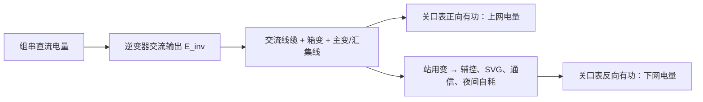

# 发电量、等效小时、PR、SOC 这些指标到底怎么算？

> 光储指标的争议很少是"谁算错了"，绝大多数是"分母不同、边界不同、时标不同"。把每个指标的公式、边界、数据源、责任人钉死，大屏和结算单差出来的那几个点才有地方归因。

## 大屏 1.2 万度，结算单 1.1 万度，谁对？

客户拿着两张纸问你哪个对：运维大屏写"今日发电 12,000 kWh"，电网结算单写 11,000 kWh，差 1,000 度、8.3%。答案是**两个都对，因为它们回答的不是同一个问题**——大屏取逆变器交流侧累计电量的日增量，没扣站用电，时标按逆变器本地时钟；结算单取并网关口表的正向有功日冻结差值，已扣线损、变压器损耗和站用电，且表是法定计量器具。

这就是口径的全部分量：**同一个业务事实，在时间、范围、来源、边界处理上的一组约定**。站内[指标体系怎么设计](/database/datawarehouse/dw-metric-system.html)讲过，指标定义要做到"只看文档就能复现这个数"。落到光储行业，每个指标至少写清五件事：

| 要素         | 光伏侧要写清什么                                      | 储能侧要写清什么                            |
| ------------ | ----------------------------------------------------- | ------------------------------------------- |
| 名称与英文名 | 等效利用小时 / `equivalent_hours`，与"利用小时数"区分 | SOC / `soc`，标明是 BMS 上报还是 EMS 重算   |
| 口径与边界   | 分母是直流 kWp 还是交流 kW，含不含站用电与限电        | 分界点在 PCS 交流侧、并网点还是电池簇直流侧 |
| 公式         | `发电量 ÷ 装机容量`，分子分母同侧                     | `剩余可用电量 ÷ 当前最大可用容量`           |
| 数据源       | 逆变器累计值 / 关口表冻结值 / 辐照仪                  | BMS 簇级数据 / PCS 计量 / 关口表            |
| 频率与责任人 | 15 分钟采集、日冻结、T+1 出账，运维 + 计量双责任人    | 秒级刷新、日月结算，EMS 厂商 + 业主运维     |

最后一列的"双责任人"不是形式主义：设备侧的数和计量侧的数天生会差，必须有人对"设备数"负责、有人对"结算数"负责，否则差异永远没人认领。

## 先把分母钉死：kWp 和 kW 不是一回事

行业最常见的分母错误就出在这两个单位上。**直流侧装机容量（kWp）**是组件标称功率之和，标定条件是 STC（辐照 1,000 W/m²、电池温度 25 ℃、AM1.5），描述"装了多少块板"；**交流侧装机容量（kW）**是逆变器额定交流输出之和，也就是并网容量、核准容量，描述"最多能往电网送多少"。两者之比是**容配比**：

```text
容配比 = 直流侧装机容量(kWp) ÷ 交流侧装机容量(kW)
```

国内电站容配比普遍 1.1–1.4，目的是让逆变器在非正午时段也跑在高效区间，代价是正午削峰（clipping）损失。**一个 10 MWp 的电站，交流侧很可能只有 8 MW**。看一个能直接感受荒谬程度的算例：某电站直流 1.3 MWp、交流 1.0 MW（容配比 1.3），某日逆变器侧发电 5,500 kWh，斜面峰值日照 5.5 h。

| 分母选择       | 等效小时               | 同一天算出的 PR   | 结论                    |
| -------------- | ---------------------- | ----------------- | ----------------------- |
| 直流 1,300 kWp | 5,500 ÷ 1,300 = 4.23 h | 4.23 ÷ 5.5 = 0.77 | 正常，符合高容配比电站  |
| 交流 1,000 kW  | 5,500 ÷ 1,000 = 5.50 h | 5.50 ÷ 5.5 = 1.00 | **荒谬：系统效率 100%** |

第二个 PR 等于 1，纯粹因为分子（交流侧电量）和分母（直流侧板子）不是同一侧的量。**规矩：算 PR 和等效小时，分子分母必须同侧**——分母用直流，分子就用逆变器直流侧或折算电量；分母用交流，分子就用交流侧或关口表电量。混用就是把容配比偷偷乘进了效率里。

## 发电量有四种，从组串走到关口表要掉几层

"今天发多少电"这个问题，系统里有四个不同答案：



| 口径           | 取自哪里                          | 含什么 / 不含什么                   | 典型用途        |
| -------------- | --------------------------------- | ----------------------------------- | --------------- |
| 逆变器侧发电量 | 逆变器累计电量寄存器（通信读取）  | 不含交流线损、箱变/主变损耗、站用电 | 运维分析、算 PR |
| 上网电量       | 关口表正向有功冻结值              | 已扣全部站内损耗                    | 结算上网电费    |
| 自发自用电量   | 逆变器侧电量 − 上网电量（差额法） | 差额里混着损耗，通常高估自用        | 分布式收益测算  |
| 下网电量       | 关口表反向有功冻结值              | 夜间和阴天站用电从电网倒送          | 结算购电成本    |

从逆变器交流侧走到关口表，中间掉的那几层是固定账：

| 环节           | 典型损失     | 说明                                   |
| -------------- | ------------ | -------------------------------------- |
| 组件失配与遮挡 | 1% – 3%      | 组串内电流不匹配、积灰、阴影、组件衰减 |
| 直流线缆       | 0.5% – 1.5%  | 组串到逆变器，压降随电流平方走         |
| 逆变器转换     | 1.5% – 3%    | 中国效率 97%–98.5%，轻载和高温时更差   |
| 交流线缆与箱变 | 1% – 2%      | 箱变空载损耗夜间也在发生               |
| 站用电         | 0.5% – 2%    | 通风、照明、通信、SVG、逆变器夜间自耗  |
| 表计误差       | ±0.2% – 0.5% | 关口表 0.2S 级，逆变器侧 0.5 级        |

典型合计 4%–9%，8.3% 的差异**看起来**像是纯损耗——这正是最危险的地方。线损、变压器损耗、站用电都是**慢变量**，随季节和负载率缓变，同一座电站相邻两周几乎不动。所以第一条经验是：**差异缓慢爬升的，往损耗方向查；差异某天突然跳出来、或者整天恒定一个比例，一定是时标、倍率、漏采这类结构性错误。**

上面那个 8.3% 的真实拆法是：站用电和线损只解释约 3 个点，剩下 5 个多点来自"逆变器累计值按本地时钟取 0 点到 24 点，关口表按表内时钟冻结，两台设备差了 47 分钟"，跨零点电量算进了不同天。每一段的加工方式见[采集数据怎么变成报表和结算单](/energy/energy-data-pipeline.html)。

## 等效小时与 PR：系统效率到底在衡量什么

**等效利用小时（等效小时）**把不同规模的电站拉到同一把尺子上，含义是"如果满功率运行，需要几小时发出这么多电"：

```text
等效小时(h) = 统计期发电量(kWh) ÷ 装机容量(kW 或 kWp)
```

10 MWp 电站某日发电 40,000 kWh，等效小时 = 40,000 ÷ 10,000 = **4 h**；换成交流侧 8 MW 做分母就是 5 h——同一个电站同一天两个数都"对"，所以报表必须标分母。**峰值日照小时数（Yr）**是分母的另一半，把"太阳给了多少能量"折算成"等效满辐照几小时"：

```text
峰值日照小时数(h) = 斜面累计辐照量(kWh/m²) ÷ 1 kW/m²
PR = 等效小时 ÷ 峰值日照小时数 = 实际发电量 ÷ (装机容量 × 峰值日照小时数)
```

**PR 衡量的是一件很具体的事：这套系统把照到板子上的能量，变成了多少可用电能。** 温度损失、污渍、失配、逆变器效率、线损、可用率全压在这一个数里。走一遍算例：10 MWp 电站（分母统一用直流），当日斜面辐照 5.5 kWh/m²，发电 44,000 kWh → 峰值日照 5.5 h，等效小时 44,000 ÷ 10,000 = 4.4 h，PR = 4.4 ÷ 5.5 = **0.80**。

关于 PR 有三个边界，不说清就会拿它做错误的横向对比：

- **PR 是温度敏感量**：组件功率温度系数约 −0.3%/℃，夏季高温吃掉好几个点是物理必然，严谨对比要用温度修正 PR；
- **PR 里含衰减**：组件首年衰减 1%–2%、之后每年 0.4%–0.55%，PR 逐年小幅下降是正常的，不必每次报警；
- **高容配比电站的 PR 天然偏低**：正午削峰损失也计入了分母对应的理论电量，所以"PR 应大于 80%"不能当验收硬指标。**PR 只适合同一电站纵向比、同类型同气候区横向比。**

## 弃光、离散、可用率：把损失算到能指导运维

运维最怕的不是发电少，而是**说不清为什么少**。三类损失混在一起，就没法指导动作、也没法分清责任。

**弃光率**衡量电网调度限出力、断面受阻、消纳不足造成的被动降功率：

```text
弃光率 = 弃光电量 ÷ (实际发电量 + 弃光电量)
```

分母是"本来能发多少"（可发电量），不是实际发电量——这是最容易写错的地方。某日实际发电 40,000 kWh、估算弃光 2,500 kWh，弃光率 = 2,500 ÷ 42,500 ≈ **5.9%**。公式成立的前提是弃光电量能被识别，工程上两个判据同时用：**指令判据**（AGC/AVC 有功设定值明显低于当前可发功率，逆变器处于限功率状态字，或调度有正式限电通知）和**物理判据**（辐照充足、温度正常、无告警，但输出电流被压在一个固定台阶上）。只用辐照判据会误判——组件脏了、逆变器降额、组串开路都会让功率上不去，长得和限电一模一样。**拿不到"限功率"状态位，弃光率就是把故障算成了限电，两个责任主体完全不同的损失混成一笔。**

**组串离散率**衡量同一 MPPT 或同一汇流箱下各条组串电流的相对离散程度——它们接收的辐照、温度、组件型号基本一致，电流理应接近：

```text
离散率 = 组串电流标准差 ÷ 组串电流平均值     （变异系数口径）
```

某汇流箱 6 路电流为 8.9 / 9.1 / 8.8 / 9.0 / 6.2 / 9.2 A：均值 8.53 A、总体标准差约 1.05 A，离散率约 **12%**，第 5 路偏低——大概率是遮挡、脏污、接头虚接或热斑。阈值**不要写死数字**：按同型号组串建基线，用该电站自身历史分布定告警线（例如取近 30 天同辐照区间的 P95），再叠加"连续 N 个采集周期越限"抑制抖动。不同朝向、倾角、组串长度的正常离散率本来就不同，写死 5% 要么天天误报，要么真故障抓不到。

**可用率与损失电量**必须按三类分账，别混：

| 损失类型     | 触发原因                       | 判定依据                    | 谁负责        |
| ------------ | ------------------------------ | --------------------------- | ------------- |
| 故障停机损失 | 逆变器故障、箱变跳闸、通信中断 | 故障码 + 无输出，且辐照正常 | 设备厂商/运维 |
| 降额损失     | 高温降额、组件衰减、脏污       | 输出低于同工况基线但未停机  | 运维          |
| 限电损失     | 调度限出力、消纳受阻           | 限功率状态位 + 调度指令     | 电网/交易     |

可用率两种算法含义不同，报表要写清用哪个：`时间可用率 = (统计时长 − 停机时长) ÷ 统计时长`，`能量可用率 = 1 − 故障损失电量 ÷ 理论发电量`。时间可用率能做到 99% 而发电量照样掉——因为"停机 1 小时"和"正午停机 1 小时"代价完全不同。对外汇报完成率用能量口径，考核设备可靠性用时间口径。

## 储能侧：SOC、SOH、DOD、C-rate 和 RTE 的分界点

储能指标混淆的根源是：**同一块电池，同时有好几个含义完全不同的"容量"在被人使用**。

| 指标     | 定义                         | 公式                            | 常见误解                         |
| -------- | ---------------------------- | ------------------------------- | -------------------------------- |
| SOC      | 剩余可放电量占比             | 剩余可用电量 ÷ 当前最大可用容量 | 以为分母永远是出厂额定容量       |
| SOH      | 健康度，容量视角或内阻视角   | 当前最大可用容量 ÷ 初始额定容量 | 以为 SOH 就是"还剩多少电"        |
| DOD      | 放电深度，本次放电占容量比例 | 已放电量 ÷ 当前最大可用容量     | 与 SOC 混用（DOD ≈ 100% − SOC）  |
| C-rate   | 充放电倍率，功率与容量之比   | 充放电功率(kW) ÷ 额定容量(kWh)  | 用 kW 当容量，说不清 1C 到底多快 |
| 可用容量 | 实际可调度的容量             | 额定容量 × SOH − 安全/备用预留  | 把额定容量当可用容量报价         |

C-rate 用算例最好记：1 MW / 2 MWh 的系统，额定功率 1,000 kW、容量 2,000 kWh，满功率充放是 **0.5C**，2 小时充满或放完；1 MW 配 1 MWh 就是 1C，1 小时充满。**C-rate 决定同样能量能做多快的功率支撑**，也是 RTE 和寿命的隐性变量——1C 的效率通常比 0.5C 低一到两个点，循环寿命也更短。

SOC 的分母是最大的坑，两种实现都真实存在：按**额定容量**算，数字稳定，但电池衰减后 SOC 显示 100% 时其实只有 80% 的原始电量，越用越"虚"；按**当前最大可用容量**算（SOH 修正），数字始终表示"相对现在的能力还剩多少"，但容量标定一变 SOC 会跳。收益测算必须用可用容量：标称 1,000 kWh 的电池，SOH 92%、又留 5% 安全边界，真正能调度的是 1,000 × 0.92 × 0.95 ≈ **874 kWh**，拿 1,000 去算，回收期能短一整年。

**RTE（Round-Trip Efficiency）**是最容易被"美化"的指标：

```text
RTE = 统计期放电量 ÷ 统计期充电量      （分子分母同一分界点、同一统计期）
```

分界点不同数值差好几个点，这不是精度问题而是定义问题：

| 分界点                    | 测到的 RTE | 少掉了什么                         |
| ------------------------- | ---------- | ---------------------------------- |
| 电池簇直流侧（DC-DC）     | 92% – 95%  | 只算电芯与簇内损耗，PCS 损耗没进来 |
| PCS 交流侧（AC-AC，单级） | 85% – 90%  | 少了变压器、辅控、消防、热管理     |
| 并网点 / 关口表（系统级） | 80% – 88%  | 全口径，含变压器、空调、待机自耗   |

算例：某日充电 1,000 kWh、放电 880 kWh，两端都在 PCS 交流侧计量时 RTE = 88%；若充电按 PCS 侧、放电按关口表计（多走了变压器和辅控），放电侧只剩 830 kWh，RTE 变成 83%——**同一套设备因计量分界点不同差了 5 个点**。另外三个会让 RTE 失真的因素：充放不对称（辅控与热管理两个方向都在耗电，RTE 不是"效率的平方"）、SOC 区间（小区间循环时电压平台偏离，表现与满充满放不同）、统计期错配（23:00 充、次日 01:00 放，按自然日各自统计会出现"只充不放"，RTE 变成 300% 这种鬼数，**必须用充放配对或滑动窗口统计**）。

## 需量：为什么它是储能最直接的收益

大工业与一般工商业的两部制电价里，**基本电费**按变压器容量或最大需量计收，二选一：

```text
按容量计费：基本电费 = 变压器容量(kVA) × 容量单价(元/kVA·月)
按需量计费：基本电费 = 月度最大需量(kW) × 需量单价(元/kW·月)
```

**最大需量**取当月所有 15 分钟窗口平均功率的最大值。注意是"滑差"不是"块状"：滑差需量每分钟滚一次，任何连续 15 分钟区间都参与比较，所以一个尖峰只要持续十几分钟就能抬高整个月的基数。杠杆有多大？需量单价按 35 元/kW·月（示例值，实际按当地目录电价与购售电合同），一台 500 kW 的储能把月度最大需量从 3,000 kW 压到 2,600 kW：削减 400 kW × 35 元 = **14,000 元/月、约 16.8 万元/年**，代价仅是每月几个尖峰各放电 15–30 分钟、一次约 100 kWh，对 1 MWh 系统的循环消耗几乎可忽略。

这就是为什么**需量控制往往是储能最"便宜"的收益**：它不要求天天满充满放，只要求在最关键的几个 15 分钟把功率顶住；而峰谷套利要天天满充满放、吃满循环寿命。策略怎么排、防逆流怎么加、SOC 留多少备用，见[储能 EMS 的策略怎么设计](/energy/energy-ems-strategy.html)。

## 收益算例：1 MWh 系统一天一充一放能挣多少

以 500 kW / 1 MWh 系统、谷充峰放、每天一充一放为例，全部按**并网点交流侧**计量：

| 步骤     | 计算                                  | 结果         |
| -------- | ------------------------------------- | ------------ |
| 可放电量 | 1,000 kWh × DOD 90%                   | 900 kWh      |
| 需充电量 | 900 ÷ RTE 88%                         | 1,022.7 kWh  |
| 放电收入 | 900 × 峰价 1.20 元                    | 1,080 元     |
| 充电成本 | 1,022.7 × 谷价 0.30 元                | 306.8 元     |
| 毛收益   | 1,080 − 306.8                         | 773.2 元/天  |
| 衰减成本 | 投资 1.2 元/Wh × 1,000 kWh ÷ 6,000 次 | 200 元/次    |
| 日净收益 | 773.2 − 200                           | **573.2 元** |
| 年净收益 | 573.2 × 330 天（扣检修与限电）        | 约 18.9 万元 |

完整公式就是把上面几项串起来：`峰谷价差净收益 =（放电量 × 放电价 − 充电量 × 充电价）− 衰减成本 − 运维分摊`，其中 `充电量 = 放电量 ÷ RTE`。三个值得盯住的点：

1. **DOD 和 RTE 直接决定分母**：RTE 从 88% 掉到 83%，充电量从 1,022.7 涨到 1,084.3 kWh，日收益少 18.5 元、年收益少 6,000 元——所以分界点必须写进合同，不能各测各的。
2. **衰减成本必须进模型**：不算这一项回收期会短一年多，而衰减速度又取决于 DOD、C-rate、温度，"多放一点"和"多用一年"是一笔要算的账。
3. **峰谷价差是变量**：分时电价政策每年调，价差收窄 0.1 元/kWh，放电收入就少 900 × 0.1 = 90 元/天、年掉近 3 万，测算要给敏感性分析，别拿单点值当结论。

## 口径冲突的四种典型

光储项目里 90% 的对账争议都能归到这四类：

| 类型         | 现象                                       | 原因                                                  | 怎么定                                       |
| ------------ | ------------------------------------------ | ----------------------------------------------------- | -------------------------------------------- |
| 采集 vs 计量 | 平台比结算单高 2%–8%，长期稳定偏一个方向   | 逆变器累计值未扣线损、变压器损耗、站用电              | 对外结算一律以关口表为准，平台只做运维参考   |
| 时间口径     | 某一天差异巨大，前后两天却正常             | 15 分钟冻结 vs 整点聚合、跨零点归属、补采数据落错时段 | 全链路统一时区与冻结时刻，跨零点按冻结点归属 |
| 单位与倍率   | 差异恰好是 2 倍、10 倍、100 倍这种整数关系 | kW/kWh 混用、0.01 倍率漏乘、CT/PT 综合倍率配错        | 建倍率台账，配置变更走审批，变更后强制重算   |
| 状态口径     | 同一台设备两套系统统计的可用率差 10 个点   | 停机算不算"可发电时间"、限电算不算"故障损失"          | 状态字典成文，停机/降额/限电三类互斥且穷尽   |

**倍率错最容易识别也最容易被忽略**：整数倍关系是它的指纹，看到差异是 2.5 倍、10 倍、100 倍，先别查业务逻辑，直接查 CT/PT 与 0.01 倍率配置，五分钟能定位的问题别花两天。状态口径则最难谈，因为它不涉及技术对错，只涉及合同怎么写。参考[需求调研和可行性分析](/engineering/engineering-requirements-feasibility.html)里的做法：口径单独确认、写进验收条款、指定确认人签字。光储同理，把"什么算故障停机""限电损失算谁的"提前定死，比上线后吵三个月便宜得多。

## 指标链路怎么保证可回溯

指标算错不可怕，**查不出错在哪一步才可怕**。链路是：原始点位（秒级/分钟级）→ 分钟级聚合（均值、最大值、状态位）→ 15 分钟冻结（与表计同粒度）→ 小时/日冻结（日电量、日最大需量）→ 日/月结算（出账数字 + 版本号）。**逆向追溯**是这条链路的核心能力，异常时必须能从月度数字倒查到某个 15 分钟点。举个真实形态的例子：月度结算单 1,102,340 kWh，平台 1,180,900 kWh，差 78,560 kWh（占平台值 6.6%，占结算单 7.1%），超容差，进入追溯。

| 层级     | 看到的数                                             | 判断                         |
| -------- | ---------------------------------------------------- | ---------------------------- |
| 月       | 差 78,560 kWh，6.6%                                  | 超容差，启动追溯             |
| 日       | 差异集中在 11-06 至 11-08 三天，每天约 26,100 kWh    | 连续三天等量，不是随机漏采   |
| 15 分钟  | 11-07 09:15 平台 3,150 kWh，表计同时段折算 1,260 kWh | 比值恒为 2.5，是倍率不是损耗 |
| 原始点位 | 该表换表后铭牌综合倍率 400，采集侧仍按 1000 配置     | 倍率错配，平台虚高 2.5 倍    |

结论清楚：改采集配置、重算那三天电量、**不动已出账的结算单**（结算以表计为准）。这里引出补数与重算的两条规矩：**迟到数据要能触发重算且范围闭合**——一条数据 T+2 才补上来，就要重算它影响的所有下游粒度（15 分钟 → 小时 → 日 → 月），只重算日不重算月，月报就和日报之和对不上；**重算是否覆盖已出账数据必须留版本**——已出账的结算数字是合同依据，不能被静默覆盖，平台侧出 v2 并标注"v1 已出账、v2 为修正值、差异原因 X"，同时发公告。这跟[指标体系怎么设计](/database/datawarehouse/dw-metric-system.html)里"口径变更五步"是同一套纪律。

## 三方对账与容差

光储项目至少要对三方，差异必须能归因到具体科目：

| 对账对象   | 拿什么对                  | 典型差异来源                     | 处理方式                     |
| ---------- | ------------------------- | -------------------------------- | ---------------------------- |
| 电网结算单 | 关口表正向/反向有功冻结值 | 时标、倍率、表计与平台时钟差     | 以结算单为准，平台修正并留痕 |
| 财务系统   | 应收电费、购电成本        | 电价版本、补贴、含税不含税、跨月 | 电费按结算单，成本按合同电价 |
| 厂商云平台 | 逆变器/储能设备侧累计电量 | 未扣损耗、固件算法变更、口径不同 | 只作设备健康参考，不进结算   |

容差不能设 0，也不能拍脑袋设 5%。**容差下限由表计精度等级决定**：`日容差 ≈ 表计精度 + 采集丢失率 + 时标错位余量 ≈ 0.2%（0.2S 级关口表）+ 0.5% + 0.5% ≈ 1%–2%`，月容差可收紧到 0.5% 左右（时标误差被大数摊薄）。设成 0 会天天报警、没人再看报警；设成 5% 则真实的倍率错误会被"在容差内"放过去。**容差的意义是让报警有信噪比，不是让差异合法化。** 归因表要固定字段，让它能当工单用：

| 差异项       | 典型量级       | 判定方法                     | 归属      |
| ------------ | -------------- | ---------------------------- | --------- |
| 线损与变压器 | 1% – 3%        | 长期稳定、随负载率缓变       | 系统固有  |
| 站用电       | 0.5% – 2%      | 夜间尤为明显，与发电量弱相关 | 系统固有  |
| 时标错位     | 0% – 3%，跳变  | 差异集中在跨零点时段         | 采集配置  |
| 漏采/补采    | 0% – 10%，跳变 | 某时段原始点缺失，平台偏低   | 通信/网关 |
| 倍率错配     | 整数倍         | 比值恒定                     | 计量配置  |

## 容易踩的坑

- **分母不写清就出报表**。同一个 10 MWp 电站同一天能算出 4 h 和 5 h 两个等效小时，报表不标分母，两个部门就能吵一下午。
- **PR 硬套阈值当验收标准**。"PR 应大于 80%" 在高容配比、高温地区完全不成立，且要说明是否温度修正。
- **弃光率分子分母写反**。分母是可发电量（实际 + 弃光），写成实际发电量会让弃光率系统性偏大，考核时直接变扯皮。
- **RTE 按自然日硬除**。跨日充放会让某天 RTE 出现 300% 这种鬼数，必须用充放配对或滑动窗口，并写明计量分界点。
- **用额定容量算储能收益**。SOH 衰减加安全预留一扣，可用容量可能只有额定的 85%，收益模型和回收期全偏乐观。
- **把限电算成故障损失**（或反过来）。两者责任主体不同（电网 vs 厂商），混在一起会导致索赔无据、考核失真。
- **风机/逆变器时钟从不同步**。设备本地时钟漂移几分钟，跨零点就会把电量算到隔壁那天，而全月总量看起来还正常。

## 小结

1. 口径 = 时间字段 + 边界范围 + 数据源 + 单位倍率 + 状态定义，任一不同就是两个数。每个指标必须写清名称、口径、公式、数据源、频率与责任人五件事。
2. 分母先行：直流 kWp 是组件标称（STC），交流 kW 是并网容量，两者之比是容配比。**算 PR 和等效小时，分子分母必须同侧**，否则就是把容配比偷偷乘进了效率里。
3. 发电量有四种（逆变器侧、上网、自发自用、关口表），链路损耗 4%–9% 且都是慢变量；差异若突然跳变或恒定整数倍，先查时标与倍率，别急着归给线损。
4. `等效小时 = 发电量 ÷ 装机容量`，`PR = 等效小时 ÷ 峰值日照小时数`，PR 把温度、脏污、失配、逆变器效率、线损、可用率全压进一个数，宜纵向比、不宜硬套阈值；储能侧 RTE 必须写明分界点（直流簇 / PCS 交流 / 并网点），能差 5 个点以上。
5. 结算以计量表为准，容差按表计精度定（日 1%–2%、月 0.5%），差异必须有归因表；重算要能逆向追溯到原始点，覆盖已出账数据必须留版本并公告。

## 参考

综合自公开的光伏与储能计量、性能评价与电价政策常识（IEC 61724 系列的性能比与监测口径思路、DL/T 645 与 104 规约里的冻结与带时标遥测做法、两部制电价的最大需量计费规则），并与站内[指标体系怎么设计](/database/datawarehouse/dw-metric-system.html)的原子/派生指标与口径治理方法论对齐口径，不重复其方法论，只做光储场景的公式与边界填充。相关篇目：[光伏电站和储能站怎么建模](/energy/energy-domain-model.html)、[采集数据怎么变成报表和结算单](/energy/energy-data-pipeline.html)。

文中的损失区间、RTE 区间、容配比区间按国内工商业与集中式项目的常见工程范围给出；电价、需量单价、投资单价、循环次数均为标注过的示例值，实际测算须按当地目录电价、购售电合同与设备铭牌参数替换。所有算例（等效小时、PR、弃光率、离散率、RTE、峰谷收益、需量收益、逆向追溯的四层数字）均为自行构造、可直接复算；"分母换侧导致 PR = 1.00"与"倍率错配 2.5 倍"是对真实口径事故形态的抽象，不指向具体项目。
