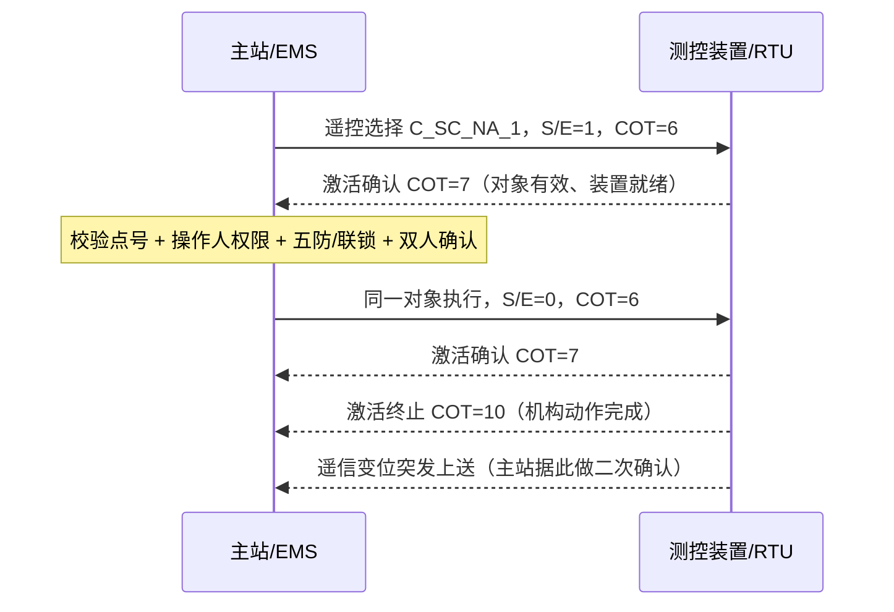
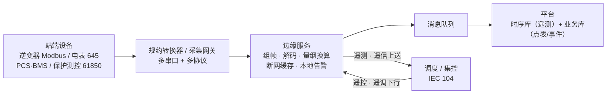

# 电站的点表和三遥四遥怎么接？104、61850 和电表规约怎么选？

> 站端接入的难点不在"会不会拼帧"，而在四件事：四遥的语义怎么划分、点表怎么和现场对上、站级远动和站内建模为什么是两套思路、以及电力监控系统的安全分区允许你把数据往哪儿放。

## 先把"四遥"翻译成工程语言

四遥是国内电力行业的黑话，是四种**语义分类**，不是四种协议。同一个 Modbus 寄存器，接成遥测还是遥信，取决于它在业务里是什么，而不是它在线上的编码。

| 分类 | 含义       | 数据方向          | 典型点                                                 | 更新方式                       |
| ---- | ---------- | ----------------- | ------------------------------------------------------ | ------------------------------ |
| 遥测 | 模拟量测量 | 设备 → 主站（读） | 有功/无功、电压、电流、频率、温度、SOC、日发电量       | 周期轮询 + 死区触发的变化上送  |
| 遥信 | 状态量     | 设备 → 主站（读） | 断路器/隔离开关位置、告警接点、运行状态、通信状态      | 变位突发上送 + 周期全量核对    |
| 遥控 | 控制命令   | 主站 → 设备（写） | 断路器分合、逆变器启停、PCS 开关机、复位、复归         | 事件触发，选择-执行            |
| 遥调 | 设定值     | 主站 → 设备（写） | 有功目标、无功目标、功率因数、充放电功率限值、电压目标 | 事件触发 + 周期刷新（AGC/AVC） |

一句话记住方向：**遥测、遥信是采集侧（读），遥控、遥调是控制侧（写）**。

这条线必须代码分层，不能只当注释：采集侧可以丢点、可以补采、可以重试；控制侧要独立的权限校验、双人确认、操作票、操作前后状态比对，两条链路共用一个 `DeviceService.write()` 是典型的架构事故。储能站尤其危险——一条误发的"满功率充电"指令，代价是设备损坏和电网考核，不是一条脏数据。

再钉一个容易混的细节：**遥信优先用双点**。断路器本体有"分/合/中间"三种物理位置，单点遥信的 0/1 表达不了"机构卡在中间"，也识别不出双位置接点断线（两边都是 0）。所以 IEC 104 里有 `M_SP_NA_1`（单点）和 `M_DP_NA_1`（双点）两种遥信类型，开关类点位用双点、告警接点用单点，是现场的默认约定。

## IEC 60870-5-104：站级远动的标准答案

104 是场站对调度/集控的**必答题**——不是技术上最优，而是国内电网调度侧的既定接口，AGC/AVC 指令也从这儿下来。它的设计目标是"窄带通道上的可靠远动"，所以处处透着一个字：省。

先说分层，104 的 APDU 只有两层，比 S7 那套 TPKT/COTP/S7 简单得多（S7 的分层见 [S7 协议怎么和西门子 PLC 通信](/iot/iot-siemens-s7-protocol.html)）：

```text
68 | 长度 L | 控制域 4 字节（APCI）| ASDU（类型标识 + 可变结构限定词 + 传送原因 + 公共地址 + 信息对象）
```

启动字符 `0x68` 加 1 字节长度字段就把帧边界定死了——**L 的取值范围 4~253，只算控制域加 ASDU，不含启动字符和长度自己**。所以 104 天生不怕粘包，组帧按长度切即可；但长度字段本身被脏数据污染时依然要限幅，这类防护跟 [设备数据粘包、丢包怎么兜住](/iot/iot-frame-parsing-reliability.html) 里讲的是同一套。

控制域有三个格式，靠首字节最低两位区分，这是读 104 抓包的第一眼功夫：

| 格式 | 首字节低位 | 内容                                 | 用途                           |
| ---- | ---------- | ------------------------------------ | ------------------------------ |
| I 帧 | `00`       | N(S) 发送序号 + N(R) 接收序号 + ASDU | 传业务数据（唯一带 ASDU 的）   |
| S 帧 | `01`       | 只有 N(R)                            | 纯确认，收到 w 个 I 帧后回一个 |
| U 帧 | `11`       | STARTDT / STOPDT / TESTFR 启停与测试 | 建链、停链、空闲保活           |

ASDU 是业务载荷，五个字段各管一件事，对照一张表比背报文有用：

| 字段           | 长度 | 含义                             | 现场怎么用                                                                                                  |
| -------------- | ---- | -------------------------------- | ----------------------------------------------------------------------------------------------------------- |
| 类型标识       | 1    | 这是什么东西                     | `1` 单点遥信、`3` 双点遥信、`13` 短浮点遥测、`45` 单点遥控、`50` 短浮点遥调、`100` 总召唤、`101` 电能量召唤 |
| 可变结构限定词 | 1    | 高位 SQ + 低 7 位对象个数        | SQ=0 每个对象各带 3 字节地址；SQ=1 只带首地址，后续地址连续递增（省带宽，也是点位错位的重灾区）             |
| 传送原因       | 2    | 低 6 位原因 + P/N + T 测试位     | `3` 突发、`6` 激活、`7` 激活确认、`10` 激活终止、`20` 总召响应                                              |
| 公共地址       | 1~2  | 站址                             | 一条通道挂多个站时的区分                                                                                    |
| 信息对象       | n    | IOA（3 字节）+ 信息元素 + 品质位 | **IOA 就是点表里的点号**，和 Modbus 的寄存器偏移等价                                                        |

一帧真实的遥测（短浮点 `13`，IOA=7，值 12.5，突发上送）：

```text
68 11 02 00 02 00 0D 01 03 00 01 07 00 00 41 48 00 00 00
68                          ← 启动字符
11                          ← 长度 17 = 4 字节控制域 + 13 字节 ASDU
02 00 02 00                 ← 控制域 I 帧：N(S)=1、N(R)=1
0D                          ← 类型标识 13 = 短浮点遥测
01                          ← 可变结构限定词：SQ=0、1 个对象
03 00                       ← 传送原因 3 = 突发
01                          ← 公共地址 = 1
07 00 00                    ← IOA = 7（点表里的点号）
41 48 00 00                 ← 12.5f = 0x41480000
00                          ← 品质位 QDS = 0（正常）
```

注意遥测在 104 里有三种编码：归一化值 `M_ME_NA_1(9)`（16 位映射到满量程，最省带宽）、标度化值 `M_ME_NB_1(11)`（16 位整数带缩放）、短浮点 `M_ME_NC_1(13)`（4 字节 IEEE754，最好读但最占带宽）。老装置常用前两种，接的时候必须配满量程或缩放系数，否则读出来是 `0.6` 这种"看着像个数、其实没乘满量程"的值。

## 总召唤与品质位：104 的两个灵魂机制

**总召唤（GI）**解决"建链后怎么拿到全量"。104 是变化上送的，你不在线的时候发生了什么它不会告诉你，所以建链的固定动作是：STARTDT → 总召唤（`TI=100`，传送原因 6）→ 装置回激活确认（7）→ 分批上送全量数据（传送原因 **20**）→ 激活终止（10）→ 进入变化上送稳态。

工程上要点三条：总召周期（常配 15 分钟到 1 小时）是给点表"兜底对齐"用的，不是主要数据源；总召期间通道会被打满，几千个点一次召完可能几十秒，调度侧超时参数要一起调；**总召只能拿"当前值"，拿不回断链期间变化过又恢复的点位**——这是 104 和 61850 的根本差异，后面单独说。

**品质位（QDS/SIQ）**解决"这个值到底能不能信"。这是 104 最不容易被互联网背景的人重视、又最救命的设计：

| 位   | 名称      | 含义                           | 现场后果                             |
| ---- | --------- | ------------------------------ | ------------------------------------ |
| `IV` | 无效      | 采集回路故障，值不可信         | 只能算坏点，禁止进均值、报警、结算   |
| `NT` | 非当前    | 值不是当前时刻的（中断后沿用） | 等价于 stale，必须透传到平台         |
| `SB` | 被取代    | 人工置数/调试置值              | 不能进报表，事故追忆时尤其要剔       |
| `BL` | 被封锁    | 该点被闭锁，变化不再上送       | 别当"运行平稳"，是没人看了           |
| `OV` | 溢出/越限 | 超出量程                       | 十有八九是量程或系数配错，不是真越限 |

判据一句话：**104 上"值不对"分两种，数值错和值不可信，后者只能靠品质位发现。** 通道断了三个月、平台一直显示 25.3℃，报表里就是一条完美水平的直线——这种数据的破坏力比缺数据大得多。

## 遥控为什么必须"选择-执行"

遥控是 104 里唯一会让你签事故责任书的动作。标准规定了 select-before-operate：先"选择"占住这个对象，装置确认准备就绪，再"执行"，最后等"激活终止"。



三件事必须写进代码，不是写进文档：

- **选择和执行要绑定同一对象，且有超时**。选择后不执行，装置侧会丢弃，超时再执行就是"未选择直接执行"被拒——日志里表现为莫名其妙的否定确认，实际是流程写错了。
- **成功判据是"激活终止 + 遥信变位"，不是"帧发出去了"。** 只发不等，等于把一次分闸当成成功；继电保护动作、机构拒动都不在协议层的承诺里。
- **序号必须成对管理**。`N(S)/N(R)` 都是 15 位、模 32768 回绕，重连后双方从 0 重新开始；沿用旧序号或者只发不收，对端会判序号错直接拆链，症状是"TCP 通着但一帧业务都过不去"。

U 帧的三个计时器按作用记就行，具体秒数是可配的建议值：**T1 = 发出 I 帧后等确认的超时（超了拆链）、T2 = 收到数据后延迟回确认的时限（没业务可捎带时就发 S 帧）、T3 = 空闲多久发 TESTFR 保活**。约束是 `T2 < T1`（否则确认还没发出去就该拆链了）、T3 要小于中间防火墙/NAT 的连接老化时间，否则闲置被踢、重连风暴。

## IEC 61850：不数点号，数对象

61850 和前面几套的思路不在一个维度上：Modbus 给你一堆寄存器、104 给你一串 IOA，语义全靠点表约定；61850 是**面向对象建模**，把"这是什么"直接编进地址里。

| 层次        | 例子                                                                     | 说明                            |
| ----------- | ------------------------------------------------------------------------ | ------------------------------- |
| 逻辑设备 LD | `MEAS`、`PROT`                                                           | 按功能域划分，一台装置含多个    |
| 逻辑节点 LN | `MMXU` 测量、`CSWI` 开关控制、`XCBR` 断路器、`GGIO` 通用 IO、`CILO` 联锁 | 按 IEC 61850-7-4 的标准化功能块 |
| 数据对象 DO | `MMXU1.TotW`（总有功）                                                   | 一个物理量/状态                 |
| 数据属性 DA | `.mag.f`（幅值浮点）、`.q`（品质）、`.t`（时标）                         | 真正承载值的最小单位            |
| 功能约束 FC | `MX` 测量、`ST` 状态、`CO` 控制、`SP` 设定、`CF` 配置                    | 决定这个属性属于哪类数据集      |

于是它的地址长这样：`MEAS/MMXU1.TotW.mag.f`。一看就知道是测量逻辑设备里第一个 MMXU 的总有功幅值——**这就是"自描述"**，也是它和 `IOA=16385`、`40001` 的根本区别。

围绕自描述，长出三个必须讲的机制：

- **数据集 + 报告控制块**。装置把一组点组成数据集，客户端建报告控制块订阅。`BRCB`（缓冲报告）在断链期间把变化缓存下来，重连后按 `EntryID` 续传；`URCB`（非缓冲）只发当前值。触发条件 `TrgOps` 分 `dchg`（值变）、`qchg`（品质变）、`dupd`（更新）、`gi`（总召）。**断链不丢数据这件事，104 做不到、61850 的 BRCB 天生就有**，这是两者最实用的差异。
- **GOOSE / SV**。GOOSE 走二层组播（以太网类型 `0x88B8`），不经过 TCP/IP，用于跳闸、闭锁这类毫秒级信号；可靠性靠"快速重发 + 心跳"（事件后按 2ms 级递增重发，稳态每几秒一次带 `stNum/sqNum` 计数）。SV 是采样值（`0x88BA`），合并单元到保护装置。现场抓手：这俩要交换机配静态组播/VLAN 优先级，抓包得看 VLAN tag，用普通端口镜像经常抓不全。
- **MMS 读写**。常规读写和报告走 MMS，跑在 TCP **102**。顺手纠正一个高频误判：102 不是"S7 专用端口"，它是 RFC 1006 ISO-on-TCP 的端口，S7 和 61850 MMS 都在上面，扫到 102 别直接判定协议。

代价也很实在：**61850 的配置不是填点表，是出文件**。厂家给 `ICD`（装置能力描述），集成商做 `SCD`（全站系统配置，含 GOOSE/SV 连线），再导出 `CID` 下装到单台装置。现场加一个点位、改一次量程，往往要改 SCD、重新导出 CID、全站相关装置重新下装，还要做一致性校验。所以 61850 项目的版本管理是硬需求——`ICD` 版本必须和装置固件版本对应，拿错文件下装会直接把装置配置搞坏。国内落地现状：升压站、保护测控、SVG 这类站内智能设备用 61850；逆变器、PCS、BMS 基本还是 Modbus 或厂商私有协议。

## DL/T 645-2007：电表这一路怎么读

关口表和考核表走 645（也有走 Modbus 的电表，但结算口径的表基本是 645）。帧结构比前面几套都"老派"，每个字段都有存在的理由：

```text
68 | 地址域 A0~A5（6 字节 BCD，低字节在前）| 68 | 控制码 C | 数据域长度 L | 数据域 | 校验和 CS | 16
```

| 字段    | 说明                                                                                                                                            |
| ------- | ----------------------------------------------------------------------------------------------------------------------------------------------- |
| 双 `68` | 起始符出现两次，中间夹地址域——这样扫到任何一个 `68` 都能快速重同步                                                                              |
| 地址域  | 12 位表号，BCD 码，**低位字节在前**；`AA…AA` 是通配（未知表号探测用，多表同挂会冲突），`99…99` 是广播（只用于校时，从站不回应答）               |
| 控制码  | D7 方向（1 = 从站发出）、D6 应答标志（1 = 异常）、D5 后续帧、D4~D0 功能码：`11H` 读数据、`12H` 读后续、`14H` 写数据、`08H` 广播校时（只发不收） |
| 数据域  | 读请求里是 **4 字节数据标识 DI**，应答里是 DI + 数值                                                                                            |
| CS      | 从第一个 `68` 到数据域末字节的算术和取低 8 位，**不含 CS 自己**                                                                                 |

读一台表号 `000000000042` 的 A 相电压（DI 手册写 `02010100`）：

```text
68 42 00 00 00 00 00 68 11 04 00 01 01 02 2B 16      → 请求
68 42 00 00 00 00 00 68 91 07 00 01 01 02 00 22 00 D0 16   → 应答，220.0V
```

两处值得盯：DI 在手册里写 `02010100`，上线要按 `DI0→DI3` **反着发**成 `00 01 01 02`，顺序搞反就是读到别的数据项；应答数值 `00 22 00` 是 3 字节 BCD 的 `2200`，单位 0.1V，所以是 220.0V——**645 的数据域（电量、电压、电流、功率）都是 BCD 编码，不是二进制整数**，用 `ByteBuffer.getInt()` 直接读会得到一串垃圾。

645 真正的业务复杂度在数据组织，不在帧：

- **冻结电量**。表内按冻结时刻把累计量快照存下来：日冻结（每日零点）、月冻结（每月 1 日零点）、整点冻结，冻结时刻可远程整定。**结算用的是冻结值，不是"我现在读到的当前累计值"**——后者受抄表时刻影响，两次抄表时间差 1 分钟，电量就差一截。
- **需量**。最大需量 + 发生时间，滑差式算法（需量周期通常 15 分钟，滑差时间 1 分钟）。这是需量电费的依据，也是"表里有、平台没采"的典型漏点。
- **费率与时段**。费率数（尖峰平谷）、每日时段表、周休日/节假日表，都要单独读，且时段的划分权在电价政策那边，不在运维手里。

## 四种规约怎么选

| 规约      | 面向谁             | 寻址与语义             | 自描述                    | 实时性                | 配置成本             | 国内落地                     |
| --------- | ------------------ | ---------------------- | ------------------------- | --------------------- | -------------------- | ---------------------------- |
| Modbus    | 单台设备           | 功能码 + 扁平寄存器    | 无                        | 由轮询决定（百 ms~s） | 低，改点表即可       | 设备级事实标准               |
| DL/T 645  | 多功能电表         | 表号 + 4 字节 DI       | 半自描述（DI 有国标语义） | 秒级~分钟级           | 低                   | 关口表、考核表必备           |
| IEC 104   | 站 ↔ 调度/集控中心 | 公共地址 + IOA 点号    | 无（点表约定）            | 秒级，遥信突发        | 中，要对点表、做总召 | 远动接口事实标准             |
| IEC 61850 | 站内智能设备       | 对象引用名 LD/LN.DO.DA | 有（ICD/SCD）             | 毫秒级（GOOSE/SV）    | 高，SCD 版本管理     | 升压站、保护测控，场站设备少 |

选择逻辑不是"哪个先进"，而是**这条链路上对面是谁**：对接调度只有 104 可选；接电表优先 645（DI 语义标准化，比 Modbus 少一层猜）；接逆变器/PCS 只有 Modbus 或厂商协议；站内保护测控和升压站用 61850。Modbus 的寄存器细节和读写坑不在这里重复，见 [Modbus 协议怎么读写寄存器](/iot/iot-modbus-protocol.html)。

## 采集架构：解码放在哪一层



**解码放边缘还是放平台**，是所有采集项目都会吵一遍的问题：

| 方案     | 边缘解码                   | 平台解码                       |
| -------- | -------------------------- | ------------------------------ |
| 带宽     | 省（只传结构化点值）       | 费（要传原始帧或半结构化数据） |
| 升级成本 | 高（几千台网关要逐台升级） | 低（服务端一次发布）           |
| 断网续传 | 天然好做（本地库 + 游标）  | 依赖网关缓冲，容易丢           |
| 排障     | 现场看不到原始字节，得回捞 | 原始帧都在，可回放             |

实操上的折中是：**边缘做"组帧 + 校验 + 断网缓存"，把原始帧和解析结果一起上报，平台做"语义映射 + 二次校验"**。这样升级点表不用动网关固件，而丢帧类问题又有原始字节可查。

## 安全分区：为什么业务系统不能直连 SCADA

这是能源行业的硬约束，也是互联网背景的人最容易在设计阶段漏掉的一块。依据是《电力监控系统安全防护规定》和配套的总体方案，落地成三条：

- **安全分区**。生产控制大区（安全 I 区：SCADA、AGC/AVC、继电保护、安稳；安全 II 区：电能量采集、水情气象、故障录波）与管理信息大区（III 区，也就是我们平时那套 K8s + MySQL + Kafka）物理分开。
- **网络专用**。生产控制大区走电力调度数据网或专用光纤，不与办公网、互联网混跑。**"用手机热点连 SCADA 调试笔记本"是明令禁止的操作**，不是建议。
- **横向隔离 + 纵向认证**。两个大区之间必须部署**正向/反向物理隔离装置**，只做单向数据摆渡；纵向连接（站到调度）部署纵向加密认证装置。

对架构的直接影响，必须在画第一版图的时候就留位置：

1. 平台（III 区）**连不上** I 区的 SCADA 库。JDBC 直连、共享数据库、甚至跨区的长连接 TCP 都不成立。
2. 数据只能经正向隔离装置单向送出，而且装置通常只接受**文件或特定格式的数据包**，不支持通用 SQL 和长连接——两侧各需要一个"落地 + 摆渡 + 取件"的适配层，出故障时表现为"数据停了几分钟"，需要独立监控。
3. 反向（控制指令从 III 区回到 I 区）要走反向隔离装置，且通常要求人工确认和签名，**自动闭环的 AGC/AVC 绝不跨区**。
4. 这意味着"边缘采集 + 边缘控制、平台只做分析与展示"不只是架构偏好，很多时候是合规逼出来的唯一形态。

## 点表对不上怎么办

点表不是配置文件，是**设备对外的契约**。它至少要包含：唯一键（设备 + 点号）、点名、四遥分类、规约地址（寄存器偏移 / IOA / DI / 61850 引用名）、数据类型与字序、系数、单位、量程、死区、报警上下限、是否参与 AGC/AVC、点表版本号。

四类典型失配，按现场出现频率排：

| 现象                  | 根因                                       | 怎么发现                                       |
| --------------------- | ------------------------------------------ | ---------------------------------------------- |
| 整段点位串到隔壁间隔  | 插入一个点后没做后续地址加法，全体偏移一位 | 遥测值"像但不像"：电压显示的是相邻间隔的电流   |
| 数值差 10 倍 / 100 倍 | 倍率不同（kWh vs 0.01kWh、0.1V vs V）      | 与表计面板或手持终端比，别拿同型号另一台当参照 |
| 值随机乱跳            | 32 位量的字序或 BCD/二进制搞反             | 取原始帧按两种字序各解一次，对得上的才对       |
| 点长期不变            | 采集没通、品质位是 `IV/NT`、或 `BL` 闭锁   | 看品质位和时标，不要只看数值                   |

治理动作落四条就够：点表进版本库、变更走审批并带版本号、上线前**逐点对点**（现场加量/断线法/面板比对，不是抽检）、平台保留原始帧和点号以便追溯。至于怎么建模把点位挂到设备上，见 [光伏电站和储能站怎么建模](/energy/energy-domain-model.html)；指标口径见 [发电量、等效小时、PR 这些指标怎么算](/energy/energy-metrics-definition.html)。

## 面试怎么答

先给划分："四遥是语义分类，遥测遥信读、遥控遥调写，控制侧要独立权限和双人确认。"再给选型："设备级 Modbus、电表 645、站级远动 104、站内智能设备 61850。"最后补两条工程现实，这两条一出口就和只会背协议的人分开了：**点表治理**（点号错一位就是别人的数据，靠版本化和逐点对点）和**安全分区**（业务系统不能直连 SCADA，数据要经隔离装置单向摆渡，架构要提前留位）。

## 容易踩的坑

- 把四遥当协议用：同一个 Modbus 寄存器写成读写接口，采集和遥控共用一条链路，权限和审计全丢。
- 104 只看数值不看品质位：通道断了三个月，报表里是一条完美水平线，比缺数据更难发现。
- 以为 104 能补历史：总召只给当前值，断链期间"变化过又恢复"的点位永远丢了，要靠装置侧 SOE 时标帧和电能量召唤补。
- 遥控"发了就认为成功"：不判激活终止、不等遥信变位，机构拒动也算执行成功。
- 重连后沿用旧序号：N(S)/N(R) 必须双方从 0 重来，否则对端拆链，症状是"TCP 通、业务不通"。
- 把 102 当成 S7 专用端口：它是 ISO-on-TCP 的端口，61850 的 MMS 也跑在上面。
- 拿当前累计电量当结算电量：结算口径是冻结值，抄表时刻差一分钟电量就差一截。
- 645 用二进制整数去解 BCD 数据域，或用 `getInt()` 读 6 字节地址域。
- 遥信不做抖动抑制：机械接点弹跳几百毫秒就是几十条报警，值班员直接把报警关掉。
- 设计阶段把平台直连 SCADA 库写进方案，到现场才发现要过正向隔离装置，整个数据链路重画。

## 小结

1. 四遥是语义分类不是协议：**遥测遥信是采集侧（读）、遥控遥调是控制侧（写）**，写侧必须独立权限、双人确认和操作票，开关类遥信用双点而不是单点。
2. 104 = APCI（`68` + 长度 + I/S/U 三种控制域）+ ASDU（类型标识 / 可变结构限定词 / 传送原因 / 公共地址 / IOA）；建链先总召拿全量，之后靠变化上送；**值可不可信只能靠品质位（IV/NT/SB/BL/OV）判断**。
3. 104 的遥控走选择-执行，成功判据是"激活终止 + 遥信变位"；序号 15 位模 32768 回绕、重连清零；T1 拆链、T2 延迟确认、T3 保活，且 T2 < T1。
4. 61850 的重心是自描述与互操作：LD/LN.DO.DA 的引用名自带语义，BRCB 断链能续传，GOOSE/SV 走二层做毫秒级信号；代价是配置靠 ICD/SCD/CID 文件，改点就要重新出文件、做版本管理。
5. 选型看对面是谁：设备 Modbus、电表 645、站级远动 104、站内智能设备 61850；再加两条工程现实——**点表治理**和**安全分区**（生产控制大区与信息大区隔离，数据单向摆渡，不能直连）。

## 参考

综合自 IEC 60870-5-104（APCI 帧格式、ASDU 结构、类型标识 1/3/9/11/13/45/46/50/100/101、传送原因、品质位 QDS/SIQ、k/w 与 T1/T2/T3 建议值）、IEC 61850 系列（7-3 数据模型与功能约束、7-4 逻辑节点、8-1 MMS 与 GOOSE 映射、9-2 采样值）、DL/T 645-2007（帧格式、控制码功能、数据标识 DI、冻结与需量、通配/广播地址）、《电力监控系统安全防护规定》与配套总体方案（安全分区、网络专用、横向隔离、纵向认证），以及 Modbus 与 S7 的站内已有整理（[Modbus 协议怎么读写寄存器](/iot/iot-modbus-protocol.html)、[S7 协议怎么和西门子 PLC 通信](/iot/iot-siemens-s7-protocol.html)、[设备数据粘包、丢包怎么兜住](/iot/iot-frame-parsing-reliability.html)）。核对项：104 的示例帧按长度字段实算（`0x11 = 4 字节控制域 + 13 字节 ASDU`）、`12.5f = 0x41480000` 已验证；645 两帧的校验和按"含地址域、不含 CS"逐字节累加复算（`0x2B`、`0xD0`），并核对了数据域 BCD 编码与低字节在前的传输顺序；文中区分了「规约强制」（帧结构、类型标识、DI 语义、品质位定义）与「工程约定」（死区取值、总召周期、点表字段、T1/T2/T3 数值），并纠正了三个常见误判——102 是 S7 专用端口、104 能补历史数据、61850 可以像 Modbus 那样只改平台侧配置。
