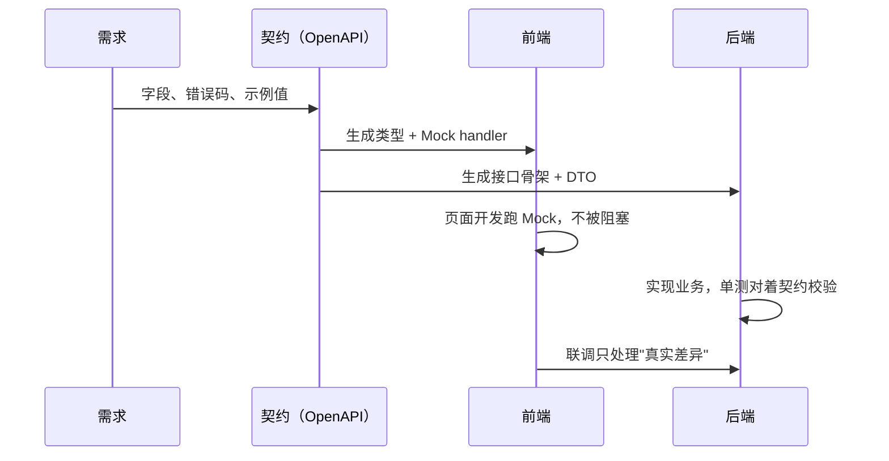

# 前后端联调怎么少返工？

> 联调阶段返工的活，技术难度通常都不高，难的是两边对"这个字段到底长什么样"的理解不一样，而这个分歧在写完代码之前没有任何人发现。

甲方定制项目工期是死的，前后端两个人并行干活，最亏时间的不是写代码，是联调那一周：前端说"你返回的 ID 不对"，后端说"我返回的就是库里的原值"，对着两块屏幕找一下午，最后发现是浏览器把 19 位数字截断了。

资源怎么建模、HTTP 方法怎么选、状态码用哪个，[RESTful 接口怎么设计才不容易返工？](/system-design/basis/design-restful-api.html) 已经讲透，这里不重复。这篇只解决两件事：**怎么在编码之前把"理解不一致"暴露掉**，以及**出了分歧按什么顺序查**。

## 返工到底是从哪儿冒出来的？

按根因归一次类，下面是交付项目里出现频率从高到低的顺序：

| 根因             | 典型表现                                                          | 预防手段                                                   |
| ---------------- | ----------------------------------------------------------------- | ---------------------------------------------------------- |
| 字段口径不一致   | 页面时间差 8 小时；金额少一分；状态列显示"未知"                   | 契约里写死格式 + 必须带示例值 + 前端用 schema 校验真实响应 |
| 空值语义不一致   | 列表页 `Cannot read properties of undefined (reading 'map')` 白屏 | 列表统一 `[]`，对象字段统一 `null`，别用"省略字段"表示空   |
| 错误处理各写各的 | 有的接口 200 + 业务码，有的 400 + 另一套错误体，前端拦截器漏分支  | 一份统一响应体 + 一张错误码表，都进契约                    |
| 跨域与鉴权       | 浏览器报 CORS，但 curl 一切正常                                   | 网关统一处理 CORS、预检放行、白名单覆盖全部前端域名        |
| 环境与数据       | "我本地是好的"；查不到数据；前端连 A 环境、后端连 B 库            | 依赖用容器起、种子数据脚本化、启动日志打印环境标识         |
| 需求本身改了     | 字段加减、流程调整，代码写完了才发现                              | 变更先改契约再改代码，契约变更走一次 review                |

前五类都能在编码前挡住，最后一类只能靠流程——但流程的前提也是"契约是唯一真相源"，否则改了需求两边都不知道。

## 为什么"契约先行"能省掉大半来回？

契约的价值不是"文档写得好看"，而是让前端不必等后端就能开工，让后端不必猜前端要什么：



契约必须**机器可读且带示例值**，因为字段说明可以糊，示例值糊不了：

```yaml
# /v3/api-docs 节选：订单 schema 与 422 错误响应
components:
  schemas:
    Order:
      type: object
      required: [id, status, payAmount, createdAt]
      properties:
        id: { type: string, example: "1802345678901234567" }
        status: { type: string, enum: [CREATED, PAID, SHIPPED], example: PAID }
        payAmount: { type: string, example: "199.90" }
        createdAt: { type: string, format: date-time, example: "2026-07-14T10:20:30+08:00" }
# responses."422".content["application/json"]：错误响应也带示例值
"422":
  description: 业务错误
  content:
    application/json:
      example:
        code: 20013
        message: 订单已支付，不能重复退款
        traceId: 3f9c1a7e8b2d4c60
```

看 `example` 的写法：字段说明写"订单 ID"，前端不知道按 `number` 还是 `string` 处理；示例值写成带引号的 `"1802345678901234567"` 配 `type: string`，前端立刻明白这是 19 位字符串。金额同理，`"199.90"` 一次说清"字符串 + 两位小数"。**示例值是契约里信息密度最高的部分**，别省。

手写契约一定和代码不同步，这是常态不是态度问题——方向要反过来，从代码生成，单向流动。springdoc 里就是把 `@Schema(example = "1802345678901234567")` 写在 DTO 字段上，`/v3/api-docs` 出来的就是契约本身；再把导出文件入库，CI 里和基线对比，破坏性变更直接让流水线红：

```bash
curl -s http://localhost:8080/v3/api-docs > openapi.current.json
oasdiff breaking openapi.baseline.json openapi.current.json --fail-on ERR
```

## 字段口径怎么定？

返工重灾区，逐条给"约定 + 反例"。原则一句话：**能被机器校验的写进契约，不能的写进约定，别指望口头说一遍。**

**时间**：接口里只允许两种形态——UTC 毫秒时间戳（数字），或 ISO-8601 带偏移的字符串（`2026-07-14T10:20:30+08:00`）。`yyyy-MM-dd HH:mm:ss` 看着友好，但它**没有时区**，等于把解释权丢给读的人。反例很具体：`spring.jackson.date-format=yyyy-MM-dd HH:mm:ss` 却没配 `time-zone`，Jackson 就用 JVM 默认时区格式化；开发机是 CST、容器基础镜像默认 UTC，于是同一份代码本地正常、上了容器整体偏 8 小时。前端还有第二个雷：`new Date("2026-07-14 10:20:30")` 空格分隔不是 ISO 格式，V8 容忍，Safari 直接 `Invalid Date`，症状是"Chrome 时间列正常、Safari 空白"。日期型 `2026-07-14` 更阴：按 UTC 解析，东八区显示成 08:00，西半球用户看到前一天。约定三条：存储统一 UTC（`Instant`、`timestamptz`）；接口用 `Instant`/`OffsetDateTime`，别拿不带时区的 `LocalDateTime` 背跨时区场景；需要"用户所在时区的今天"时把 IANA 时区名（`Asia/Shanghai`）当参数显式传，别写死 `+08:00` 或 `ZoneId.systemDefault()`——写死偏移在有夏令时的地区每年会错一小时。

**金额与长整型 ID**：真实事故，不是理论风险。金额用 `BigDecimal` 并序列化成**字符串**；雪花 ID 存 `Long`，但接口上必须**序列化成字符串**。

前端 `JSON.parse('{"id":1802345678901234567}')` 拿到的是 `1802345678901234700`。JS 的 `number` 是双精度浮点，安全整数上限只有 `9007199254740991`（2^53−1），19 位雪花 ID 必然截断。症状：列表页正常（传的是字符串），点进详情 404；保存报"数据不存在"；严重的会更新到另一条记录上。前端截图说"你返回的就是这个值"，后端一脸无辜——确实不是他返回的，是浏览器解析时丢的。证实方式：Network 看原始 Response（原文是对的），Console 里 `JSON.parse` 同一个字符串，两个数一对比，立刻定位在解析层。

```java
// 全局把 Long 序列化成字符串；也可以只在 ID 字段上加 @JsonSerialize(using = ToStringSerializer.class)
@Bean
Jackson2ObjectMapperBuilderCustomizer longToString() {
    return builder -> builder.modules(new SimpleModule().addSerializer(Long.class, ToStringSerializer.instance));
}
```

只给 ID 字段加 `@JsonSerialize(using = ToStringSerializer.class)` 能避开副作用，但每个 DTO 都得记得加，**漏一个就是一个线上事故**，所以多数团队选全局改，前端类型统一写 `id: string`。金额还有两个前端专属陷阱：`19.99 * 100` 是 `1998.9999999999998`，`(1.005).toFixed(2)` 是 `"1.00"` 不是 `"1.01"`。约定"金额只做展示和透传，计算交后端"，前端真要算就换整数分。后端判等用 `compareTo`，`1.0` 和 `1.00` 的 `equals` 返回 `false`。

**枚举**：返回稳定 code（`PAID` 或数字都行），**永不复用、永不改语义**，中文 label 由前端映射。后端不返回"已支付"这种文案：前端 `switch (status)` 一遇到没见过的中文就进 default；后端做 i18n 又得看 `Accept-Language`，日志和缓存里全是本地化字符串，排查更难。契约里把 enum 列全，前端对未知值兜底：`ORDER_STATUS[code] ?? '未知状态'`。

**空值**：列表一律 `[]`，绝不 `null`；对象字段一律输出 `null`，不要省略。前者避免 `.map` 白屏，后者避免"字段不存在"和"值为空"两种语义混在一起——TS 里 `userName?: string` 和 `userName: string | null` 是两套类型。别用 `@JsonInclude(NON_NULL)` 省流量，它把 `rows: null` 变成"字段消失"，前端拿到 `undefined` 照样崩。

**布尔**：只用 JSON 的 `true`/`false`。不要 0/1，不要 `"Y"/"N"`，更不要 `"0"/"1"` 字符串——`if (row.enabled)` 在 `enabled` 是 `"0"` 时为真，整页状态全显示"已启用"。库表侧也有坑：MySQL `tinyint(1)` 被 Connector/J 默认按布尔映射（`tinyInt1isBit`），同一列存 `2` 也变 `true`，所以布尔列用 `bit(1)`，状态列别和布尔共用类型。

## 错误码和响应体该怎么分工？

状态码表达"这次请求"的通用结果、业务码表达具体失败原因，这个分工 REST 那篇讲过。联调现场真正缺的是另外三件事：错误码谁维护、前端按什么分支、出问题怎么串日志。先把壳定下来，成功和失败共用同一个：

```json
{ "code": 0,     "message": "ok",                        "data": { "id": "1802345678901234567" }, "traceId": "3f9c1a7e8b2d4c60" }
{ "code": 20013, "message": "订单已支付，不能重复退款", "data": null,                            "traceId": "3f9c1a7e8b2d4c60" }
```

`code` 给程序判断分支，`message` 给人看，前端**永远不要靠 message 做判断**（文案随时会被改）。错误码必须分段，否则几千个码堆在一个数字空间里，谁也不敢清理：

| 段位    | 范围        | 例子                                               | 谁维护                   |
| ------- | ----------- | -------------------------------------------------- | ------------------------ |
| `0`     | 0           | 成功                                               | 平台统一                 |
| `1xxxx` | 10001–19999 | `10004` 参数校验失败、`10401` 未登录、`10429` 限流 | 平台通用，各服务必须一致 |
| `2xxxx` | 20001–29999 | `20013` 订单已支付、`21007` 渠道返回失败           | 业务域，按千位再分域     |
| `3xxxx` | 30001–39999 | `30001` 短信通道超时、`30012` OCR 服务不可用       | 外部依赖                 |
| `5xxxx` | 50000–59999 | `50000` 系统内部错误（只回码，不回细节）           | 兜底                     |

统一响应体本身有争议，两种做法的代价要摆明：

| 做法                           | 好处                                                         | 代价                                                                   |
| ------------------------------ | ------------------------------------------------------------ | ---------------------------------------------------------------------- |
| 所有接口套 `code/message/data` | 前端拦截器一处处理；分页、空值规则能统一；`traceId` 有地方放 | Swagger 多一层泛型；HTTP 语义被包住；非 2xx 时也得保证 body 是同一个壳 |
| 直接返回资源本身               | 符合 HTTP 语义，契约干净；监控直接看状态码                   | 每个接口自己定错误体，前端为每个接口写解析                             |

结论是**按接口类型分开**：业务接口套壳，文件下载、支付回调、健康检查不套；套了就全套，最怕同一系统里有的套有的不套。再定一条映射：鉴权、权限、参数格式、资源不存在这类用 4xx；业务规则失败用 422（或 200 + `code`，二选一）；第三方超时与内部异常一律 5xx。

`traceId` 是这条链上最值钱的东西。网关生成或透传 `X-Trace-Id`，落 MDC 打进日志，同时回写响应头；前端存进错误提示和上报里。用户说"我点了报错"，你拿一个 traceId 就能捞到那行日志。**注意**：前端默认只读得到几个 CORS 安全列表里的响应头，`X-Trace-Id` 必须放进 `Access-Control-Expose-Headers`，否则前端永远拿不到，排障链就断在这。

## 跨域和鉴权为什么会互相绊倒？

同源是 scheme + host + port 三者全等。`localhost:5173` 调 `localhost:8080` 端口不同也算跨域，所以本地开发必然撞上 CORS。不是所有跨域请求都先发预检，触发条件是：方法不是 GET/HEAD/POST；或 `Content-Type` 不是 `x-www-form-urlencoded`、`multipart/form-data`、`text/plain` 之一；或带了自定义头。所以**只要 `Content-Type: application/json`、带 `Authorization`、用 PUT/DELETE，浏览器就先发 `OPTIONS`**。

```http
OPTIONS /api/orders HTTP/1.1
Host: api.example.com
Origin: http://localhost:5173
Access-Control-Request-Method: POST
Access-Control-Request-Headers: content-type,authorization

HTTP/1.1 204 No Content
Access-Control-Allow-Origin: http://localhost:5173
Access-Control-Allow-Methods: GET,POST,PUT,PATCH,DELETE,OPTIONS
Access-Control-Allow-Headers: content-type,authorization
Access-Control-Allow-Credentials: true
Access-Control-Max-Age: 3600
Vary: Origin
```

三条硬规则，踩任何一条都是"浏览器报 CORS、curl 一切正常"：

1. `Allow-Credentials: true` 时 `Access-Control-Allow-Origin` **不能是 `*`**，必须回显具体 Origin。Spring 对应 `setAllowedOriginPatterns(...)`，不是 `setAllowedOrigins("*")`。
2. **预检请求不带 Cookie 和 `Authorization`**。鉴权拦截器若对 `OPTIONS` 也拦，会返回 401，而浏览器只在 Console 报 CORS，你看不到那个 401——于是"接口明明放行了为什么还跨域"。放行 `OPTIONS`，或把 CORS 处理放在鉴权之前（`CorsFilter` 的 order 早于安全过滤链）。
3. 响应头不能重复。网关 `add_header` 一次、应用 `@CrossOrigin` 再一次，浏览器报 `header contains multiple values ... but only one is allowed`。**只在网关或只在应用处理一处**。

还有容易忽略的：缺 `Vary: Origin` 时 CDN 会缓存住某个 Origin 的响应，别的域名拿到不匹配的头，表现成"偶发跨域"。Cookie 这条路还叠了 `SameSite`：Chrome 默认 `Lax`，跨站 fetch 不带 Cookie；要带必须 `SameSite=None; Secure`，而 `None` 强制 HTTPS——本地 http 联调 Cookie 直接被丢，症状是"本地登不上、测试环境好的"。前后端同 eTLD+1 的不同子域算 same-site 不受影响，跨公司域名才需要 `None`。

选 token 还是 Cookie：`Authorization` 头不会被自动携带，天然没有 CSRF，代价是 token 存在前端、遇到 XSS 就丢，适合前后端分离和多端共用；Cookie 由浏览器自动带、`HttpOnly` 让 JS 读不到，但必须防 CSRF（`SameSite` + CSRF token），适合同域或同 eTLD+1 且有网关统一会话的场景。

```java
@Bean
CorsFilter corsFilter() {
    CorsConfiguration cfg = new CorsConfiguration();
    cfg.setAllowedOriginPatterns(List.of("http://localhost:5173", "https://*.example.com"));
    cfg.setAllowedMethods(List.of("GET", "POST", "PUT", "PATCH", "DELETE", "OPTIONS"));
    cfg.setAllowedHeaders(List.of("*"));
    cfg.setExposedHeaders(List.of("X-Trace-Id")); // 不配这行，前端读不到 traceId
    cfg.setAllowCredentials(true);
    cfg.setMaxAge(3600L);
    UrlBasedCorsConfigurationSource source = new UrlBasedCorsConfigurationSource();
    source.registerCorsConfiguration("/api/**", cfg);
    return new CorsFilter(source);
}
```

## 前端 Mock 和后端契约测试怎么配合？

三件事要分开，它们经常被混成一团：前端拿 Mock 自己往前开发（不等后端）、两边各自对着契约校验（保证理解一致）、联调只处理真实差异。

| 方案         | 拦截层                       | 对 `fetch` | 能复用到 Node 测试 | 适合                      |
| ------------ | ---------------------------- | ---------- | ------------------ | ------------------------- |
| Mock.js      | 改写 `XMLHttpRequest`        | 不支持     | 不支持             | 老项目、临时挡一下        |
| MSW          | 浏览器 Service Worker / Node | 支持       | 支持               | 主流选择，handlers 可复用 |
| 组件内假数据 | 组件代码里                   | —          | —                  | 单页 demo，多了就失控     |

Mock 必须覆盖三种态，否则全留到联调当天才暴露：**空**（`[]`、`total: 0`，验证空状态页）、**异常**（500、业务错误码、401 跳登录）、**慢**（延迟超过前端 timeout，验证 loading 和取消逻辑）。只 mock 开心路径，等于把白屏、转圈转死、token 过期不跳转三个 bug 攒着送给自己。

更关键的是**别手写 Mock 数据**：手写的一旦和契约分叉，联调就变成"对着两个假数据找真 bug"。从同一份 OpenAPI 生成 handler，或用 schema 反向生成样例。契约校验要两头都跑，前端在开发环境把**真实响应**过一遍同一个 schema：

```js
// schema/order.js：前后端共用的唯一真相（也可从 openapi 生成）
import { z } from "zod";

export const OrderSchema = z.object({
  id: z.string().regex(/^\d{16,19}$/), // 雪花 ID 必须是字符串，不是 number
  status: z.enum(["CREATED", "PAID", "SHIPPED"]),
  payAmount: z.string().regex(/^\d+\.\d{2}$/), // 金额字符串，两位小数
  createdAt: z.string().datetime({ offset: true }),
});

// 只在开发环境：真实响应不符合契约就打日志，联调前暴露
export function checkContract(url, raw) {
  if (!import.meta.env.DEV) return;
  const r = OrderSchema.safeParse(raw);
  if (!r.success) console.error(`[contract] ${url} 与契约不一致`, r.error.issues);
}
```

后端侧 `@Valid` 只是"后端自己的入参约束"，不等于契约；出参的守护靠前面那条 CI diff。至于 Pact、Spring Cloud Contract 这套消费者驱动契约测试，**跨公司**（要对接甲方既有系统）值得上，能锁住对方字段；一个团队两个人前后端，schema + CI diff 的性价比更好，没必要为"架构正确"多维护一个 broker。

## 联调卡住了按什么顺序查？

顺序决定你花多少时间。固定五步：**用 curl 绕开前端复现 → 判断网络层还是应用层 → 用 traceId 对齐网关和后端日志 → 逐字段对比请求报文 → 最后才看响应解析**。第一步能砍掉一半问题：curl 通了说明接口没问题，curl 也不通报错就全在后端。

```bash
# ① 最小化变量：-i 打状态行和响应头，CORS 问题一眼看清
curl -i -X POST 'http://localhost:8080/api/orders' -H 'Content-Type: application/json' \
  -H 'Authorization: Bearer <TOKEN>' -d '{"skuId":"1001","qty":1}'
# ② 只测连通性：排除 DNS / 端口 / TLS / 网关
curl -v --resolve api.example.com:443:10.0.0.12 https://api.example.com/actuator/health
```

| 现象           | 优先怀疑                                           | 验证方式                                                  |
| -------------- | -------------------------------------------------- | --------------------------------------------------------- |
| 404            | 路径不对：前缀、`context-path`、网关 rewrite       | `curl -i` 是否命中；查 `HandlerMapping` 有没有这个映射    |
| 401            | token 没带上或过期；预检被鉴权拦了                 | 看请求头有没有 `Authorization`；curl 重放同一个 token     |
| 403            | 认证过了但没权限；网关 IP 白名单                   | curl 换一个角色 token 对比                                |
| 405            | 方法不匹配                                         | 看响应头 `Allow` 里列了哪些方法                           |
| 415            | `Content-Type` 不对，转换器找不到                  | `curl -i` 看是不是 `text/plain` 或表单类型                |
| 400            | 参数解析失败或 `@Valid` 不通过                     | 后端日志里是 `HttpMessageNotReadableException` 还是校验错 |
| 500            | 已进业务代码，抛了未捕获异常                       | 拿 traceId 查日志第一条 `Caused by`                       |
| 200 但前端报错 | 响应解析：精度、字段名、包裹层、返回了 HTML 登录页 | Console 里 `JSON.parse` 原始文本，对比 Network 原文       |

这套顺序能落地，是因为 [Spring MVC 请求处理流程是怎样的？](/system-design/framework/spring-mvc-request-processing.html) 那条链路上每层抛的异常不一样，异常本身就是定位线索：没异常、直接 404 是 `HandlerMapping` 压根没匹配上；`HttpRequestMethodNotSupportedException` 是路径对了、方法不对（405）；`HttpMediaTypeNotSupportedException` 是 `HttpMessageConverter` 找不到能读的转换器（415）；`HttpMessageNotReadableException` 是 `@RequestBody` 的 JSON 或类型不匹配，`MethodArgumentNotValidException` 是 `@Valid` 校验没过，两者都是 400 但修法完全不同；能进 Controller 再抛出来、最后由 `@RestControllerAdvice` 收口的，才是 500 或 422。

## 重复提交为什么防不住？

前端防抖、loading、按钮置灰只是体验优化，挡不住真正的重复来源：**超时重试**（axios 自动重试、网关 retry、用户 F5 重发）、双击穿透、多标签页同时提交、移动端断网重连、定时任务重放。最常见的组合是：网关超时短于后端处理时间 → 前端收 504 → 自动重试一次 → 后端两次都成功。

防线只能在服务端，用幂等键（客户端生成，放 `Idempotency-Key` 头）或业务唯一键（订单号、支付流水号）。要特别说清"先查再插"为什么不可靠：查和插之间有窗口，两个并发请求都查到"不存在"就都插进去了。可靠做法是让**数据库唯一索引兜底**（插入冲突即重复），或 Redis `SETNX` 抢锁，并且"写幂等记录"和"执行业务"必须在同一个原子操作或同一事务里。完整设计见 [接口幂等怎么设计？](/high-availability/high-availability-idempotency-design.html)。

## 分页、导出和大响应要注意什么？

分页参数只有一件事必须全系统统一：**名字和基数**。叫 `page/size`（1 基）还是 `offset/limit`（0 基）都行，但不能这个接口一套、那个接口另一套。前端表格组件的页码常是 1 基，后端 `Page(0, 10)` 是 0 基，混用就出现"首屏空白、每次都差一页"。别让后端静默纠正，`page < 1` 直接报参数错误更靠谱。响应结构统一成 `{ list, page, size, total }`，前端不要有的接口读 `data`、有的读 `data.list`。

`total` 不免费：千万级表 + 多条件 join 的 `count(*)` 可能比列表本身还慢，`PageHelper` 默认还会额外跑一次 count，真贵就返回 `hasNext`，或明确"只精确到第一万条"。导出别用同步流：网关 `proxy_read_timeout` 默认就 60 秒，WAF 还有自己的硬超时，`Content-Length` 未知、浏览器中途断开、后端 `ByteArrayOutputStream` 攒到 OOM，三件事常一起来。做法是提交任务返回 `taskId` → 前端轮询进度 → 完成后给带签名、有时效的一次性下载链接。大字段同理要懒加载，列表接口别带富文本正文和 base64 图片，一页 20 条带正文响应轻松上几 MB。

## 容易踩的坑

- **长整型 ID 精度丢失**：现象是详情 404、保存报"数据不存在"；先怀疑前端拼错 ID；证实是比对 Network 原始响应和 Console 里 `JSON.parse` 的结果。
- **时间差 8 小时**：现象是本机对、容器里偏 8 小时；先怀疑前端格式化；证实是 `curl` 看原始值加 `docker compose exec api date` 看容器时区（容器细节见 [Docker Compose 本地联调怎么用？](/tools/docker/docker-compose.html)）。
- **`Content-Type` 写成 `text/plain` 导致 415**：现象是 415 且后端没有任何业务日志；先怀疑后端没配转换器；证实是 `curl -i` 看请求头——`fetch` 手写 `body: JSON.stringify(x)` 不设头，浏览器默认就是 `text/plain`。
- **`@RequestBody` 与表单混用**：现象是参数全 `null` 或直接 400；先怀疑字段名拼错；证实是看请求头——前端发的是 `x-www-form-urlencoded`，`@RequestBody` 读不到。
- **网关超时短于后端处理时间**：前端 504、库里数据却已生成；先怀疑后端慢或死锁；拿 traceId 查后端日志那条 200 和耗时，就知道是"后端成功、前端超时"，接着必然伴随重复提交。
- **跨域只放行了 GET**：查询正常、一提交就报 CORS；先怀疑后端没配，实际是 `Allow-Methods` 里没有 POST，看失败的 OPTIONS 响应头就知道。
- **生产前端域名不在白名单**：测试环境好好的、一上线就 CORS；先怀疑用户网络；证实是把 Console 里的 `Origin` 和响应里的 `Allow-Origin` 一对一对。白名单要当配置项管，跟着发布单走。
- **异常栈直接返回前端**：现象是弹窗里出现 Java 类名甚至 SQL 片段；先怀疑前端渲染；证实是 `curl -i` 看 body。`@RestControllerAdvice` 兜底，生产只回错误码，堆栈进日志靠 traceId 关联。
- **下载接口 `responseType: 'blob'` 把错误也变成了 blob**：失败时前端读不出任何信息；把 blob 按 text 读一次，就能看到后端返回的真实错误体。

## 小结

- 返工根因高度集中：字段口径、空值语义、错误处理、跨域鉴权、环境数据。前五类能靠"契约先行"在编码前挡掉。
- 契约要有**示例值**，示例值比字段说明更能说清格式；契约从代码生成（springdoc），手写那份一周后必然过期，再加 CI diff 拦破坏性变更。
- 字段三条硬线：时间带时区（ISO-8601 或 UTC 毫秒）、金额用字符串、19 位雪花 ID 必须转字符串——最后这条是真会丢精度的线上事故。
- 错误码分段，`code` 做分支、`message` 只给人看，`traceId` 贯穿网关与后端日志，并用 `Access-Control-Expose-Headers` 暴露给前端。
- CORS 预检不带凭据，鉴权拦 `OPTIONS` 会伪装成跨域错误；查问题固定顺序：curl 复现 → 网络层还是应用层 → traceId 对齐日志 → 比请求报文 → 最后看响应解析。

## 参考

综合自 [RFC 9110（HTTP 语义）](https://www.rfc-editor.org/rfc/rfc9110.html)、[Fetch 规范的 CORS 协议章节](https://fetch.spec.whatwg.org/#http-cors-protocol)、[OpenAPI 3.1 规范](https://spec.openapis.org/oas/v3.1.0)、[Spring Framework 参考文档的 CORS 与 MVC 章节](https://docs.spring.io/spring-framework/reference/web/webmvc-cors.html)、[springdoc-openapi 文档](https://springdoc.org/)、[MSW 文档](https://mswjs.io/docs/) 与 MySQL Connector/J 关于 `tinyInt1isBit` 的说明整理改写。

核对说明：JS 数字精度的结论（`9007199254740991` 上限、`19.99 * 100`、`(1.005).toFixed(2)`、`JSON.parse` 对 19 位 ID 的截断）在 Node 里实测；`new Date("2026-07-14 10:20:30")` 的空格容忍度按 V8 实测，Safari 只认 `T` 分隔属于已知差异；CORS 预检触发条件、`Allow-Credentials` 与 `*` 互斥、预检不带凭据均按 Fetch 规范核对；Spring 侧异常类型与抛出层级按 MVC 源码位置核对（`HandlerMapping` → 参数解析 → `HttpMessageConverter`）。REST 资源建模、方法语义、状态码选择不在本篇展开，统一放到 [RESTful 接口怎么设计才不容易返工？](/system-design/basis/design-restful-api.html)。
