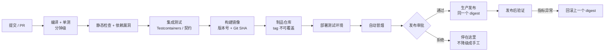
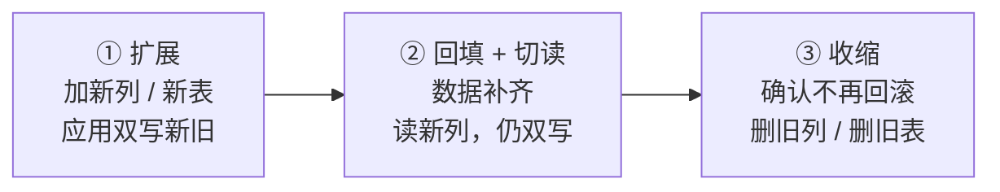

# CI/CD 流水线怎么设计？制品怎么晋级、怎么回滚？

> 流水线的产出不是"跑绿的日志"，而是**一个可重复部署、内容永不改变的制品**：同一个镜像从测试环境一路晋级到生产，回滚就是把它换回上一个。分层、门禁、迁移脚本、审批链，全都是围绕这句话长出来的。

## 流水线真正的产出是什么？

多数团队把流水线当成"自动跑命令的地方"，于是验收标准退化成"绿了没有"。可上线那晚真正被搬动的东西不是日志，是制品：镜像、迁移脚本、配置。判断一条流水线是否合格，看它能不能回答三个问题：

| 问题                       | 合格的回答                             | 不合格的样子                 |
| -------------------------- | -------------------------------------- | ---------------------------- |
| 线上跑的是哪个东西？       | 镜像 digest + 版本号，能反查到某次提交 | "昨天构建的那个包"           |
| 测试和生产是同一个东西吗？ | 是，同一个 digest                      | 两边各构建一次，各打一个包   |
| 出事回滚要多久、回到哪？   | 切回上一个 digest，分钟级              | 重新构建上个分支，半小时起步 |

主干链路只有一个方向，且每一段都产出可存档的东西：



注意 E 之后没有任何"重新构建"的环节。中间一旦插入重新构建，前面的验证就全部作废——你测过的那个包，和上线的那个包不是同一个。

## 分层：每一层跑什么、卡什么

分层的依据不是"功能不同"，而是**反馈速度**：缺陷离提交越远越贵，一行写错的判断在本地 3 秒发现是零成本，在客户验收前发现是两个人天。所以按从快到慢排，越快的层越不允许跳过，越慢的层越要少而准（层内的取舍见[测试怎么写才不白写](/engineering/engineering-testing-strategy.html)）。

| 阶段                       | 时长目标   | 失败怎么办                           |
| -------------------------- | ---------- | ------------------------------------ |
| 编译 + 单元测试            | 3–5 分钟   | 立刻红，阻断合并，不设"稍后修"       |
| 静态检查 + 依赖漏洞扫描    | 2–3 分钟   | 新增高危阻断；历史存量走豁免单       |
| 集成测试（Testcontainers） | 10–15 分钟 | 阻断出制品；先修或回退这次提交       |
| 构建镜像并打版本           | 3–5 分钟   | 不进制品仓库，不留半成品             |
| 部署测试环境 + 自动冒烟    | 5–10 分钟  | 自动回退上一版，人只看结果           |
| 晋级生产（审批 + 灰度）    | 按发布窗口 | 审批拒绝就停住，不临时改命令行手工发 |

同一份流水线定义，两种触发：**PR 只跑前两层**（10 分钟内必须出结果，否则开发者会转头去干别的），合并到主干后才跑集成测试、构建制品、部署与冒烟。多模块工程别全量构建，按反应堆裁剪（见 [Maven 多模块怎么组织](/tools/maven/maven-multi-module.html)）：

```bash
mvn -B -pl order-app -am verify                  # 只构建 app 及其上游，-B 关掉交互与彩色
mvn -B -pl order-app -am verify -DskipITs=true   # PR 快层：跳集成测试，只跑编译/单测/检查
```

集成测试挂在 `failsafe`（`integration-test` / `verify` 阶段），和 `surefire` 的单测分开。别把它们塞进同一段：否则"单测挂了"和"容器没起来"混在一个红叉里，看的人都得猜。

时间目标不是拍脑袋：容器首次启动要 15–25 秒，之后每条用例 1–3 秒，40 条集成用例大约就是一分多钟的增量；再加上拉镜像，正好卡在十分钟这条线上。

## 制品不可变与版本语义

`build once, deploy many` 不是口号，是可以检查的约束：

- **引用用 digest，不用 tag**。`image: registry.local/order-app@sha256:…` 才是钉死的；tag 只做人类可读的别名。
- **tag 不可覆盖**。制品仓库开 immutable tag 规则，同一版本号再推一次直接拒绝，从机制上堵住"同名不同内容"。
- **版本号 = 语义版本 + 提交**。`2.4.1-9f3c2ab`：前三位说兼容性（主版本=有破坏性变更，次版本=兼容的新功能，补丁=修复），后缀说来源。只靠 `latest` 或只靠时间戳，都追溯不了代码。
- **`-SNAPSHOT` 只允许出现在开发分支**，主干与生产永远是可枚举的正式版本。
- **保留策略**：生产发过的版本永久保留；测试环境版本留最近 20 个或 30 天。GC 脚本必须排除"仍被某个环境引用"的 digest——否则回滚时仓库里已经没有那个镜像了。

| 版本来源    | 例子            | 能回答什么                     |
| ----------- | --------------- | ------------------------------ |
| Git SHA     | `9f3c2ab`       | 精确到某次提交，排障的最后一环 |
| 语义版本    | `2.4.1`         | 这次改动对调用方是否兼容       |
| 发布时间    | `20260512-1030` | 环境里跑的是不是那一批         |
| 镜像 digest | `sha256:4b1e…`  | 内容指纹，唯一不可伪造的身份   |

## 配置外置与环境漂移

流水线只搬运"不含环境信息"的制品，环境差异全部外置到配置与密钥：默认值写在仓库里的 `application.yml`，环境值走环境变量、ConfigMap、配置中心，密钥走独立的密钥管理。

| 允许随环境变              | 绝不能随环境变         |
| ------------------------- | ---------------------- |
| 数据源地址、外部服务 URL  | 依赖版本、基础镜像     |
| 日志级别、并发度、副本数  | 代码分支、构建参数     |
| JVM 堆、GC 参数、资源限额 | 数据库迁移脚本内容     |
| 功能开关、限流阈值、密钥  | 序列化格式、错误码定义 |

**环境漂移是事故温床**，最典型的不是代码不同，而是 JVM 参数不同。测试容器 limit 4G，JVM 按四分之一算出 1G 堆，还带着 `-XX:+HeapDumpOnOutOfMemoryError`，跑了大半年没事；生产 Pod limit 1G，启动脚本却没写 `-Xmx`，而基础镜像里的老 JDK 不看 cgroup 上限、按宿主机 32G 算出 8G 堆——容器一摸到 limit 就被 OOMKilled，日志里只剩一行 exit 137，连堆快照都没有。顺带纠一个过时认识：JDK 8u191 之后容器内 JVM 默认识别 cgroup 内存上限（`UseContainerSupport`），但**它只负责识别上限，不负责帮你算合理**，`-Xmx` 仍要显式写，并给元空间、直接内存、栈留出余量。

## 数据库变更：扩展—收缩两步走

应用可以回滚，schema 不能。这是流水线里唯一一处"发布不可逆"的地方，出事概率也最高。

**先做两件事：脚本版本化、迁移与发布解耦。** 迁移脚本随代码进仓库，按序号命名（`V2_4_1__add_rule_team.sql`），执行记录落在 `flyway_schema_history` 一类表里，checksum 变了就报错——防止有人偷偷改已执行过的脚本。执行时机上是独立的流水线阶段（或独立的 Job），**不要挂在应用启动时**：滚动发布时多个实例同时启动，迁移变成并发抢锁，锁等待超时就把新实例打挂，看起来像"应用起不来"。

真正保护你的是扩展—收缩。字面上只有两步：**先让新旧并存（扩展），确认不再需要回滚后再删旧（收缩）**；中间的回填与切读属于扩展阶段的收尾，可以按节奏拆成多次发布，所以实际落地通常是三个发布：



| 步骤 | 做什么                                     | 此时旧版本还能跑吗 | 出问题怎么退   |
| ---- | ------------------------------------------ | ------------------ | -------------- |
| 扩展 | 只加不删：新列可空或带默认值、新表、新索引 | 能，它不认识新列   | 直接退镜像     |
| 迁移 | 后台分批回填历史数据，应用双写             | 能                 | 停回填，退镜像 |
| 切读 | 读新列、写双份；观察一个发布周期           | 能，旧列数据仍新   | 切回读旧列     |
| 收缩 | 单独一次发布再删旧列                       | 不需要旧版本了     | 只能前滚       |

反过来说，**禁止在同一个版本里做破坏性 DDL**：既 `DROP COLUMN` 又上新代码，等于亲手拆掉回滚通道——镜像退回去，老代码 SELECT 一个不存在的列，服务直接起不来。

具体到 MySQL 还有一层坑：8.0 加列可以 `ALGORITHM=INSTANT` 秒回，但**改列类型、改字符集仍然要重建表**，几千万行的表会把发布窗口吃掉。所以 `ALTER TABLE t_order ADD COLUMN rule_team_id BIGINT NULL` 是安全的，`MODIFY COLUMN amount DECIMAL(18,4)` 就得排窗口、走 `gh-ost`/`pt-online-schema-change` 之类的在线工具，或者干脆加新列 + 双写（还是扩展—收缩）。

不可逆的迁移（删列、改类型、加密、归档）上线前必须写清三件事：备份在哪、恢复到什么时间点、谁批准。备份没做过恢复验证，等于没有备份（这条在[交付文档](/engineering/engineering-delivery-docs.html)里讲运维手册时也提过，同一个道理）。

## 质量门禁的尺度

门禁的目的是拦住真问题，不是制造仪式感。设太松没意义，设太严会被绕过——被绕过一次，后面所有门禁都形同虚设。

| 门禁     | 建议口径                                  | 设过头的后果                   |
| -------- | ----------------------------------------- | ------------------------------ |
| 覆盖率   | 只看**新增代码** 60–70%，整体只记趋势     | 逼出 getter 测试和 `@Ignore`   |
| 变异测试 | 只对领域层（金额、状态机、规则）跑 PIT    | 全项目跑 30 分钟起，没人看报告 |
| 依赖漏洞 | 新增 Critical/High 阻断，存量按豁免单处理 | 一律阻断，老项目永远发不出去   |
| 镜像漏洞 | 只看"有修复版本"的，并定期重建基础镜像    | 无限豁免，扫了等于没扫         |

覆盖率唯一的正确用法是指出"哪些分支从没被执行过"，尤其是这次改动新增的那几行；把它挂到个人考核上，得到的一定是刷数字的测试。

漏洞豁免要有格式、有主、有过期时间：写进 `dependency-check-suppressions.xml` 或扫描工具的豁免文件，注明 CVE、为什么不可达（未被调用 / 只在测试 scope / 无修复版本）、审批人、复查日期。没有到期日的豁免，三个月后就是一排没人认领的注释。

## 回滚：能滚什么，滚不动什么

回滚不是"把镜像换回去"这一件事，它是四类对象的四种命运：

| 对象          | 能否回滚 | 手段                                     | 现实耗时         |
| ------------- | -------- | ---------------------------------------- | ---------------- |
| 应用镜像      | 能       | 部署上一个 digest                        | 2–10 分钟        |
| 配置          | 能       | 配置中心历史版本 / ConfigMap 回滚 + 重启 | 1–10 分钟        |
| 数据库 schema | **不能** | 只能前滚：写补偿迁移                     | 小时级起         |
| 数据          | 部分能   | 备份恢复 / 反向补偿脚本                  | 小时级，会丢增量 |

由此推出一条硬约束：**回滚窗口内，N-1 版本必须能读 N 版本的 schema**。这就是扩展—收缩的真正理由——不是洁癖，是给回滚留出时间。只要这条成立，"退镜像"就是有效的止血手段；不成立，回滚就是一次数据事故的开始。

回滚本身也要走流水线：把"部署上一个 digest"做成一个按钮或一条流水线参数，不靠人手敲 `kubectl set image`。手工回滚会漏掉配置、漏掉副本数、漏掉 sidecar 版本，而且没人记得当时敲了什么。

**定期真回滚一次**，别只在脑内演练。每季度在准生产或生产低峰做一次，记录：从决定回滚到流量恢复用了多久（目标 10 分钟内）、回滚后旧版本读新 schema 有没有报错、监控和告警有没有跟着恢复。演练过的回滚叫预案，没演练过的叫愿望。发布策略的选择（滚动、蓝绿、金丝雀各自适合什么回滚姿势）见[滚动、蓝绿、金丝雀怎么选](/engineering/engineering-container-release.html)。

## 权限、审批与审计

生产发布权限要收窄到"少数人 + 明确流程"，而不是"是个开发就有 kubectl"：

- **CI 服务账号只有测试环境权限**，生产部署用另一个身份，且只在审批通过后短期签发。
- **发布负责人 + 一人复核**：双人确认，紧急通道事后补审并留记录。
- **发布记录必须能关联变更单**：谁、什么时间、发了哪个 digest、对应哪张变更单、审批人是谁、有没有回滚。CI 里可以直接校验变更单号字段格式，填不对就不让往下走；模板见[交付文档](/engineering/engineering-delivery-docs.html)里的变更单骨架。
- **密钥不进流水线变量**：用密钥管理服务下发短期凭证，变量里长期存着的 Token 没人轮换，泄露时也查不到谁用过。

## 哪些反模式会让流水线白建

| 反模式                             | 为什么错                             | 改成什么                   |
| ---------------------------------- | ------------------------------------ | -------------------------- |
| 流水线中间夹手工步骤               | 结果不可复现，环境差异没人说得清     | 手工步骤固化成脚本或 Job   |
| 每次部署都 `latest` 或重新构建     | 测过的不是上线的，回滚也不知道回哪个 | 晋级同一个 digest          |
| 用生产分支热修                     | 主干与线上分叉，下次发布必冲突       | 走正常分支 + 补丁版本发布  |
| 产物在 CI 之外产出（本机打包上传） | 制品来路不明，无法追溯也无法复现     | 只有流水线能写制品仓库     |
| 密钥写在流水线变量里且永不轮换     | 泄露面大、无法审计                   | 密钥服务 + 短期凭证 + 轮换 |

## 面试里怎么讲这条链路

分三层说，从结论进，从细节出：

1. **先说目标与结构**：流水线的产出是不可变制品，不是日志；按反馈速度分层，PR 跑快层、主干跑全套，每层失败的动作都预先定义好。
2. **再说晋级与配置**：`build once, deploy many`，用 digest 钉死制品，版本号带 Git SHA，配置外置、环境之间的差异只允许出现在配置和密钥里。
3. **最后说数据库与回滚**：schema 不可回滚，所以破坏性变更走扩展—收缩，回滚窗口内保持 N-1 兼容，并且定期真回滚演练。

追问大概率落在"删列怎么发""回滚多久""谁能点生产"这三处，上面三层已经覆盖；再深就接到发布策略那一篇（滚动/蓝绿/金丝雀）和排障那一篇（[Pod 起不来、上不了线怎么查](/tools/kubernetes/kubernetes-troubleshooting.html)）。

## 容易踩的坑

- **只记 tag 不记 digest**：tag 被覆盖后，回滚回去的不是当时验证过的那个镜像。
- **迁移和应用同版本删列**：镜像退回去，老代码 SELECT 列不存在，回滚窗口直接消失。
- **紧急通道没有回收**：`-DskipTests` 的开关留着不收，三个月后成了默认路线。
- **冒烟只看健康检查**：`/actuator/health` 回 UP 但业务接口 500，进程活着不等于服务可用。
- **CI 缓存键不含依赖文件哈希**：换了版本还用旧缓存，构建出来的东西和本地不一致。
- **制品 GC 删掉了还能回滚的版本**：真回滚时仓库里没有那个 digest，只能现场重建。

## 小结

- 流水线的产出是可重复部署的不可变制品；判断标准是"线上跑的是哪个 digest、能不能反查到提交"。
- 按反馈速度分层：PR 跑分钟级快层，主干跑集成、构建、部署与冒烟；每层失败的动作要提前写死。
- `build once, deploy many`：同一 digest 从测试晋级到生产，版本号带 Git SHA，tag 不可覆盖、禁用 `latest`，制品保留策略要护住可回滚版本。
- 数据库是唯一不可逆的一环：脚本版本化、迁移与发布解耦、破坏性变更走扩展—收缩，回滚窗口内保持 N-1 兼容。
- 回滚要按对象拆开看（镜像/配置/schema/数据），并且定期真演练一次；生产发布权限收窄、发布记录关联变更单。

## 参考

综合自持续交付与制品管理的公开实践（OCI 镜像摘要与不可变 tag、Kubernetes 按 digest 引用镜像）、Flyway/Liquibase 的版本化迁移与"迁移与应用解耦"做法、以及若干 Java 交付项目的流水线复盘；对版本相关的事实做了核对：JDK 8u191 起容器内默认识别 cgroup 内存上限但仍需显式设堆，MySQL 8.0 加列可 INSTANT 而修改列类型仍需重建表。剔除了"覆盖率必须 80% 以上""回滚一律靠镜像"这类绝对化说法，阈值与保留数量需按团队实际规模调整。
