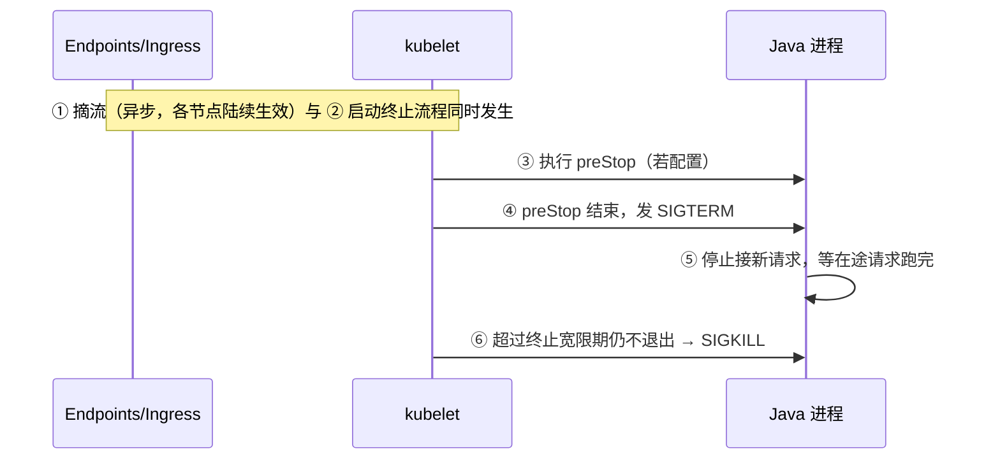

# 滚动、蓝绿、金丝雀怎么选？回滚要准备什么？

> 发布策略真正要回答的只有两个问题：**这次变更允许我多久退回旧版本**，以及**数据库能不能让两个版本同时读写同一份数据**。至于"滚动还是蓝绿"——那是这两个答案的下游结论。

流量怎么按比例切、灰度看哪些维度、网关/服务网格/客户端该在哪一层分流，[灰度发布、金丝雀和蓝绿怎么落地](/distributed-system/distributed-gray-release.html) 已经讲透了。这篇换一个视角：**发布这个动作本身**——Pod 怎么换、进程怎么退、库表怎么改、出事按什么顺序退回去。

## 四种发布方式：先摆在一张表里

| 方式         | 同时在线版本数 | 资源成本        | 回滚速度                    | 影响面                   | 典型场景                          | 最大的坑                              |
| ------------ | -------------- | --------------- | --------------------------- | ------------------------ | --------------------------------- | ------------------------------------- |
| **停机重建** | 1 版（先全停） | 1×              | 慢，重走一遍发布            | 100% 不可用窗口          | 内部工具、夜间批处理、早期项目    | 不可用窗口被严重低估（拉镜像+冷启动） |
| **滚动**     | 1~2 版混跑     | 1× + `maxSurge` | 中，反向再滚一遍（分钟级）  | 部分请求，配好探针才无感 | 日常迭代、向后兼容的改动          | 探针写错 → 启动中的 Pod 接流量吐 5xx  |
| **蓝绿**     | 2 版并存       | 2×              | 快，切负载均衡/网关（秒级） | 切换瞬间全量             | 大版本、UI/协议整体改、要秒级撤回 | 一次切全量，新环境的冷启动问题同时爆  |
| **金丝雀**   | 2 版并存       | 1× + 少量       | 快，权重归零/摘实例（秒级） | 按比例或按规则，可控     | 核心链路、高风险变更、算法类改动  | 分桶不粘、观测没有对照组，结论是假的  |

结论写在表外：**不是越高级越好**。

- 数据库能双版本兼容、回滚窗口能容忍几分钟 → 滚动 + 正确探针 + 优雅停机最划算，机器最少、流水线最简单。
- 数据库**不能**双版本兼容 → 蓝绿和金丝雀给的"安全感"是假的：新版本一写脏数据，你连退都退不干净，这时该做的是拆变更，而不是升级发布策略。
- 需要"秒级止痛"（对外承诺、大促前夜、监管敏感）→ 金丝雀/蓝绿，代价是多一套资源和一个更复杂的观测体系。

## 滚动更新的真相：把门的不是策略，是 readiness

K8s 里 `Deployment` 默认就是 `RollingUpdate`，`maxUnavailable` 和 `maxSurge` 默认都是 `25%`。这两个参数常被当"性能旋钮"随手填，其实各管一件事：

| 参数                      | 管什么                                      | 填错的后果                                                          |
| ------------------------- | ------------------------------------------- | ------------------------------------------------------------------- |
| `maxUnavailable`          | 滚动过程中**最多允许多少实例不可用**        | 填大了，容量在滚动时塌陷，扛不住正常流量                            |
| `maxSurge`                | 滚动过程中**最多多起多少实例**（资源峰值）  | 填大了，节点配额不够 → 新 Pod `Pending` → 滚动卡死                  |
| `minReadySeconds`         | ready 之后还要稳定多久才算"可用"            | 不填，Pod 一 ready 就被替换掉，预热没做完就上生产                   |
| `progressDeadlineSeconds` | 多久没有进展就判定本次滚动失败（默认 600s） | 以为它会自动回滚——它只把 Deployment 标成 `ProgressDeadlineExceeded` |

`maxUnavailable: 0` + `maxSurge: 1` 是"先起新、再下旧"，全程不减容量，Java 服务最常用。但它有前提：**新 Pod 必须真的会变 ready**，否则旧 Pod 一直不会被删，滚动就永久停在那里——反过来这也算一种保护，至少没把老实例弄没。

而"会变 ready"完全取决于探针怎么写。最常见的致命写法是把下游依赖塞进 readiness：`/actuator/health` 默认聚合了 DB、Redis、磁盘，于是 Redis 抖三秒，**全部实例同时**被判不 ready，端点被清空，网关直接 503——一次下游抖动被放大成全站故障。readiness 只该回答"我这个实例现在能不能接业务流量"——要查关键依赖也必须留缓冲，不能一票否决全部实例；更稳的是把下游交给熔断降级（详见 [服务降级怎么做才不变成「摆设」](/high-availability/high-availability-graceful-degradation.html)）。

liveness 同理，绝不能查下游：查了下游，下游一挂就触发全量重启，故障从"调用失败"升级成"重启风暴"。JVM 冷启动慢的服务再配 `startupProbe`，否则 liveness 会在启动期把进程反复杀掉。

## 优雅停机：SIGTERM 和"摘流"是并行的

这套时序必须背下来，几乎所有 502 都出在这里：



关键点：①和④**不是串行**的。kubelet 不会等所有节点的 kube-proxy、Ingress Controller 把转发规则更新完再发 SIGTERM。这段窗口里进程可能已关闭监听端口，而流量还在往这个 IP 上打——表现就是发布期间零星的 `502 / connection reset`。

工程上有两种处理，选一个：

1. **`preStop` 里 sleep 几秒**（最简单）：让摘流先跑完，进程还活着、还能正常应答，只是不再有新流量。代价是每次发布多花这几秒。
2. **主动注销**：`preStop` 里调注册中心的 `deregister`，等服务列表推送完再退出。适合 Nacos/Eureka 这类自建注册中心，但推送延迟本身不可控。

两份配置要对齐着改：

```yaml
spec:
  replicas: 4
  strategy:
    rollingUpdate: { maxUnavailable: 0, maxSurge: 1 }
  minReadySeconds: 10
  progressDeadlineSeconds: 600
  template:
    spec:
      terminationGracePeriodSeconds: 45 # 必须 > preStop 10s + 应用停机 30s
      containers:
        - name: order-api
          image: registry.example.com/order-api:1.8.3
          ports: [{ containerPort: 8080 }]
          lifecycle:
            preStop:
              exec: { command: ["sh", "-c", "sleep 10"] }
          readinessProbe:
            httpGet: { path: /actuator/health/readiness, port: 8080 }
            periodSeconds: 5
            failureThreshold: 2
          livenessProbe:
            httpGet: { path: /actuator/health/liveness, port: 8080 }
            periodSeconds: 10
            failureThreshold: 3
          startupProbe: # 冷启动最多容忍 150s
            httpGet: { path: /actuator/health/liveness, port: 8080 }
            periodSeconds: 5
            failureThreshold: 30
```

```yaml
# application.yml —— 服务端这一半
server:
  shutdown: graceful # Spring Boot 2.3+，停止接收新请求并等待在途请求
spring:
  lifecycle:
    timeout-per-shutdown-phase: 30s # 每个停机阶段最多等多久，默认也是 30s
```

三处时间要对得上：`terminationGracePeriodSeconds`(45) ≥ `preStop`(10) + `timeout-per-shutdown-phase`(30) + 余量。宽限期小于应用停机时间，到点就是 SIGKILL，前面配的优雅停机全白做。

还要知道 `server.shutdown=graceful` 的边界：它**只管 HTTP 请求线程**。线程池里的异步任务、`@Scheduled` 定时任务、MQ 消费者、Kafka 一个 poll 批次里的剩余消息，它都不管。要真"退干净"得用 `SmartLifecycle` 按顺序停：先停消费者（不再拉新消息）→ 等在途任务跑完 → 关线程池 → 关连接池。长连接（WebSocket/SSE）则直接被掐断，需要业务自己发关闭帧。

## 数据库与发布顺序：最容易翻车的地方

所有发布事故里，最难收场的不是代码，是库表。判断标准只有一句：**任意相邻的两个版本，必须能同时正确读写同一份 schema**（业内叫 N-1 兼容）。蓝绿和金丝雀期间两个版本同时在线，所以：

- 删字段、改类型、改约束、`RENAME`、`TRUNCATE` 这类不可逆 DDL，**不能和发布同批**。旧代码还在跑，列一没了就是大面积 `Unknown column`。
- 大表加索引也不等于免费：MySQL 8 的 online DDL 虽不长时间锁表，但仍有元数据锁与主从延迟，发布窗口叠加迁移会放大抖动。
- 迁移脚本要能重复执行、带版本号、且**先于新代码启动**（`initContainer` 或启动时 Flyway/Liquibase），否则新代码可能先于表结构就位——这一步属于流水线设计，见 [CI/CD 流水线怎么设计](/engineering/engineering-cicd-pipeline.html)。

把变更拆成"扩展-收缩"四个阶段，是唯一稳的走法：

| 阶段   | 这次发布做了什么                    | 数据库状态             | 旧版本还能跑吗       |
| ------ | ----------------------------------- | ---------------------- | -------------------- |
| 1 扩展 | 加新列（可空/有默认值）、写双写代码 | 新旧列都在，以旧列为准 | 能                   |
| 2 回填 | 后台任务把历史数据补进新列          | 两列逐步一致           | 能                   |
| 3 切读 | 读新列、继续双写                    | 以新列为准             | 能（仍读旧列）       |
| 4 收缩 | 停写旧列 → 观察一个版本 → 删旧列    | 只剩新列               | 不能，必须等旧版下线 |

四个阶段至少跨三次发布。"一次发布搞定库表变更"只在单版本的停机发布里成立，在多版本并存的发布里就是给自己埋雷。

## 金丝雀落地：分桶要粘，观测要有对照组

流量怎么分不再展开（网关权重、Ingress 注解、服务网格 `VirtualService` 各有取舍，见灰度篇），这里只讲三个决定成败的细节。

**一、分桶必须粘。** 按请求随机分 1%，同一个用户会在几秒内来回跨两个版本：一次下单在新版本、一次查单在旧版本，缓存和会话互相打架，问题也定位不出来。按 `userId`（或设备 ID）哈希取模分桶，保证同一用户在整个灰度期落在同一侧。

**二、必须有对照组。** 1% 流量的绝对值完全不可信——基数太小，下游抖一下就能让它翻倍。判断"新版本是否更差"，比的不是绝对阈值，而是**同期旧版本**（或同机房同时间窗的历史基线）：

| 观测项         | 对照组怎么取                | 值得介入的信号                     |
| -------------- | --------------------------- | ---------------------------------- |
| 5xx / 异常率   | 同期旧版本实例              | 差值持续扩大，且两个观察窗口都成立 |
| P95 / P99 延迟 | 同接口、同机房              | 稳定劣化 30% 以上，而不是单点毛刺  |
| 核心业务指标   | 下单/支付成功率、转化率     | 下降 0.5pp 就值得暂停放量          |
| 日志异常指纹   | 新版本独有的异常类型/堆栈   | 出现新类型即人工介入，不看数量     |
| 资源水位       | GC 次数、线程池队列、连接池 | 新版本明显更高，说明藏着泄漏或锁   |

**三、观察窗口要"时长 + 样本量"双满足。** 只设 15 分钟不够——凌晨低峰可能只来 200 个请求；只设样本量也不够——刚放量的前几分钟全是冷启动噪音。两个条件都满足才做"继续放量 / 回滚"的判断。

自动回滚建议做成**只降不升**：命中阈值自动把权重调到 0（或摘掉金丝雀实例），但**不要自动 `rollout undo`**——镜像回滚会再触发一轮滚动，在故障现场叠加一次新变更，反而更难看清。人保留一键覆盖权，回滚动作本身要发群通知。

## 回滚三件套：镜像、配置、数据

| 层       | 手段                                       | 生效速度             | 硬边界                                           |
| -------- | ------------------------------------------ | -------------------- | ------------------------------------------------ |
| **镜像** | `kubectl rollout undo`、改回上一个镜像 tag | 分钟级（要再滚一遍） | 制品仓库必须留着旧镜像，且旧镜像能跑在当前配置上 |
| **配置** | 配置中心版本回滚、关特性开关               | 秒级                 | 只对"每次读配置"的代码生效，标了重启生效的白搭   |
| **数据** | 几乎不存在"回滚"，只有前滚修复或补数据     | ——                   | 删除、覆盖、对外发送过的动作不可逆               |

`kubectl rollout undo deployment/order-api` 只是把 Pod 模板换回上一个 revision，**它不撤销任何已经发生的事**。下面这些必须单独处理：

- **已写入的数据**：新逻辑算错的金额、错乱的状态流转，只能用补偿脚本/对账修，回滚镜像不会让它们自己变回来。
- **已发出的消息**：旧代码可能不认识新版本写的字段，消费者直接反序列化失败。要么容忍未知字段（`FAIL_ON_UNKNOWN_PROPERTIES=false`），要么给消息带版本号、按主题隔离，回滚后单独消费积压。
- **已写入的缓存**：新版本换了 value 结构，回滚后旧代码读到新结构会解析异常。做法是缓存 key 带版本前缀（`order:v2:{id}`），切换版本等于换命名空间。
- **已调用的外部系统**：短信发了、支付扣了、工单派了，这些只能事后补偿。

所以真正的设计目标不是"能回滚"，而是**把不可逆动作做成可补偿**：任何对外副作用都要有冲正入口和幂等键。

## 部署与发布解耦：让"上线"和"可见"分开

镜像回滚是分钟级，开关关闭是秒级——想"秒级止痛"，就得把功能是否生效从部署里摘出来交给特性开关：

- **默认关闭**，只有显式打开才生效。默认开等于忘了配就全量上线。
- **能立刻关**：配置中心推送 + 本地落盘快照 + 默认值兜底，开关中心自己挂了不能把业务带崩。
- **覆盖异步链路**：只关 HTTP 入口，队列里积压的几千条任务还在跑，是最常见的漏网。
- **带 owner 和过期时间**：没过期时间的临时开关，半年后会变成没人敢动的祖传配置。

分层开关设计、灰度期怎么用开关做降级，[AI 功能怎么灰度、怎么评测、怎么兜底](/ai/ai-feature-rollout-guard.html) 里有完整一套，思路可直接搬到普通业务服务。但要记住它的边界：**开关救不了 schema 不兼容**——代码已上线开始双写，关开关只是不展示功能，写操作该跑的还在跑。

## 发布检查清单

三个时刻各一张表，比任何"发布规范文档"都好用。

**发布前**

| 检查项   | 具体要求                                                       |
| -------- | -------------------------------------------------------------- |
| 容量配额 | HPA 上限、`ResourceQuota`、节点剩余资源 ≥ `maxSurge` 峰值      |
| 依赖变更 | 迁移脚本向前兼容、缓存 key 结构、消息 schema、下游已有兼容版本 |
| 配置     | 新增配置项都有默认值、敏感配置已下发、新功能开关默认关闭       |
| 观测     | 看板建好、告警已配置、日志级别不是 DEBUG、Trace 采样已调       |
| 人       | 发布负责人、值守人、**回滚决定人**（只能有一个）、通知群       |
| 窗口     | 避开定时任务、对账、批量导入、月末结算、大促                   |

**发布中**

| 检查项 | 具体要求                                                |
| ------ | ------------------------------------------------------- |
| 分批   | 先发 1 个实例（或 5%），观察窗口通过后再继续            |
| 每批看 | 5xx 率、P95、GC、日志新增异常、下游错误率是否被带起来   |
| 节奏   | 留一个人工暂停点，别让流水线一口气滚完；变更要记 digest |

**发布后**

| 检查项     | 具体要求                                         |
| ---------- | ------------------------------------------------ |
| 冒烟       | 核心链路走一遍：登录 → 下单 → 支付 → 查询 → 退款 |
| 指标对比   | 与发布前 1 小时、昨天同时段对比，而不是看绝对值  |
| 依赖侧观察 | DB 慢查询、下游错误率、MQ 堆积量、缓存命中率     |
| 收尾       | 清临时开关、恢复临时扩容、归档发布记录与回滚点   |

## 常见事故：多半不是"发布失败"，而是"发布撞上了别的东西"

| 事故                 | 触发条件                            | 表现                                        | 对策                                     |
| -------------------- | ----------------------------------- | ------------------------------------------- | ---------------------------------------- |
| 发布撞上定时任务     | 凌晨发版，同时对账/结算任务在跑     | 新旧代码抢同一把锁、写同一批数据            | 发布窗口与调度表对齐，发版前停任务       |
| 缓存集中失效击穿     | 全停重建，或新版本换了 key 结构     | 流量全打到 DB，连接数打满                   | 用滚动而非停机、缓存预热、发布时临时限流 |
| 扩缩容与发布抢资源   | HPA 缩容同时 `maxSurge` 起新 Pod    | 新 Pod `Pending`，卡在 `progressDeadline`   | 发布期临时冻结 HPA、预留 surge 配额      |
| 两个团队发同一服务   | 两条流水线并行改同一个 `Deployment` | 后写覆盖先写，`rollout undo` 把别人版本顶掉 | 环境独占锁、单一声明式同步源（GitOps）   |
| 只回滚镜像没回滚配置 | 回滚时只改了镜像 tag                | 旧代码读到新格式配置，启动失败或行为异常    | 镜像与配置一起打版本号，按"发布单元"回滚 |

最后一条尤其隐蔽：配置中心里的值通常全局生效、不随镜像回滚。所以"发布单元"这个粒度要定义成**镜像 + 配置快照 + 开关状态 + 迁移脚本版本**，四者一起回。

## 容易踩的坑

- **readiness 里塞了全部下游依赖**：`/actuator/health` 默认聚合 DB、Redis、磁盘，下游抖一下全部实例同时被判死、端点被清空。它只该回答"我这个实例能不能接业务流量"。
- **以为 `progressDeadlineSeconds` 会自动回滚**：它只把 Deployment 标成 `ProgressDeadlineExceeded` 并停止推进，Pod 还卡在那儿；要退得显式 `rollout undo`，流水线判失败的口径是 `kubectl rollout status --timeout` 的退出码。
- **把终止宽限期当成"应用停机时间"**：`preStop` 的 sleep 也算在里面，给了 30s 宽限、preStop 睡 10s，应用只剩 20s 跑停机逻辑，长事务直接被 SIGKILL。
- **以为蓝绿一定比金丝雀安全**：它是一次切全量，新环境的冷启动、缓存未预热、连接池未建立会在同一秒暴露给所有用户——只是把风险从"持续几分钟"压成"瞬间爆一下"。
- **只在网关做了灰度**：服务间调用还全量走默认路由，新版本的下游兼容问题照样被放大，真正隔离影响面要让工作负载本身是新旧两套实例。

## 小结

- 选策略看两个硬约束：**回滚需要多快**、**数据库能否双版本兼容**。能兼容且能容忍分钟级回滚就选滚动；要秒级止痛才上蓝绿/金丝雀；schema 不兼容时先拆变更，别指望策略兜底。
- 滚动的无损取决于三件事：`maxUnavailable: 0` + `maxSurge` 留够配额、readiness 只查自身状态、`minReadySeconds` 给足预热时间。
- 优雅停机要对齐三处时间：`preStop`（等摘流生效）+ `server.shutdown=graceful` 与 `timeout-per-shutdown-phase`（等在途请求）+ `terminationGracePeriodSeconds` 大于前两者之和；因为 SIGTERM 与摘流并行，做不到就要接受少量 502。
- 库表变更走"扩展 → 回填 → 切读 → 收缩"，至少跨三次发布；不可逆 DDL 永不和业务发布同批。
- 回滚不是撤销：镜像回滚只换 Pod 模板，数据、消息、缓存、外部副作用都要单独补偿；发布单元要包含镜像、配置、开关与迁移版本，四个一起回。

## 参考

综合自 Kubernetes 官方文档（Deployment 滚动更新策略与 `maxSurge`/`maxUnavailable`/`minReadySeconds`/`progressDeadlineSeconds` 语义、Pod 生命周期与终止流程、探针三类语义及 `/actuator/health` 分组）、Spring Boot 参考文档的优雅停机章节（`server.shutdown`、`spring.lifecycle.timeout-per-shutdown-phase` 及其只管 HTTP 请求线程的边界）、MySQL 8 InnoDB 在线 DDL 与元数据锁的公开说明，以及特性开关与渐进式交付的工程实践整理。

核对说明：Pod 终止时"摘流与 SIGTERM 并行"、`progressDeadlineSeconds` 不会自动回滚、`terminationGracePeriodSeconds` 包含 `preStop` 耗时，这三点按官方文档口径写；三处时间的大小关系与 `preStop: sleep 10` 的取值是 4 副本 Deployment 上的经验值，不是必须照抄的数字。站内口径对齐：[灰度发布、金丝雀和蓝绿怎么落地](/distributed-system/distributed-gray-release.html) 管分流手段与观察窗口母题，[服务降级怎么做才不变成「摆设」](/high-availability/high-availability-graceful-degradation.html) 管降级与熔断配合，[Pod、Deployment、StatefulSet 该用哪个](/tools/kubernetes/kubernetes-core-objects.html) 管对象语义与滚动参数，[CI/CD 流水线怎么设计](/engineering/engineering-cicd-pipeline.html) 管迁移脚本与制品晋级，[AI 功能怎么灰度、怎么评测、怎么兜底](/ai/ai-feature-rollout-guard.html) 管分层开关。
