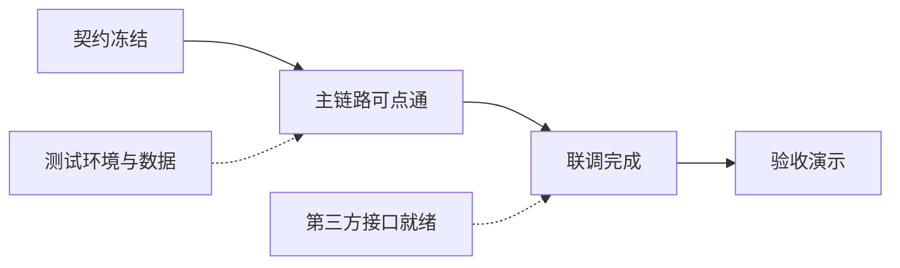

# 跨团队怎么对齐、怎么推动？

> "推动不动"通常不是嘴皮子不够利索，而是你手里只有一句口头约定——口头约定没有载体，就没有人需要对它负责。这篇讲的是把"说过"变成"签过、能查、能判对错"的那些具体物件。

## 后端为什么天然站在汇合点上？

一个接口字段，六个人对它抱着六种期待：产品关心它表达什么业务、前端关心它长什么样、测试关心它怎么判对错、DBA 关心它怎么存怎么索引、运维关心改它要停多久、客户关心这个数算不算数。

所以后端的时间被切碎，不是能力问题，是位置问题——**你站在所有依赖的交叉口，每个方向都有人等你给一个确定答复**。而等你答复这件事，每个角色都有自己的默认动作：

| 角色        | 他默认你会给出     | 你迟迟不给时，他的默认动作           |
| ----------- | ------------------ | ------------------------------------ |
| 产品        | 能不能做、要多久   | 全都要，排期压缩的压力留给你扛       |
| 前端        | 字段、错误码、空态 | 自己拍一版先写，联调时再改           |
| 测试        | 能判定的验收标准   | 按自己的理解写用例、按感觉定缺陷级别 |
| 运维 / DBA  | 变更影响面、窗口   | 按流程最保守的一档先拒一次           |
| 客户/业务方 | 口径与验收条款     | 按合同字面理解，验收会上再谈         |

这张表右边一列就是你的返工来源。所谓推动，本质是**降低别人的判断成本**：让他不需要相信你这个人，只看一眼手上的东西就能做决定。

## 口头约定为什么会自己漂？

三个机制，跟人品无关：**没有版本**（周二说返回数字，周五说还是字符串，两句都算数）；**没有判定标准**（"支持导出"算不算 10 万行、算不算中断续传）；**没有痕迹**（对接人一换，等于从没说过）。

典型现场：联调第一天前端说"列表要带总数"，你回了句"我看看能不能加"，一周后这句变成"你答应过的"。加不加是一件事，**谁定、什么时候定、定完落在哪**是另一件事；第二件没做，第一件永远谈不完。把它换成可验证物，就是填一张表：

| 场景     | 只"说过"的版本 | 可验证物                                        | 载体                       |
| -------- | -------------- | ----------------------------------------------- | -------------------------- |
| 接口字段 | "金额是数字"   | 字段字典：单位、精度、序列化形态、示例值        | 契约（OpenAPI / 字段字典） |
| 验收标准 | "导出要能用"   | 验收清单：数据量、耗时上限、失败提示、续传      | 用例 + 验收清单            |
| 依赖排期 | "你们先做"     | 依赖表：交付物、需要日期、拿不到的降级方案      | 依赖表 + 里程碑            |
| 上线时间 | "下周差不多"   | 发布单：窗口、影响面、回滚预案、审批人          | 发布单                     |
| 数据口径 | "按月份统计"   | 字段字典 + 口径说明：时区、归属日期、跨零点规则 | 签字版口径说明             |

载体不需要多高级：一张表、一个版本号、一个日期就够。判断它算不算可验证物，看三件事是否齐全——**能被看到、能被判定对错、能追到人**。

## 五类对象怎么对齐？

这几类人的关注点完全不同，用一套话术对齐，必然有一半人不买账。

### 产品：把"做不完"翻译成"砍哪个"

产品要的是范围和时间的可控，你能给的是三档取舍，而不是一句"排满了"：

| 档位             | 本期交付什么               | 代价                   | 谁拍板            |
| ---------------- | -------------------------- | ---------------------- | ----------------- |
| 最小可用         | 主流程跑通，缺边界功能     | 两个场景靠人工补       | 产品              |
| 分期             | 本期留接口与数据位，下期补 | 一次补数或迁移         | 产品 + 客户       |
| 不做（写进清单） | 明确不做并写理由           | 无，但要进验收范围说明 | 产品 + 客户签字人 |

关键动作是**把工时差摆到台面**："加这个看板等于后端 1.5 人日 + 前端 1 人日，等于把联调窗口从 3 天压到 1.5 天。"决定权交给产品，代价必须由你先算——你不算，就变成你扛。真需求该怎么问出来，见[需求调研和可行性分析怎么做到位？](/engineering/engineering-requirements-feasibility.html)，这里只管怎么谈取舍。

### 前端：契约先行，分歧写在纸上

前端要的是"今天就能开始写页面"，你能给的是契约 + Mock + 错误码表 + 明确的联调窗口。撕裂几乎都发生在这四类具体分歧上：

| 分歧点    | 前端默认                 | 后端默认                 | 契约里必须写死              |
| --------- | ------------------------ | ------------------------ | --------------------------- |
| 长整型 ID | JS Number 只有 53 位精度 | 返回 `long`              | ID 一律按字符串序列化       |
| 金额      | 页面显示两位小数         | `BigDecimal` / `decimal` | 返回字符串 + 单位（元/分）  |
| 时间      | 浏览器本地时区           | 服务器时间               | ISO-8601 带偏移，或统一 UTC |
| 分页      | `total` 是全部条数       | 深分页不查 `total`       | 写清 `total` 是精确还是估算 |

空值同理：列表给 `[]`、对象给 `null`，别用"省略字段"表示空，否则前端一个 `map` 就白屏。联调窗口也要进计划——哪天到哪天、谁在场、用哪个环境；字段口径怎么定、Mock 与契约测试怎么配合，[前后端联调怎么少返工？](/engineering/engineering-api-contract-testing.html)讲得更细，这里只记一句：**契约在编码前定，不是联调时定**。

### 测试：验收标准前置到开发前

测试要的是"能判定的东西"和"能复现的环境"，你能给的是验收清单、错误码表、状态机表——后者顺手就把要覆盖的状态组合列全了。两个撕裂点最值得提前处理：

**"这不是 bug"不能靠嘴说。** 给一份可复现说明：版本号或 commit、环境、账号与角色、请求 ID / traceId、种子数据脚本、期望值来源、日志片段。一条能直接复制的 `curl` 加一条能跑的 SQL，比十句解释有用。

**缺陷定级要共建标准。** 按业务影响分四级：P0 主流程不可用或数据错误、无绕过手段，P1 主流程可用但有明显错误或需人工兜底，P2 边界与体验问题、有替代操作，P3 文案样式与建议。P0/P1 的升降级要测试负责人和你两人同意，P2 由测试负责人定，P3 提出人自己定。定级错的方向不同、代价也不对称：P0 定成 P1，故障靠客户发现；P1 定成 P0，团队被无意义加班拖垮。

### 运维 / DBA / 安全：提前两周，而不是当天

他们要的是"变更可控、出事能退"，你能给的是影响面清单 + 时间窗 + 回滚步骤。当天下午找人开端口，本质是要求对方替你背风险，被拒是合理的。

| 事项          | 典型周期         | 你要提供什么                                     | 给晚了会怎样           |
| ------------- | ---------------- | ------------------------------------------------ | ---------------------- |
| 防火墙/白名单 | 3 工作日–2 周    | 源 IP、目标、端口、方向、用途                    | 联调窗口直接错过       |
| 账号与权限    | 1–5 工作日       | 申请人、角色、最小权限、回收时间                 | 只能借账号，审计过不去 |
| 大表 DDL      | 按表大小算       | 行数、是否锁表、用不用 gh-ost / pt-osc、回滚脚本 | 窗口内做不完，上线顺延 |
| 域名与证书    | 1–2 周（含备案） | 域名、证书类型、到期时间、续期负责人             | 上线当天浏览器报警告   |
| 配置与开关    | 半天             | 改哪项、影响哪些实例、怎么回滚                   | 半夜被叫起来手动改配置 |

### 客户与业务方：找对人，口径落纸

协作上只有三条：使用者、决策者、签字人往往不是一个人，别让一个人代表三方；口径必须落到有签字权的位置；每次变更都回到签字人那里过一次，不要用"对接人转述"充当批准。角色怎么分、谁能行使什么否决权，[需求调研和可行性分析怎么做到位？](/engineering/engineering-requirements-feasibility.html)有一张现成的表。

## 推动进度的四个抓手

### 一、风险前置：先把阻塞清单列出来

长周期项不会因为你着急而变快。开工第一周就列成清单，每项带"最晚发起日"和"不发起的后果"：

| 长周期项      | 典型周期 | 最晚发起    | 卡住谁   |
| ------------- | -------- | ----------- | -------- |
| 环境与网络    | 1–2 周   | 第一周      | 全部联调 |
| 第三方接口    | 2–4 周   | 设计评审后  | 主链路   |
| 安全扫描/测评 | 2–6 周   | 上线前 6 周 | 上线     |
| 采购与到货    | 4 周     | 报价确认时  | 现场实施 |
| 验收条款确认  | 1–2 周   | 需求基线时  | 收款     |

每一项都要写"不发起的后果"，否则它永远排在最后——人只会为有后果的事腾时间。

### 二、里程碑与依赖图

里程碑要少（3–5 个），每个都可判定：不是"完成开发"，而是"联调用例 30 条全部通过"。依赖画出来，比在群里喊一百句有用：



图给人看，表用来追账，尤其是"拿不到怎么办"这一列：

| 依赖对象   | 要什么              | 需要日期    | 拿不到的降级方案           |
| ---------- | ------------------- | ----------- | -------------------------- |
| 第三方厂商 | 接口文档 + 测试账号 | M2 前       | 本地 Mock 桩，上线前替换   |
| DBA        | 大表 DDL 执行       | 上线前 3 天 | 先分表灰度，不动原表       |
| 客户 IT    | 白名单 + 证书       | 联调前      | 内网跳板机临时联调         |
| 前端       | 页面骨架与联调实例  | M2 前       | 后端出静态 HTML 做数据验证 |

### 三、周报只写"变化与阻塞"

流水账没人看，因为它回答不了"我该做什么"。三行就够：

1. **本周变化**：契约冻结到 v1.2；订单表新增 `source` 字段。
2. **下周会动的**：联调开始，需要前端周二前给页面骨架。
3. **要谁在什么时候给什么**：DBA 周三前执行 DDL，否则上线顺延两天。

每条阻塞写全四个要素——**要谁、要什么、什么时候、不给的后果**。缺一个，它就会在群里被已读不回。

### 四、把问题变成选择题

反例："第三方接口调不通，怎么办？"这是把问题原样抛回去，还附赠一份焦虑。正例给的是带代价的选项：

- **A 加代理中转**：我方出网关做协议转换，代价 3 人日 + 一个单点，适合第三方短期改不动。
- **B 等厂商修复**：排期顺延 2 周，代价是验收节点风险，适合客户能接受延期。
- **C 先人工补录**：上线后按模板导入，代价每天约 1 小时人工，适合必须赶验收。

格式固定：**两个以上方案 + 每个的代价 + 你的建议 + 谁决策 + 决策截止时间**。带建议不是越权，不带建议才是把责任推回去。

## 会议和记录怎么才不白开

评审会只解决三件事：**目标**（今天必须定什么）、**输入材料**（提前一天发，否则就是听念稿）、**决策项**（谁定、定成什么、什么时候生效）。没有决策项的会，本质是一次广播。设计评审该看哪些点，[概要设计、详细设计要写到什么程度？](/engineering/engineering-design-docs.html)列得很细，不重复。

会外留三种记录，越轻越好：**决策记录（ADR）**记为什么这么定，决定当天由提出决策的人写；**变更单**记谁提的、改了什么、影响面评估、谁批准，变更当天由提出人写；**待确认清单**记编号、问题、责任人、截止日，周会前由你更新。一份能直接抄的决策记录长这样：

```text
# ADR-007 订单金额与 ID 统一按字符串传输
日期 / 决策人 / 状态：2026-11-17 / 后端负责人、前端负责人 / 已采纳
背景：19 位 ID 与 decimal 金额在 JS 里精度丢失，联调阶段两次返工
选项：A 数字传输，前端用字符串或 BigInt 接收 —— 改造散落在每个页面，容易漏
      B 后端统一字符串序列化，契约标注 format —— 改动集中在一处
决定：采用 B，ID 与金额字段统一 string，契约写清单位与精度
后果：老接口保留一轮兼容期（同时接受数字）；导出脚本改取字符串，兼容期结束前不得删数字分支
```

影响面里如果塞进了临时方案，顺手登记进[技术债怎么量化、怎么还？](/engineering/engineering-tech-debt-refactor.html)的台账，否则三个月后没人记得这里为什么留了个开关。

## 插队、抢资源、线上故障怎么接

**需求临时插队。** 别用"我们排满了"当理由，用交换。一句能直接发出去的话："可以插，代价是 A 功能顺延 2 天、联调窗口从 3 天压到 1.5 天；如果 A 不能顺延，需要你确认是否接受延期上线。"决策留给有决策权的人，代价由你算清楚。

**跨团队资源争抢。** 先找共同目标——同一个验收日期、同一份验收指标、同一个客户，这比"我们组更急"有力得多。找上级裁决有明确时机：同一议题三轮对齐仍无结论、争议会直接影响验收、两个团队的目标本身冲突（不是优先级先后）、需要跨部门预算或人力。带上去的是选择题和影响面，不是投诉。

**线上故障中的分工。** 三顶帽子必须分给三个人：**止血**只做回滚、关开关、扩容、限流，不查根因；**对外**只管统一话术与时间点，所有"什么时候好"只从他嘴里出，不判断技术细节；**记录**只写时间线，五分钟一条，含谁做了什么决定。一个人同时止血和对外，承诺的时间必然失控。复盘怎么写见[线上缺陷怎么复盘](/engineering/engineering-defect-rca.html)。

## 怎么用数字证明协作确实变好了？

"沟通顺畅了"没法汇报，指标可以。前提是**先量基线再谈改善**，而且指标用来定位、不用来考核——一旦挂到绩效，数字立刻被人优化掉。

| 指标                   | 怎么算                         | 采集方式           | 它想发现什么             |
| ---------------------- | ------------------------------ | ------------------ | ------------------------ |
| 返工率                 | 返工条目 / 总交付条目          | 需求条目关联缺陷单 | 口径与验收标准是否定清了 |
| 需求变更率             | 基线后变更条目 / 基线条目      | 变更单计数         | 范围控制与签认是否有效   |
| 上线成功率             | 一次成功上线 / 总上线次数      | 发布单记录         | 影响面评估够不够         |
| 回滚率                 | 回滚次数 / 总发布次数          | 发布单 + 值班记录  | 灰度与回滚预案是否可用   |
| 跨团队阻塞平均解除时长 | 阻塞从记录到解除的中位数（时） | 阻塞清单上的时间戳 | 对齐动作有没有真的提速   |

这类改善通常能报到具体数字："阻塞中位解除时长从 3 天降到 1 天""回滚率从 15% 降到 5%"。它比"协作更顺畅"有说服力，因为它能被别人拿去复核。

## 面试里怎么讲这段经历？

不讲"我沟通能力好"，讲一次具体的推动，五段走完：**目标**（要解决什么，卡在谁的哪个交付物）→ **你发现的卡点**（不是"对方不配合"，而是没有可验证物）→ **你造了什么可验证物**（验收清单、契约、依赖表、发布单，长什么样、谁签的字）→ **谁因此改变了决定**（产品砍了哪个需求、DBA 提前了 DDL、第三方接了 Mock）→ **结果与遗留问题**（阻塞时长、回滚率、延期天数，以及没解决的那部分）。

差别只在有没有证据：

| 弱讲法                       | 强讲法                                                                                                     |
| ---------------------------- | ---------------------------------------------------------------------------------------------------------- |
| "我负责跨团队协调，沟通顺畅" | "我把'导出能用'拆成三条可测标准——10 万行 3 分钟内、失败给出行号、中断可续传，测试照它写用例，验收时没再吵" |
| "我推动了第三方对接"         | "第三方晚两周，我先冻结 Mock 契约让前端开工，把依赖写进里程碑并备好降级方案，最终只延期 2 天"              |

面试官真正想确认的是：**你能不能让别人在不确定中做决定**——靠的不是人情，是让对方看到证据、看到代价、看到选项。STAR 的整体组织方式见[项目 STAR 怎么讲](/interview-preparation/interview-prep-project-star.html)，这类经历一般挂在"协作推动"或"复盘"那一块。

## 容易踩的坑

- **把推动理解成催进度。** 每天问"好了吗"只会让对方躲你，把阻塞清单摆上台面更有效。
- **用会议代替决定。** 会开完没有决策项、没有责任人、没有日期，等于把问题推迟一周。
- **只对齐直接对接人。** 签字人、运维、DBA 第一次听说方案是在评审会上，否决是必然结果。
- **口头承诺停在微信里。** 没有版本号、没有日期、没有回执，两周后就是两套记忆在打架。
- **绕过审批链抄近道。** 这次通了，下次流程只会更硬，出事时也没人替你担。
- **用协作指标考核人。** 回滚率一旦挂绩效，大家就不发高风险变更，指标立刻失真。

## 小结

1. 后端站在多个接口的汇合点，"推动不动"多半不是话术问题，而是口头约定没有载体、没有判定标准、没有责任人。
2. 把口头约定换成可验证物：字段口径进契约，验收标准进用例，依赖进依赖表，上线进发布单，数据口径进签字版说明。
3. 对不同角色用不同抓手：产品给三档取舍，前端给契约与联调窗口，测试给可测标准与定级规则，运维/DBA/安全提前两周给影响面，客户口径落到签字人。
4. 推动靠四个动作：长周期项列阻塞清单、里程碑可判定、周报只写变化与阻塞、把问题变成带代价的选择题。
5. 会议要有决策项，决定留 ADR 与变更单，协作改善用阻塞解除时长、回滚率这类可复核的数字说话。

## 参考

综合自架构决策记录（ADR，Michael Nygard 2011 年提出的轻量决策记录格式）、Google SRE 手册中事故指挥与角色分工的公开做法、PMBOK 的干系人参与与整体变更控制过程、DORA 关于软件交付效能的指标定义，以及政企定制项目中设计评审、变更单与验收签字的常见实践，并做了改写。核对重点四处：可验证物能否被别人独立判定（而不是自我确认）；阻塞清单的周期是否对应真实审批链而不是拍脑袋；缺陷定级与 ADR 是否互相越权（定级管优先级，ADR 管技术决定）；度量指标是否都给了采集方式与失真风险。文中看板、工单、导出、第三方对接等案例为自拟示例，未把任一种流程模板当作强制标准。
