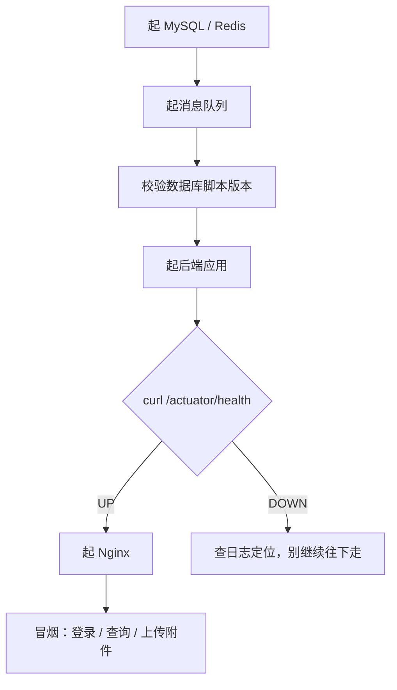

# 交付文档到底要交哪些？

> 甲方项目里的文档不是给评审看的装饰，它是部署依据、验收附件、运维接手的前提。判断标准只有一条：没参与开发的人，能否只靠它把系统跑起来、把故障查下去、把系统接过来。

## 一份文档合不合格，怎么判断？

别数文档有几本，先问一句：**把文档丢给一个懂技术但没参与开发的人，他能否独立完成部署、排障、交接？**

| 动作 | 文档必须提供的东西                       | 缺了卡在哪                   |
| ---- | ---------------------------------------- | ---------------------------- |
| 部署 | 版本对应关系、端口、依赖获取方式、命令   | 装到一半少个组件，停在那儿   |
| 排障 | 日志位置、指标阈值、故障对应处置         | 只能打电话找人，人不在就停摆 |
| 交接 | 账号密钥、仓库地址、第三方服务、变更历史 | 换人接手等于把项目重做一遍   |

用这把尺子量，"看起来齐全"的文档立刻现形：有《概要设计》却没有端口清单和防火墙策略，装不上；有《运维手册》但全是"定期检查系统状态"，查不出东西；有《验收报告》但结论是"功能正常，符合要求"，出了争议自证不了。

**不写会怎样**：一个项目交付半年后客户机房搬迁，运维照《部署手册》操作——手册只写了"把程序包部署到应用服务器"，没写要单独挂载附件目录、没写 Nginx 要转发 `/api` 前缀、没写证书装哪个目录。系统起来了，附件全丢、接口 404，查了两天，客户产线停了两天。跑不通的文档，写得再多都是负担。

## 文档到底要交哪些？

清单基本固定，差别只在详略：

| 文档                     | 读者                   | 用途                       | 什么时候写     | 谁维护      | 缺失后果                     |
| ------------------------ | ---------------------- | -------------------------- | -------------- | ----------- | ---------------------------- |
| 需求规格说明             | 客户业务方、项目经理   | 界定做什么、不做什么       | 调研后、开发前 | 项目经理    | 范围扯皮，收尾无限加需求     |
| 概要设计                 | 客户 IT、架构评审      | 分层、部署形态、选型       | 方案阶段       | 技术负责人  | 评审看不出方案落不落得地     |
| 详细设计                 | 接手开发               | 模块划分、关键流程、状态机 | 开发中同步     | 开发负责人  | 换人要重读全部代码           |
| 接口文档                 | 对接方、前端           | 请求响应、错误码、鉴权     | 接口定稿即写   | 后端开发    | 联调靠猜，错误码靠问         |
| 数据库设计（含字段字典） | 客户 IT、DBA、接手开发 | 表结构、字段含义、枚举     | 建表时同步     | 后端开发    | 报表口径错，历史数据解释不清 |
| 部署手册                 | 客户 IT、实施          | 从零装出一套可用系统       | 首次部署后定稿 | 实施 + 开发 | 现场装不上，交付延期         |
| 运维手册                 | 客户运维、值班         | 巡检、监控、处置、恢复     | 上线前         | 实施 + 运维 | 小故障升级成大故障           |
| 验收报告                 | 客户、监理、审计       | 逐条证明需求已实现         | 验收阶段       | 项目经理    | 验收款拖延，责任说不清       |
| 测试报告                 | 客户 IT、质量          | 范围、结果、遗留风险       | 测试结束       | 测试        | 质量没证据，遗留全算你的     |
| 培训材料                 | 业务操作员、客户 IT    | 教会用、教会管             | 上线前         | 实施        | 上线后天天被叫去当客服       |
| 变更记录                 | 双方                   | 改了什么、怎么回滚         | 每次发布       | 开发负责人  | 出事不知改了什么，回滚靠猜   |
| 应急预案                 | 客户运维、你方值班     | 大故障处置与升级           | 上线前         | 技术负责人  | 无人决策，恢复时间翻倍       |

它们跟着项目阶段产出，只写一次就锁进 U 盘的文档，半年后就是废纸：


## 部署手册怎么写才能让别人照着跑通？

这是最容易被写废的一份：它最像"操作记录"，而操作记录往往只有写的人看得懂。唯一的验收方式：**找一台干净机器，只按手册操作，看能否跑通；跑不通就改手册，改完再跑一遍。** 你本机装过的组件、改过的 hosts、留着的旧配置，全是作弊。

### 章节骨架

```markdown
# XX 系统部署手册 v1.3

1. 适用范围：程序包 / 前端包 / SQL 脚本三个版本号，与上一版的差异
2. 环境要求：服务器规格（CPU / 内存 / 磁盘 / OS 与内核）；软件版本（JDK、MySQL、
   Redis、Nginx、MQ、对象存储）；端口清单与防火墙策略；句柄、时区、时钟同步
3. 依赖清单与获取方式：包名、版本、内网地址、离线打包、校验方式
4. 安装步骤（命令级，按序可复制）：建用户与目录 → 装 JDK 与中间件 → 上传解压 →
   放配置文件（配置不写死在包里）
5. 配置项说明（见下方表）
6. 初始化：建库建用户与字符集授权 → SQL 脚本执行顺序（标明能否重复执行）→
   建桶 / 导证书 / 建初始管理员
7. 启动与停止：启动顺序、健康检查、停止顺序
8. 部署后验证清单（逐项打勾）；9. 常见失败与处理；10. 回滚步骤；附录 A 目录结构、B 本次变更点
```

### 端口、配置项与常见失败

| 端口 | 用途       | 谁访问谁      | 对外开放 |
| ---- | ---------- | ------------- | -------- |
| 8080 | 应用 HTTP  | Nginx → 应用  | 否       |
| 3306 | MySQL      | 应用 → 数据库 | 否       |
| 443  | HTTPS 入口 | 用户 → Nginx  | 是       |

部署卡住的一半问题在网络上：写清"谁访问谁"，现场网管才能一次开对策略。端口如此，配置项也一样——现场改配置的人不懂代码，每个能填错的地方都要标出错误后的表现：

| key                     | 默认值 | 说明                       | 必填 | 写错的后果                 |
| ----------------------- | ------ | -------------------------- | ---- | -------------------------- |
| `server.port`           | 8080   | 应用监听端口               | 是   | 与端口清单不一致，反代 502 |
| `spring.datasource.url` | 无     | 连接串，含库名与时区       | 是   | 时区错，时间字段偏 8 小时  |
| `app.storage.bucket`    | 无     | 对象存储桶名               | 是   | 上传成功，下载 404         |
| `app.job.enabled`       | false  | 定时任务开关，集群只开一台 | 否   | 多台都开，任务重复执行     |
| `logging.level.root`    | INFO   | 日志级别                   | 否   | 调成 DEBUG，一夜写满磁盘   |

写"按需修改"等于没写。



每步都要给判断依据：`redis-cli ping` 回 `PONG`、`mysql -e "select 1"` 回 1、健康检查回 `{"status":"UP"}`、`curl -I https://域名` 无证书告警。**进程在 ≠ 服务可用**，`ps` 看到 java 进程但连不上库的情况很常见。

| 现象                        | 最可能原因                      | 处理                      |
| --------------------------- | ------------------------------- | ------------------------- |
| `Table 'xxx' doesn't exist` | 脚本没执行或顺序错              | 按 6 重跑，确认可重复执行 |
| `Access denied for user`    | 授权只给了 `localhost`          | 补 `'app'@'%'` 或对应网段 |
| 页面能开但接口 502          | 反代端口与 `server.port` 不一致 | 核对端口清单与 upstream   |
| 附件上传报错                | 目录不存在或运行用户无权限      | 建目录并 `chown`          |
| 时间差 8 小时               | 容器或 JVM 时区为 UTC           | 显式设 `TZ` 与连接串时区  |

## 运维手册该写什么？

运维手册回答"每天看什么、出问题先动哪里"。部署手册有终点，它长期滚动：

| 巡检项       | 检查方式                               | 正常范围         | 异常动作                     | 频率 |
| ------------ | -------------------------------------- | ---------------- | ---------------------------- | ---- |
| 磁盘         | `df -h`                                | < 80%            | 清日志、扩盘，先查大文件     | 每日 |
| 进程与端口   | `ps -ef \| grep java`、`ss -lntp`      | 进程在、端口监听 | 看日志尾部再重启             | 每日 |
| 错误日志     | `grep -c ERROR app.log`                | 无新增           | 抽样看堆栈，判断是否影响业务 | 每日 |
| 数据库连接数 | `show status like 'Threads_connected'` | < 最大连接 70%   | 查慢查询与连接泄漏           | 每日 |
| 队列积压     | 管理台 / 监控曲线                      | 低于阈值且下降   | 查消费端是否卡住             | 每日 |
| 定时任务     | 任务执行记录表                         | 按计划全执行     | 手工补跑并记原因             | 每日 |
| 证书有效期   | `openssl s_client -connect 域名:443`   | 剩余 > 30 天     | 提前续签排更换窗口           | 每月 |

监控阈值别照抄：每天 200 单和每分钟 2000 单的系统，同一个阈值没有意义。常用的几个——接口错误率 5 分钟 > 1% 告警；P99 > 2s 查库与外部依赖；老年代 > 85% 导堆快照；主从延迟 > 30s 停报表类查询；队列积压持续涨 10 分钟查消费者。

故障处置必须写成动作序列，别只写"重启试试"：

| 故障     | 判断依据                 | 处置                                             | 恢复验证             |
| -------- | ------------------------ | ------------------------------------------------ | -------------------- |
| 进程挂了 | 端口不监听、健康检查失败 | 看日志与 OOM 记录 → 留现场 → 重启 → 观察 10 分钟 | 健康检查 UP + 冒烟通 |
| 库连不上 | 应用报超时、端口不通     | 查库进程与连接数 → 查网络与防火墙 → 必要时切备库 | 连接数恢复、可写入   |
| 磁盘满   | `df -h` 100%             | 清过期日志与临时文件 → 确认备份完好 → 扩盘       | 读写恢复、日志滚动   |
| 证书过期 | 浏览器告警、SSL 报错     | 换证书 → `nginx -s reload`（别重启）             | `curl -I` 无告警     |
| MQ 积压  | 曲线持续上涨             | 查消费异常 → 扩消费者 → 评估是否补数据           | 积压开始下降         |

日志位置要写全，还要写"怎么串起来"：应用 `/opt/app/logs/app.log`（留 30 天，按 traceId 检索）、Nginx `/var/log/nginx/access.log`（14 天，按状态码与耗时筛）、GC `/opt/app/logs/gc.log`（7 天）、慢查询 `/var/log/mysql/slow.log`（14 天）。日志里没有 traceId，前后端与下游串不起来，手册写了位置也白搭。

**备份不做演练等于没有备份**，恢复记录要留档：

| 日期       | 备份文件               | 恢复到哪台       | 耗时    | 数据核对               | 执行人 |
| ---------- | ---------------------- | ---------------- | ------- | ---------------------- | ------ |
| 2026-03-12 | `full_20260311.sql.gz` | 演练库 10.0.0.31 | 38 分钟 | 行数一致，抽 20 条一致 | 运维 A |

**不写会怎样**：某项目每天凌晨备份、日志显示成功、从没恢复过。真出事才发现导出脚本只导了一个库，系统实际用了两个库，恢复出来缺一半数据。备份靠不住"脚本没报错"，只能靠恢复验证。

最后是联系人与升级路径：值班运维 5 分钟响应 → 实施/交付经理 30 分钟 → 开发负责人 1 小时 → 技术负责人或厂商支持。谁在什么情况下被叫、非工作时间怎么找，写"联系项目组"等于没写。

## 验收报告和测试报告的区别在哪？

测试报告对内：测了什么、结果如何、剩多少风险。验收报告对外：逐条证明"你要的，确实实现了"。混成一份，两边都不够用。

"功能正常"不是证据，可核验的形式是需求编号 → 验收方法 → 证据；这张表同时就是需求范围边界，没有编号的需求，收尾时最容易被说成"这不是本来就该有吗"：

| 编号  | 需求条目               | 验收方法                          | 证据                         | 结论                    |
| ----- | ---------------------- | --------------------------------- | ---------------------------- | ----------------------- |
| R-012 | 工单超 4 小时自动升级  | 造一条 4 小时前的工单，看是否触发 | 截图 + 通知日志 + 状态变更   | 通过                    |
| R-015 | 按班组导出月度电耗     | 选两个班组导出，与抄表核对        | 导出文件 + 差异说明（≤0.5%） | 通过                    |
| R-021 | 与客户 OA 单点登录     | 从 OA 跳转免登录                  | 录屏 + 接口日志              | 通过                    |
| R-024 | 断网 30 分钟后自动补传 | 断网 30 分钟恢复后比对            | 网关日志 + 数据比对          | 有条件通过：补传 6 分钟 |

```markdown
# XX 系统测试报告

1. 范围：哪些模块测了，哪些没测及原因
2. 环境：版本、数据量、与生产的差异
3. 类型：功能 / 接口 / 性能 / 兼容 / 安全
4. 用例：总数、执行数、通过数、通过率
5. 缺陷：按严重级别分布，已修复 / 遗留
6. 风险：遗留问题的影响范围、规避方式、修复计划
7. 结论：是否满足上线条件
```

最容易糊弄也最要命的两处：测试库 1 万条、生产 800 万条，性能结论直接无效；遗留问题写"若干"，等于承认有雷却不说在哪。

## 培训与交接怎么做到人走了系统还能转？

客户对接人会换，你这边负责人也会换。目标不是"讲一遍"，是"文档 + 演练"。技术交接里最值钱的也不是架构图，是**坑清单**——哪些地方看着能改其实改不得、哪个定时任务和哪个接口抢同一张表、哪段逻辑是为迁就客户历史数据硬写的：

| 对象           | 材料                                  | 粒度                                 | 形式                    |
| -------------- | ------------------------------------- | ------------------------------------ | ----------------------- |
| 业务操作员     | 操作手册                              | 一个功能一页，带截图和"做错了怎么改" | 现场培训 + 录屏         |
| 客户 IT / 运维 | 部署 + 运维手册 + 应急预案            | 命令级，含处置步骤                   | 一起装一遍，他们动手    |
| 接手开发       | 详细设计 + 接口文档 + 架构图 + 坑清单 | 能定位到模块和文件                   | 代码走读 + 提个需求练手 |

交接清单按"少了就干不了活"排：

| 类别     | 具体项                             | 交付形式                | 已验证 |
| -------- | ---------------------------------- | ----------------------- | ------ |
| 账号     | 服务器、数据库、后台、堡垒机       | 密码管理器 / 密封交接单 | 是     |
| 密钥     | 证书私钥、API Key、加密盐、CI 变量 | 加密传输，不入仓库      | 是     |
| 代码     | 仓库地址、分支约定、发布流程       | 权限开通且能拉取        | 是     |
| 服务器   | 主机清单、规格、归属、到期时间     | 表格 + 云控制台权限     | 是     |
| 第三方   | 短信、地图、支付、对象存储         | 账号移交或改绑联系人    | 是     |
| 域名证书 | 注册商、DNS、到期日                | 管理权限移交            | 是     |

"已验证"这列是重点：给了账号没试登录等于没交接。**不写会怎样**：交接后三个月证书到期，谁都不知道证书在谁名下，业务中断两小时才找回原负责人。

## 变更记录和文档版本怎么管？

变更记录要在上线前写、上线后补结果，不是事后补一份好看的台账；"回滚到上个版本"也不算方案，"换回哪个包、脚本要不要反向执行"才是。文档本身同样要版本化，最省事也最可靠的是和代码同仓：

```markdown
# 变更单 2026-07-08 / v2.3.1

- 变更内容：工单升级规则按班组配置；修复报表导出中文乱码
- 影响范围：工单、报表模块；t_work_order_rule 新增 2 字段
- 数据库变更：upgrade_2.3.1.sql（可重复执行）
- 配置变更：新增 app.rule.team-enabled=true，默认 false
- 部署步骤：停应用 → 执行脚本 → 换包 → 起应用 → 冒烟
- 回滚方式：换回 v2.3.0 包；字段保留不删（删字段难回滚）
- 验证人 / 时间窗：客户运维 B，22:00-23:00
```

| 做法                | 好处                                 | 代价               |
| ------------------- | ------------------------------------ | ------------------ |
| 放代码仓库 `docs/`  | 版本天然对齐，改代码的 PR 顺手改文档 | 得有人 review 文档 |
| 放独立 Wiki         | 好编辑、好搜索                       | 容易和代码版本脱节 |
| 放某个人电脑 / 微信 | 无                                   | 人一走就没了       |

**不写会怎样**：上线后数据异常，翻遍记录只知道"发了个版本"，不知道改了哪张表、哪个开关。最后靠对比代码猜，恢复时间从 10 分钟变成 3 小时。

## 写文档有哪些省力的习惯？

1. **模板化**：每类文档一个固定骨架放仓库，新建时复制。写的人只填内容，读的人知道去哪找。
2. **图表优先**：一张拓扑图（用户 → Nginx → 应用 → 库/缓存/队列 → 外部服务）比三段文字直观。
3. **命令可复制、术语统一**：路径写绝对路径，别写"你的安装目录"；业务词最容易出歧义，一张术语表省掉一半沟通。

| 术语 | 本项目口径                                  | 别混用的说法               |
| ---- | ------------------------------------------- | -------------------------- |
| 设备 | 一台可独立通信的物理装置，有唯一 `deviceId` | 别和"点位"混               |
| 点位 | 设备上一个可采集/可写的量，有编码和单位     | 别说"信号""参数"           |
| 工单 | 一次要人处理的任务，有状态机和超时          | 别和"告警"混               |
| 批次 | 同一工艺参数下连续生产的一段时间            | 别说"班次"，班次是人       |
| 报警 | 越限事件，有触发和恢复两个状态              | 别说"故障"，故障是设备坏了 |

## 容易踩的坑

- **部署手册没写端口和防火墙**：现场装三天，最后发现是安全组没开。
- **配置项写"按需修改"**：现场不敢改，改错了也不知道错在哪。
- **验收标准没量化**："数据准确"没法验，"抽 20 条误差 ≤0.5%"才能签。
- **运维手册没有恢复演练**：备份天天成功，恢复时缺库、缺表、缺权限。
- **文档里的 IP 与真实环境不一致**：照着手册把测试数据写进了生产库。
- **交接没交密钥**：证书、加密盐、第三方 Key 留在个人手里，换人即中断。
- **客户换对接人后全盘重来**：没有需求编号和验收证据，新对接人重提一遍需求。

## 小结

- 文档合格的唯一标准：没参与开发的人能只靠它完成部署、排障、交接；过不了这条，写得越多越是负担。
- 清单固定十二类、跟着阶段产出；部署手册、运维手册、验收报告这三份最省不得。
- 部署手册要在干净机器上照着跑通再定稿：端口、配置项、初始化顺序、健康检查、回滚一个都别落下。
- 验收对着需求编号给证据，测试报告写清范围、环境、通过率、遗留风险；"功能正常"不是结论。
- 文档与代码同仓、每次上线一份变更单、交接清单逐项验证——这三件事决定换人之后系统是否还转得动。

## 参考

综合自公开的软件工程交付实践、信息系统验收与运维管理的通用做法（部署手册要素、变更管理、备份恢复演练、验收证据链等），对照若干行业定制项目的实际交付物核对：把"部署手册可在干净环境复现""备份必须做恢复验证""验收证据需可复核"作为硬要求，剔除了只讲原则不给操作步骤的写法；表格与骨架按可复用模板组织，具体字段和阈值需按项目实际调整。
