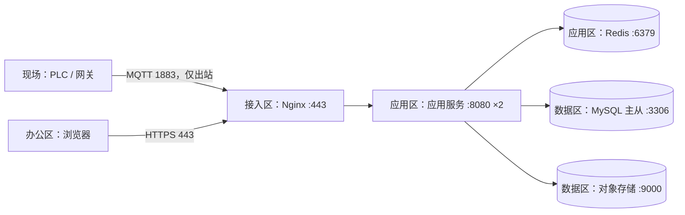
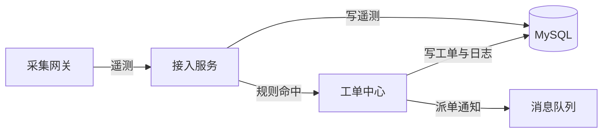
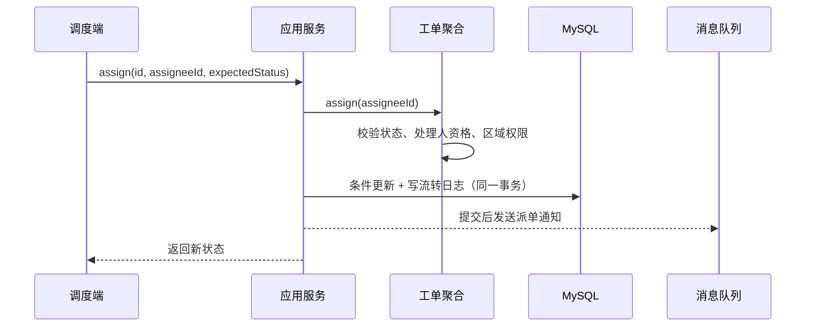
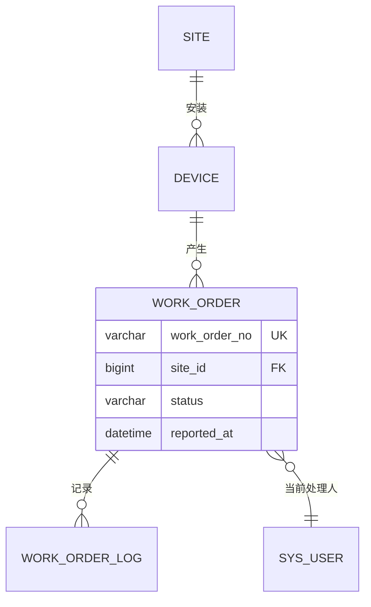

# 概要设计、详细设计要写到什么程度？

> 设计文档不是评审会上摆给人看的厚度，而是一份“允许别人安全改动”的操作说明：三个月后的自己、接手的同事、客户的技术对接人，能不能只靠它完成一次修改？

## 设计文档到底在解决什么问题？

甲方定制项目的设计文档有三个读者，他们关心的不是同一件事：

| 读者           | 要回答的问题                         | 文档提供的价值           |
| -------------- | ------------------------------------ | ------------------------ |
| 三个月后的自己 | 当时为什么这么定？改这里会碰哪里？   | 决策理由、边界、影响面   |
| 接手的开发     | 从哪个类、哪张表、哪个接口下手？     | 结构、时序、字段口径     |
| 客户技术对接人 | 系统连了什么、部署在哪、验收对什么？ | 上下文、拓扑、指标、术语 |

所以文档的价值不在篇幅，而在**降低一次具体改动的不确定性**。概要设计回答“系统由哪些部分组成、边界在哪、为什么这样选”，给不熟悉本模块的人看；详细设计回答“内部如何运转、数据如何流动、异常如何处理”，给要动这个模块的人看。

> **够用标准**：没参加需求调研的开发，读完能画出系统边界，并准确说出三个外部依赖和两个本期不做的功能。

## 概要设计先让“非本模块的人”看懂边界

概要设计不要从包结构写起。先写系统上下文：谁用（调度员、现场工程师、客户报障人）、连哪些外部系统（PLC 网关、告警平台、对象存储），再往里收；下面这份目录可以直接作为交付骨架：

```text
1. 文档信息：编号、版本、密级、编写/评审/批准人
2. 背景与范围：业务问题、建设边界、明确不做什么、关键约束
3. 系统上下文：用户角色、外部系统、协议、责任方
4. 模块划分：职责、拥有数据、允许的调用关系
5. 部署拓扑：机器、网络区、端口、连接方向
6. 技术选型：选择、理由、放弃的备选、代价
7. 数据流与接口：主链路、数据所有权、接口清单概览
8. 非功能与风险：并发、数据量、可用性、备份、待确认项
```

模块划分不能只写“订单模块、设备模块”，至少要能判断新功能落在哪：

| 模块     | 一句话职责                 | 拥有的数据                     | 明确不做         |
| -------- | -------------------------- | ------------------------------ | ---------------- |
| 设备接入 | 接收网关上报，维护在线状态 | `device`、`device_telemetry`   | 不判定告警等级   |
| 工单中心 | 管理工单创建、派单、验收   | `work_order`、`work_order_log` | 不向设备下发指令 |

部署拓扑要能指导实施，而不只是几个方框：



图下要补拓扑表达不了的内容：哪些端口单向、现场断网时缓存还是直接失败、备份放在哪个网络区。技术选型要写“为什么适合这个项目”：选 MySQL 8.0 而不是 PostgreSQL，是因为现场运维熟悉、备份恢复成熟，代价是不做跨库强事务；选 MQTT 是因为现场带宽不稳定、需要断线重连，边界是只承载遥测，不承载工单事务；采用单体模块化，是因为 6 人交付团队独立部署的收益低于运维成本，因此模块间只走应用服务接口，禁止跨模块查表。非功能指标要写到可验收：本期按 200 并发、工单年增 80 万、99.5% 可用性、每日全备加 binlog 增量来验收。

关键数据流用一张图说清“谁产生、谁处理、谁落库”：



> **够用标准**：实施人员能列出防火墙开通清单；开发能判断新功能归属；客户看完“不做什么”不会在验收时突然扩范围。

## 详细设计写的是“改动说明书”，不是代码翻译

详细设计不逐行翻译代码，它要固定四类容易产生分歧的东西：职责、时序、状态、数据口径。先切清模块内部的类职责：

| 类 / 组件             | 职责                         | 不该做的事         |
| --------------------- | ---------------------------- | ------------------ |
| `WorkOrderController` | 参数校验、鉴权、DTO 转换     | 判断工单能否派单   |
| `WorkOrderAppService` | 编排派单用例、控制事务边界   | 拼 SQL、计算 SLA   |
| `WorkOrder` 聚合      | 状态迁移、守卫条件、流转日志 | 发短信、调外部接口 |
| `WorkOrderRepository` | 持久化与查询                 | 决定业务状态       |

一次派单要写清事务从哪里开始、通知在事务内还是事务后：



这段时序回答了四个问题：并发派单靠行锁和条件更新、幂等靠 `expectedStatus` 和请求号、通知失败不回滚工单而是进本地消息表重试、返回值统一由领域状态映射。详细设计还要写并发与幂等、定时任务与批量、缓存 key 与失效、异常码与降级；只写“使用 Redis 缓存”等于没写。

> **够用标准**：开发能判断新逻辑放哪层；测试能照时序构造并发、重复请求、消息失败三类用例；运维知道哪些异常要人工介入。

## 状态机为什么不能只画一张图？

只画箭头、不写迁移条件，结果就是谁都能 `update status = 3`，最后没人知道合法路径。状态机要用“状态 × 事件 × 守卫条件 × 动作”固定下来：

| 当前状态                 | 事件       | 守卫条件                   | 动作                       | 目标状态                |
| ------------------------ | ---------- | -------------------------- | -------------------------- | ----------------------- |
| `SUBMITTED` 待派单       | `ASSIGN`   | 处理人存在、有站点权限     | 写处理人、派单时间、发通知 | `ASSIGNED` 待接单       |
| `ASSIGNED` 待接单        | `ACCEPT`   | 操作人就是当前处理人       | 记录接单时间               | `PROCESSING` 处理中     |
| `ASSIGNED` 待接单        | `REASSIGN` | 新处理人有效、原因非空     | 保留原处理人历史           | `ASSIGNED` 待接单       |
| `PROCESSING` 处理中      | `SUBMIT`   | 处理结果非空、至少一张照片 | 写结果、提交时间           | `PENDING_ACCEPT` 待验收 |
| `PENDING_ACCEPT` 待验收  | `REJECT`   | 驳回原因非空               | 写验收记录                 | `PROCESSING` 处理中     |
| `PENDING_ACCEPT` 待验收  | `PASS`     | 验收人有权限               | 写完成时间、触发回访       | `COMPLETED` 已完成      |
| `SUBMITTED` / `ASSIGNED` | `CANCEL`   | 尚未到场、原因非空         | 写取消原因和时间           | `CANCELLED` 已取消      |

配套要有状态字典（库中存英文编码、页面显示中文）、事件字典和非法迁移错误码，例如“已完成再派单”返回 `40901 INVALID_STATE_TRANSITION`。更新语句必须带旧状态：`where id=? and status=?`，影响行数为 0 说明状态已被并发修改。没有这张表，前端不知道按钮怎么显示，测试不知道要覆盖什么，数据修复时也判断不出哪些状态组合根本不可能出现。

> **够用标准**：给出任意两个状态，能回答“能不能直接跳、必须经过哪个事件、缺哪个条件会被拒绝”，并能写出对应用例。

## 数据库设计只交 ER 图为什么不够？

ER 图要标关联基数，否则一对一还是一对多只能靠猜：



但 ER 图表达不了字段含义。字段字典里“含义”和“口径”两列最容易被省，也最致命：

| 字段名          | 类型          | 可空 | 默认值      | 含义         | 口径                                         | 来源              |
| --------------- | ------------- | ---- | ----------- | ------------ | -------------------------------------------- | ----------------- |
| `work_order_no` | `varchar(32)` | 否   | 无          | 对外工单编号 | `WO`+`yyyyMMdd`+6 位日序列                   | 系统生成          |
| `site_id`       | `bigint`      | 否   | 无          | 所属站点     | 取设备所属站点；无设备工单由客户选择         | 设备档案 / 客户端 |
| `status`        | `varchar(20)` | 否   | `SUBMITTED` | 当前状态     | 见状态机表，库中存英文编码                   | 流程动作写入      |
| `reported_at`   | `datetime`    | 否   | 无          | 报障时间     | 客户提交或告警首次触发时刻，不用入库时间代替 | 客户端 / 告警平台 |
| `finished_at`   | `datetime`    | 是   | `NULL`      | 完成时间     | 仅验收通过时写入，不是最后处理时间           | 验收动作写入      |

`reported_at` 和 `created_at` 的差别、`finished_at` 和 `updated_at` 的差别，就是口径。不写清楚，报表按入库时间统计，补录或跨时区数据必然对不上。索引要写“为哪条查询服务”：`uk_work_order_no` 支撑按编号查详情并兼作防重约束；`idx_wo_status_reported` 支撑待办列表按状态和时间排序；`idx_wo_device_reported` 支撑设备历史工单。

分区与归档要写触发条件、分区键、在线保留期、归档表和恢复方式，例如工单在线保留 24 个月，历史按月迁到归档表。初始化脚本与增量脚本都必须进版本库：`db/init/V1__baseline.sql`、`db/migration/V2__add_source.sql`。脚本可评审、可重放、能追溯到需求单；手工改生产库则回答不了“谁加的、为什么加、其他环境有没有”。

> **够用标准**：接手的人只靠字段字典就能写查询和接口映射；只靠脚本能在空库重建结构；数据有争议时能指出每个值由谁、何时、按什么规则写入。

## 接口清单和报文怎么写才能少吵架？

接口清单是前后端、第三方和测试共用的索引，不是目录页：

| 编号  | 名称     | 方法 | 路径                              | 调用方       | 幂等性                   | 鉴权               |
| ----- | -------- | ---- | --------------------------------- | ------------ | ------------------------ | ------------------ |
| IF-01 | 创建工单 | POST | `/api/v1/work-orders`             | 客户端、后台 | 按 `requestId` 幂等      | `workorder:create` |
| IF-02 | 派单     | POST | `/api/v1/work-orders/{id}/assign` | 调度端       | 按 `expectedStatus` 幂等 | `workorder:assign` |
| IF-03 | 告警回调 | POST | `/api/v1/open/alarm-callback`     | 第三方       | 按 `alarmId` 去重        | 签名 + 时间戳      |

单接口详设要细到字段边界，而不是只给一个成功示例：

| 字段          | 类型       | 必填 | 约束                          | 说明                       |
| ------------- | ---------- | ---- | ----------------------------- | -------------------------- |
| `requestId`   | string(64) | 是   | 24 小时内唯一                 | 幂等键，重复提交返回原工单 |
| `siteId`      | long       | 是   | 存在且当前用户有权限          | 站点 ID                    |
| `deviceId`    | long       | 否   | 存在时必须属于该站点          | 设备类工单必填             |
| `description` | string     | 是   | 1–500 字，不能纯空白          | 报障描述                   |
| `reportedAt`  | string     | 否   | ISO-8601，不晚于服务端 5 分钟 | 不传取当前时间             |

<!-- prettier-ignore -->
```json
{ "code": "0", "message": "ok", "data": { "workOrderNo": "WO20261117000001", "status": "SUBMITTED" }, "requestId": "req-7f3c2a" }
```

错误码要能指导调用方动作：`40001` 参数错误、`40301` 无站点权限、`40901` 状态迁移非法、`40902` 幂等键冲突但报文不一致、`50301` 下游暂不可用；同时写清 HTTP 状态、能否重试、提示语归谁负责。字段命名、时间格式、空值语义和分页约定必须与下一篇 [前后端联调怎么少返工？](/engineering/engineering-api-contract-testing.html) 共用同一套契约，否则文档、Mock、真实响应会变成三套口径。

> **够用标准**：前端只拿清单就能搭页面和 Mock；测试只拿字段与错误码就能写边界用例；第三方无需再开澄清会即可对接。

## 文档写到什么程度才算够？

不要用页数判断，用“能否独立完成一个动作”判断：

| 动作           | 只靠文档应做到                           | 做不到时的缺口                 |
| -------------- | ---------------------------------------- | ------------------------------ |
| 加一个字段     | 找到字典、迁移脚本、接口字段和影响范围   | 含义、默认值、兼容策略没写     |
| 定位一次数据错 | 还原来源、状态路径、时间口径和幂等键     | 状态机、日志表、来源字段缺失   |
| 完成一次部署   | 列出机器、网络区、端口、配置项、回滚步骤 | 拓扑只有逻辑关系，没有环境参数 |
| 改一条业务规则 | 找到守卫条件、影响状态和要补的测试       | 只有流程图，没有条件和动作     |
| 交接给新人     | 一周内独立提交一个小改动                 | 关键知识还在某个人脑子里       |

出现这些信号说明写过头了：详细设计逐行解释 getter/setter，篇幅比代码还长；为尚未确定的扩展预留五层抽象；每个接口重复粘贴通用分页说明；评审只签字不记录异议；更新靠某个人“有空时补”。过度设计的真正成本不是打印纸，而是没人愿意维护，最后整份文档失去可信度。

## 文档和代码怎么同步才不互相打脸？

先区分事实来源：接口路径和字段以代码/契约为准，设计理由和边界以文档为准。混在一起，必然一边改一边忘。

| 内容       | 事实来源           | 同步方式             | 检查点           |
| ---------- | ------------------ | -------------------- | ---------------- |
| 接口字段   | 代码注解 / OpenAPI | 构建时生成文档       | CI 校验契约变更  |
| 表结构     | 迁移脚本           | 迁移工具按版本执行   | 禁止手工改生产库 |
| 状态与事件 | 状态机表 + 枚举    | 改枚举必须同 PR 改表 | 单测覆盖非法迁移 |
| 设计决策   | 概要 / 详细设计    | 评审通过后回写       | 变更记录留链接   |

手写接口文档不是原罪，适合接口少、对接方固定的项目；接口多、迭代快时从代码生成更可靠。但生成只能保证字段没写错，生成不了“为什么可为空”“失败后是否重试”，这些要人工补。

设计变更必须回写，并留下可追溯记录：

| 版本 | 日期       | 变更                         | 原因                 | 影响范围                  | 评审人               |
| ---- | ---------- | ---------------------------- | -------------------- | ------------------------- | -------------------- |
| V1.2 | 2026-11-10 | 工单新增“改派”               | 调度员要求换人       | 状态机、IF-02、流转日志   | 客户代表、测试负责人 |
| V1.3 | 2026-11-17 | `reported_at` 改为客户端传入 | 补录需要真实报障时间 | 字段字典、IF-01、报表口径 | 产品、数据开发       |

评审不是听作者念目录。会前至少一天发文档和待决问题，会上按主链路走：产品和业务确认范围、状态与异常路径；开发负责人确认边界、依赖和数据口径；测试负责人确认状态组合、错误码和指标可测；运维确认拓扑、部署与回滚；客户技术接口人确认外部系统、网络和验收口径。结论要含版本号、日期、参与角色、遗留问题和关闭状态。只留一句“评审通过”，三个月后没人知道当时同意了什么。

> **够用标准**：代码评审能看到对应文档变更；契约在 CI 有校验；任意线上变更都能反查到需求、设计章节和评审结论。

## 交付项目还多哪些硬要求？

甲方项目的设计文档常作为合同附件或验收材料，除了技术正确，还要“可签字”：

| 文档     | 主要读者                         | 用途                     | 更新频率       |
| -------- | -------------------------------- | ------------------------ | -------------- |
| 概要设计 | 客户技术负责人、项目经理、新开发 | 范围确认、评审、验收附件 | 每个里程碑     |
| 详细设计 | 开发、测试、接手人               | 编码、测试设计、影响分析 | 每次迭代       |
| 接口清单 | 前端、第三方、测试               | 联调、Mock、对接确认     | 接口变更当次   |
| 字段字典 | 开发、DBA、数据对接方            | 建表、取数、数据修复     | 表结构变更当次 |

文档首页要有编号、版本、密级、编写/评审/批准人和签字页。客户评审最常见的争议不是架构，而是术语：需求叫“设备”，设计叫“终端”，接口叫 `equipment`，验收时一定被追问是不是同一个对象。

| 主用词      | 英文标识         | 定义                                   | 不要混用         |
| ----------- | ---------------- | -------------------------------------- | ---------------- |
| 设备        | `device`         | 现场可被采集或控制的物理对象           | 终端、器材、点位 |
| 站点 / 点位 | `site` / `point` | 站点是设备安装位置，点位是设备上的测点 | 现场、通道、信号 |
| 工单        | `work_order`     | 一次可派发、处理、验收的现场任务       | 任务单、订单     |

验收附件还要建立追溯关系，让客户看到每条需求都有设计和测试落点：

| 需求编号 | 设计章节   | 接口 / 表           | 验收用例               |
| -------- | ---------- | ------------------- | ---------------------- |
| REQ-012  | 派单与改派 | IF-02、`work_order` | 改派后保留原处理人历史 |

> **够用标准**：客户不用拉开发解释术语就能读完；签字页、版本、密级齐全；每条验收需求两分钟内能找到设计章节和用例。

## 哪些坑最容易把设计文档写成摆设？

最常把文档写成摆设的六种情况：只有架构图没有字段口径，`status`、`amount` 全靠猜；状态机只画箭头不写守卫条件，代码各处直接改状态；接口文档与代码不一致（文档 `userId`、实际 `user_id`），联调按旧版返工；ER 图不标基数，一对多还是多对多靠猜；没有变更记录，新版覆盖旧版后无法回溯；详细设计写成代码翻译，代码一改文档就过期。对应的改法分别是补“含义 / 口径 / 来源”、用状态 × 事件 × 守卫 × 动作表、让契约进版本库并由 CI 校验、明确 `||--o{` 与可选性、维护版本表与评审记录、只写职责/时序/状态和取舍。还有一个隐蔽的坑：只写正常流程，不写失败和补偿——消息发不出去、回调重复、归档任务失败怎么办，这些才是接手人最需要答案的地方。判断一个坑要不要补，看它是否挡住了加字段、查错、部署或交接中的某个具体动作。

## 小结

1. 设计文档的验收标准是“别人能只靠它安全改动”，不是页数、图数或签字数量。
2. 概要设计面向非本模块读者，固定上下文、模块边界、部署拓扑、选型理由、数据流和非功能指标。
3. 详细设计必须写清职责、时序、状态机、字段口径、并发幂等和异常；状态机要给守卫条件与动作。
4. 数据库交付物是 ER 图、字段字典、索引理由、归档策略和可重放的迁移脚本，“含义”和“口径”不能省。
5. 文档与代码靠契约、迁移脚本、变更记录和评审闭环同步；交付项目还要统一术语、签字版本和需求追溯。

## 参考

综合自 arc42 架构文档模板、IEEE 1016 软件设计描述、C4 模型、ISO/IEC/IEEE 42010 架构描述标准、OpenAPI 3.0 规范，以及 Flyway / Liquibase 的数据库迁移实践，并参考了政企定制项目中设计评审、签字归档和验收附件的常见做法。文中工单、设备、点位案例为自拟示例；核对重点是状态迁移完备性、字段时间口径、接口幂等性和文档版本可追溯性，未把任一种模板当作强制标准。
