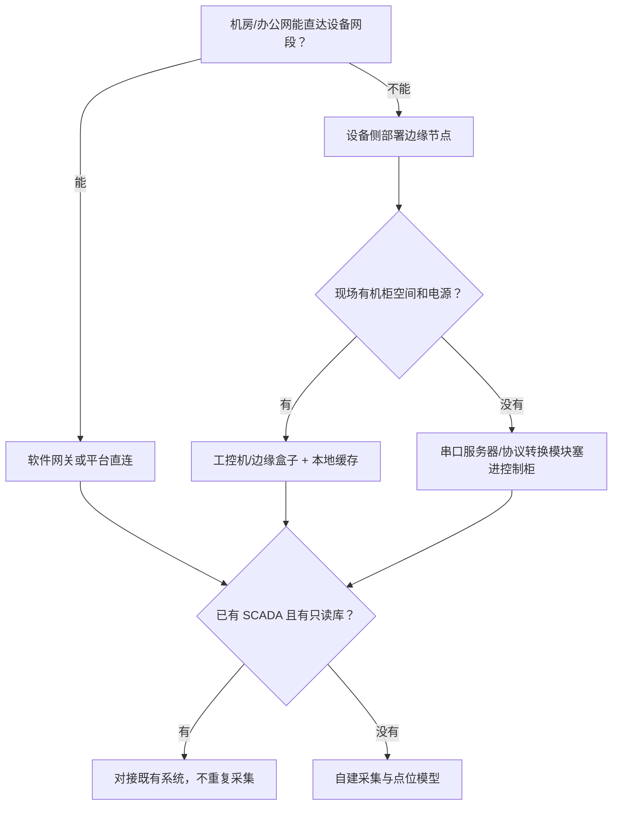
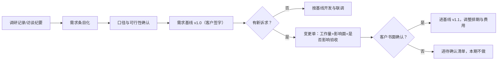

# 需求调研和可行性分析怎么做到位？

> 定制项目没有 PRD 可读，需求是从客户一句"我要看实时产量"、一堆历史 Excel 报表和几个老师傅的脑子里挖出来的。调研做浅了，后面每一层设计都在猜，猜错的账单最后由开发加班来付。

## 为什么后端也得会调研这件事

互联网产品的需求来自产品经理，下游是数据和增长；甲方定制项目的需求来自现场，下游是验收签字。差别不在"谁写文档"，而是**需求一开始并不存在**，它散落在三处：

- 客户的一句话，通常是他以为的解决方案（"给我上个看板"），而不是问题本身；
- 一堆现有 Excel 报表，口径藏在公式和手工调整里，谁也说不清为什么第 37 行要减 2；
- 老师傅的经验："这块表一直不准，我们都手动改""月底那两天系统会卡，别排那时候上线"。

后端在这件事里位置特殊：客户说"实时"，落到你身上是轮询周期、缓存策略、聚合表和索引；客户说"准确率 100%"，落到你身上是一个永远达不到的验收条款。**前端能靠演示糊过去，后端糊不过去**，因为数错了就是数错了。

| 调研时漏掉的 | 三个月后长成什么                                       |
| ------------ | ------------------------------------------------------ |
| 现有报表口径 | 上线后客户说"这不是我要的数"，全部统计逻辑返工         |
| 点表质量     | 按 300 个点位报价，实测 40 个是坏的，联调排期全乱      |
| 客户 IT 流程 | 防火墙开通走了两周审批，联调窗口错过，验收顺延         |
| 现场网络形态 | 架构按"平台直连设备"设计，到现场发现隔着网闸，方案重做 |
| 谁真正签字   | 跟对接人对三个月，签字人说"我从没同意过这个口径"       |

## 调研前该把哪些材料要到手

不要空着手去现场。材料决定你问的问题有没有质量——拿着对方的报表问"这一列怎么算的"，比问"你们想统计什么"有效十倍。

| 材料                       | 用来判断什么                         | 拿不到会怎样                             |
| -------------------------- | ------------------------------------ | ---------------------------------------- |
| 现有报表模板（Excel/纸质） | 输出口径、字段、班次与结算周期       | 报表对不上账面，统计逻辑整体返工         |
| 设备清单与控制柜铭牌照片   | 协议种类、点位规模、是否需通信模块   | 按 300 点位报价，实际 1200 点，工时翻倍  |
| 网络拓扑（甲方 IT 提供）   | 网关形态、是否需要网闸或单向隔离     | 联调当天发现到不了设备网段，方案推倒     |
| 历史系统截图或库表结构     | 迁移量、数据质量、编码与主键是否规范 | 迁移时发现编码混乱、主键重复、时间戳缺失 |
| 组织架构与岗位职责         | 权限模型、审批链                     | 权限按部门树设计，实际按班组+班次授权    |
| 合同技术附件               | 范围边界、验收条款、工期罚则         | 越做越像无底洞，且没有依据拒绝追加       |

比材料更重要的是**见对人**。只跟一个"对接人"聊，是这类项目最常见的灾难源头：信息被转述两轮，而转述者往往没有决策权。

| 角色                     | 关心什么                   | 决策权                     | 只找他聊的后果                   |
| ------------------------ | -------------------------- | -------------------------- | -------------------------------- |
| 使用者（班组长、操作工） | 少录数据、别加操作步骤     | 无签字权，有日常否决权     | 上线没人用，数据靠补录           |
| 验收签字人（生产/财务）  | 验收通过、指标能向上汇报   | **验收签字权**             | 做完才发现他要的是月度达成率     |
| 项目对接人（信息中心）   | 进度、流程合规、别出事     | 信息闸门权（决定你见到谁） | 你拿到的永远是过滤后的二手需求   |
| 客户 IT / 网络           | 安全、不出事故、别让我背锅 | 网络策略一票否决           | 端口开不下来，方案再好也上不了线 |
| 设备供应商               | 别改我 PLC 程序            | 协议文档与配合度的实控权   | 拿不到点表和协议文档，只能靠猜   |

第一轮调研就把这张表填满，标清"谁签字""谁能否决""谁只是使用者"，然后**至少和签字人当面确认一次诉求**。哪怕只有二十分钟，也能避开后面三个月的方向性错误。

## 到现场到底看什么

办公室里想不出来、到现场十分钟就看明白的东西，主要有四件，它们分别锁死四个设计决策：

1. **控制柜与设备型号** → 定协议。同样叫"PLC"，西门子 1200 走 S7 且支持 Modbus TCP，三菱 FX5U 是另一套，某国产老设备可能只有 RS485 私有 ASCII。铭牌拍下来，比听转述靠谱。
2. **网络能不能通到设备网段** → 定网关形态。从机房 ping 得到 PLC 吗？中间有网闸、防火墙、单向光闸吗？这一条直接决定"平台直连"还是"设备侧部署边缘节点"。
3. **有没有既有 SCADA / MES / 能源系统** → 定集成还是替换。已有系统若有只读库或接口，优先对接，别重复采一遍——两套数对不上时，谁也不认。
4. **现场有没有 7×24 值守** → 定运维方案。没人值守就必须做自愈、看门狗、远程通道；有人值守则可以给一份"红灯亮了打这个电话"的纸质手册。



现场勘察清单，可以直接打印带去打勾：

| 类别     | 要确认的具体项                                             | 影响的设计决策         |
| -------- | ---------------------------------------------------------- | ---------------------- |
| 设备     | PLC 型号与 CPU、串口/网口是否被 HMI 占用、是否需加通信模块 | 协议驱动与硬件报价     |
| 协议     | Modbus TCP / S7 / OPC UA 是否支持、OPC UA 是否需要授权     | 采集方式与授权成本     |
| 网络     | 设备网段 IP 规划、有无空闲交换机口、网闸方向与策略         | 网关位置、是否需要中转 |
| 既有系统 | SCADA/MES 厂商、数据库类型、能否给只读账号                 | 集成方案与迁移范围     |
| 环境     | 机柜剩余空间、电源与 UPS、粉尘温度、有无接地               | 硬件选型与稳定性预期   |
| 人员窗口 | 是否 7×24 值守、夜班谁看告警、何时能停线联调、能否改 PLC   | 运维方案与联调排期     |

## 访谈该怎么问

访谈的目标不是收集功能清单，而是**复原一遍现在的工作流程**。四类问题按顺序问，别跳：现状（这活谁干、用什么工具、一天几次、数据从哪抄）→ 痛点（哪一步最容易错、错了怎么发现、上个月出过什么事）→ 期望（想看到什么、多久刷新、给谁看、看到后做什么决定）→ 约束（能不能停线、能不能动 PLC、数据能不能出内网、谁能批账号）。

最容易失效的是"期望"这一段，因为客户会用解决方案的语言描述问题。对照一下好坏问法：

| 坏问题         | 为什么坏                                 | 换成                                                      |
| -------------- | ---------------------------------------- | --------------------------------------------------------- |
| 你要什么功能？ | 让客户替你做产品设计，换回一份功能清单   | 现在这活你怎么干的？把上个月的报表翻出来讲一遍            |
| 实时是多久？   | 客户嘴里的"实时"通常指"我打开时是最新的" | 你看到这个数之后做什么？如果是发现超产，晚 5 分钟会怎样？ |
| 准确率要多少？ | 客户会答 100%，写进合同就是坑            | 现在报表和月底盘点差多少？差多少以内你能接受？            |
| 支持多少设备？ | 客户按当前数量报，扩产不会主动提         | 三年内这条线会加几台？有没有二期规划？                    |
| 有没有接口？   | 客户不懂"接口"具体指什么                 | 现在这套系统谁做的？能否协调一个只读库账号或接口文档？    |

两个现场技巧很管用：**让他演示一遍**，屏幕上那些手工调整的步骤就是未来需求的边界；**追问三次为什么**，"要看温度"→ 怕烧电机 → 上次烧了一台停了六小时，到这里真正的需求是报警及时性，不是一张温度曲线。

## 一句"我要看实时产量"怎么变成可验收的需求

需求条目的价值在于：客户能指着它说"是/不是"，开发能指着它说"做完/没做完"。一条合格的需求至少要有角色、场景、输入、输出、判定标准五段。

| 字段     | 要写清什么                             | 常见反例                       |
| -------- | -------------------------------------- | ------------------------------ |
| 需求编号 | `REQ-014`，全生命周期引用              | 用"看板需求"指代，变更时对不上 |
| 角色     | 谁在什么岗位上用                       | 写"用户"，等于没写             |
| 场景     | 什么触发、什么时间、多频繁             | 写"实时查看"，无法测试         |
| 输入     | 数据来源、采集频率、字段与单位         | 写"从 PLC 取数"，来源不明      |
| 输出     | 界面/文件/消息、字段、精度、排序       | 只给一张截图，没有字段定义     |
| 判定标准 | 可测量的验收条件（延迟、准确率、条数） | 写"界面美观、数据准确"         |
| 优先级   | 本期 / 下期 / 不做（明确写不做）       | 全部标"重要"，等于没有排期     |

以"看板要实时产量"为例，一条需求会拆成五个独立可验收的部分：

| 拆解维度 | 要问出来的东西                       | 客户原话 → 可验收条目                                                                               |
| -------- | ------------------------------------ | --------------------------------------------------------------------------------------------------- |
| 数据来源 | 数从哪个设备、哪个寄存器、还是人工录 | 产量取自包装线 PLC `DB100.DBD0` 累计计数，每 2 秒读一次，同时保留原始值用于对账                     |
| 刷新频率 | 页面刷新还是推送、能容忍多少延迟     | 看板每 5 秒刷新，端到端延迟 ≤ 10 秒（95 分位）；明确不做秒级强实时                                  |
| 口径定义 | 什么算一件成品、班次怎么切           | 以通过称重剔除工位且未判不合格的箱数计一件；返工箱不重复计数；班次 8:00–20:00，跨零点按开班时间归属 |
| 异常处理 | 断采、跳变、设备停机时显示什么       | 采集中断超过 60 秒，看板标记灰色并显示最后有效时间，**不显示 0，也不删历史点**                      |
| 权限     | 谁能看、看多少                       | 车间大屏免登录只读；班组长看本班组；生产经理看全部；导出需审批                                      |

**口径不清是最常见的验收纠纷来源，而且这类纠纷没有技术对错，只看合同怎么写。** 真实场景：月底对账，仓库入库 12,340 箱，看板累计 12,180 箱，差 160 箱。查下来两个原因——返工箱重复计数，跨零点那半小时归到了第二天。功能没 bug，但客户不会签这个字。所以口径要单独确认：

| 口径项     | 客户确认的写法                                    | 谁确认     |
| ---------- | ------------------------------------------------- | ---------- |
| 计量单位   | 箱（不是件、不是托），保留整数，四舍五入          | 生产经理   |
| 计数时点   | 通过剔除工位即计数，不等入库                      | 生产经理   |
| 返工/报废  | 返工不重复计数；报废在成品数中扣除                | 质检负责人 |
| 班次划分   | 8:00–20:00 / 20:00–8:00，跨零点归属开班日         | 生产经理   |
| 与账面差异 | 日累计差异 ≤ 0.5%，超出以人工盘点为准并留调整记录 | 财务       |

## 可行性评估该看哪六个维度

可行性不是一句"能做"，而是六个维度各自给结论。结论只有三档，**"有条件可行"必须写成可验证的动作和截止时间**，否则等于"不可行但不好意思说"。

| 维度       | 要确认的点                                   | 常见结论           | 依据（必须写具体）                                          |
| ---------- | -------------------------------------------- | ------------------ | ----------------------------------------------------------- |
| 技术       | 协议是否开放、网络是否可达、性能是否够       | 有条件可行         | Modbus TCP 可用，但网口被 HMI 占用，需加通信模块，交期 4 周 |
| 数据       | 有无历史数据、点表质量、数据准确性           | 有条件可行         | 300 点位中 40 个地址存疑，需现场逐点核对后形成签字版点表    |
| 工期       | 联调窗口、客户审批周期、硬件到货             | 不可行（按原排期） | 停线窗口每月仅一次 4 小时且需提前两周报批                   |
| 成本       | 硬件、软件授权、人力、差旅                   | 可行               | 网关 3 台 + OPC UA 授权 1 套，人力 2 人 6 周                |
| 运维       | 客户有没有人会看、会不会重启、有没有值守     | 有条件可行         | 无 7×24 值守，需远程运维通道 + 自愈脚本，培训 2 名运维      |
| 合规与安全 | 等保要求、网闸策略、数据能否出内网、账号审计 | 有条件可行         | 数据不出厂区；日志留存 6 个月，账号分级与审计               |

三个容易糊弄过去的点：**性能要算不要拍**，设备数 × 点位 × 频率 = 每秒写入点数，才知道要不要上时序库（算法见[设备接入平台的整体链路怎么搭？](/iot/iot-device-access-overview.html)）；**工期要按窗口算不按人日算**，一个停线窗口只能干完一件事，抢不到就是整周空转；**合规要提前问**，等保和网闸约束改架构的成本远高于改配置。

## 为什么技术可行性必须先验证再承诺

"技术可行"最容易自我欺骗：文档写支持 Modbus TCP 就假设能读，设备有网口就假设能连。现场现实是——网口被 HMI 占了、只允许单主站、防火墙只放行 102、PLC 在手动模式下不响应读请求。

所以规矩是**先验证、再报价、再承诺工期**。最小验证清单四项就能覆盖大部分翻车点：

| 验证项     | 做什么                         | 通过标准                   | 不通过意味着                   |
| ---------- | ------------------------------ | -------------------------- | ------------------------------ |
| 单点打通   | 读一个寄存器，与现场仪表比对   | 值与现场一致，字序系数正确 | 协议或点表有系统性错误         |
| 单设备联通 | 一台设备关键点位连续采 30 分钟 | 无超时堆积、无错位         | 连接数或总线受限，采集策略要改 |
| 一条链路   | 采集→网关→平台→落库→页面       | 端到端延迟可测、可追踪     | 中间某段有网络或权限墙         |
| 压测一轮   | 按目标点位数 × 频率跑 1 小时   | CPU/内存/延迟在预算内      | 硬件选型或采集周期要重定       |

PoC 的边界也要写清楚，否则会变成免费定制开发：

| 项         | 内容                                                                         |
| ---------- | ---------------------------------------------------------------------------- |
| 验证什么   | 单点读值正确、单设备连续采集、端到端链路通、网闸单向可达                     |
| 不验证什么 | 全量点位、断网续传、报表口径、并发用户、界面效果                             |
| 时限与退出 | 现场半天 + 远程 1 天；读到值按现方案报价，读不到则改方案或按"有条件可行"报价 |

一个真实省钱的例子：报价前花半天打通一台 PLC，会发现它的网口已被触摸屏占满且不支持多主站，必须加一块通信模块（一万二、交期四周）。报价时按"直接连"算，这笔钱和四周工期都得自己吞，后面两周的返工只是开始。**半天的现场验证，是这类项目里性价比最高的投入。**

## 需求和范围怎么才不被改烂

范围失控几乎都不是被"大变更"搞垮的，而是被几十个"顺便加一下"磨死的。控制手段只有一个：**需求基线 + 变更必须走单**。



变更评估就问三件事，缺一件都不能答复：**工作量**（后端/前端/现场各多少人日，要不要新增硬件授权）、**影响面**（动到数据模型、接口契约、报表口径、已交付功能中的哪几项）、**是否影响验收**（会不会新增验收项、会不会让原验收项延期）。

口头需求是范围失控的主要入口。处理方式很朴素：**当场记、当天发、要回执**。会议纪要用固定格式发项目群，写清"我方理解如下，如无异议默认以此为准，48 小时未回复视为确认"。免费改几次也要提前约定，写"验收前 2 轮免费调整，超出按变更单计"，而不是含糊的"小改免费"。

```text
变更单编号：CR-2026-011
提出人 / 日期：客户生产部 王工 / 2026-03-11
变更内容（客户原话）：「看板再加一个按班组的达成率对比」
我方理解（复述后请客户确认）：新增按班组维度的日达成率对比图，数据源同 REQ-014
关联需求条目：REQ-014（修改）/ 新增 REQ-021
工作量评估：后端 1.5 人日，前端 1 人日，现场 0 人日
影响面：需新增「计划产量」输入；不影响数据模型；联调排期顺延 2 天
是否影响验收：是，新增验收项 A-07（班组达成率与手工核算一致）
费用与工期：含在合同内，工期顺延 2 天
回复期限：3 个工作日内书面回复，逾期转入下期需求池
双方确认：客户签字 ______   我方 PM 签字 ______
```

## 交付哪些文档，谁签字

文档在这类项目里不是形式主义，它是**验收时的唯一凭据**。现场换人接手是常态，一份写得清楚的文档能省掉无数次远程电话。

| 文档             | 核心内容                                   | 给谁看           | 谁签字     | 不做的后果                 |
| ---------------- | ------------------------------------------ | ---------------- | ---------- | -------------------------- |
| 需求规格说明     | 需求条目表+口径定义+明确不做的范围         | 客户签字人、开发 | 客户签字人 | 验收时各说各话，扯皮无据   |
| 可行性结论       | 六维结论+条件+依据                         | PM、销售、客户   | PM / 销售  | 报价拍脑袋，亏损落在项目里 |
| 风险清单         | 技术/进度/依赖风险，含触发条件与应对       | PM、技术负责人   | PM         | 风险爆发时既没预案也没记录 |
| 待确认问题清单   | 编号、问题、影响、责任人、截止日期         | 双方             | 对接人     | 问题烂在微信里，到期才发现 |
| 接口与点表确认单 | 地址、数据类型、字序、系数、单位、读写权限 | 客户 IT、供应商  | 双方       | 联调当天发现地址全错       |

风险清单不要写成"存在一定风险"，每条要有触发条件和应对动作：

| 风险             | 触发条件                | 影响           | 应对                                 | 负责人 |
| ---------------- | ----------------------- | -------------- | ------------------------------------ | ------ |
| 通信模块到货延期 | 下单后 4 周未到         | 联调整体顺延   | 提前 6 周下单，备一台同型号网关      | 采购   |
| 点表错误率高     | 现场核对不一致超 10%    | 采集数据不可用 | 分批核对，先关键点位，形成签字版点表 | 实施   |
| 防火墙开通审批慢 | 提交后 5 个工作日未批复 | 无法远程联调   | 第一周就发起申请，走客户 IT 流程     | 对接人 |
| 停线窗口不足     | 当月窗口少于 2 次       | 联调周期翻倍   | 提前一个月锁定窗口，非侵入项远程完成 | PM     |

## 跟不同的人怎么说才不会给自己挖坑

同一个事实，对不同的人要说不同的话，但底线只有一条：**说结论加条件，不说"应该可以"**。"应该可以"在客户耳朵里是"可以"，在 PM 耳朵里是"没风险"，最后风险全落到实现的人身上。

| 对象       | 说什么                                              | 别说什么                     |
| ---------- | --------------------------------------------------- | ---------------------------- |
| 客户业务   | "能做。前提是 8 月 10 日前给到签字版点表，否则顺延" | "应该可以""问题不大""我试试" |
| 客户 IT    | 具体端口、协议、带宽、账号权限、数据流向、日志留存  | "就开个端口而已""不占带宽"   |
| 设备供应商 | 要协议文档、点表、测试账号、通信模块型号与交期      | "你们这协议应该是标准的吧"   |
| PM         | 资源缺口、排期风险、需要谁协调、何时必须决策        | "我加班赶一下""到时候再说"   |
| 技术同事   | 接口契约、数据边界、异常路径、数据量级、不做清单    | "客户说要实时，你看着办"     |

还有一条经验：**坏消息要早说，且带着方案说。** "这个点位读不到"只是坏消息；"读不到，两个方案——加模块多花一万二、四周到货；或改人工录入先上线、二期补采"是可执行的沟通。前者只会换来追问，后者能当场做决定。

## 容易踩的坑

- **把客户说的方案当需求。** "我要一个 Grafana 大屏"背后是"异常要能五分钟内被发现"，照着做大屏，最后没人看。
- **没确认点表就报工期。** 点位数量、坏点比例、是否需要加模块，任何一项估错，联调排期直接崩。
- **忽略客户 IT 的审批流程。** 防火墙、账号、数据出网都要走流程，流程时间往往比开发时间长。
- **验收标准没写数据准确率和延迟。** 只写"数据准确、实时显示"，验收时就靠自由心证。
- **只做演示不做数据核对。** 演示用造的数据，现场用真实脏数据，一上就露馅；核对要用客户的历史数据在他现场做。
- **把"以后可能加"当本期范围。** 一句"先留着接口"会变成三个未定义模块，落进"明确不做"清单才安全。
- **只跟对接人聊。** 需求被过滤成二手信息，签字人第一次看到方案是在验收会上，措手不及就是否决。

## 小结

1. 定制项目的需求不在文档里，在现场：现有报表、设备铭牌、网络拓扑、老师傅的经验，四样都要拿到手，只跟对接人聊必然失真。
2. 现场走访锁死四个设计决策：设备型号定协议、网络可达性定网关形态、既有系统定集成还是替换、值守情况定运维方案。
3. 需求条目必须有角色、场景、输入、输出、可测的判定标准；"实时产量"要拆成数据来源、刷新频率、口径定义、异常处理、权限五段，口径不清是最常见的验收纠纷来源。
4. 可行性分技术、数据、工期、成本、运维、合规六维，结论只能是可行/有条件可行/不可行；"有条件可行"要写清条件和截止时间，技术可行性一律先 PoC 再承诺。
5. 范围靠需求基线加变更单控制，变更必评工作量、影响面、是否影响验收；口头需求当场记、当天发、要回执。

## 参考

综合自需求工程与项目交付的公开标准做法并做了改写：需求条目的可测试性组织方式参考 ISO/IEC/IEEE 29148（及它取代的 IEEE 830）对需求属性的定义；范围基线与变更控制流程参考 PMBOK 的范围管理与整体变更控制过程；工控网络分区、单向隔离与日志留存要求对照 GB/T 22239（等保 2.0）与 IEC 62443 系列的公开条款；协议占用与多主站限制部分对照 Modbus 应用协议规范与 OPC UA 公开文档中关于连接资源与授权模式的说明。核对重点三处：需求条目能否被客户判定为"是/不是"、可行性结论是否都带可验证依据、"有条件可行"的条件是否落到具体动作与时间点。
