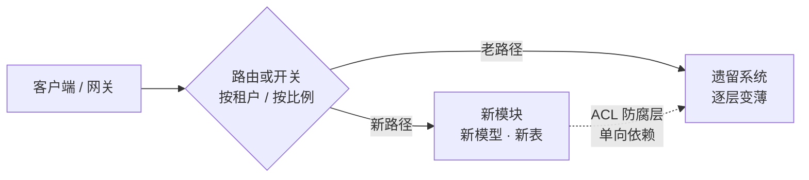

# 技术债怎么量化、怎么还？遗留系统从哪里下刀？

> 技术债不是"代码丑"，是**未来的变更成本被提前透支**：现在省下的一天，会在后面每个迭代里带着复利收回来。这篇讲三件事——怎么把它算成钱、怎么排优先级、怎么在不停业务的前提下换掉遗留系统。

## 技术债到底指什么？先纠正一个流传很广的误解

1992 年 Ward Cunningham 用金融债务打过比方：为了让产品早点交付，先借一笔"设计上的债"，后面靠持续还本来付利息。**这个比喻的前提是"借了要还、而且要算利息"**，它从来不是"可以先写烂代码"的许可证。后来这句话被简化成"有技术债很正常"，于是最常见的自我安慰出现了：反正都有债，先堆着。真正有意义的分野不是"有没有债"，而是下面这张二维表（业界常引用 Fowler 的债务象限）：

|          | 有意为之                             | 无意造成                           |
| -------- | ------------------------------------ | ---------------------------------- |
| **审慎** | 赶版本先上硬编码，已登记、有偿还计划 | 设计时没看到并发场景，事后暴露     |
| **草率** | 明知会炸还先糊上，不留记录           | 不懂分层，随手在 Controller 拼 SQL |

左上角（审慎 + 有意）是唯一能理直气壮存在的债：它是**决策**，代价已知、偿还时间已知。右下角（草率 + 无意）不是债，是事故的原料。两者凭肉眼分不出来——区别只在有没有台账，所以本篇的立场是：**有意负债不可怕，没有台账才可怕**。

## 债务分六类，症状和诱因各不相同

把"技术债"当一个笼统词，讨论就会停在"代码质量要提高"。分类的目的是：**每一类的偿还手法完全不同**，混着谈必然用错药。

| 类型         | 症状                                              | 后果                                 | 典型诱因                     |
| ------------ | ------------------------------------------------- | ------------------------------------ | ---------------------------- |
| 代码债       | 方法 300 行、`if` 嵌套六层、三份复制粘贴的逻辑    | 改一处漏两处，回归靠人肉             | 赶工期、缺少评审             |
| 设计债       | 模块间循环依赖、Service 直接注入别的模块的 Mapper | 想换实现时牵一发动全身               | 没有边界约定、需求硬塞       |
| 测试债       | 只有冒烟没有回归、断言只写 `assertNotNull`        | 不敢改，改了也不知道坏没坏           | 进度压测、把测试当交付物凑数 |
| 数据债       | 一个含义三个字段、状态码五种写法、脏数据无约束    | 统计口径打架，迁移时分不清哪份是对的 | 多轮需求叠加、没有数据字典   |
| 环境与交付债 | 发布靠手工、配置在机器上改、回滚没演练过          | 上线窗口长，故障恢复全靠人           | 早期没流水线，后来没人补     |
| 文档债       | 设计文档停在第一版、没人知道某个开关为什么在      | 新人上手慢，同一个坑反复踩           | 文档与代码脱钩               |

设计债与代码债的分界，本质是**边界有没有被守住**：分层写烂的项目不是没分层，是每层都在干别人的事（判据见[分层架构怎么划分边界](/system-design/basis/design-layered-architecture.html)）。设计债又常表现为"违反某条原则"——一个 `OrderService` 同时管库存、支付、短信，改支付就得把下单全回归一遍（手法见 [SOLID 原则怎么落到代码里](/system-design/basis/design-solid-principles.html)）。登记时把"违反了哪条边界"写进症状，后面才好定切口。

## 怎么量化：翻译成业务能听懂的话

拿"圈复杂度 28""覆盖率 41%"去要预算，业务方只会反问一句：所以呢？**量化的终点不是指标，是钱、时间和风险。**

| 技术指标       | 怎么取数                              | 翻译成业务语言                                   |
| -------------- | ------------------------------------- | ------------------------------------------------ |
| 变更失败率     | 回滚/热修/事故次数 ÷ 发布次数         | 每 10 次改动有 2 次上不去，客户现场多等半天      |
| 需求交付周期   | 进入开发到上线的自然日                | 客户提需求到能用要 3 周，投标时这数字就是承诺    |
| 缺陷密度       | 每需求（或每千行）交付后 3 个月的缺陷 | 质保期内的补丁量，直接吃掉售后人力               |
| 平均恢复时长   | 从告警到业务恢复                      | 每次事故停 40 分钟，乘上单分钟成交额就是损失     |
| 新人上手时间   | 首个独立合并的 PR 所需时间            | 每来一个人多付 3 周工资，期间还得拉一个人结对    |
| 构建与发布耗时 | 流水线各阶段 P50 / P90                | 每人每天等 15 分钟，发布窗口只能排到深夜         |
| 回滚能力       | 决定回滚到流量恢复的分钟数            | 事故时长的下限；滚不动只能前滚，等于没有止血手段 |

最后一行要单独强调：**回滚能力本身就是技术债指标**，它决定重构能有多大胆。只能手工回滚、迁移脚本与应用同批上线的系统，任何结构改动都是高风险动作；反过来，能把镜像切回上一个 digest、十分钟止血的环境才允许小步试错（流水线怎么设计见 [CI/CD 流水线怎么设计](/engineering/engineering-cicd-pipeline.html)）。为什么不拿圈复杂度单独说事？① 它是代理指标：复杂度高但半年不动一次的报表模块边际成本接近零，复杂度中等但每周改三次的价格计算才是持续失血点，要看"改动频率 × 复杂度"的热点图而不是全局排行榜；② 10 这个阈值来自上世纪七十年代的度量研究，只说明"这段代码难测"，不说明"这里一定有缺陷"，认知复杂度这类修正指标的出现正是因为原指标对嵌套不敏感、对 `switch` 分支重复计数；③ 它没法折算成人天，而业务批预算看的是"能省多少"。算笔账就能拿去开会——某订单模块一个月有 8 个需求落在它身上：同类模块平均 2.5 人天/需求，它平均 5 人天，每月多花 **20 人天**；变更失败率 25%（团队均值 8%），每月约 2 次失败、每次止血加修复 1.5 人天，又是 **3 人天**。合计每月约 **23 人天**，接近一个人的全部产能；分期偿还估 9 人天（3 次 × 3 天），**半个月回本**。这个算法粗糙但够用：它把"我觉得代码很烂"变成"每月有一个人白干"，后者能被批准，也能被验收。

## 台账：让债有地址、有主、有价格

债务清单最常见的死法，是做成一张 Excel 放共享盘里，三个月后没人打开。它之所以死，是因为**清单和日常动作没有连接**：排期时不看它，评审时不更新它。所以台账的第一设计目标是"能被顺手更新"，第二才是"完整"。

| 字段       | 写法示例                                  | 为什么必须有                        |
| ---------- | ----------------------------------------- | ----------------------------------- |
| 位置       | `order-service/PriceCalculator#calc`      | 定位到类/方法，不写"价格模块有点乱" |
| 影响面     | 12 个接口、3 个客户、日均 1.2 万单        | 决定优先级，也决定能不能拖          |
| 年化成本   | 约 276 人天/年                            | 排序的分母，来自上一节的换算        |
| 修复成本   | 分 3 期，共 9 人天                        | 排序的分子                          |
| 风险与依赖 | 触及资金链路需影子流量；先补 3 条特征测试 | 决定"怎么做"，不是"要不要做"        |
| Owner      | 张三，下个迭代复查                        | 没有人的债等于不存在的债            |

排序公式可以足够简单：**优先级 = 年化成本 ÷ 修复成本**（年化成本本身就是"影响 × 频率"折成人天的结果），即"每投入 1 人天能省回多少人天"。价格计算 276÷9≈30.7、库存同步 60÷6=10、报表导出 90÷40≈2.25，排期结论自然出来：立刻做、排下个迭代、先做只读旁路观察一季。第三步才是关键：**把债挂到具体模块和需求上**。做法很土但有效——每次需求评审顺手看一眼要改的模块有没有未结清的债；有就把工期里 10% 留给它，或者明确写下"这次不还，理由是……"。台账因此不再是"一张表"，而是需求评审的一个输入项。

## 偿还节奏：三种模式，各有各的适用面

| 模式       | 怎么落地                                                       | 适用场景                         | 失效方式                             |
| ---------- | -------------------------------------------------------------- | -------------------------------- | ------------------------------------ |
| 童子军规则 | 每次 PR 顺手清一小块（改名、抽方法、补条测试），单次不超半小时 | 高频改动的小文件、日常迭代       | 只改格式不改结构，没人验收就流于形式 |
| 固定配额   | 每迭代留 10%~20% 容量（两周约 1~2 人天），写进迭代计划         | 存量分散、团队 ≥3 人、需持续投入 | 配额被需求挤掉，且不解释去向         |
| 专项治理   | 立项：目标指标 + 验收标准 + 分期上线 + 回滚预案                | 影响多条链路、有明确可量化痛点   | 变成大爆炸，切片不够小就上不了线     |

怎么选：**有能被指标证实的痛点**（每月 X 人天、失败率是均值 3 倍）就走专项治理，只有专项才配得上跨期资源；**没有专项但模块每周都在改**就走童子军规则，成本最低、收益随改动频率累积；**两者都不成立、债散在几十个文件里**就走固定配额，用制度保证"总有人在还"，同时接受它见效慢。配额制有一个必须补的动作：**没用完要说明去向**——没有这句话，配额会在第三次冲刺时悄无声息地消失，然后所有人都学会"配额是写在纸上给人看的"。

## 遗留系统从哪里下刀：绞杀者模式

改造遗留系统最贵的不是写新代码，是**切换的那一刻**。绞杀者模式（Strangler Fig）的全部设计都围绕"永远不要把切换做成一次大动作"：新逻辑走新路径，旧路径一格一格停止服务，旧系统被缠住、变薄，最后只剩一个壳，删掉。



它能成立的前提，比模式本身更重要（最容易忽略的是最后一条）：

| 前提           | 不满足时的样子                                               |
| -------------- | ------------------------------------------------------------ |
| 有统一入口     | 客户端直连老服务，没有地方挂路由，切不动                     |
| 有可观测性     | 切过去不知道新路径成功率，只能等客户打电话                   |
| 有可回滚的开关 | 出事只能重新发版，切换成本逆天                               |
| 数据边界可切分 | 新老共用一张表且互相写，切一半就数据错乱                     |
| 旧系统能变薄   | 每切走一块还得回来改老代码，等于把一套系统变成两套，债务翻倍 |

## 新模型别直接碰旧模型：防腐层（ACL）

遗留系统最脏的往往不是代码，是**数据模型和它的历史语义**：状态码五种写法、一个含义三个字段、`NULL` 有时表示"未激活"有时表示"没填"。新模块若直接读旧表、调旧接口，这些语义会渗进新设计，新模型三个月后就和旧的一样难改。防腐层的职责只有一件：**在边界上做翻译，并且只做翻译**。

```java
// 唯一认识旧模型的地方
public class LegacyCustomerTranslator {
    public Customer toDomain(LegacyCustDO row) {
        if (row == null || row.getCustStat() == null) return Customer.inactive(null); // NULL=未激活
        return switch (row.getCustStat()) {            // 一个字段两种含义：1/A、9
            case "1", "A" -> Customer.active(row.getCustId());
            case "9" -> Customer.frozen(row.getCustId(), row.getFreezeReason());
            default -> throw new IllegalStateException("未知状态: " + row.getCustStat());
        };
    }
}
```

三条纪律，缺一条防腐层就失效：**单向依赖**（新模型可依赖 ACL，ACL 依赖旧模型，反过来禁止，旧代码一旦 import 新模型边界就没了）；**ACL 里不写业务规则**（"未激活客户不能下单"该写在新领域实体里，否则 ACL 会长成第二个 God 层）；**未知值要炸不要猜**（没见过状态码就抛异常并告警，比默认成"正常"安全，配合边界测试更稳，见[单元测试怎么写才不是自嗨](/engineering/engineering-unit-test-junit5.html)）。

## 同一进程内换实现：分支抽象（Branch by Abstraction）

不是所有改造都能拆成独立服务。很多逻辑就在单体里、被十几个地方调用，这时用分支抽象：**先抽接口，再换实现，最后删旧实现**，三步都能独立上线。

```java
public interface PriceCalculator { BigDecimal price(Order o); }    // ① 抽接口
@Component @Primary
class LegacyPriceCalculator implements PriceCalculator {           // ② 旧实现：纯转发
    private final com.legacy.PriceEngine engine;
    public BigDecimal price(Order o) { return engine.compute(o); }
}
// ③ 新实现挂同一接口 + 开关选路（先内部账号），全量后删 Legacy 实现与 PriceEngine
```

关键在于**第一步的克制**：抽出来的接口按现有调用方的需要定义，别顺手设计一个"更合理"的模型。一旦抽接口时改了语义，这次改动就从"重构"变成了"改需求"，回滚也不可能了。它和绞杀者的区别：

| 维度     | 绞杀者                  | 分支抽象                 |
| -------- | ----------------------- | ------------------------ |
| 切换粒度 | 进程/服务边界，按流量切 | 进程内，按接口实现切     |
| 适合     | 整体替换一个子系统      | 替换单体里的一块核心逻辑 |

## 并行运行与影子流量：让新旧代码互相校对

切换前最有力的证据不是"测试全绿"，而是"新老算出来的结果一样"：同一份输入新旧都算，只把旧结果返回用户，新结果拿去比对。这件事能做对，全靠四条：**只读优先**（先在查询路径上跑，写路径要有幂等和"只算不落库"的开关）、**结果归一化**（时间戳、UUID、浮点精度、集合顺序、`null` vs 空串全部归一后再比）、**差异可归因**（每条差异带输入快照与调用方标识，能定位到哪类订单不一致）、**有判定阈值**（一致率 ≥ 99.9% 才允许切读，剩余差异必须逐类解释）。最常见的翻车点是归一化没做：把 `createTime` 的毫秒差、`HashMap` 的遍历顺序、`BigDecimal` 的标度差异全算成"不一致"，一致率 60%，告警天天响，两周后整套比对被关掉——你以为有了验证手段，实际只多了一个没人看的日志。

## 一个具体切片顺序：把「优惠券」从单体里摘出来

抽象讲完，落到一次真实改造的顺序上。核心原则两条：**先读后写、先旁路后主路**。

| 步  | 做什么                                               | 线上影响         | 出问题怎么退         |
| --- | ---------------------------------------------------- | ---------------- | -------------------- |
| 1   | 读旁路：老逻辑照跑，新模块只被内部调用算一遍并记日志 | 零               | 关开关               |
| 2   | 切查询接口：券列表、可用券校验走新模块，写仍走老系统 | 读结果可能不一致 | 开关切回老查询       |
| 3   | 影子写：新模块算写计划，只落影子表不提交             | 零               | 丢弃影子表           |
| 4   | 双写：写老库同时写新库，逐条比对差异                 | 数据双份         | 停双写，清理新库数据 |
| 5   | 校验读：读新库并抽样与老库比对，只告警不切读         | 只多告警         | 停比对               |
| 6   | 切写主路：老库改为异步同步，回滚仍能切回老写         | 真实写           | 开关切回老写         |
| 7   | 切读主路：读全部走新模块                             | 真实读           | 开关切回老读         |
| 8   | 收尾：停双写、删影子表、删老代码、删开关             | 不可回滚         | 只能前滚             |

为什么读一定要先于写？**读错了可以切回去，写错了要修数据**。为什么第 8 步单独一次发布？删代码不可逆，必须等新路径稳定运行一个发布周期——回滚窗口关掉之前别动旧代码。这条和数据库"扩展—收缩"同一个道理，迁移节奏也按同一套来（见 [CI/CD 流水线怎么设计](/engineering/engineering-cicd-pipeline.html)）。

## 特性开关：把"上线"和"切换"分开

没有开关的重构，等于把一次结构改动变成一次全量发布：上线即生效，出事只能回滚代码。有了开关，上线只是"代码在线上但不生效"，切换是另一个动作，中间隔着可观测的时间窗。

| 开关类型 | 生命周期         | 谁来管      | 什么时候删             |
| -------- | ---------------- | ----------- | ---------------------- |
| 发布开关 | 天到周           | 开发        | 全量后一周内           |
| 灰度开关 | 周到月           | 开发 + 运营 | 定好全量日期，到期复查 |
| 迁移开关 | 到旧路径下线为止 | 迁移负责人  | 与"删旧代码"同一个 PR  |

开关的成本不在实现，在**不收**。半年不清理的系统里躺着两百个开关，出事时没人说得清该关哪一个，最后只能整体回滚。所以每个开关必须带三样东西：默认值、owner、死期；过期开关和对应死代码一起登记进台账——这正是前面"债要有地址"的用途（推动别组一起清的口径见[跨团队怎么对齐、怎么推动](/engineering/engineering-cross-team-collaboration.html)）。

## 安全重构的纪律：四步，每一步都能停

| 步骤       | 具体做法                                                  | 验收标准                            |
| ---------- | --------------------------------------------------------- | ----------------------------------- |
| 特征测试   | 用现有输入锁住现有输出，包括已知 bug；用黄金文件快照比对  | 故意改一行逻辑，测试必须变红        |
| 小步提交   | 一次提交一件事，重构与需求分开 PR，单 PR 能独立上线/回滚  | 单个 PR 出问题只退这一个            |
| 灰度观测   | 错误率、P99、比对一致率、业务指标（下单成功率）四项同时看 | 有基线对比才叫验证，不是"没报错"    |
| 清理旧代码 | 旧实现、旧开关、旧配置、双写脚本、影子表同批删除          | `grep` 不到引用，`@Deprecated` 清零 |

其中特征测试无法跳过，也最容易被跳过：它**不断言"应该是什么"，只断言"现在是什么"**。

```java
@Test
void legacyPricing_keepsCurrentRoundingBehavior() {
    // 锁的是现状，不是"正确值"：连已知的取整偏差也照原样断言
    assertThat(legacyPriceEngine.compute(vipOrderWithFreightCoupon()))
        .isEqualByComparingTo("87.60");
}
```

对它有个常见误解：以为特征测试会把 bug 固化下来。确实会，而且在重构阶段这是**刻意的**——重构的契约是不改行为；先把现状锁住，行为修正作为独立需求、独立 PR 去做。两件事混在一起，出问题时你无法判断是重构引入了回归，还是本来就要改。

## 千万别做的四件事

| 反模式                   | 为什么错                                                   | 换成什么                      |
| ------------------------ | ---------------------------------------------------------- | ----------------------------- |
| 大爆炸重写               | 新系统要塞满"上次没做的特性"（第二系统效应），两年后回不去 | 绞杀者 + 分支抽象，逐步切流量 |
| 没有测试就重构           | 你以为在重构，其实在改需求，而且没人知道改了什么           | 先补特征测试，再动结构        |
| 重构和需求塞进同一个 PR  | 回滚时不知道该退哪一半，评审也看不出行为变更               | 结构与行为分两个 PR，先后有序 |
| 为"架构好看"引入新中间件 | 用新组件解决老问题，同时引入新运维成本与新故障模式         | 先解决边界，再看是否真需要    |

第二条和第四条经常一起出现：有人拿"引入消息队列解耦"当重构方案，结果旧逻辑原封不动，只是多了一层异步，故障模式从"同步超时"变成"消息堆积 + 重复消费"，债务不减反增。

## 怎么跟业务开口：把"我要重构"换成一张账

"我要重构"在业务方听来等于"我要请三个月假，产出不可见"。同一件事换成可验证的数字，性质就变了。可直接套用的话术：

> 这个模块每改一次，平均比其他模块多花 3 天。上个月 8 个需求落在它上面，多花 20 多人天；同期它的上线失败率 25%，其他模块 8%，两次失败各花 1.5 天止血。合起来每月约 23 人天，相当于一个人的全部产能。
>
> 我建议分三次偿还，每次 3 天，切一小块、上一小块，每次都能单独回滚，不停业务。第一期做完价格计算这块，预计下个季度该模块的改动能回到 2.5 天。可以把它当成一次投资：9 人天，半个月回本。

这段话的结构可以复用：**现状数字 → 折成人天 → 分期方案（含不影响业务）→ 可验收的回收预期**。四要素缺一个就会被挡回来：缺现状数字是"感觉"，缺分期是"黑洞"，缺"不停业务"是"风险"，缺回收预期是"看不到回报"。出过事故再提重构说服力最强，但那时通常已在救火——所以平时就把数字记下来（事故怎么复盘成改进项，见[线上缺陷怎么复盘](/engineering/engineering-defect-rca.html)）。

## 面试怎么讲这段经历

这类问题考的不是"知不知道绞杀者"，而是"有没有真的在不停业务的前提下换掉一个核心模块"。按四段讲，每段给证据：

1. **切口怎么选**：不选最烂的模块，选"改动最频繁 + 影响面可控"的那块；依据是近半年提交次数、需求数、失败率与团队均值的对比。
2. **怎么保证不回归**：先补特征测试锁住现状（含已知 bug），再做结构改动；结构与行为分 PR；影子流量一致率达标才切。
3. **怎么灰度**：开关 + 按租户/比例切流，先读后写；观测错误率、P99、一致率、业务成功率四项，出问题一分钟内拨回开关。
4. **怎么把旧代码删掉**：旧实现、开关、双写脚本、影子表一起清，`grep` 不到引用，接口保留但实现只剩一份——删不掉说明切换没真正完成。

追问通常落在"回滚窗口多长""双写期间数据不一致怎么办""开关后来怎么清理"，答案分别落到：删旧代码必须晚于稳定运行一个发布周期；先读后写 + 差异归因 + 以老库为准；每个开关有 owner 和死期，登记进台账。

## 容易踩的坑

- **把重构当需求做**：一个 PR 里既改结构又改行为，回滚时不知道退哪一半，评审也看不出行为变更。
- **没有特征测试就动老代码**：以为在重构，实际在悄悄改需求，且没有基线证明"行为没变"。
- **只盯圈复杂度和覆盖率**：把稳定的低风险模块重构三遍，真正每周改三次的钱链路一动不动。
- **专项治理没有验收标准**："重构完成了"无法验证，下次再要预算就没人信。

## 小结

- 技术债是"未来变更成本被提前透支"，判断标准不是代码丑不丑，而是有没有台账：有地址、有 owner、有价格、有死期。
- 量化要落到人天、周期、失败率、恢复时长这些业务能验收的口径；圈复杂度只能当附录，它的成本取决于改动频率而非数字本身。
- 排序用"年化成本 ÷ 修复成本"，并把债挂到具体模块与需求评审上；三种偿还节奏按"痛点能否被指标证实""是否高频改动"来选。
- 改造遗留系统靠绞杀者（切流量）、防腐层（隔离旧模型）、分支抽象（进程内换实现）、影子流量（新老互校）、特性开关（上线与切换分离），顺序永远是先读后写、先旁路后主路。
- 安全重构的纪律：先特征测试锁现状，小步可回滚，灰度看四项指标，最后把旧代码彻底删掉——删不掉就等于没改完。

## 参考

综合自 Ward Cunningham 关于技术债的原始比喻、Martin Fowler 的绞杀者与分支抽象模式及技术债象限、Michael Feathers 的"遗留代码即没有测试的代码"与特征测试、Fred Brooks 的第二系统效应、以及 DORA 交付指标口径；核对并纠偏了三处：DORA 的恢复时长已细化为"失败部署的恢复时间"而非所有事故平均恢复时长，圈复杂度的 10 只是经验阈值且与缺陷非线性相关，绞杀者与分支抽象不依赖微服务、单体内部同样适用。文中配额（10%~20%）、分期（3 期）、一致率门槛（99.9%）均为可按团队规模调整的默认值。
