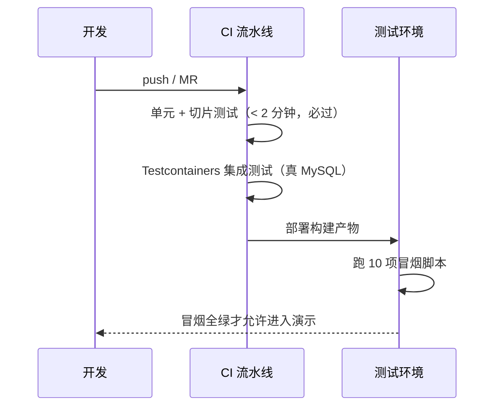

# Java 项目的测试怎么写才不白写？

> 交付项目里测试的真实价值不是"证明代码是对的"，而是"允许你在客户演示前一天还敢改代码"。所以要把它押在改一次就疼的地方——service 与 SQL、事务、序列化的接缝上，而不是押在覆盖率数字上。

## 为什么这个项目里必须写测试？

甲方定制项目的典型形态：需求验收前还在变，代码两三个人写，交付后由客户 IT 接手，半年后没人记得当初为什么这么写。测试在这种项目里买到的是三样东西：

| 收益             | 具体表现                                                 | 没有它时的代价               |
| ---------------- | -------------------------------------------------------- | ---------------------------- |
| 改动时的安全感   | 改一处，跑 90 秒就知道有没有踩到别的分支                 | 改一行 `if`，人工回归一整天  |
| 需求的另一种描述 | "已支付订单不能取消"写成一条会红的用例，比写进 Word 管用 | 口径活在口头，验收时各说各话 |
| 排障的定位仪     | 出问题先跑对应用例，把范围缩到某个接缝                   | 只能翻日志猜，一猜两小时     |

"改一行代码要人工回归一天"不是夸张：一个 12 个接口的订单模块，改状态判断要手点下单、支付、取消、退款、超时关单、重复支付、越权查看，一轮 40 分钟到半天；三个月改 20 次就是十几个纯人工工作日，而且人一累就漏，漏那次往往在客户面前。反过来也要说清：**覆盖率 80% 但里面全是 getter 测试，是自欺**。一份 82% 的报告里，getter/setter、DTO 拷贝、Controller 转发就能占六成，而金额分摊、状态迁移、并发扣减、SQL 条件分支一行没测。覆盖率唯一的正确用法是**指出哪些分支从来没被执行过**，适合看"这次改动新增的行跑到了没有"，不适合挂考核。

## 分层测试的成本差在哪，钱该花在哪一层？


| 层级     | 典型形态                                      | 能抓住什么                           | 抓不住什么                    | 维护成本           | 一次多久                      |
| -------- | --------------------------------------------- | ------------------------------------ | ----------------------------- | ------------------ | ----------------------------- |
| 单元测试 | JUnit 5 + Mockito，不起容器                   | 纯计算、分支、边界、异常类型         | SQL、事务、序列化、鉴权、并发 | 低，但要跟着实现改 | 单类 < 10ms                   |
| 切片测试 | `@WebMvcTest`、`@DataJpaTest`、`@MybatisTest` | 参数校验、JSON 契约、映射与方言      | 跨层编排、事务边界、多表规则  | 中                 | 2–8s / 类                     |
| 集成测试 | `@SpringBootTest` + Testcontainers            | 业务规则 + SQL + 事务 + 序列化的接缝 | 页面行为、真实第三方、性能    | 中高               | 首次 15–25s，之后 1–3s / 用例 |
| 端到端   | 真部署 + HTTP + MQ + 下游桩                   | 链路通不通、配置对不对、字段对不对   | 出错定位（红了不知哪层坏）    | 高，最脆           | 分钟级                        |

结论说白：**交付项目里最值钱的是接口级集成测试**，因为 bug 几乎都长在 service 和 SQL 的接缝上：

- `UPDATE product SET stock = stock - #{qty} WHERE id = #{id} AND stock >= #{qty}`，`>=` 写成 `>`，卖最后一件报"库存不足"。service 单测 mock 掉 Repository，永远绿灯。
- 多租户条件放在 Mapper XML 的 `<if test="tenantId != null">` 里，新接口忘了传，跨租户读到别人的数据。只有带真 SQL 打进去才看得见。
- 金额在 Java 用 `BigDecimal` 算对了，落库列是 `decimal(10,2)`，报表再走一遍 `SUM()` 的 `double` 转换，差一分钱——截断发生在数据库，不在代码。

所以测试金字塔在交付项目里不是标准三角形，而是"底座很薄的菱形"：少而准的单元测试 + 大量接口级集成测试 + 极少量端到端。别倒过来崇拜端到端，它慢、脆、定位差，一个环境问题能让二十条用例一起红，正确位置是**上线前那 10 个冒烟接口**。

## 什么代码值得单独写单元测试？

值得单测的共同特征：输入输出确定、分支多、算错了业务就错，而且**不会因为重构实现而改变**。

| 值得写                                               | 不值得写                                  |
| ---------------------------------------------------- | ----------------------------------------- |
| 金额分摊、税费、汇率、折扣叠加（含舍入规则）         | 纯 getter/setter、`@Data` 生成的 `equals` |
| 状态机迁移表（谁能到谁、非法迁移抛什么）             | 一层透传的 Controller 或 Facade           |
| 时间换算：时区、账期、工作日、超时判定               | 直接转发给 Repository 的 service 方法     |
| 解析器：报文、CSV、表达式、规则 DSL、身份证/金额校验 | Spring 配置类、`@Value` 注入              |
| 分页与排序边界（第 0 页、超过总页数、空集合）        | Mapper 接口本身（交给集成测试）           |

```java
// 静态导入 Assertions.* 与 CsvSource
class AmountAllocatorTest {
    private final AmountAllocator allocator = new AmountAllocator();

    @ParameterizedTest(name = "{0} 分 {1} 份，首份应为 {2}")
    @CsvSource({"100.00,3,33.34", "0.01,3,0.01", "0.00,3,0.00"}) // 尾差、分币、零金额
    void 均摊金额时尾差必须归入第一份(BigDecimal total, int parts, String first) {
        List<BigDecimal> shares = allocator.allocate(total, parts);
        assertEquals(new BigDecimal(first), shares.get(0));
        assertEquals(total, shares.stream().reduce(BigDecimal.ZERO, BigDecimal::add));
        assertEquals(parts, shares.size());
    }

    @Test
    void 份数为零时直接拒绝而不是返回空集合() {
        assertThrows(IllegalArgumentException.class, () -> allocator.allocate(BigDecimal.TEN, 0));
    }
}
```

这段能抓住：尾差丢失、`double` 污染精度、除零、负数份数、单份退化。抓不住：谁调用它、并发下是否被共享实例污染、落库时 `decimal(10,2)` 有没有截断——后者必须交给集成测试。

## Mock 到底该画在哪条线上？

一条可操作的划线规则：**mock 你不拥有、且慢或不稳定的东西；不要 mock 你要验证的行为本身。**

| 可以 mock                             | 不要 mock                  | 原因                                    |
| ------------------------------------- | -------------------------- | --------------------------------------- |
| 第三方 HTTP（短信、支付、物流、地图） | 自己的 Repository / Mapper | SQL 条件、方言、约束就是最容易错的地方  |
| 消息队列发送、对象存储上传            | 事务管理器、`JdbcTemplate` | 事务边界与可见性只能真跑                |
| 时钟、随机数、ID 生成器               | JSON 序列化、参数校验      | 时区与字段口径的 bug 只在真序列化时暴露 |

Mockito 的三个现实陷阱：

1. **把实现细节写进测试**：`verify(repository).findById(1L)`，实现换成 `findByIdAndTenantId` 就红，行为却一点没坏。断言该停在"结果对不对、有没有副作用"。
2. **`when(...)` 管不了的三种情况**：`void` 要用 `doThrow(...).when(mq).send(any())`；`static` / `final` 从 Mockito 5 起由默认 inline mock maker 支持（5 之前要加 `mockito-inline`）；参数匹配走 `equals()`，没重写 `equals` 的 DTO 传"看起来一样"的实例匹配不上，要么 `argThat`，要么 `ArgumentCaptor` 事后取值。
3. **`@MockBean` 会拖慢并污染测试**：TestContext 按配置缓存容器，每个不同的 `@MockBean` 组合都算一份新配置、新建一个 `ApplicationContext`，随手多写两个，整套测试从 20 秒变 90 秒。（`@MockBean`/`@SpyBean` 在 Boot 3.4 已废弃，改用 `@MockitoBean`/`@MockitoSpyBean`。）

最能说明问题的是这个反例——测试全绿，线上炸：

```java
@ExtendWith(MockitoExtension.class)
class OrderServiceTest {
    @Mock OrderRepository repository;
    @InjectMocks OrderService service;

    @Test
    void 同一订单号重复提交时返回已有订单() {
        when(repository.findByOrderNo("A001")).thenReturn(Optional.of(existing)); // "库里已有这单"是假设
        when(repository.save(any())).thenAnswer(inv -> inv.getArgument(0));
        assertEquals("A001", service.submit(command("A001", 2)).orderNo());
    }
}
```

| 这段测试能抓住                 | 抓不住                                                                        |
| ------------------------------ | ----------------------------------------------------------------------------- |
| 分支选择：走"已存在"还是"新建" | `uk_order_no` 真冲突时抛的 `DuplicateKeyException`（mock 的 `save` 永远成功） |
| 返回值组装、订单号透传         | 两个请求并发时都查不到、都去 insert，线上直接 500                             |
| 幂等分支有没有误调插入         | 事务回滚后订单表有没有残留半条数据                                            |

修法不是把 mock 写得更多，而是把这条规则**挪到接口级集成测试**：两路并发打真库，断言"同单号、库里只有一行、第二次返回同一订单"。

## Spring Boot 测试怎么配才接近线上？

先选 `webEnvironment`：`MOCK`（默认，配 `MockMvc`，最快，绝大多数接口测试够用）、`RANDOM_PORT`（真 Servlet 容器，需要 `WebTestClient`、过滤器链或真实错误处理时用）、`NONE`（只起 Spring 容器，测 service 和定时任务）。然后是 `@Transactional` 回滚这个"看起来很香"的坑：测试方法挂 `@Transactional`，用例结束自动回滚、数据很干净，但它同时改变了被测代码看到的世界。

| 副作用             | 表现                                                                |
| ------------------ | ------------------------------------------------------------------- |
| 事务从不提交       | `@TransactionalEventListener(AFTER_COMMIT)` 不触发，消息发不出去    |
| 自增 ID 不回滚     | 断言 `id == 1` 的用例第二次跑就红，而且和顺序相关                   |
| 可见性与锁行为变了 | `REQUIRES_NEW` 那部分真提交、不回滚；乐观锁与唯一索引延迟报错都变味 |

建议：**接口级集成测试不要给测试方法加 `@Transactional`**，每个用例自己造数据、自己收尾，或让 Testcontainers 每个类拿一个干净库；准备数据用 `@Sql` 比在 Java 里 `new` 一堆实体更好读。

```java
@SpringBootTest
@AutoConfigureMockMvc
@Sql("/sql/clean-business-tables.sql") // 用例前清表，不靠 @Transactional 兜
class OrderApiTest {

    @Autowired MockMvc mockMvc;
    @Autowired JdbcTemplate jdbc;

    @Test
    void 下单成功时返回订单号并扣减库存() throws Exception {
        jdbc.update("INSERT INTO product(id, name, price, stock) VALUES (9001, '螺丝刀', 12.50, 10)");
        String body = """
            {"productId": 9001, "quantity": 3, "buyerId": "U100"}""";

        mockMvc.perform(post("/api/orders").contentType(MediaType.APPLICATION_JSON)
                .header("X-Tenant-Id", "T01").content(body))
            .andExpect(status().isCreated())
            .andExpect(jsonPath("$.code").value("0")).andExpect(jsonPath("$.data.amount").value(37.5))
            .andExpect(jsonPath("$.data.status").value("CREATED"));

        assertEquals(new BigDecimal("37.50"), jdbc.queryForMap(
            "SELECT amount FROM orders WHERE buyer_id = 'U100'").get("amount"));
        assertEquals(7, jdbc.queryForObject("SELECT stock FROM product WHERE id = 9001", Integer.class));
    }
}
```

这段能抓住：路由与参数绑定、JSON 字段名与类型、业务错误码、`BigDecimal` 精度、事务是否真提交（库里有行才说明提交了）、扣减 SQL 条件写对没有。抓不住：前端怎么展示错误、现场网关超时、性能。库存不足这类分支同理——断言的不只是 HTTP 状态，而是"表里没多行、库存没被改"。

## 为什么 H2 上跑过的 SQL 上线会挂？

H2 的 MySQL 模式只是"嘴上兼容"。用 H2 顶掉真库，等于在一台行为不同的数据库上验收 SQL：

| 差异面        | H2 上的表现                                                              | MySQL 上的行为                                     |
| ------------- | ------------------------------------------------------------------------ | -------------------------------------------------- |
| 方言函数      | `ON DUPLICATE KEY UPDATE`、`DATE_FORMAT`、`FIND_IN_SET` 不支持或语义不同 | 项目里到处都是                                     |
| JSON 与生成列 | `JSON_EXTRACT`、`->>`、函数索引支持有限                                  | JSON 列 + 虚拟列索引是常用优化                     |
| 锁与隔离级别  | 默认 READ_COMMITTED，行锁实现简化                                        | 默认 REPEATABLE READ，范围锁、间隙锁、死锁时机不同 |
| 标识符大小写  | 未加引号的标识符被转大写                                                 | Linux 下表名大小写敏感                             |

```java
@SpringBootTest
@Testcontainers
class OrderRepositoryIT {
    @Container
    static final MySQLContainer<?> MYSQL = new MySQLContainer<>("mysql:8.0.36")
        .withDatabaseName("app").withUsername("app").withPassword("app")
        .withReuse(true); // 本机复用容器，启动从 ~20s 降到接近 0

    @DynamicPropertySource
    static void datasource(DynamicPropertyRegistry r) {
        r.add("spring.datasource.url", MYSQL::getJdbcUrl);
        r.add("spring.datasource.username", MYSQL::getUsername);
        r.add("spring.datasource.password", MYSQL::getPassword);
    }
}
```

三个实务要点：一是**复用要开全局开关**，`withReuse(true)` 需要 `~/.testcontainers.properties` 里 `testcontainers.reuse.enable=true`，否则白写，Boot 3.1 之后也可以用 `@ServiceConnection` 配容器 Bean 省掉手工绑属性；二是**成本要算清**，MySQL 8 首次拉镜像加初始化 15 到 25 秒，之后每个用例 1 到 3 秒，整套压在 3 分钟内才有人愿意提交前跑；三是**CI 必须有 Docker**，GitHub Actions 自带，老 Jenkins 或内网构建机未必有，没有就装，或把集成测试拆成 `-Pit` 独立流水线，别让它卡死主线，但也别因为"CI 跑不了"就删掉它。

## 测试数据怎么管才不自相矛盾？

固定夹具 SQL 适合只读查询、报表和字典表，拿它测写操作必撞唯一键，用例之间还会互相看见对方数据；写操作、状态迁移、并发用例要每个用例自造数据，靠工厂方法收口；把生产数据拷进测试库是三重风险——隐私、体量、不可复现，而且生产里缺的边界它也没有。

- **唯一约束**：夹具里别写死 `order_no = 'A001'`，用"前缀 + 用例维度自增"，写死就意味着这个用例只能跑一次。
- **时间**：领域代码不写 `LocalDateTime.now()`，注入 `Clock`；测试用 `Clock.fixed(Instant.parse("2026-03-01T02:00:00Z"), ZoneId.of("Asia/Shanghai"))` 就能断言"东八区 3 月 1 日 10 点"这类跨时区口径。时区 bug 最爱在演示当天 23:50 出现。
- **随机数**：`UUID` / `ThreadLocalRandom` 会让"按 ID 排序""按创建时间倒序"的断言随机红，要么固定种子，要么注入 `Supplier<String>`。
- **flaky**：先定位再修，不许靠重跑遮。根因就三类——时间、并发（`Thread.sleep` 等异步）、共享状态（用例顺序）。CI 里更靠谱的做法是同一套用例连跑 3 次暴露间歇失败，而不是加重试把红刷成绿。

## 业务上必须钉住哪些行为？

| 行为           | 典型事故                                       | 测试怎么打                                                  |
| -------------- | ---------------------------------------------- | ----------------------------------------------------------- |
| 状态机非法迁移 | 已支付订单被取消、已发货订单被改价             | 遍历"当前状态 × 目标状态"矩阵，非法组合断言异常 + 错误码    |
| 幂等重复提交   | 连点两次生成两张订单、回调重放重复入账         | 同请求体连发两次，断言只有一行记录、第二次返回同一结果      |
| 并发扣减       | 超卖、余额扣成负数                             | 多请求并发打同一资源，断言库存不为负、总账守恒              |
| 边界值         | 0 件、负数、超长文本、空集合返回 `null` 前端崩 | 参数化覆盖 0、-1、`varchar` 上限 +1、空 `List`              |
| 异常分支       | 第三方超时后本地回滚了但消息已发               | 用桩模拟超时/500，断言数据与消息的最终状态                  |
| 权限与越权     | 换个 ID 就看别人订单、跨租户查数据             | 换 `ROLE_B` 令牌打同一 URL 断言 403，换他人资源 ID 断言 404 |
| 分页与排序     | 第 0 页报错、超总页数返回 500                  | 边界页码、空结果、多字段排序稳定性                          |
| 金额与精度     | 分摊后总和不等于原额、报表差一分               | 断言"分项之和 == 总额"，并与库中 `decimal` 值比对           |

对甲方项目，前四条优先级最高。它们不是技术洁癖，是验收现场业务人员随手就能点出来的问题。

## 哪些做法让测试变成负债？

| 做法                                  | 为什么是负债                                  |
| ------------------------------------- | --------------------------------------------- |
| 无断言测试（只 `assertDoesNotThrow`） | 覆盖率上去了，行为没锁住，红绿都没信息量      |
| 测试里 `Thread.sleep(2000)`           | 机器慢就红、CI 就抖，还掩盖真正的异步边界问题 |
| 用例之间依赖执行顺序                  | 单跑通过、全跑失败，最后没人敢动这个类        |
| 只测 happy path                       | 真正出事的都是异常分支，而它一条没覆盖        |
| 把生产数据拷进测试库                  | 隐私风险 + 不可复现 + 结果依赖当天数据        |

## 上线前那十分钟该跑什么？

交付项目有个硬动作：**现场演示前先把冒烟跑一遍**。冒烟不是回归，它只回答一个问题——这套环境能不能把主链路走通。

| #   | 冒烟项                         | 断言什么                                       |
| --- | ------------------------------ | ---------------------------------------------- |
| 1   | 登录 / 令牌换取                | 能拿到令牌，过期令牌被拒                       |
| 2   | 健康检查与版本号               | `/actuator/health` 为 UP，版本号是这次要演示的 |
| 3   | 主数据查询（字典、组织、商品） | 非空，条数与预期一致                           |
| 4   | 核心创建接口                   | 200/201 + 业务码 0 + 库里多一行                |
| 5   | 核心查询接口                   | 关键字段值与刚创建的一致                       |
| 6   | 状态流转                       | 一次合法流转成功、一次非法流转被拒             |
| 7   | 越权访问                       | 换身份打同一资源返回 403/404                   |
| 8   | 导出 / 文件下载                | 文件非空，字段顺序与编码正确                   |
| 9   | 定时任务手动触发               | 有执行记录，业务表按预期变化                   |
| 10  | 下游回调 / 对接方连通性        | 桩或测试环境能收到请求，签名校验通过           |

冒烟必须脚本化（curl 集合、Newman、pytest 都行），不接受"我手工点一遍"：手工点不可复现，第二次演示前没人愿意再点。



灰度与回滚也要提前想好，别等出事再现场发挥：灰度期用同一批请求同时打新旧版本、比对响应体差异，这是最省力的兼容性验证；回滚只对"没改表结构"的版本安全，改过字段就必须前向兼容 + 双写/回填，**回滚不是数据结构变更的退路**。回滚后要校验的数据也很具体：发布期间产生的单据是否完整、状态是否合法、有没有半截事务留下的孤儿行。

## 哪些坑最容易让测试白写？

| 坑                                | 会怎么咬你                                                      |
| --------------------------------- | --------------------------------------------------------------- |
| H2 全绿，MySQL 上线挂             | 方言函数、JSON、锁与隔离级别、标识符大小写、排序规则都不是一套  |
| `@Transactional` 掩盖真实事务边界 | 事务从不提交，`AFTER_COMMIT` 事件、MQ 发送、回调全没验证过      |
| mock 掉的东西线上才炸             | Repository、MQ、外部 HTTP 全 mock，只证明"按我设想的分支走"     |
| 时间/时区/随机数导致 flaky        | `now()`、`UUID` 直接进断言，东八区用例跑到 UTC 的 CI 就红       |
| Testcontainers 在 CI 无 Docker    | 本地绿、流水线红，有人"临时注释掉集成测试"，从此再没打开        |
| 测试互相污染                      | 共享静态状态或夹具数据，单跑通过、全跑失败                      |
| 只断言状态码，不断言业务字段      | 200 也可能是 `{"code":"SYSTEM_ERROR"}`，不看金额/状态等于没断言 |

## 小结

1. 测试的收益是"敢改"和"需求的可执行描述"，不是覆盖率数字；覆盖率只用来找没被执行的分支。
2. 交付项目的 bug 集中在 service 与 SQL 的接缝，测试重心要往接口级集成测试倾斜，单元测试只留给纯计算、状态机、时间与解析这类高价值逻辑。
3. Mock 只该画在"你不拥有、且慢或不稳定"的边界上；mock 掉 Repository 就等于放弃 SQL、事务和约束的验证。
4. 用 Testcontainers 起真 MySQL 替掉 H2，`@Transactional` 别滥用，集成测试要真提交、真断言库中状态。
5. 上线前 10 项脚本化冒烟是硬动作，演示前一天跑通它，比任何覆盖率报告都让人踏实。

## 参考

综合自 JUnit 5 用户指南（参数化测试、断言与生命周期）、Mockito 官方文档与 Javadoc（`doThrow`、参数匹配、mock maker）、Spring Boot 测试章节与 Spring Framework TestContext 文档（上下文缓存、`@MockBean` 语义及其向 `@MockitoBean` 的迁移）、Testcontainers for Java 文档与 MySQL 模块说明（容器复用开关、`@DynamicPropertySource`、`@ServiceConnection`）等公开资料整理。文中关于 H2 与 MySQL 在方言、JSON、锁与隔离级别、标识符大小写、排序规则上的差异，`@Transactional` 测试对事务可见性与事件的影响，`@MockBean` 触发上下文新建，以及 `withReuse(true)` 依赖全局开关这些结论，按各项目官方文档核对，并在本地 MySQL 8 容器上跑过对应用例验证；示例代码为便于阅读裁剪了包名与 import，实际使用时按项目版本调整。
