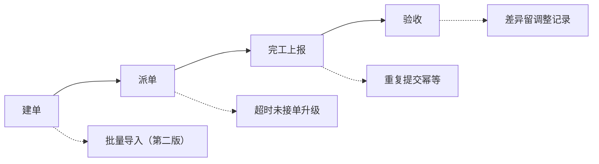

# 需求怎么细化成可验收的条目？用户故事和验收标准怎么写？

> 后端收到的需求常常只有一句"我要看实时产量""数据要准确""下周上线"。返工不是因为实现难，而是这句话里没有"什么情况算做完、什么情况算没做完"。用户故事负责说清给谁、为什么，验收标准负责说清什么算完成——后者才是后端能拿来挡返工的那张纸。

## 返工的根源：形容词直接进了代码

把典型句子拆开看，"实时"缺的是时间口径，"准确"缺的是容差与对账对象，"下周上线"缺的是范围与冻结点。它们落进代码就变成猜测：你按 5 秒轮询做了，客户以为是"设备一变页面就变"；你按 100% 准确做了，月底对账差 160 箱，功能没 bug，字却没人签。

| 收到的原话     | 缺的是什么          | 细化成可判定条目                                                        |
| -------------- | ------------------- | ----------------------------------------------------------------------- |
| 我要看实时产量 | 延迟口径 + 归属规则 | 看板每 5 秒刷新，端到端 P95 ≤ 10 秒；按通过剔除工位计数，跨零点归开班日 |
| 数据要准确     | 容差 + 对账对象     | 与仓库入库日累计差异 ≤ 0.5%，超差以人工盘点为准并留调整记录             |
| 下周上线       | 范围 + 冻结点       | 本期只交付主流程与导出，其余下期；上线前 3 个工作日代码冻结             |
| 支持导出       | 量级 + 失败语义     | 单次 ≤ 10 万行、≤ 60 秒，超限返回 413；失败可重试且不产生重复文件       |

判断一句话是否细化到位的标准很朴素：**客户能不假思索地答"是/不是"，测试能不追问就写出用例。** 两头都做不到，它就还是形容词。

## 用户故事：它描述价值，不描述规则

经典三段式 `As a / I want / So that`，落到产量看板是这样：

```text
作为 生产经理
我想要 看到当班累计产量与计划差距，以便 在班中及时发现掉产并调度人手
```

它的真实用处有三个：**逼出角色**（写不出"As a"的，多半没人真需要）、**逼出动机**（"So that"站不住的，往往是把客户的解决方案当成了需求——他要的是"异常五分钟内被发现"，不是"一个 Grafana 大屏"）、**给砍需求提供依据**（动机不成立，砍它不必吵架）。

局限同样明显：用户故事只描述价值，三个洞必须用别的东西补——**判定条件**（"当班"从几点算、延迟多少算合格）、**异常路径**（断采、重复上报、无权限）、**量级约束**（多少设备、多少并发）。所以它的天花板是"值不值得做、给谁做"，回答不了"做成什么样算完"。

## INVEST 不背名词：真正卡人的是 I 和 N

| 字母        | 人话含义               | 后端拿它做什么                               |
| ----------- | ---------------------- | -------------------------------------------- |
| Independent | 能单独上线、单独回滚   | 查它是否共享未交付的表结构，共享就得先拆数据 |
| Negotiable  | 描述问题，不指定方案   | 挡住"必须加这个接口"式的伪需求               |
| Valuable    | 说得出谁受益、在哪受益 | 说不清"So that"的，本期进不做清单            |
| Estimable   | 能估出人日             | 估不出来先做技术验证（spike），不排开发      |
| Small       | 一个迭代做得完验得完   | 超过 5 人日的，多半藏着没暴露的规则          |
| Testable    | 有能判定的验收条件     | 写不出 AC 就是不可测，回炉重写               |

**Independent 在真实项目里几乎都要打折**，因为后端的故事天然共享库表和发布窗口。判断标准不是"有没有共享代码"，而是：这个故事单独上线，会不会逼别的故事也必须同时上线？会，就得重拆——典型反例是"报价单导出"依赖一张尚未上线的价格版本表，导出一上，价格模块被迫一起上，两个故事焊成了一个。

**Negotiable 常被误读成"可以随时改"。** 它指实现方式与范围可谈，不含验收口径。正确分工是：**故事可谈，AC 不可谈**。故事阶段可以说"这个维度本期先不做，用固定三个维度顶上"；AC 双方确认后就是判定完成的尺子，改它要走变更。

## 故事怎么拆才拆得动

拆分不是把任务切小，而是切出能单独验收的边界。四种切法覆盖绝大多数后端场景：

| 切法       | 怎么切                       | 后端例子                                                   |
| ---------- | ---------------------------- | ---------------------------------------------------------- |
| 按业务流程 | 沿主链路节点切，一节点一故事 | 建单 → 派单 → 接单 → 完工上报 → 验收，各自能独立演示       |
| 按数据类型 | 按输入/输出形态切            | 实时遥测查询、历史区间查询、报表导出、批量导入，量级各不同 |
| 按规则     | 一条判定规则一个故事         | 超差判定、返工不重复计数、跨零点归属，各自可单独验         |
| 按异常路径 | 正常路径先上，异常单独成故事 | 主流程一版；断采标记、重复提交幂等、越权提示各一版         |

按规则切最容易被低估：一句话的规则往往就是一个 `if`，但边界条件能把工期翻三倍。**把它拆成独立故事，成本会在排期表上暴露，而不是在联调最后两天爆出来。**



横轴是主干（实线），纵向是"做到什么程度"（虚线分支）：先走通能演示的一条线，再往线上加分支，比横向一次性铺开更容易在中期拿到客户确认。

## 验收标准（AC）：后端真正的护身符

一条 AC 就是一个可判定的陈述：满足它算完成，不满足算没完成。用 `Given / When / Then` 写，三段分别对应测试的准备、动作、断言——Given 是前置状态（已有数据、登录身份、系统时间）、When 是触发动作（调接口、定时任务、并发提交）、Then 是可观察结果（响应码与字段、库中状态、消息、日志）。

```text
AC-03 跨零点班次归属
Given 班次为 8:00–20:00 / 20:00–8:00，跨零点产量归属开班日，当前时间 2026-03-11 23:50
When  包装线在 23:50 与次日 00:10 各上报 1 箱
Then  两箱均计入 2026-03-11 班次产量，按日汇总 count = 2，次日班次中不含这两箱
```

| 特征   | 反例             | 正例                                                     |
| ------ | ---------------- | -------------------------------------------------------- |
| 可观测 | "系统要稳"       | 200 并发持续 5 分钟，错误率 ≤ 0.1%，无请求超时           |
| 单义   | "合理时间内返回" | 查询接口 P95 ≤ 800 ms，超过 3 s 返回 504 与重试建议      |
| 有边界 | "支持导出"       | 10 万行 60 秒内完成并给下载链接；超限返回 413 附行数提示 |
| 可执行 | "数据准确"       | 与入库日累计差异 ≤ 0.5%，抽 3 天历史数据核对并留记录     |

一条 AC 至少对一条测试用例，这是它唯一的验收方式。把 AC 编号带进用例名，映射关系不用额外维护：`OutputShiftIT#ac03_crossMidnightBelongsToStartShift`。测试怎么分层、哪层覆盖哪类 AC，见[Java 项目的测试怎么写才不白写](/engineering/engineering-testing-strategy.html)。

## AC 里必须写异常与边界

正常路径第一次联调就能跑通，异常路径要等到上线后半夜两点。AC 的完整度不看正常路径写得多细，看下面几类有没有覆盖：

| 维度         | 后端要问的                 | AC 写法示例                                                              |
| ------------ | -------------------------- | ------------------------------------------------------------------------ |
| 空值         | 没数据、缺省字段、除零     | 无数据返回 `count = 0` 与 `lastUpdated`，不返回 null，页面显示"暂无数据" |
| 并发         | 两人同时操作同一条记录     | 同时完工时先提交者成功，后者 409 并提示当前状态                          |
| 超限         | 批量条数、文件大小、分页   | 单次导入 ≤ 5000 行，超出整批拒绝并返回首个超限行号                       |
| 权限不足     | 越权、跨班组、导出审批     | 班组长查其他班组返回 403，且不暴露该班组数据是否存在                     |
| 幂等重复提交 | 前端重试、MQ 重投、连点    | 同一 `requestId` 重复提交返回首次结果，不重复扣减、不重复发消息          |
| 时间边界     | 跨零点、时区、夏令时、月末 | 库内存 UTC、按现场时区展示；跨时区查看不改变班次归属                     |
| 依赖失败     | 网关断连、第三方超时       | 采集中断 60 秒标灰并显示最后有效时间，**不显示 0、不删历史点**           |

"依赖失败"那一行尤其值得写死：演示时"显示 0"看似正常，客户看到的却是"产量归零"，第二天就来问。**异常状态的展示方式本身就是一条验收条款。**

## 非功能需求也要写成 AC，否则上线后没人认账

"高可用""性能要好"写不进验收范围，验收后就会变成一句"再优化一下"，无限期挂在后端头上。非功能项要么写成 AC，要么明确不承诺：

| 指标     | 可验收写法                                             | 怎么测                      |
| -------- | ------------------------------------------------------ | --------------------------- |
| 延迟     | 查询接口 P95 ≤ 800 ms、P99 ≤ 1.5 s（50 并发、10 万行） | 压测报告 + 慢查询日志       |
| 并发吞吐 | 200 并发错误率 ≤ 0.1%；遥测写入 2000 点/秒不丢、无积压 | JMeter / Gatling，跑 1 小时 |
| 可用率   | 月度 99.5%，单次不可用 ≤ 30 分钟                       | 探活记录 + 月度统计         |
| 数据保留 | 明细 13 个月，之后按月归档，可查 3 年                  | 归档任务执行 + 历史查询     |
| 审计     | 导出、改口径、改权限全留痕，保留 6 个月                | 审计页面与日志抽查          |

写这些数字必须带**测量条件**："P95 ≤ 800 ms"要同时写清数据量、并发数与查询条件，否则压测时各测各的——报告上的 800 ms 和客户现场的 8 s 会是同一个功能。

## 三份文档各管一段，别互相顶替

| 文档     | 回答什么                 | 主要读者         | 缺了它会怎样                     |
| -------- | ------------------------ | ---------------- | -------------------------------- |
| 用户故事 | 给谁、为什么、值不值得做 | 产品、客户、PM   | 做了没人用的功能，砍不掉也说不清 |
| AC       | 什么算完成、怎么判定     | 测试、客户、自己 | 验收靠自由心证，扯皮无据         |
| 设计文档 | 怎么做、边界在哪         | 接手的开发、DBA  | 改动靠猜，联调靠喊               |

最常见的错位是把实现手段写进 AC：

| 错位写法                              | 问题                         | 改法                                        |
| ------------------------------------- | ---------------------------- | ------------------------------------------- |
| AC：用 Redis 缓存产量结果，TTL 5 分钟 | 锁死方案，且没定义新鲜度上限 | AC：查询结果与源数据偏差 ≤ 60 秒，实现自定  |
| AC：新增 `/api/v1/output/board` 接口  | 接口是手段，不是结果         | AC：看板 2 秒内出首屏数据，加载中显示骨架屏 |

一句话记住分工：**AC 写"可观察的世界状态"，设计文档写"怎么让世界变成那样"。** 设计写到什么程度，见[概要设计、详细设计要写到什么程度？](/engineering/engineering-design-docs.html)。

## 需求澄清清单：后端最该问的十个问题

| #   | 问什么                           | 拿到它能定什么                   |
| --- | -------------------------------- | -------------------------------- |
| 1   | 谁用、什么岗位、什么时段用       | 权限模型、高峰时段、峰值并发     |
| 2   | 一天几次、峰值多少、一次多少数据 | 表设计、索引、压测目标           |
| 3   | 这个功能挂了会怎样、能容忍多久   | 可用性等级、降级策略、要不要双活 |
| 4   | 数据从哪来、谁维护、多久变一次   | 采集方式、缓存时长、对账来源     |
| 5   | 谁能看、谁能改、改完留不留痕     | 权限粒度、审计字段、操作日志     |
| 6   | 口径谁签字、有争议按谁的算       | 验收依据、口径说明的版本与签字人 |
| 7   | 要不要历史数据、要多久、能不能补 | 迁移范围、归档策略、补数脚本     |
| 8   | 两人同时改同一条记录怎么算       | 乐观锁/悲观锁、冲突提示          |
| 9   | 重复提交、网络重试怎么办         | 幂等键、去重窗口、消息去重表     |
| 10  | 上线后怎么算成功、看哪个指标     | 验收指标、灰度判据、监控埋点     |

答案问不出来就写进待确认清单，标责任人和截止日期——自己拍一版写进代码，是这类项目最贵的三个字："我以为"。该拿哪些材料、见哪些人，见[需求调研和可行性分析怎么做到位](/engineering/engineering-requirements-feasibility.html)。

## 把形容词翻译成数字

这是全篇最值钱的一节。客户不会主动给数字，但每个形容词背后都有三个具体问题，答完数字就出来了：

| 形容词   | 背后要问的三件事                         | 落成的数字                                                        |
| -------- | ---------------------------------------- | ----------------------------------------------------------------- |
| 实时     | 多快算实时、慢一点会怎样、要快照还是历史 | 采集 2 秒一次，端到端 P95 ≤ 10 秒；报表按 T+1，不当实时承诺       |
| 准确     | 和谁对账、允许多大差、差异怎么处理       | 与入库日累计差异 ≤ 0.5%，超差以人工盘点为准并留调整记录           |
| 很多数据 | 存量多少、日增多少、单条多大             | 存量 8000 万行、日增 60 万行、单条 ≤ 2 KB、年增约 120 GB          |
| 要快     | 谁的视角、哪个操作、多大数据量           | 列表首屏 P95 ≤ 800 ms（10 万行、按时间 + 设备查询、50 并发）      |
| 随时可改 | 改什么、谁批、能不能停机                 | 配置类 5 分钟内生效无需发版；结构类走变更单，窗口每日 02:00–04:00 |

每个数字都带三件套：**测量对象、测量条件、测量方法**。缺一个它又变回形容词——"接口 800 ms"和"10 万行按时间范围查 800 ms"是两个工程量。

## 优先级与砍需求：给成本，不给结论

MoSCoW 只是给优先级分档，真正有用的是它逼你回答的判定问句：

| 档位   | 含义               | 判定问句                     |
| ------ | ------------------ | ---------------------------- |
| Must   | 没有它本期无法上线 | 缺了它，验收能通过吗？       |
| Should | 重要，但能短期绕过 | 能不能人工顶一个迭代？       |
| Could  | 有余力才做         | 砍掉它，客户会当场反对吗？   |
| Won't  | 本期明确不做       | 写进范围说明了吗？谁确认的？ |

后端最容易犯的错是只说"做不了"。可执行的表达只有三种：**延后**（本期不做、下期排，代价是二期补一次数据迁移或重算）、**降级为人工**（系统不做，用导入模板 + 人工核对顶住，代价是每天 20 分钟人工且要有人认领）、**不做并说明代价**（写进范围说明，代价是某场景下用户另开 Excel 自己拼）。

无论选哪种都附成本估计，最少三个数：人日、数据影响、上线风险。例：客户要 15 个维度任意组合对比，成本是后端 6 人日 + 预聚合表 + 查询 P95 上涨 40%；可谈档位是本期限定 3 个维度（1.5 人日），其余下期。数字摆上台面，决定权自然回到产品和客户手里；只说"做不了"，压力全留在你身上。跨团队怎么把取舍谈成结论，见[跨团队怎么对齐、怎么推动](/engineering/engineering-cross-team-collaboration.html)。

## 变更控制：AC 要跟着版本走

| 要素     | 要写什么                           | 缺了的后果             |
| -------- | ---------------------------------- | ---------------------- |
| 提出人   | 谁、哪天、原话怎么说的             | 三周后没人认账         |
| 影响评估 | 动到哪几条 AC、哪个接口、哪张表    | 改一处崩三处           |
| 工期资源 | 人日、是否新增硬件或授权           | 排期被静默吞掉         |
| 数据兼容 | 要不要迁移、老数据怎么补、能否回滚 | 上线后历史数据算不出来 |
| 回滚方案 | 怎么退、退到什么状态、退完谁验证   | 出事只能硬扛           |
| AC 更新  | 新增/修改哪几条 AC，版本号怎么变   | 做了但不在验收范围里   |

三个冻结窗口提前说定：**需求冻结**（迭代开始前）、**代码冻结**（上线前 3 个工作日）、**口径冻结**（报表上线前，之后改动按下期口径变更处理）。冻结后再提的进下期需求池，而不是"顺便加一下"。最容易漏的一步是变更后同步 AC：AC 要有编号和版本，改了当天就发给测试和客户确认，否则测试按旧 AC 写用例、客户按新理解验收，两边都对，吵起来没有赢家。

## 验收：拿 AC 逐条过一遍

验收会不是"演示一遍系统"，而是按 AC 逐条打勾。带上三样东西：验收清单、demo 脚本、遗留问题清单。

```text
1. AC-01 正常路径：导入 200 行 → 看板 5 秒内出数，截图留档
2. AC-03 口径：跨零点两箱计入开班日 → 查库 + 页面双确认
3. AC-05 幂等：同一 requestId 连点两次 → 只生成一条记录
4. AC-06 权限：班组长查其他班组 → 403 且不泄露数据是否存在
5. AC-08 断采：拔网线 70 秒 → 灰色标记 + 显示最后有效时间
6. AC-11/12 性能与审计：10 万行导出计时 → 下载链接可用 → 审计页可查记录
```

每条 AC 背后应有自动化用例托底，验收会只是"演示 + 抽查"，不是第一次验证：

| AC    | 测试层级         | 用例                                                    |
| ----- | ---------------- | ------------------------------------------------------- |
| AC-03 | 集成（真 MySQL） | `OutputShiftIT#ac03_crossMidnightBelongsToStartShift`   |
| AC-05 | 接口级           | `WorkOrderApiIT#ac05_duplicateSubmitReturnsFirstResult` |
| AC-06 | 接口级           | `BoardApiIT#ac06_groupLeaderCannotReadOtherGroup`       |
| AC-11 | 端到端 + 压测    | `export_100k_rows` 性能用例                             |

遗留问题清单每条写四样：现象、影响、临时绕法、责任人与时间。**验收会上，一份诚实的遗留清单比"总体感觉良好"有用得多**，它也是下一期需求和变更单最好的来源。接口层怎么把 AC 提前变成可执行的契约，见[后端也要懂体验：接口怎么设计才不折腾前端](/engineering/engineering-backend-api-experience.html)。

## 容易踩的坑

- **AC 写成技术方案。**"用 Redis 缓存""加个索引""拆微服务"都不是结果，测试无从判定，方案还被锁死。
- **只写正常路径。** 空值、并发、超限、越权、重复提交全空着，演示很顺，上线第一周全是异常单。
- **没有量级。** 10 万行和 1000 万行是两个项目；不写数据量，架构选型等于抛硬币。
- **用不可判定项当 AC。**"用户满意""界面友好""响应及时"写进条款，等于把判定权交回自由心证。
- **AC 由后端单方面补写。** 写完没人确认，验收时一句"我没同意这个口径"，全部重新谈。
- **变更只改代码不改 AC。** 功能做了但不在验收范围里，等于白干。
- **拿造的数据验收。** 演示数据全对，真实脏数据一上就露馅；要用客户历史数据在他现场核对。

## 小结

1. 返工的根源是需求没细化到可判定：一句话要能让客户答"是/不是"、让测试不追问就写出用例，否则它还是形容词。
2. 用户故事负责给谁、为什么，回答不了"做成什么样算完"；INVEST 里真正卡人的是 Independent（能否单独上线）和 Negotiable（故事可谈、AC 不可谈）。
3. AC 用 Given/When/Then 写，一条 AC 至少对应一条测试用例；空值、并发、超限、越权、幂等、跨零点、依赖失败必须写进 AC，非功能指标（P95、并发、可用率、保留期、审计）不写进 AC 就等于没承诺。
4. 形容词转数字要带测量对象、条件、方法："实时"变 P95 ≤ 10 秒，"准确"变差异 ≤ 0.5% 加对账口径，"很多数据"变存量/日增/单条大小。
5. 优先级讨论给成本不给结论（人日、数据影响、上线风险），砍需求只有延后、降级为人工、不做并说明代价三种说法；变更要留单并同步 AC 版本。

## 参考

综合自需求工程与敏捷实践的公开标准并做了改写：用户故事与 INVEST 检查项参考 Bill Wake 提出的准则及敏捷社区关于故事拆分的通行做法；Given/When/Then 形式参考 Gherkin 语法与 BDD 公开文档；需求条目应具备可验证、无歧义、可追溯属性这一定义对照 ISO/IEC/IEEE 29148；可用率、数据保留与审计指标对照 GB/T 22239（等保 2.0）与信息系统运维的公开实践。文中产量看板、工单、导出等例子按交付项目常见形态改写，未引用任何具体客户资料；用例名与代码片段为说明格式做了裁剪。核对重点三处：每条 AC 能否落到一条可执行测试、非功能指标是否都带测量条件、成本估计是否给出人日与影响面而不是"做不了"。
