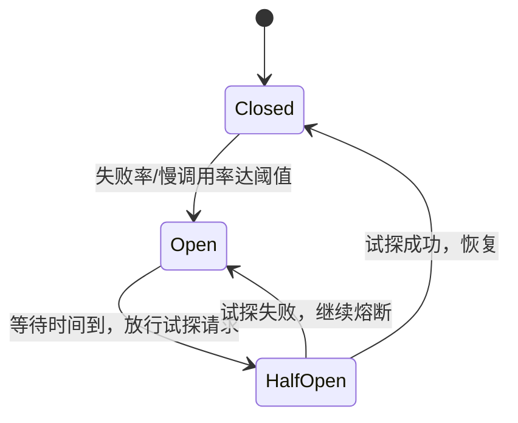

# 熔断器怎么设计？状态机、滑动窗口和半开恢复怎么落？

下游服务挂了，上游还在不停重试，结果请求堆积、线程池打满、上游也跟着挂——这就是雪崩。熔断器（Circuit Breaker）就是挡在调用方前面的"保险丝"：调用失败到一定程度就别调了，直接快速失败，等下游缓过来再试探恢复。

## 核心状态机

熔断器三个状态：

| 状态             | 行为                                                  |
| ---------------- | ----------------------------------------------------- |
| Closed（关闭）   | 正常调用，统计失败率；超阈值跳 Open                   |
| Open（打开）     | 直接快速失败，不发起真实调用；等一段时间后跳 HalfOpen |
| HalfOpen（半开） | 放行少量试探请求；成功 → Closed，失败 → Open          |

关键点：**Open 时快速失败**是为了保护上游（不消耗线程、不堆积请求），**半开探测**是为了判断下游是否恢复，避免一恢复就放全量流量打死它。

## 怎么统计"失败率"

两种常见统计窗口：

- **计数窗口**：固定 N 次调用里失败 M 次则熔断。简单但突增流量时不准。
- **滑动窗口**：按时间（如最近 10 秒）或按桶（bucket，每秒一个桶，10 个桶滑）统计。更平滑，主流实现（Resilience4j、Sentinel）都用这个。

判定指标通常是：

- 失败率（如 >50%）：异常、超时、拒绝都算失败。
- 慢调用率（如 RT > 500ms 占比 >30%）：下游没挂但很慢，也该熔断——慢比错更危险，会拖垮线程池。

> 注意最小调用量：窗口里只有 2 次调用、失败 1 次就 50% 熔断？太激进。一般设 `minimumNumberOfCalls`（如 10），样本不足不判定。

## 半开恢复的关键

- **放行量要小**：1~N 个试探请求，不是全量。Resilience4j 默认放行 10 次，Sentinel 按 maxHalfOpen。
- **试探期间并发**：放行的试探请求要串行或限并发，否则又把下游打爆。
- **恢复节奏**：Closed 后别立刻给全量，可逐步放量（但熔断器本身不管这个，靠限流配合）。

## 主流实现对比

| 实现         | 来源                  | 特点                                                   |
| ------------ | --------------------- | ------------------------------------------------------ |
| Hystrix      | Netflix（已停止维护） | 经典，基于滑动窗口，线程 / 信号量隔离                  |
| Resilience4j | Hystrix 现代替代      | 函数式 API，轻量，熔断 + 限流 + 重试组合               |
| Sentinel     | Alibaba               | 流控 + 熔断 + 系统保护一体，规则可热更新，控制台可视化 |

选型：新项目 Resilience4j 或 Sentinel；Spring Cloud 生态用 Resilience4j（Spring 官方推荐）；阿里系 / 需要控制台用 Sentinel。

## 落地的几个坑

- **熔断粒度**：按接口 / 方法配，别全局一把熔断器，否则一个下游挂全站不可用。
- **慢调用熔断要配超时**：没配超时，慢调用统计不出来，熔断形同虚设。
- **fallback 别再调被熔断的下游**：降级逻辑里再调一次下游，等于没降级，把熔断打穿。
- **熔断 vs 限流**：限流防自己被打爆，熔断防下游拖垮自己，两者保护对象不同，都要配。
- **指标要可观测**：熔断状态切换要打日志、埋点，不然线上"为什么挂了"查不清。

## 小结

- 熔断器三态：Closed 正常统计、Open 快速失败、HalfOpen 放行试探，关键是 Open 不调下游、HalfOpen 小流量探测。
- 统计用滑动窗口，看失败率或慢调用率，要设最小样本量避免误判。
- 慢调用熔断要配超时，否则统计不到。
- Hystrix 已停维护，新项目用 Resilience4j 或 Sentinel。
- 熔断按接口粒度配，fallback 别再调下游，状态切换要可观测。

## 参考

本文综合公开高可用与容错教材，核对了熔断器状态机、滑动窗口统计、半开恢复机制，并对照了 Hystrix、Resilience4j、Sentinel 的实现差异。
