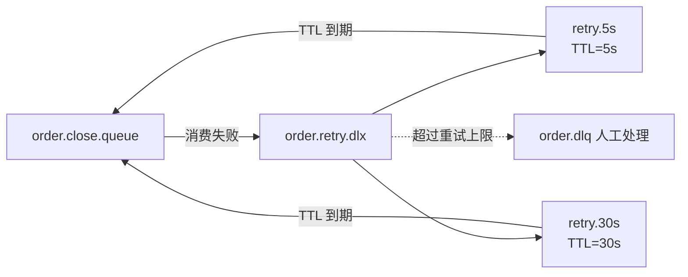

# RabbitMQ 延迟消息和死信队列怎么落地？

> 延迟队列和死信队列在面试里常被讲成两个孤立的知识点，真实项目里它们是同一条“失败与超时兜底链路”的两段。

先给一个具体场景，后面所有机制都围着它转：

> 订单创建后 30 分钟未支付要自动关闭。关闭动作还可能失败（比如下游库存服务超时），失败要重试几次，最终仍失败就落人工处理。

这个需求拆开是三件事：

1. **延迟触发**：30 分钟后才处理，不能一直轮询数据库。
2. **失败重试**：失败要有退避重试，不能原地打转。
3. **兜底**：重试到上限还不行，消息不能凭空消失，得有人能看见。

RabbitMQ 没有原生的延迟队列（老版本确实没有），但用 TTL + DLX 能拼出来；重试靠 DLX 环路或 quorum 的延迟重试；兜底就是死信队列本身。下面逐层拆。

## TTL 的两种粒度，和那个必须知道的坑

TTL 可以设在两个地方，语义完全不同：

| 粒度           | 设置方式                                         | 作用范围       |
| -------------- | ------------------------------------------------ | -------------- |
| 队列级消息 TTL | 队列参数 `x-message-ttl` 或 policy `message-ttl` | 该队列所有消息 |
| 消息级 TTL     | 发布时设置消息属性 `expiration`（毫秒字符串）    | 单条消息       |

两者同时存在时，**取较小值**。

关键坑在这里：**过期是“消息到达队头时才判定”的**，不是定时扫描整条队列。官方文档写得很清楚：过期消息只有在到达队头时才会被实际删除（标记删除），在此之前它会一直占着资源，也依然计入队列统计。

这带来一个很实际的结论：

**用一个队列 + 每条消息不同 TTL 来做延迟队列，是行不通的。**

举个例子，队列里依次进入三条消息：

```text
消息 A：expiration = 30s（第 0 秒入队）
消息 B：expiration = 1s （第 1 秒入队）
消息 C：expiration = 5s （第 2 秒入队）
```

直觉上 B 应该在第 2 秒过期。但因为 A 还堵在队头、A 的 TTL 还有 28 秒，B 和 C 都排在 A 后面，**它们的过期判定要等 A 被消费或过期之后才开始**。结果 B 实际过期时间远晚于 1 秒。这就是典型的“队头阻塞 + TTL 不精确”。

所以延迟队列的 TTL 方案必须满足一个前提：**同一个队列里所有消息的 TTL 相同**。需求里有 1 分钟、5 分钟、30 分钟三档，就建三个队列（或三档各一个队列），每档固定 TTL，各自绑到 DLX。这就是所谓“时间分桶”。

## DLX：死信的四个触发条件

死信交换器（DLX）本质就是一个普通 Exchange，队列通过 `x-dead-letter-exchange`（或 policy `dead-letter-exchange`）指定它。消息被“死信化”后重新发布到 DLX，再按正常路由规则走。

触发条件有四个，很多资料只写前三个：

| 条件         | 说明                                              |
| ------------ | ------------------------------------------------- |
| 被拒绝       | `basic.reject` 或 `basic.nack` 且 `requeue=false` |
| TTL 过期     | 消息或队列的 TTL 到期（且到达队头判定）           |
| 队列长度超限 | 触发 `max-length` 溢出策略而丢弃的消息            |
| 投递次数超限 | quorum queue 超过 `delivery-limit` 的重复投递     |

第三个条件要补一句版本细节：队列长度溢出策略有 `drop-head`（默认，丢最老的）和 `reject-publish`（拒绝新的）。被 `drop-head` 丢掉的消息，如果配了 DLX，会走死信；`reject-publish` 时生产者会收到 nack。`reject-publish-dlx` 这种一次性写进 DLX 的策略**只有 classic queue 支持**，quorum queue 明确不支持。

第四个条件是 quorum queue 专属的“毒消息”防护：消息被反复投递超过 `delivery-limit`（4.x 默认 20）后，要么丢弃，要么死信。没有它，一条必然失败的消息会在队列里无限循环。

还有一个常被忽略的边界：**整个队列因为 `x-expires` 过期被删除时，队列里的消息不会走死信**，直接消失。所以“用队列 TTL 清理”和“用死信兜底”是两件事，别指望互相替代。

### 死信之后的消息长什么样

死信化会改写消息头，最有用的是 `x-death` 数组，每次死信事件记一条：

| 字段                        | 含义                                                    |
| --------------------------- | ------------------------------------------------------- |
| `queue`                     | 从哪个队列死信过来的                                    |
| `reason`                    | `rejected` / `expired` / `maxlen` / `delivery_limit`    |
| `count`                     | 因该原因死信了几次（同一 `{queue, reason}` 会合并计数） |
| `time`                      | 第一次死信的时间                                        |
| `exchange` / `routing-keys` | 死信前的交换器和路由键                                  |

另有 `x-first-death-*` 和 `x-last-death-*` 两组头，分别记录第一次和最近一次死信的位置。**做重试次数控制时，判断依据就是这个 `count`**，而不是自己在消息体里塞一个字段（虽然两者都常见，但前者是 Broker 维护的，不会被业务代码漏改）。

### 死信循环与两个安全边界

“失败 → 死信 → 回到原队列重试”这个环路是标准做法，但有两个安全边界必须知道：

1. **RabbitMQ 会检测死信环路**：如果一条消息在完整环路里一次都没有被 reject，只是为了 TTL 转圈，Broker 会判定为循环并丢弃它，防止无限自转发。
2. **默认的死信转发是 at-most-once**：Broker 把消息重新发布到目标队列时，内部**不带 publisher confirm**，源队列里的消息会立即被移除。目标队列不可用时，这条消息就丢了。quorum queue 支持切换到 `at-least-once` 死信策略（`dead-letter-strategy: at-least-once` + `overflow: reject-publish`），代价是源队列要在目标确认前保留消息，资源占用更高。

第 2 点经常被当成“实现细节”，但它直接决定了你的死信通道是不是可靠。要求死信一条都不能少的场景（比如资金相关），必须开 `at-least-once`，或者干脆别用死信链路、改成业务侧补偿表。

## 延迟消息的五种实现，怎么选

把可选方案列全，面试时能说清取舍就够用了：

| 方案                                     | 精度                   | 容量边界               | 适用场景                       |
| ---------------------------------------- | ---------------------- | ---------------------- | ------------------------------ |
| 单队列 TTL + DLX                         | 秒级，但受队头阻塞影响 | 受队列长度限制         | 单一延迟时长的简单场景         |
| 分档队列 TTL + DLX                       | 秒级到分钟级，各档独立 | 同上                   | 延迟档位固定（1/5/30 分钟）    |
| delayed-message-exchange 插件            | 毫秒到秒级             | 内存敏感，百万级以下   | 延迟值随机、量级中等           |
| quorum 延迟重试 / 4.4 原生延迟消息       | 秒级，可带退避         | 受 quorum 队列能力约束 | 新版集群、重试退避场景         |
| 外部调度（Redis ZSet、时间轮、任务平台） | 可控到秒甚至更细       | 取决于外部系统         | 千万级延迟消息、需要可视化补偿 |

### 方案一、二：TTL + DLX

思路是把消息先投到一个“等待队列”，队列设 `x-message-ttl`，同时配 DLX 指向业务队列。TTL 到期后消息变死信，转发到业务队列，消费者就能收到了。

```text
业务代码 publish → delay.30m 队列（x-message-ttl=1800000, x-dead-letter-exchange=order.dlx）
                    ↓ TTL 到期
                 order.dlx → order.close.queue → 消费者处理关单
```

分档方案就是给 1 分钟、5 分钟、30 分钟各建一个这样的等待队列。优点是零依赖、逻辑全在拓扑里、可视化管理；缺点是**档位一多拓扑就膨胀**，而且延迟值不能动态变化（TTL 是队列属性，改要重建队列）。

### 方案三：delayed-message-exchange 插件

插件提供一个新的 Exchange 类型 `x-delayed-message`，发布时在 header 里写 `x-delay` 毫秒数，Exchange 自己负责到期后再转发。它的好处是**一条消息一个延迟值**，不需要为每个档位建队列。

但它有一个必须说清的容量边界：延迟中的消息由插件在 Broker 内部维护，堆积量上去之后对内存压力很大。业界的经验值是**单节点数十万级以上就要谨慎**，规模再大应该换外部调度。另一个实践约束是插件要靠版本矩阵对齐 Erlang/OTP，升级时要一起验证。

### 方案四：新版的原生能力

如果集群在 4.3/4.4 以上，这个问题已经有官方解了：

- **4.3**：quorum queue 支持 `delayed-retry`，即消息被 nack/reject 后不立刻重投，而是按线性退避延迟再投（`x-delayed-retry-type`、`x-delayed-retry-min`、`x-delayed-retry-max`，延迟 = `min(min_delay × 投递次数, max_delay)`）。
- **4.4**：支持发布时直接指定投递时间（`x-opt-delivery-time`），消息立刻完成路由和复制，但到指定时间才对消费者可见，**不需要插件、不需要额外队列**。

这意味着“RabbitMQ 只能靠 TTL+DLX 或插件做延迟队列”这个说法在新版本上已经过时了。面试答这个题时，先问一句版本，再给方案，会显得非常靠谱。

### 方案五：外部调度

当延迟消息量级到千万、或者需要“延迟任务可视化管理、能手动改时间、能查某条任务状态”时，MQ 就不是最合适的载体了。常见做法：

- Redis `ZSet` 存 `score = 到期时间戳`，定时任务 `ZRANGEBYSCORE` 捞到期任务；
- 时间轮（Netty `HashedWheelTimer`、Kafka 的 `TimerWheel`）做进程内调度；
- 任务调度平台（XXL-JOB、SchedulerX）做持久化和重试编排。

用 MQ 做延迟的优势是和消息链路天然一体、消费幂等复用；用外部调度的优势是容量和可运维性。**这条取舍在面试里说出来，比背“TTL 加死信交换机”有价值得多。**

## 延迟重试怎么做才不打死下游

关单失败要重试，但“失败立刻 requeue”是最糟的做法：消息回到队头（上一节讲过 requeue 的真实位置），立刻又被投给同一个消费者，形成空转，下游还在故障中，等于自己打自己。

正确的重试结构：



要点有三条：

1. **每档一个 TTL 队列**，避免上一节讲的队头阻塞。
2. **重试次数用 `x-death` 的 `count` 判断**，超限就直接进最终 DLQ，不再回主队列。
3. **退避要递增**（5s → 30s → 5min），且总时间要小于业务容忍窗口。

如果用的是 quorum queue，可以省掉手写这套拓扑：配 `delivery-limit` + `dead-letter-exchange`，超限自动进 DLX；再配 `delayed-retry` 让重投自带退避。这就是“用 Broker 的能力替代应用层的重试编排”。

## 优先级队列：只在你堆积的时候才有意义

延迟和死信之外，队列还有一种“排序”能力常被问到。

classic queue 通过 `x-max-priority` 开启优先级（取值 0-255，实践建议 1-10，优先级层次越多 Erlang 进程开销越大），发布时在消息属性里设 `priority`。这时高优先级消息会被优先投递。

两个边界必须讲：

1. **只有队列里有堆积时优先级才起作用**。生产速度小于消费速度时，消息基本是来一条走一条，优先级没有施展空间。有人以为“加了优先级就等于 SLA 分级”，其实它只在排队时有用。
2. **quorum queue 的优先级是另一套规则**。`x-max-priority` 只对 classic queue 生效；quorum queue 从 4.3 起默认支持 0-31 的严格优先级，不需要也不能用 `x-max-priority` 声明，无优先级属性的消息默认按 4 处理。低版本 quorum queue 只是把优先级粗略映射成“普通/高”两档，效果差很多。

顺带一个反直觉的细节：quorum queue 里被退回（reject/nack）的消息**不保留原优先级**，会进入返回队列并按退回顺序重排。也就是“重试的消息可能插到高优先级消息前面”，需要严格优先级语义时要注意。

## 死信队列的运维面：别只建不管

死信队列最大的问题不是“怎么配”，而是“配完之后没人看”。落地时要补三件事：

| 要做的事   | 具体做法                                                                                                      |
| ---------- | ------------------------------------------------------------------------------------------------------------- |
| 死信可观测 | 对 DLQ 的 `messages_ready` 设告警阈值，DLQ 有消息就是异常信号                                                 |
| 死信可归因 | 消费 DLQ 时读 `x-death`，按 `reason` 和 `count` 分级：`expired` 多为延迟配置问题，`rejected` 多为业务代码问题 |
| 死信可重放 | 写一个重放脚本/接口，把 DLQ 消息按 `x-death` 修正后重新投回主队列，且重放必须幂等                             |

还有一个权限细节容易在上线时卡住：**配置了 DLX 的队列，声明者除了队列的 configure 权限，还需要该队列的 read 权限和 DLX 的 write 权限**，这些权限在队列声明时校验。换个环境部署时“本地好好的、生产 403”，多半是这里。

## 小结

- TTL 的过期判定发生在消息到达队头时，所以「一个队列 + 每条消息不同 TTL」做不出准确延迟，同一队列的 TTL 必须一致。
- 死信有四个触发条件：reject/nack 且 requeue=false、TTL 过期、长度超限丢弃、quorum 超过 delivery-limit；整个队列过期时消息不会走死信。
- 死信转发默认是 at-most-once（内部不带 confirm），要求不丢就开 quorum 的 at-least-once 死信策略。
- 延迟消息有四代做法：TTL+DLX（分档）、延迟插件、quorum 延迟重试 / 4.4 原生 `x-opt-delivery-time`、外部调度；延迟值随机且量大时优先外部调度。
- 重试要递增退避并按 `x-death` 的 count 限次，直接 requeue 会把消息放回队头、形成空转。
- 优先级只在有堆积时生效，且 quorum queue 与 classic queue 的优先级是两套规则；死信队列必须配告警、归因和可重放工具，否则等于没做。

## 参考

综合自仓库内高性能消息队列参考材料，并结合 RabbitMQ 官方文档（Time-To-Live and Expiration、Dead Letter Exchanges、Quorum Queues、Priority Queues 章节）关于 TTL 队头判定、死信四个触发条件、死信安全性与 at-least-once 策略、`x-death` 结构、延迟重试与原生延迟消息、优先级适用范围的说明整理；其中“延迟消息只能靠 TTL+DLX 或插件”按 4.3/4.4 版本事实做了更新，“队列过期不走死信”“quorum 不支持 reject-publish-dlx”等边界按官方文档核对。
